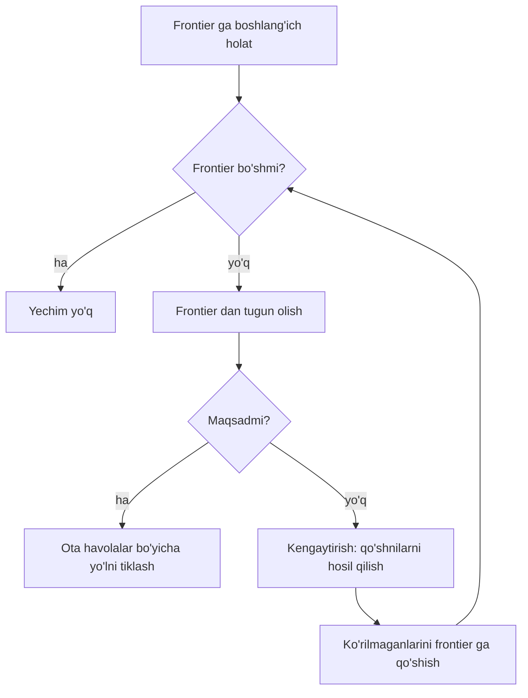
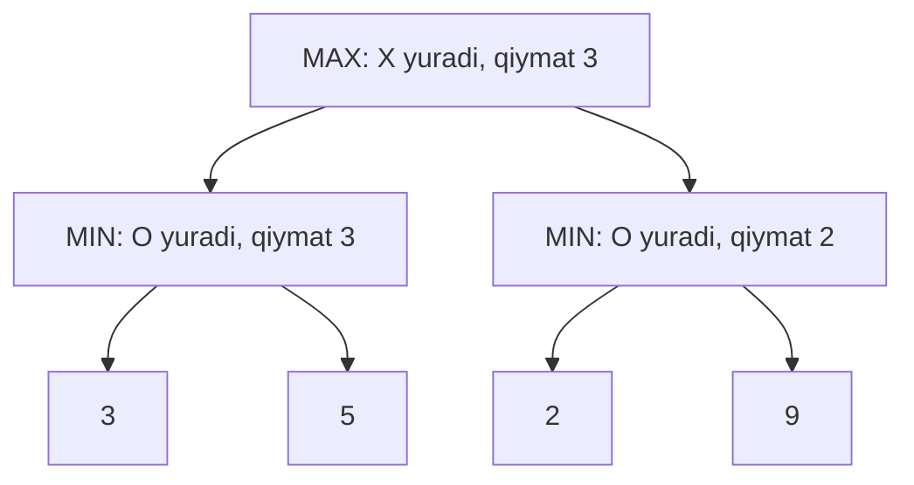

## Bu dars nima uchun kerak

Navigator ilovasi shahar xaritasida eng qisqa yo'lni topadi, o'yin dasturi shaxmatda yurish tanlaydi, robot omborda yukka boradi. Bu vazifalarning umumiy jihati: dasturga "javobni" yozib qo'yib bo'lmaydi, lekin **qoidalarni** yozish mumkin - qayerdan boshlanadi, qanday harakatlar bor, har harakat qayerga olib boradi va qachon maqsadga yetiladi. Qolganini dastur o'zi **qidiradi**. Sun'iy intellekt (AI, artificial intelligence) tarixidagi birinchi muvaffaqiyatli g'oyalar aynan shu: aqlli xatti-harakatni ko'p variantlar ichidan yaxshisini tizimli tanlash sifatida ifodalash.

Bu dars kursning oldingi qismlariga tayanadi. 27-darsda queue bilan BFS yozgan edik va u yerda "queue o'rniga stack qo'yilsa, algoritm DFS ga aylanadi" degan edik - endi buni labirintda sanab ko'ramiz. 18-darsdagi rekursiya minimax algoritmining asosiy vositasi bo'ladi, 16-darsdagi Big O esa o'yin daraxti nega "portlab ketishini" tushuntiradi. 29-darsdagi daraxtlar bu yerda **qidiruv daraxti** va **o'yin daraxti** shaklida qaytadi. Kod Python'da (31-35-darslar), chunki g'oyaga e'tibor qaratish uchun qisqa yoziladi.

Bu darsdan keyin siz:

- muammoni qidiruv sifatida ifodalay olasiz: holat, harakat, o'tish modeli, maqsad testi, yo'l narxi;
- DFS va BFS farqini frontier tuzilmasi (stack yoki queue) orqali tushuntira olasiz va kengaytirilgan tugunlarni sanay olasiz;
- greedy best-first search va A* qanday ishlashini, Manhattan masofasi evristika sifatida nimani bildirishini bilasiz;
- admissible evristika ta'rifini aniq aytib, u A* optimalligiga qanday ta'sir qilishini tushuntira olasiz;
- minimax algoritmini tic-tac-toe misolida yozib, o'yin daraxti hajmini hisoblay olasiz;
- alpha-beta pruning natijani o'zgartirmasdan nega kamroq tugun ko'rishini sanab ko'rsata olasiz;
- shaxmat va Go uchun to'liq qidiruv nega imkonsizligini va depth-limited minimax bilan baholash funksiyasi bu muammoni qanday chetlab o'tishini bilasiz.

## Muammoni qidiruv sifatida ifodalash

Qidiruv algoritmini yozishdan oldin muammoni bir xil "tilga" o'tkazish kerak. Darsliklarda (masalan, Russell va Norvig'ning "Artificial Intelligence: A Modern Approach" kitobida, CS50 AI kursi ham shunga tayanadi) qidiruv muammosi quyidagi qismlardan iborat:

| Qism | Ma'nosi | Labirint misolida | 15-puzzle misolida |
|---|---|---|---|
| Boshlang'ich holat (initial state) | Agent qayerdan boshlaydi | `A` katagi | Aralashtirilgan taxta |
| Harakatlar (actions) | Holatda nima qilish mumkin | Yuqoriga, pastga, chapga, o'ngga (devor bo'lmasa) | Bo'sh katakka qo'shni plitkani surish |
| O'tish modeli (transition model) | `result(holat, harakat)` - yangi holat | Qo'shni katak | Plitka joyi almashgan taxta |
| Maqsad testi (goal test) | Holat maqsadmi? | Katak `B` mi? | Plitkalar tartibdami? |
| Yo'l narxi (path cost) | Yo'lning "bahosi" | Qadamlar soni | Surishlar soni |

Holatlar va o'tishlar birgalikda **holatlar fazosi** (state space) ni hosil qiladi - bu 27-darsdagi graf: tugunlar holatlar, qirralar harakatlar. Yechim - boshlang'ich holatdan maqsadga olib boruvchi harakatlar ketma-ketligi, **optimal yechim** - narxi eng kichigi.

Muhim nozik farq: qidiruv algoritmi grafni oldindan butunligicha xotiraga olmaydi. U `result` funksiyasi orqali qo'shnilarni kerak bo'lganda hosil qiladi. Shaxmatdagi holatlar soni (pastda hisoblaymiz) har qanday xotiradan katta, lekin "bu pozitsiyadan qanday yurish mumkin" degan funksiya bir necha qator kod.

### Tugun, frontier va kengaytirish

Algoritm ichida har bir holat **tugun** (node) ichida saqlanadi: holatning o'zi, ota tugun (qaysi tugundan kelindi), harakat va shu paytgacha yo'l narxi. Ota havolalar orqali maqsaddan orqaga yurib, butun yo'lni tiklash mumkin (bu 28-darsdagi linked list'ga o'xshash zanjir).

Qidiruvning umumiy sxemasi bitta tsikl:

1. **Frontier** (chegara, "keyin ko'riladiganlar ro'yxati") ga boshlang'ich tugunni qo'yamiz.
2. Frontier bo'sh bo'lsa - yechim yo'q.
3. Frontier'dan bitta tugunni olamiz.
4. U maqsad bo'lsa - yo'lni qaytaramiz.
5. Aks holda tugunni **kengaytiramiz** (expand): uning hamma qo'shnilarini hosil qilamiz va avval ko'rilmaganlarini frontier'ga qo'shamiz.
6. 2-qadamga qaytamiz.



Sxemadagi yagona ochiq savol - 3-qadam: frontier'dan **qaysi** tugun olinadi? Butun dars shu savolga turli javoblar haqida. Algoritm sifatini ikki o'lchov bilan solishtiramiz: topilgan yo'l uzunligi (optimalmi?) va **kengaytirilgan tugunlar soni** (qancha ish qilindi). Ko'rilgan tugunlarni eslab qolish (`parent` lug'ati yoki `explored` to'plami) ham shart: aks holda labirintdagi ikki qo'shni katak orasida algoritm cheksiz aylanadi.

## DFS va BFS: stack yoki queue

Agar frontier **stack** bo'lsa (27-dars, LIFO), eng oxirgi qo'shilgan tugun birinchi olinadi. Algoritm bitta yo'nalishda iloji boricha chuqur ketadi, boshi berk joyga yetgandagina orqaga qaytadi. Bu **depth-first search** - DFS (chuqurlik bo'yicha qidiruv).

Agar frontier **queue** bo'lsa (FIFO), eng eski tugun birinchi olinadi. Avval boshlang'ichdan 1 qadam uzoqdagi hamma tugunlar, keyin 2 qadamdagilar va hokazo - "to'lqin" kabi tarqaladi. Bu **breadth-first search** - BFS (kenglik bo'yicha qidiruv). 27-darsda ko'rganimizdek, FIFO tartibi har bir tugunga eng kam qadam bilan yetilishini kafolatlaydi, shuning uchun BFS har bir qadam narxi bir xil bo'lganda optimal yechim beradi.

| Xususiyat | DFS | BFS |
|---|---|---|
| Frontier | Stack (LIFO) | Queue (FIFO) |
| Optimal yechim (bir xil qadam narxida) | Kafolat yo'q | Ha |
| To'liqlik (yechim bo'lsa topadi) | Chekli grafda, ko'rilganlarni eslasa - ha | Ha |
| Xotira (daraxtda, b - tarmoqlanish, d - chuqurlik) | O(b · m), m - eng katta chuqurlik | O(b^d): butun "to'lqin" frontier'da |
| Qachon yaxshi | Yechim chuqurda, har qanday yechim yetadi | Eng qisqa yo'l kerak |

**Tarmoqlanish koeffitsienti** (branching factor) b - bitta tugundan nechta qo'shni chiqishi. Labirintda b ko'pi bilan 4, shaxmatda o'rtacha o'nlab. BFS d chuqurlikdagi yechimni topguncha 1 + b + b² + ... + b^d tartibdagi tugunlarni ko'radi va oxirgi qatlamni frontier'da ushlaydi. b = 10, d = 6 bo'lsa, bu 10^6 tartibdagi tugun - xotirada saqlash kerak bo'lgan million obyekt.

### Labirintda sanab ko'ramiz

Quyidagi dastur 9x17 labirintda `A` dan `B` ga yo'l qidiradi. Bo'sh kataklar - ochiq, `#` - devor. Bir xil `uninformed` funksiyasi ikki rejimda ishlaydi: DFS uchun `frontier.pop()` (oxiridan - stack), BFS uchun `frontier.popleft()` (boshidan - queue). Python'ning `collections.deque` (32-dars) ikkala uchidan ham O(1) da olish imkonini beradi. Shu yerdayoq keyingi bo'limdagi greedy va A* ham yozilgan - natijani bir jadvalda solishtirish uchun.

```python run
from collections import deque
import heapq

MAZE = [
    "#################",
    "##      #      B#",
    "# #   #      #  #",
    "## #  #  #   #  #",
    "##   #  # #  # ##",
    "#    #   #      #",
    "##     #      # #",
    "#A   # #        #",
    "#################",
]

def find(ch):
    for r, row in enumerate(MAZE):
        if ch in row:
            return (r, row.index(ch))

START, GOAL = find("A"), find("B")

def neighbors(cell):
    r, c = cell
    for dr, dc in ((-1, 0), (1, 0), (0, -1), (0, 1)):
        if MAZE[r + dr][c + dc] != "#":
            yield (r + dr, c + dc)

def path_to(parent, cell):
    path = []
    while cell is not None:
        path.append(cell)
        cell = parent[cell]
    return path[::-1]

def uninformed(kind):
    frontier = deque([START])          # DFS uchun stack, BFS uchun queue
    parent = {START: None}
    expanded = 0
    while frontier:
        cell = frontier.pop() if kind == "DFS" else frontier.popleft()
        expanded += 1
        if cell == GOAL:
            return path_to(parent, cell), expanded
        for nb in neighbors(cell):
            if nb not in parent:
                parent[nb] = cell
                frontier.append(nb)
    return None, expanded

def manhattan(cell):
    return abs(cell[0] - GOAL[0]) + abs(cell[1] - GOAL[1])

def informed(kind):
    g = {START: 0}
    parent = {START: None}
    frontier = [(manhattan(START), 0, START)]   # (ustuvorlik, tartib, katak)
    order = 0
    done = set()
    expanded = 0
    while frontier:
        _, _, cell = heapq.heappop(frontier)
        if cell in done:
            continue
        done.add(cell)
        expanded += 1
        if cell == GOAL:
            return path_to(parent, cell), expanded
        for nb in neighbors(cell):
            new_g = g[cell] + 1
            if nb not in g or new_g < g[nb]:
                g[nb] = new_g
                parent[nb] = cell
                order += 1
                h = manhattan(nb)
                priority = h if kind == "Greedy" else new_g + h
                heapq.heappush(frontier, (priority, order, nb))
    return None, expanded

print("Algoritm  yo'l uzunligi  kengaytirilgan tugunlar")
results = {}
for kind in ("DFS", "BFS", "Greedy", "A*"):
    path, expanded = uninformed(kind) if kind in ("DFS", "BFS") else informed(kind)
    results[kind] = path
    print(f"{kind:8} {len(path) - 1:14} {expanded:24}")

grid = [list(row) for row in MAZE]
for r, c in results["A*"][1:-1]:
    grid[r][c] = "."
print()
print("\n".join("".join(row) for row in grid))
```

Natija:

```text
Algoritm  yo'l uzunligi  kengaytirilgan tugunlar
DFS                  26                       28
BFS                  20                       78
Greedy               22                       24
A*                   20                       44

#################
##      #......B#
# #   #...   #  #
## #  #. #   #  #
##   #..# #  # ##
#    #.  #      #
##.....#      # #
#A.  # #        #
#################
```

Avval faqat birinchi ikki qatorni tahlil qilamiz. Labirintda `A` dan yetib boriladigan 80 ta katak bor.

- **DFS** 28 ta tugun kengaytirib, maqsadni tez topdi, lekin yo'li 26 qadam - eng qisqasidan 6 qadam uzun. U birinchi uchragan yo'nalishga "sho'ng'idi" va tasodifan maqsadga chiqdi. Boshqa labirintda xuddi shu DFS deyarli hamma kataklarni aylanib chiqishi mumkin: uning tezligi omadga bog'liq.
- **BFS** eng qisqa yo'lni (20 qadam) topdi, lekin buning uchun 80 katakdan 78 tasini kengaytirdi. Maqsad `A` dan eng uzoq kataklardan biri bo'lgani uchun "to'lqin" deyarli butun labirintni qamrab oldi.

Kodda bitta tafsilotga e'tibor bering: katak `parent` lug'atiga frontier'ga **qo'shilayotganda** yoziladi. Shu bilan har katak frontier'ga ko'pi bilan bir marta kiradi. BFS uchun bu to'g'ri va optimal; DFS uchun esa bu klassik rekursiv DFS'dan biroz boshqacha tartib beradi, lekin "stack bilan chuqurga ketish" xususiyati saqlanadi.

DFS ham, BFS ham **informatsiyasiz qidiruv** (uninformed search): ular maqsad qayerdaligi haqida hech narsa bilmaydi, faqat qo'shnilarni ko'radi. Odam labirintda bunday qilmaydi: chiqish yuqori o'ng burchakda ekanini ko'rsa, o'sha tomonga intiladi. Shu "qo'shimcha bilim" - evristika.

## Evristika: greedy best-first va A*

**Evristika** (heuristic) - holatdan maqsadgacha qolgan narxni **taxmin qiladigan** funksiya, odatda h(n) deb belgilanadi. U aniq bo'lishi shart emas, lekin tez hisoblanishi va maqsad yo'nalishini ko'rsatishi kerak.

Kvadrat panjarada, faqat to'rt yo'nalishda yurilganda tabiiy evristika - **Manhattan masofasi**:

h(n) = |qator(n) - qator(B)| + |ustun(n) - ustun(B)|

Bu devorlarni e'tiborsiz qoldirib, "nechta qadam yuqoriga va nechta o'ngga" yurish kerakligini sanaydi. Nomi Manhattan ko'chalari to'rsimonligidan: ikki chorraha orasidagi masofa havo bo'ylab emas, ko'chalar bo'ylab o'lchanadi. Bizning labirintda `A` (7, 1) da, `B` (1, 15) da: h(A) = |7 - 1| + |1 - 15| = 6 + 14 = 20.

### Greedy best-first search

**Greedy best-first search** frontier'dan h(n) eng kichik tugunni oladi: "maqsadga eng yaqin ko'ringan joyga bor". Frontier endi stack ham, queue ham emas, balki **priority queue** (ustuvorlik navbati) - eng kichik kalitli elementni tez beradigan tuzilma. Python'da bu `heapq` moduli: binary heap (29-darsdagi daraxtning massivdagi ko'rinishi), `heappush` va `heappop` O(log n). Kortejdagi ikkinchi element `order` teng ustuvorlikda avval qo'shilganini oldin olish uchun - shu bilan natija qayta tiklanadigan bo'ladi.

Jadvalda greedy atigi 24 ta tugun kengaytirdi (eng kam), lekin yo'li 22 qadam - optimal emas. Sababi: u faqat "qancha qoldi" ga qaraydi va "qancha yurildi" ni hisobga olmaydi. Maqsad tomonga ketgan yo'l devorga taqalsa, greedy uni aylanib o'tadi, lekin bu aylanishning narxi uning qarorlarida hech qachon aks etmaydi.

### A*: yurilgan yo'l + qolgan taxmin

**A*** ("A-star" deb o'qiladi) ikkala ma'lumotni qo'shadi:

f(n) = g(n) + h(n)

Bu yerda g(n) - boshlang'ichdan n gacha **haqiqatan** yurilgan narx, h(n) - n dan maqsadgacha **taxmin**. f(n) "n orqali o'tadigan eng yaxshi yechim narxining taxmini". Frontier'dan f eng kichik tugun olinadi. Algoritmni 1968-yilda Stanford Research Institute'dan Peter Hart, Nils Nilsson va Bertram Raphael e'lon qilgan; uni Dijkstra algoritmining evristika bilan kengaytirilgan shakli deb qarash mumkin (h = 0 bo'lsa, A* aynan Dijkstra'ga aylanadi).

Kodda A* va greedy farqi bitta qator: `priority = h if kind == "Greedy" else new_g + h`. Natija: A* 20 qadamlik optimal yo'lni BFS kabi topdi, lekin 78 emas, 44 ta tugun kengaytirdi. Xaritada nuqtalar bilan ko'rsatilgan yo'l `A` dan yuqori o'ngga deyarli to'g'ri boradi.

Qo'lda bir necha qadam hisoblaymiz. `A` = (7, 1): g = 0, h = 20, f = 20. Uning yuqori, past va chap qo'shnilari devor, yagona ochiq qo'shni - (7, 2): g = 1, h = |7 - 1| + |2 - 15| = 6 + 13 = 19, f = 20. (7, 2) dan ikki yangi katak ochiladi: (6, 2) va (7, 3); ikkalasida g = 2, h = 18, f = 20. Maqsadga yaqinlashtiradigan har bir qadam g ni 1 ga oshirib, h ni 1 ga kamaytiradi, f o'zgarmaydi. Devor tufayli "orqaga" qadam qo'yilsa, g ham, h ham 1 ga oshadi va f = 22 bo'ladi - bunday tugunlar f = 20 lilar tugagandan keyingina ko'riladi. A* shuning uchun "behuda" yo'nalishlarni oxirigacha qoldiradi.

| Algoritm | Frontier tartibi | Optimal | Kengaytirilgan (bizning labirint) |
|---|---|---|---|
| DFS | Eng yangi (stack) | Yo'q | 28 |
| BFS | Eng eski (queue) | Ha (bir xil narxda) | 78 |
| Greedy best-first | Eng kichik h(n) | Yo'q | 24 |
| A* | Eng kichik g(n) + h(n) | Ha (h admissible bo'lsa) | 44 |

## Admissible evristika va A* optimalligi

A* har doim optimal yechim beradimi? Yo'q - bu evristikaga bog'liq. Kerakli shartning aniq ta'rifi:

Evristika h **admissible** (yo'l qo'yiladigan) deyiladi, agar har bir n holat uchun h(n) ≤ h*(n) bo'lsa, bu yerda h*(n) - n dan maqsadgacha **haqiqiy eng kichik** narx. Boshqacha aytganda, admissible evristika maqsadgacha narxni hech qachon **oshirib** baholamaydi; u qolgan narxning quyi chegarasi. Maqsad holatida esa h = 0.

Asosiy natija: agar h admissible bo'lsa (va har qadam narxi musbat bo'lsa), A* optimal yechimni qaytaradi. Intuitiv sabab: A* maqsadni frontier'dan olganda uning f qiymati = haqiqiy narx C. Agar yaxshiroq yechim (narxi C' < C) mavjud bo'lsa, o'sha yechim yo'lida hali kengaytirilmagan qandaydir n tugun frontier'da turgan bo'lardi. Admissibility tufayli f(n) = g(n) + h(n) ≤ g(n) + h*(n) = C' < C, ya'ni n maqsaddan **oldin** olinishi kerak edi. Ziddiyat.

Manhattan masofasi bu labirintda admissible: har bir qadam qator yoki ustunni faqat 1 ga o'zgartiradi, demak |Δqator| + |Δustun| dan kam qadamda yetib bo'lmaydi; devorlar faqat yo'lni uzaytiradi. Aksincha, agar diagonal yurish ham ruxsat etilsa (bitta qadam bilan), Manhattan masofa endi admissible emas: (0, 0) dan (3, 3) gacha 3 ta diagonal qadam yetadi, Manhattan esa 6 deydi.

Admissible bo'lmagan evristika bilan nima bo'ladi? A* f ni oshirib baholangan yo'lni "yomon" deb chetga qo'yadi va boshqa, uzunroq yechimni birinchi topishi mumkin. Masalan, h(n) = 3 · Manhattan desak, algoritm greedy'ga yaqinlashadi: tezroq, lekin optimallik kafolati yo'q.

### Consistency: kuchliroq shart

Amaliyotda yana bir tushuncha uchraydi. Evristika **consistent** (izchil, monotone) deyiladi, agar har bir n va uning qo'shnisi n' uchun h(n) ≤ narx(n, n') + h(n') bo'lsa. Bu uchburchak tengsizligiga o'xshaydi: "n dan to'g'ri maqsadga" taxmini "bir qadam yurib, keyin taxmin qilish" dan katta bo'lmasligi kerak. Har qanday consistent evristika admissible, lekin teskarisi doim to'g'ri emas.

Nega bu muhim? Bizning koddagi kabi har bir katak bir marta kengaytirilib, `done` to'plamiga yopiladigan A* (graph search) uchun consistency bir marta yopilgan tugunga keyinchalik qisqaroq yo'l topilmasligini kafolatlaydi. Faqat admissible, lekin consistent bo'lmagan evristikada esa yopilgan tugunni qayta ochishga ruxsat berish kerak, aks holda optimallik buzilishi mumkin. Manhattan masofasi to'rt yo'nalishli panjarada consistent: qo'shniga o'tishda h ko'pi bilan 1 ga o'zgaradi, qadam narxi esa 1. Shuning uchun bizning sodda kodimiz to'g'ri ishlaydi.

Yaxshi evristika qanday? Admissible evristikalar ichida h* ga **yaqinrog'i** yaxshiroq: u kamroq tugun kengaytiradi. h = 0 ham admissible, lekin u A* ni Dijkstra'ga (bir xil narxda BFS ga) aylantiradi. h = h* bo'lsa, A* to'g'ridan-to'g'ri yechim bo'ylab yuradi, lekin h* ni hisoblash muammoning o'zini yechish degani. San'at - arzon hisoblanadigan va h* ga yaqin evristikani topish; ko'pincha bu muammoning **yengillashtirilgan** (relaxed) versiyasining aniq yechimi: Manhattan masofa - "devorlar yo'q" deb faraz qilingan labirintning aniq yechimi.

## O'yinlar: minimax

Labirintda dunyo "jim" edi: harakatlarimiz natijasi oldindan ma'lum. O'yinlarda raqib bor va u bizga qarshi o'ynaydi. Tic-tac-toe (krestik-nolik) misolida raqibli qidiruvni (adversarial search) ko'ramiz.

O'yinni ham qidiruv sifatida ifodalaymiz, lekin ba'zi qismlar o'zgaradi:

- `player(s)` - holatda kimning navbati;
- `actions(s)` - qonuniy yurishlar;
- `result(s, a)` - yurishdan keyingi holat;
- `terminal(s)` - o'yin tugadimi;
- `utility(s)` - tugagan o'yin qiymati: X yutsa +1, O yutsa -1, durang 0.

X qiymatni **maksimallashtirishga**, O esa **minimallashtirishga** intiladi. **Minimax** algoritmi holat qiymatini rekursiv ta'riflaydi: terminal holatda - `utility`; X navbatida - bolalar qiymatlarining maksimumi; O navbatida - minimumi. Bu 18-darsdagi rekursiyaning to'g'ridan-to'g'ri qo'llanishi: base case - terminal holat, rekursiv qadam - har bir yurish uchun o'zini chaqirish.



Diagrammada X ikki yurishdan birini tanlaydi. Chap yurishdan keyin O 3 va 5 ichidan 3 ni (minimum) tanlaydi, o'ngdan keyin 2 va 9 dan 2 ni. X bilgan holda 3 va 2 dan 3 ni tanlaydi. O'ngdagi 9 jozibali ko'rinsa ham, raqib uni hech qachon bermaydi - minimax raqibni eng yaxshi o'ynaydi deb faraz qiladi.

### Tic-tac-toe daraxti qancha katta?

Birinchi qo'pol hisob: birinchi yurishga 9 ta katak, ikkinchisiga 8 ta, ... oxirgisiga 1 ta. Barcha 9 ta yurish ketma-ketligi 9! = 9 · 8 · 7 · 6 · 5 · 4 · 3 · 2 · 1 = 362 880. Lekin bu yuqori chegara: o'yin ko'pincha 9-yurishdan oldin, kimdir uchtani terganda tugaydi. Haqiqiy sonni sanab ko'ramiz:

```python run
import math

LINES = [(0, 1, 2), (3, 4, 5), (6, 7, 8), (0, 3, 6),
         (1, 4, 7), (2, 5, 8), (0, 4, 8), (2, 4, 6)]

def winner(b):
    for i, j, k in LINES:
        if b[i] != "." and b[i] == b[j] == b[k]:
            return b[i]
    return None

def count(b, player, positions):
    positions.add(b)
    if winner(b) or "." not in b:
        return 1
    games = 0
    for i in range(9):
        if b[i] == ".":
            nb = b[:i] + player + b[i + 1:]
            games += count(nb, "O" if player == "X" else "X", positions)
    return games

positions = set()
games = count("." * 9, "X", positions)
print("9! =", math.factorial(9))
print("Tugallangan o'yinlar:", games)
print("Turli pozitsiyalar:", len(positions))
```

Natija:

```text
9! = 362880
Tugallangan o'yinlar: 255168
Turli pozitsiyalar: 5478
```

Taxta 9 belgili satr sifatida saqlanadi (`"X.O......"`), bu immutable va hashable (32-dars), shuning uchun `set` ga qo'yiladi. Uch xil son uch xil savolga javob beradi:

- **362 880** - o'yinning erta tugashini hisobga olmagan yurish ketma-ketliklari.
- **255 168** - haqiqiy tugallangan o'yinlar (o'yin daraxtining barglari). CS50 AI ma'ruza notes'ida ham aynan shu son keltiriladi.
- **5 478** - turli taxta holatlari (bo'sh taxtani ham qo'shib). Turli yo'llar bilan bir xil taxtaga kelish mumkin, shuning uchun holatlar o'yinlardan ancha kam. Simmetriyani (aylantirish va aks ettirish) hisobga olsak, Wikipedia'ga ko'ra 765 ta mohiyatan turli pozitsiya qoladi. Taqqoslash uchun, har katakka 3 xil belgi qo'yishning 3^9 = 19 683 usuli bor - ko'pi qonuniy emas (masalan, beshta X va bitta O).

Daraxt barglar emas, barcha tugunlardan iborat: bo'sh taxta, birinchi yurishdan keyingi 9 ta holat, ikkinchidan keyingi 72 ta va hokazo. Keyingi blokda minimax hammasini aylanib chiqadi va sanaydi.

### Minimax va alpha-beta pruning

Minimax hamma tugunni ko'radi, lekin bu ko'pincha ortiqcha. Yuqoridagi diagrammaga qaytaylik: X chap yurishning qiymati 3 ekanini bilgandan keyin o'ng tarmoqqa o'tdi. O'ng tarmoqda O ning birinchi javobi 2 bo'ldi. Endi O'ng tarmoq qiymati **ko'pi bilan** 2 (O minimal tanlaydi, keyingi bolalar uni faqat kamaytirishi mumkin). X esa allaqachon 3 lik variantga ega. Demak qolgan bolaga (9) qarash shart emas: u X ning qaroriga ta'sir qilmaydi. Bu g'oya - **alpha-beta pruning** (alfa-beta kesish).

Algoritm ikki chegarani pastga uzatadi:

- **alpha** - MAX o'yinchi yo'lning yuqorisida allaqachon kafolatlagan eng yaxshi qiymat (quyi chegara);
- **beta** - MIN o'yinchi kafolatlagan eng yaxshi (eng kichik) qiymat (yuqori chegara).

Agar biror tugunda alpha ≥ beta bo'lsa, bu tarmoq ota-bobolar tanloviga hech qachon ta'sir qilmaydi va qolgan bolalari kesiladi. Muhim: alpha-beta minimax bilan **aynan bir xil qiymatni** qaytaradi - u faqat natijaga ta'sir qilmaydigan tarmoqlarni tashlab yuboradi. Alpha-beta g'oyasi 1950-1960-yillarda bir necha tadqiqotchi tomonidan mustaqil kelgan; Donald Knuth va Ronald Moore uni 1975-yilda batafsil tahlil qilgan.

```python run
LINES = [(0, 1, 2), (3, 4, 5), (6, 7, 8), (0, 3, 6),
         (1, 4, 7), (2, 5, 8), (0, 4, 8), (2, 4, 6)]

def winner(b):
    for i, j, k in LINES:
        if b[i] != "." and b[i] == b[j] == b[k]:
            return b[i]
    return None

def utility(b):
    w = winner(b)
    if w == "X":
        return 1
    if w == "O":
        return -1
    if "." not in b:
        return 0
    return None          # o'yin hali tugamagan

def moves(b):
    return [i for i in range(9) if b[i] == "."]

def play(b, i, player):
    return b[:i] + player + b[i + 1:]

visited = 0

def minimax(b, maximizing):
    global visited
    visited += 1
    u = utility(b)
    if u is not None:
        return u
    if maximizing:
        return max(minimax(play(b, i, "X"), False) for i in moves(b))
    return min(minimax(play(b, i, "O"), True) for i in moves(b))

def alphabeta(b, maximizing, alpha=-2, beta=2):
    global visited
    visited += 1
    u = utility(b)
    if u is not None:
        return u
    if maximizing:
        value = -2
        for i in moves(b):
            value = max(value, alphabeta(play(b, i, "X"), False, alpha, beta))
            alpha = max(alpha, value)
            if alpha >= beta:
                break        # MIN bu tarmoqqa yo'l qo'ymaydi
        return value
    value = 2
    for i in moves(b):
        value = min(value, alphabeta(play(b, i, "O"), True, alpha, beta))
        beta = min(beta, value)
        if alpha >= beta:
            break            # MAX bu tarmoqqa yo'l qo'ymaydi
    return value

for name, f in (("minimax", minimax), ("alpha-beta", alphabeta)):
    visited = 0
    v = f("." * 9, True)
    print(f"{name:10}  qiymat={v:+d}  tugunlar={visited}")
```

Natija (brauzerda bir necha soniya ishlashi mumkin):

```text
minimax     qiymat=+0  tugunlar=549946
alpha-beta  qiymat=+0  tugunlar=18297
```

Ikkala algoritm ham bo'sh taxta qiymatini 0 deb topdi: ikki tomon ham xatosiz o'ynasa, tic-tac-toe durang bilan tugaydi (bu ma'lum natija). Minimax o'yin daraxtining **barcha** 549 946 tugunini (shu jumladan 255 168 barg) ko'rdi; alpha-beta esa atigi 18 297 tasini - taxminan 30 marta kam. -2 va +2 boshlang'ich chegaralar sifatida olingan, chunki utility -1 dan +1 gacha: istalgan haqiqiy qiymat ulardan qat'iy ichkarida.

Kesish samarasi bolalar **tartibiga** bog'liq. Eng yaxshi yurish birinchi ko'rilsa, chegara tez torayadi va ko'p kesiladi. Nazariy eng yaxshi holatda (ideal tartib) b tarmoqlanishli, d chuqurlikli daraxtda alpha-beta O(b^d) o'rniga O(b^(d/2)) tugun ko'radi: tarmoqlanish koeffitsienti amalda √b ga tushadi. Bir xil vaqtda **ikki marta chuqurroq** qidirish mumkin degani. Eng yomon tartibda esa hech narsa kesilmaydi va natija minimax bilan bir xil. Shuning uchun haqiqiy o'yin dasturlari yurishlarni oldindan "ehtimoliy yaxshi" tartibda saralaydi.

## Katta o'yinlar: depth-limited minimax va baholash funksiyasi

Tic-tac-toe'da yarim million tugun - kompyuter uchun bir soniya. Shaxmatda-chi? Claude Shannon 1950-yilgi "Programming a Computer for Playing Chess" maqolasida (u kompyuter shaxmatining boshlanishi hisoblanadi) shunday hisoblagan: bir juft yurish (oq va qora) uchun taxminan 10^3 variant, odatiy o'yin taxminan 40 juft yurish davom etadi. Demak turli o'yinlar soni taxminan (10^3)^40 = 10^120. Bu son **Shannon soni** deb ataladi va shaxmat o'yin daraxti murakkabligining konservativ quyi bahosi hisoblanadi. Shaxmatdagi qonuniy pozitsiyalar soni esa ancha kichik, lekin baribir ulkan: John Tromp va Peter Österlund bahosi taxminan 4,8 · 10^44.

Go o'yinida (19x19 taxta) vaziyat yanada og'ir. Victor Allis hisobiga ko'ra, ustalar o'yini taxminan 150 yurish davom etadi va har yurishda o'rtacha 250 ta tanlov bor: 250^150 = 10^(150 · log10 250) ≈ 10^(150 · 2,398) ≈ 10^360. 19x19 taxtadagi qonuniy pozitsiyalar soni Tromp hisobiga ko'ra taxminan 2,08 · 10^170.

| O'yin | Tarmoqlanish (o'rtacha) | O'yin uzunligi | O'yin daraxti | Qonuniy pozitsiyalar |
|---|---|---|---|---|
| Tic-tac-toe | 9 dan 1 gacha kamayadi | 5-9 yurish | 255 168 o'yin | 5 478 |
| Shaxmat | ~35 | ~70-80 yarim yurish | ~10^120 (Shannon) | ~4,8 · 10^44 |
| Go 19x19 | ~250 | ~150 yurish | ~10^360 (Allis) | ~2,08 · 10^170 |

Raqamlarni his qilish uchun: sekundiga 10^9 tugun ko'radigan kompyuter bir yilda taxminan 3,15 · 10^7 · 10^9 ≈ 3 · 10^16 tugun ko'radi. 10^120 tugunga u 10^120 / (3 · 10^16) ≈ 3 · 10^103 yil sarflaydi. Alpha-beta ideal holatda ham daraxtni "ildiz ostiga" - taxminan 10^60 ga tushiradi; bu ham imkonsiz. Demak oxirigacha qidirish yo'li yopiq.

### Chuqurlikni cheklash

Yechim: **depth-limited minimax** - qidiruvni oldindan berilgan chuqurlikda (masalan, 4 yarim yurish) to'xtatish. Lekin u yerda o'yin tugamagan, `utility` yo'q. Shuning uchun terminal bo'lmagan holat uchun **baholash funksiyasi** (evaluation function) kerak: pozitsiya qanchalik yaxshi ekanini **taxmin** qiladigan son. Shaxmatda eng oddiy baholash - material: piyoda 1, ot va fil 3, rux 5, farzin 9 deb sanab, oq minus qora. Haqiqiy dasturlar bunga figura faolligi, qirol xavfsizligi va boshqa belgilarni qo'shadi.

Bu - darsning ikkinchi evristikasi. A* dagi h(n) "maqsadgacha qancha qoldi" ni taxmin qilgan edi, evaluation function "bu pozitsiya kimning foydasiga" ni taxmin qiladi. Ikkalasi ham to'liq qidiruvning imkonsiz qismini tez taxmin bilan almashtiradi.

Tic-tac-toe'da sinab ko'ramiz. Baholash: X uchun hali ochiq chiziqlar (O belgisi yo'q chiziqlar) soni minus O uchun ochiq chiziqlar soni; yutuq +100, mag'lubiyat -100.

```python run
LINES = [(0, 1, 2), (3, 4, 5), (6, 7, 8), (0, 3, 6),
         (1, 4, 7), (2, 5, 8), (0, 4, 8), (2, 4, 6)]

def winner(b):
    for i, j, k in LINES:
        if b[i] != "." and b[i] == b[j] == b[k]:
            return b[i]
    return None

def evaluate(b):
    # X uchun hali ochiq chiziqlar - O uchun ochiq chiziqlar
    w = winner(b)
    if w == "X":
        return 100
    if w == "O":
        return -100
    x_open = sum(1 for line in LINES if all(b[i] != "O" for i in line))
    o_open = sum(1 for line in LINES if all(b[i] != "X" for i in line))
    return x_open - o_open

visited = 0

def limited(b, depth, maximizing):
    global visited
    visited += 1
    if depth == 0 or winner(b) or "." not in b:
        return evaluate(b)
    player = "X" if maximizing else "O"
    values = [limited(b[:i] + player + b[i + 1:], depth - 1, not maximizing)
              for i in range(9) if b[i] == "."]
    return max(values) if maximizing else min(values)

board = "." * 9
for depth in (1, 2):
    visited = 0
    scores = [limited(board[:i] + "X" + board[i + 1:], depth - 1, False) for i in range(9)]
    print(f"chuqurlik {depth}: baholar {scores}  tugunlar={visited}")
```

Natija:

```text
chuqurlik 1: baholar [3, 2, 3, 2, 4, 2, 3, 2, 3]  tugunlar=9
chuqurlik 2: baholar [-1, -2, -1, -2, 1, -2, -1, -2, -1]  tugunlar=81
```

Baholar ro'yxati taxtadagi 0-8 kataklar tartibida. Chuqurlik 1 ni qo'lda tekshiramiz. Taxtada faqat bitta X bor, O yo'q - demak X uchun 8 ta chiziqning hammasi ochiq. O uchun esa X turgan chiziqlar yopiladi. Burchakdagi X uchta chiziqda qatnashadi (qator, ustun, diagonal): 8 - (8 - 3) = 3. Yon tomon o'rtasidagi X ikkita chiziqda: 8 - 6 = 2. Markazdagi X to'rtta chiziqda: 8 - 4 = 4. Chuqurlik 2 da O ning eng yaxshi javobi ham hisobga olinadi, baholar pasayadi, lekin tartib saqlanadi: markaz eng yaxshi, keyin burchaklar. Shu bilan 549 946 o'rniga 81 ta tugun bilan oqilona birinchi yurish tanlandi.

Narxi ham bor: baholash funksiyasi faqat taxmin. Chuqurlik chegarasidan sal narida turgan xavfni (masalan, keyingi yurishda figura yo'qotilishini) algoritm ko'rmaydi - bu **ufq effekti** (horizon effect) deyiladi. Shuning uchun chuqurlik va baholash sifati o'rtasida doimiy trade-off bor: tezroq baholash ko'proq chuqurlik beradi, aniqroq baholash har tugunni qimmatlashtiradi.

Bugungi kuchli o'yin dasturlari bu g'oyalarni rivojlantiradi: shaxmat dasturlari alpha-beta qidiruvni juda puxta yurish tartiblash va baholash bilan birlashtiradi, Go dasturlari esa tasodifiy simulyatsiyalarga asoslangan qidiruvni neyron tarmoq bilan o'rganilgan baholash bilan birga ishlatadi. Baholash funksiyasini qo'lda yozish o'rniga ma'lumotdan **o'rganish** - keyingi, 54-darsning mavzusi.

## Ko'p uchraydigan xatolar

- **Ko'rilgan holatlarni eslamaslik.** `parent` yoki `explored` to'plamisiz BFS/DFS ikki qo'shni katak orasida cheksiz aylanadi yoki bir tugunni eksponensial marta qayta ko'radi. Holat hashable bo'lishi kerak (kortej yoki satr, ro'yxat emas).
- **DFS ni eng qisqa yo'l uchun ishlatish.** DFS yechim topadi, lekin optimal bo'lishi kafolatlanmagan: bizning labirintda 26 qadam, optimal esa 20.
- **"Greedy tez, demak yaxshi" deb o'ylash.** Greedy best-first ko'pincha eng kam tugun kengaytiradi, lekin g(n) ni hisobga olmagani uchun yo'li uzun bo'lishi mumkin. Optimallik kerak bo'lsa - A*.
- **Admissible bo'lmagan evristika bilan A* dan optimallik kutish.** Diagonal yurish ruxsat etilganda Manhattan masofasi narxni oshirib baholaydi. Har bir evristikada "u hech qachon haqiqiy narxdan katta bo'la oladimi?" deb so'rang.
- **A* da maqsadni frontier'ga qo'shilganda to'xtatish.** Maqsad frontier'dan **olinganda** tekshiriladi; qo'shilish paytida yaxshiroq yo'l hali frontier'da bo'lishi mumkin. BFS da bu farq bir xil narxlarda sezilmaydi, A* va Dijkstra'da esa muhim.
- **Alpha-beta natijani o'zgartiradi deb o'ylash.** U minimax bilan aynan bir xil qiymatni beradi; faqat kamroq tugun ko'radi. Natija farq qilsa, kodda xato bor (ko'pincha alpha va beta noto'g'ri yangilangan yoki noto'g'ri uzatilgan).
- **Minimax qiymatini yurish bilan adashtirish.** Funksiya holat qiymatini qaytaradi; qaysi yurish tanlanganini bilish uchun ildizda har bir yurish qiymatini alohida hisoblab, eng yaxshisining indeksini olish kerak (chuqurlik bloki shunday qiladi).
- **Baholash funksiyasini haqiqat deb qabul qilish.** Depth-limited minimax faqat chuqurlik chegarasigacha "ko'radi"; undan narida yashiringan xavf (ufq effekti) e'tibordan chetda qoladi.

## Xulosa

- Qidiruv muammosi: boshlang'ich holat, harakatlar, o'tish modeli, maqsad testi va yo'l narxi. Algoritm grafni kerak bo'lganda hosil qiladi.
- Barcha qidiruvlar bitta tsikl; farq faqat frontier'dan qaysi tugun olinishida: stack - DFS, queue - BFS, eng kichik h - greedy, eng kichik g + h - A*.
- Labirintda: DFS 28 tugun / 26 qadam, BFS 78 / 20, greedy 24 / 22, A* 44 / 20. A* BFS kabi optimal, lekin ancha kam ish qiladi.
- Admissible evristika h(n) ≤ h*(n) - narxni hech qachon oshirib baholamaydi; A* shunda optimal. Consistent evristika bilan har tugunni bir marta yopish yetadi.
- Minimax raqibni eng yaxshi o'ynaydi deb faraz qilib, MAX va MIN qatlamlarini rekursiv hisoblaydi. Tic-tac-toe: 9! = 362 880 ketma-ketlik, 255 168 haqiqiy o'yin, 549 946 daraxt tuguni, 5 478 pozitsiya; qiymati 0 (durang).
- Alpha-beta pruning bir xil natijani 18 297 tugun bilan beradi; ideal tartibda O(b^d) ni O(b^(d/2)) ga tushiradi.
- Shaxmatda ~10^120 (Shannon soni), Go'da ~10^360 o'yin: to'liq qidiruv imkonsiz. Depth-limited minimax baholash funksiyasi bilan pozitsiyani taxmin qiladi; narxi - ufq effekti.

## Amaliy topshiriq

Pastdagi blokda `astar(maze)` funksiyasini yozing. Labirint satrlar ro'yxati: `#` devor, `A` boshlanish, `B` maqsad, qolganlari ochiq; yurish faqat to'rt yo'nalishda, har qadam narxi 1. Funksiya `(narx, kengaytirilgan)` juftligini qaytarsin: narx - eng qisqa yo'l qadamlari (yo'l bo'lmasa `None`), kengaytirilgan - frontier'dan olinib kengaytirilgan tugunlar soni (maqsad tugunining o'zi ham sanaladi).

1. `parse` va `neighbors` tayyor. Manhattan masofasini qaytaradigan `h(cell)` yozing.
2. Frontier sifatida `heapq` ishlating; elementlar `(f, tartib, katak)` ko'rinishida bo'lsin.
3. `g` lug'atida eng yaxshi ma'lum narxlarni saqlang; qo'shniga qisqaroq yo'l topilsagina uni frontier'ga qo'shing.
4. Allaqachon kengaytirilgan katakni qayta kengaytirmang (`done` to'plami) va maqsadni frontier'dan olinganda tekshiring.
5. Testlar faqat narxni emas, kengaytirilgan tugunlar sonini ham tekshiradi: ochiq maydonda A* BFS dan ancha kam tugun ko'rishi kerak, "tuzoq" labirintda esa greedy kabi uzun yo'lni qaytarmasligi kerak.
6. Testlardan o'tgach, evristikani `3 * manhattan` ga almashtirib ko'ring va "tuzoq" testida nima bo'lishini tushuntiring.

```python run
import heapq

def parse(maze):
    start = goal = None
    for r, row in enumerate(maze):
        for c, ch in enumerate(row):
            if ch == "A":
                start = (r, c)
            elif ch == "B":
                goal = (r, c)
    return start, goal

def neighbors(maze, cell):
    r, c = cell
    for dr, dc in ((-1, 0), (1, 0), (0, -1), (0, 1)):
        nr, nc = r + dr, c + dc
        if 0 <= nr < len(maze) and 0 <= nc < len(maze[nr]) and maze[nr][nc] != "#":
            yield (nr, nc)

def astar(maze):
    start, goal = parse(maze)
    # Yechimingizni shu yerga yozing
    return None, 0

TRAP = [
    "##########",
    "#A      ##",
    "# ##### ##",
    "# #   #  #",
    "# # # ## #",
    "#   #   B#",
    "##########",
]
print(astar(TRAP))
```

```python test
TRAP = [
    "##########",
    "#A      ##",
    "# ##### ##",
    "# #   #  #",
    "# # # ## #",
    "#   #   B#",
    "##########",
]
OPEN = [" " * 20 for _ in range(21)]
OPEN[10] = "A" + " " * 18 + "B"

check("qo'shni maqsad: ['A B'] narxi 2", lambda: astar(["A B"])[0] == 2)
check("yo'l yo'q bo'lsa narx None", lambda: astar(["A#B"])[0] is None)
check("tuzoq labirint: optimal narx 11 (greedy 15 beradi)", lambda: astar(TRAP)[0] == 11)
check("ochiq maydon: narx 19", lambda: astar(OPEN)[0] == 19)
check("ochiq maydon: 60 tadan kam tugun kengaytirilgan (BFS 310 ta)", lambda: 0 < astar(OPEN)[1] < 60)
check("kengaytirilganlar soni maqsadni ham o'z ichiga oladi", lambda: astar(["A B"])[1] == 3)
```

Yaxshi javobda bo'lishi kerak bo'lgan narsalar:

- f = g + h bo'yicha priority queue, g faqat qisqaroq yo'l topilganda yangilanadi;
- kengaytirilgan katak `done` to'plamiga qo'shiladi va qayta sanalmaydi; maqsad frontier'dan olinganda tekshiriladi;
- yo'l bo'lmasa `(None, kengaytirilgan)` qaytadi, cheksiz tsikl yo'q;
- Manhattan masofasi nega bu masalada admissible va consistent ekani 1-2 gapda tushuntirilgan;
- 6-qadamda `3 * manhattan` bilan "tuzoq" labirintda narx 11 emas, 15 chiqishi (greedy bilan bir xil) va buning sababi - evristika endi admissible emas, narxni oshirib baholaydi - aytilgan;
- BFS bilan kengaytirilgan tugunlar sonini taqqoslash keltirilgan (masalan, ochiq maydonda 310 ga qarshi o'nlab).

Javobingizni pastdagi maydonga yozing va yuqoridagi mezonlar bilan solishtiring.

## Manbalar

- CS50's Introduction to Artificial Intelligence with Python. [Lecture 0: Search notes](https://cs50.harvard.edu/ai/notes/0/) - "Search Problems", "Depth-First Search", "Breadth-First Search", "Greedy Best-First Search" (Manhattan masofasi), "A* Search", "Minimax", "Alpha-Beta Pruning", "Depth-Limited Minimax" bo'limlari; 255 168 tic-tac-toe o'yini.
- CS50x 2026. [Artificial Intelligence notes](https://cs50.harvard.edu/x/notes/ai/) - "Decision Trees" va "Minimax" bo'limlari: kursning AI ma'ruzasi.
- Wikipedia. [A* search algorithm](https://en.wikipedia.org/wiki/A*_search_algorithm) - tarixi (Hart, Nilsson, Raphael, 1968), "Admissibility" bo'limi: admissible evristika bilan A* optimal; consistency va optimal samaradorlik.
- Wikipedia. [Admissible heuristic](https://en.wikipedia.org/wiki/Admissible_heuristic) - ta'rif: evristika maqsadgacha narxni hech qachon oshirib baholamaydi; consistent va admissible farqi.
- Wikipedia. [Alpha-beta pruning](https://en.wikipedia.org/wiki/Alpha%E2%80%93beta_pruning) - tarixi (Knuth va Moore, 1975), "Improvements over naive minimax": ideal tartibda O(b^(d/2)).
- Wikipedia. [Tic-tac-toe](https://en.wikipedia.org/wiki/Tic-tac-toe) - 765 ta mohiyatan turli pozitsiya, ideal o'yinda durang.
- Wikipedia. [Shannon number](https://en.wikipedia.org/wiki/Shannon_number) - Shannon 1950 maqolasi, 10^3 variant juftligi va 40 juft yurishdan 10^120; Tromp va Österlund pozitsiyalar bahosi (~4,8 · 10^44).
- Wikipedia. [Go and mathematics](https://en.wikipedia.org/wiki/Go_and_mathematics) - 19x19 qonuniy pozitsiyalar (~2,08 · 10^170) va Allis bahosi: 150 yurish, 250 tanlov, 10^360.
