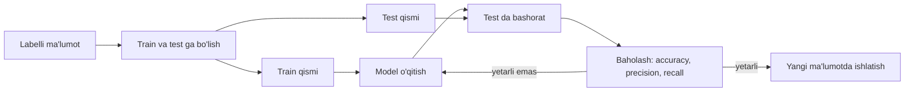

## Bu dars nima uchun kerak

53-darsda dastur aqlli qaror qabul qildi, lekin hamma bilim kod ichida edi: labirint qoidalari, Manhattan evristikasi, tic-tac-toe baholash funksiyasi - hammasini odam yozdi. Endi boshqa turdagi vazifani olaylik: xat spammi yoki yo'q? Rasmda mushukmi yoki itmi? Bunday vazifa uchun qoidalarni qo'lda yozishga urinib ko'ring: "agar xatda 'yutuq' so'zi bo'lsa..." - yuzta qoida yozilgandan keyin ham spam yuboruvchilar ularni aylanib o'tadi, oddiy xatlar esa adashib spamga tushadi. Mushukni piksellar orqali ta'riflaydigan qoidani yozish esa umuman imkonsiz.

**Machine learning** (mashinali o'rganish) yondashuvi boshqacha: qoidalarni yozish o'rniga dasturga **misollar** beriladi (bu xat spam, bu xat spam emas), u esa misollardan qoidani o'zi chiqaradi. Dasturchi endi qarorni emas, **o'rganish usulini** yozadi. 53-darsdagi baholash funksiyasini qo'lda yozish o'rniga uni ma'lumotdan o'rganish ham aynan shu g'oya.

Bu dars oldingi darslarga tayanadi: 16-darsdagi Big O (k-NN narxi), 31-35-darslardagi Python (barcha kod sof Python'da, kutubxonasiz - har bir formula ko'z oldida bo'lsin), 53-darsdagi optimallashtirish g'oyasi. 55-darsdagi large language model'lar shu darsdagi neyron tarmoq va gradient descent'ning juda katta shakli.

Bu darsdan keyin siz:

- supervised, unsupervised va reinforcement learning farqini, classification va regression farqini aytib bera olasiz;
- k-nearest neighbors (k-NN) algoritmini yozib, k tanlovining ta'sirini tushuntira olasiz;
- chiziqli regressiya uchun MSE loss funksiyasini va gradient descent qadamini qo'lda hisoblay olasiz, learning rate ta'sirini bilasiz;
- overfitting nima ekanini va nega ma'lumot train va test qismlarga bo'linishini tushuntira olasiz;
- perceptron qanday o'rganishini va nega u XOR ni o'rgana olmasligini ko'rsata olasiz;
- neyron tarmoq qatlamlari, og'irliklar, ReLU va sigmoid, forward pass va backpropagation g'oyasini bilasiz;
- confusion matrix asosida accuracy, precision va recall'ni hisoblay olasiz va ma'lumotdagi bias xavfini tushunasiz.

## Qoidalar o'rniga misollar: o'rganish turlari

Klassik dasturda kirish va qoidalar beriladi, natija chiqadi. Machine learning'da kirish va **kutilgan natijalar** beriladi, chiqadigan narsa esa **model** - yangi kirishlar uchun natija beradigan funksiya. Modelni misollar asosida sozlash jarayoni **o'qitish** (training) deyiladi.

Asosiy uch yondashuv:

| Tur | Nima beriladi | Nima o'rganiladi | Misol |
|---|---|---|---|
| Supervised learning (nazoratli) | Kirishlar va har biri uchun to'g'ri javob (label) | Kirishdan javobga o'tkazadigan funksiya | Spam/spam emas, uy narxi |
| Unsupervised learning (nazoratsiz) | Faqat kirishlar, javobsiz | Ma'lumotdagi tuzilma: guruhlar, naqshlar | Xaridorlarni o'xshashlik bo'yicha guruhlash (clustering) |
| Reinforcement learning (mustahkamlash) | Muhit va har harakatdan keyin mukofot yoki jazo | Mukofotni ko'paytiradigan xatti-harakat (policy) | O'yin o'ynash, robot yurishi |

**Supervised learning** - bu darsning asosiy mavzusi. Ma'lumot `(x, y)` juftliklaridan iborat: x - **belgilar** (features, masalan "kuniga o'qish soati" va "uyqu soati"), y - **label** (javob, masalan "imtihondan o'tdi"). Vazifa - x dan y ni bashorat qiladigan f funksiyani topish, shunday qilib u **ko'rilmagan** yangi x larda ham to'g'ri ishlasin.

Supervised vazifalar ham ikki turga bo'linadi:

- **Classification** (tasniflash) - javob chekli sinflardan biri: "spam" / "spam emas", "o'tdi" / "yiqildi", raqam tasvirida 0-9.
- **Regression** - javob uzluksiz son: uy narxi, ertangi harorat, yetkazib berish vaqti.

Bitta ma'lumotdan ikkalasini ham qilish mumkin: "imtihon bali necha bo'ladi?" - regression, "imtihondan o'tadimi?" - classification.



Diagramma butun darsning xaritasi: avval eng sodda model (k-NN), keyin o'qitish g'oyasi (gradient descent), keyin nega test qismi kerakligi (overfitting), keyin murakkabroq model (perceptron va neyron tarmoq), oxirida baholash.

## k-nearest neighbors: o'xshash misollarga qarash

Eng sodda classification g'oyasi: yangi nuqta qaysi sinfga tegishli ekanini bilish uchun unga **eng yaqin** ma'lum misollarga qarang. **k-nearest neighbors** (k-NN, k ta eng yaqin qo'shni) algoritmi:

1. Yangi nuqtadan har bir o'qitish misoligacha masofani hisoblang.
2. Eng yaqin k tasini oling.
3. Ular ichida eng ko'p uchragan label - javob (ovoz berish).

Masofa sifatida ko'pincha Evklid masofasi ishlatiladi: d = √((x1 - y1)² + (x2 - y2)²). Python'da bu `math.dist`. Quyidagi misolda 10 ta talaba haqida ma'lumot bor: kuniga o'qish soati, uyqu soati va imtihon natijasi. Yangi talaba 4,5 soat o'qiydi va 6,5 soat uxlaydi.

```python run
import math
from collections import Counter

# (o'qish soati kuniga, uyqu soati) -> imtihon natijasi
train = [
    ((1.0, 5.0), "yiqildi"), ((2.0, 8.0), "yiqildi"), ((3.0, 4.5), "yiqildi"),
    ((3.5, 6.0), "yiqildi"), ((4.0, 8.5), "o'tdi"),   ((5.5, 4.5), "yiqildi"),
    ((5.5, 7.5), "o'tdi"),   ((6.0, 6.0), "o'tdi"),   ((7.0, 8.0), "o'tdi"),
    ((8.0, 5.0), "o'tdi"),
]
new = (4.5, 6.5)

ranked = sorted(train, key=lambda item: math.dist(item[0], new))
for point, label in ranked[:5]:
    print(f"{point}  masofa {math.dist(point, new):.3f}  {label}")
print()
for k in (1, 3, 5):
    votes = Counter(label for _, label in ranked[:k])
    print(f"k={k}: ovozlar {dict(votes)} -> {votes.most_common(1)[0][0]}")
```

Natija:

```text
(3.5, 6.0)  masofa 1.118  yiqildi
(5.5, 7.5)  masofa 1.414  o'tdi
(6.0, 6.0)  masofa 1.581  o'tdi
(4.0, 8.5)  masofa 2.062  o'tdi
(5.5, 4.5)  masofa 2.236  yiqildi

k=1: ovozlar {'yiqildi': 1} -> yiqildi
k=3: ovozlar {'yiqildi': 1, "o'tdi": 2} -> o'tdi
k=5: ovozlar {'yiqildi': 2, "o'tdi": 3} -> o'tdi
```

Birinchi masofani qo'lda tekshiramiz: (3,5; 6,0) dan (4,5; 6,5) gacha √((4,5 - 3,5)² + (6,5 - 6,0)²) = √(1 + 0,25) = √1,25 ≈ 1,118. Eng yaqin qo'shni "yiqildi", shuning uchun k = 1 "yiqildi" deydi. k = 3 da esa keyingi ikki qo'shni "o'tdi" - javob o'zgaradi. Qaysi biri to'g'ri? Bitta qo'shniga ishonish - bitta tasodifiy misolga ishonish; ko'proq qo'shni shovqinni "o'rtachalashtiradi". Lekin k juda katta bo'lsa (masalan, hamma 10 ta misol), algoritm yangi nuqtaga qaramay, shunchaki ko'pchilik sinfni aytadi. k ni tanlash - keyingi bo'limlardagi overfitting mavzusining birinchi ko'rinishi.

k-NN haqida yana uch muhim fakt:

- **O'qitish yo'q.** k-NN misollarni shunchaki saqlaydi, butun ish bashorat paytida. Har bir bashorat n ta misolgacha masofa hisoblaydi va saralaydi: O(n log n), n = 1 000 000 bo'lsa bu har so'rov uchun million masofa. Amalda maxsus tuzilmalar (k-d tree va boshqalar) yoki taxminiy qidiruv ishlatiladi.
- **Shkala muhim.** Agar bir belgi soatlarda (0-10), boshqasi so'mda (millionlar) bo'lsa, masofani faqat ikkinchisi belgilaydi. Shuning uchun belgilar odatda bir xil oraliqqa keltiriladi (normalization).
- **Toq k.** Ikki sinfda toq k teng ovozdan saqlaydi.

## Chiziqli regressiya va gradient descent

k-NN modelsiz ishladi. Ko'p ML usullari esa **parametrli model** quradi: formulaning shakli oldindan tanlanadi, sonlari (parametrlari) esa ma'lumotdan topiladi. Eng sodda misol - **chiziqli regressiya**:

ŷ = w · x + b

Bu yerda w - og'irlik (weight, chiziq qiyaligi), b - siljish (bias, y o'qini kesish nuqtasi), ŷ - model bashorati. O'qitish - shunday w va b topish kerakki, bashoratlar haqiqiy y larga iloji boricha yaqin bo'lsin.

"Yaqin" ni o'lchash uchun **loss funksiyasi** (xato funksiyasi) kerak. Regression'da eng keng tarqalgani - **MSE** (mean squared error, o'rtacha kvadratik xato):

MSE(w, b) = (1/n) · Σ (w · xᵢ + b - yᵢ)²

Kvadrat ikki ish qiladi: musbat va manfiy xatolar bir-birini yo'q qilmaydi, katta xatolar esa qattiqroq jazolanadi.

Misol ma'lumot: x = [1, 2, 3, 4], y = [3, 5, 7, 9]. Bu nuqtalar aniq y = 2x + 1 chizig'ida yotadi, demak ideal javob w = 2, b = 1 va MSE = 0. Algoritm buni bilmaydi; u w = 0, b = 0 dan boshlaydi. Boshlang'ich loss: barcha bashoratlar 0, xatolar -3, -5, -7, -9, MSE = (9 + 25 + 49 + 81) / 4 = 164 / 4 = 41.

### Gradient: qaysi tomonga yurish kerak

**Gradient descent** (gradient bo'yicha tushish) g'oyasi: loss funksiyasini tog'li relyef deb tasavvur qiling, biz esa tuman ichida pastga tushmoqchimiz. Har nuqtada qaysi tomon qiyalik pastga ketishini tekshiramiz va o'sha tomonga kichik qadam qo'yamiz. Matematik "qiyalik" - **hosila** (derivative): parametr ozgina oshsa, loss qanchaga o'zgaradi. Bir nechta parametr bo'yicha hosilalar to'plami - **gradient**. MSE uchun:

∂MSE/∂w = (2/n) · Σ (ŷᵢ - yᵢ) · xᵢ, ∂MSE/∂b = (2/n) · Σ (ŷᵢ - yᵢ)

Yangilash qoidasi (gradientga **qarshi** yo'nalishda, chunki gradient loss o'sadigan tomonni ko'rsatadi):

w ← w - α · ∂MSE/∂w, b ← b - α · ∂MSE/∂b

α - **learning rate** (o'rganish tezligi): qadam o'lchami.

Birinchi qadamni qo'lda hisoblaymiz. w = b = 0, xatolar (ŷ - y) = -3, -5, -7, -9.

- ∂MSE/∂w = (2/4) · (-3 · 1 - 5 · 2 - 7 · 3 - 9 · 4) = 0,5 · (-70) = -35
- ∂MSE/∂b = (2/4) · (-3 - 5 - 7 - 9) = 0,5 · (-24) = -12
- α = 0,01 bo'lsa: w = 0 - 0,01 · (-35) = 0,35, b = 0 - 0,01 · (-12) = 0,12.

Ikkala gradient manfiy: w va b ni oshirish loss'ni kamaytiradi, algoritm ularni oshirdi. Endi bu jarayonni to'rt xil learning rate bilan 100 qadam takrorlaymiz:

```python run
xs = [1, 2, 3, 4]
ys = [3, 5, 7, 9]
n = len(xs)

def mse(w, b):
    return sum((w * x + b - y) ** 2 for x, y in zip(xs, ys)) / n

def step(w, b, lr):
    dw = 2 / n * sum((w * x + b - y) * x for x, y in zip(xs, ys))
    db = 2 / n * sum((w * x + b - y) for x, y in zip(xs, ys))
    return w - lr * dw, b - lr * db

for lr in (0.01, 0.05, 0.1, 0.2):
    w = b = 0.0
    print(f"learning rate = {lr}")
    print(" qadam        w        b         loss")
    for t in range(101):
        if t in (0, 1, 2, 3, 5, 20, 100):
            print(f"{t:6} {w:8.3f} {b:8.3f} {mse(w, b):12.4f}")
        if mse(w, b) > 1e6:
            print("   ... loss o'smoqda: qadam juda katta, jarayon uzoqlashmoqda")
            break
        w, b = step(w, b, lr)
    print()
```

Natija:

```text
learning rate = 0.01
 qadam        w        b         loss
     0    0.000    0.000      41.0000
     1    0.350    0.120      28.4532
     2    0.642    0.220      19.7471
     3    0.884    0.304      13.7062
     5    1.255    0.432       6.6059
    20    2.038    0.712       0.0396
   100    2.072    0.788       0.0075

learning rate = 0.05
 qadam        w        b         loss
     0    0.000    0.000      41.0000
     1    1.750    0.600       1.1288
     2    2.038    0.703       0.0433
     3    2.084    0.723       0.0134
     5    2.090    0.734       0.0118
    20    2.072    0.788       0.0075
   100    2.022    0.937       0.0007

learning rate = 0.1
 qadam        w        b         loss
     0    0.000    0.000      41.0000
     1    3.500    1.200      18.4150
     2    1.150    0.410       8.2743
     3    2.720    0.953       3.7210
     5    2.367    0.850       0.7579
    20    2.052    0.844       0.0041
   100    2.005    0.986       0.0000

learning rate = 0.2
 qadam        w        b         loss
     0    0.000    0.000      41.0000
     1    7.000    2.400     224.4600
     2   -9.400   -3.160    1229.1256
     3   28.960    9.904    6730.8524
     5  149.266   50.853  201847.5263
   ... loss o'smoqda: qadam juda katta, jarayon uzoqlashmoqda
```

Jadvaldagi 1-qadam qatori qo'lda hisoblaganimiz bilan bir xil: 0,35 va 0,12. To'rt rejimni taqqoslaymiz:

| Learning rate | Xatti-harakat | 100 qadamdan keyin |
|---|---|---|
| 0,01 | Sekin, lekin barqaror pasayish | Loss 0,0075, w = 2,072, b = 0,788 - hali yetib kelmadi |
| 0,05 | Tez va barqaror | Loss 0,0007 |
| 0,1 | Birinchi qadamda "sakrab o'tib ketdi" (w = 3,5), keyin tebranib yaqinlashdi | Loss 0,0000 (4 xonagacha), w ≈ 2,005, b ≈ 0,986 |
| 0,2 | Har qadamda qarama-qarshi tomonga kattaroq sakraydi | Loss portlaydi - divergence (uzoqlashish) |

Xulosa: learning rate juda kichik bo'lsa - o'qitish sekin, juda katta bo'lsa - minimum ustidan sakrab o'tib, uzoqlashib ketadi. Yaxshi qiymat ko'pincha tajriba bilan topiladi. E'tibor bering, w b ga qaraganda tezroq to'g'ri qiymatga keldi: chiziqning qiyaligini aniqlash oson, b ni aniq topish esa ko'p mayda qadamlarni talab qiladi.

Bu misolda w va b ni formula bilan bir zumda topish ham mumkin edi (chiziqli regressiyaning yopiq ko'rinishdagi yechimi bor). Gradient descent'ning qiymati shundaki, u **har qanday** differensiallanuvchi loss va modelga ishlaydi - millionlab parametrli neyron tarmoqqa ham. Pastda aynan shunday qilamiz.

## Overfitting va train/test bo'linishi

Model o'qitish ma'lumotida qanchalik yaxshi ishlashi - asosiy savol emas. Asosiy savol: **yangi**, ko'rilmagan ma'lumotda qanday ishlaydi? Bu xususiyat **generalization** (umumlashtirish) deyiladi.

**Overfitting** (ortiqcha moslashish) - model o'qitish ma'lumotiga, uning tasodifiy shovqiniga ham shunchalik moslashadiki, yangi ma'lumotda yomon ishlaydi. Imtihon savollarini tushunmasdan yodlab olgan talabaga o'xshaydi: o'sha savollarga a'lo javob beradi, boshqacha so'ralsa - yo'q. Teskarisi **underfitting**: model shunchalik sodda-ki, o'qitish ma'lumotidagi naqshni ham ushlay olmaydi.

Overfitting'ni ko'rish uchun ma'lumotni ikkiga bo'lamiz: **train** (o'qitish) va **test** (sinov) qismlari. Model faqat train'dan o'rganadi, test esa "imtihon" - unga o'qitish paytida tegilmaydi. Quyidagi dastur 80 ta sun'iy talaba yaratadi: o'tish qoidasi "o'qish + 0,6 · uyqu > 8,5", lekin 15% holatda natija tasodifan teskari (hayotdagi kutilmagan omillar). 60 tasi train, 20 tasi test. `random.Random(1)` - qat'iy seed: har ishga tushirishda bir xil ma'lumot.

```python run
import math
import random
from collections import Counter

rnd = random.Random(1)
data = []
for _ in range(80):
    hours = round(rnd.uniform(0, 10), 1)
    sleep = round(rnd.uniform(4, 9), 1)
    label = "o'tdi" if hours + 0.6 * sleep > 8.5 else "yiqildi"
    if rnd.random() < 0.15:                      # 15% shovqin: tasodifiy holatlar
        label = "yiqildi" if label == "o'tdi" else "o'tdi"
    data.append(((hours, sleep), label))

train, test = data[:60], data[60:]

def predict(train, point, k):
    nearest = sorted(train, key=lambda item: math.dist(item[0], point))[:k]
    return Counter(label for _, label in nearest).most_common(1)[0][0]

def accuracy(train, rows, k):
    return sum(predict(train, p, k) == y for p, y in rows) / len(rows)

print("  k   train accuracy   test accuracy")
for k in (1, 3, 7, 15, 59):
    print(f"{k:3} {accuracy(train, train, k):14.2f} {accuracy(train, test, k):15.2f}")
```

Natija:

```text
  k   train accuracy   test accuracy
  1           1.00            0.60
  3           0.87            0.80
  7           0.78            0.85
 15           0.77            0.90
 59           0.52            0.60
```

- **k = 1**: train'da 100% - har bir train nuqtasining eng yaqin qo'shnisi o'zi. Bu "yodlash": shovqinli misollar ham to'g'ri "eslab qolindi". Test'da esa atigi 60%: yangi nuqta yonida tasodifan teskari belgili misol bo'lsa, model unga ishonadi. Bu - overfitting.
- **k = 7 va 15**: train aniqligi pasaydi (shovqinli misollarni endi qo'shnilar "ovozda yengadi"), test aniqligi esa 85-90% ga ko'tarildi. Model naqshni o'rgandi, shovqinni emas.
- **k = 59**: deyarli butun train to'plami ovoz beradi - model har doim ko'pchilik sinfni aytadi. Train'da ham, test'da ham yomon: underfitting.

Ikki muhim ogohlantirish. Birinchidan, test to'plami bu yerda atigi 20 ta misol: bitta misol 5% ga teng, shuning uchun 0,85 va 0,90 farqi tasodif bo'lishi mumkin. Ikkinchidan, k ni test natijasiga qarab tanlasak, test endi "ko'rilmagan" emas - biz unga moslashib qoldik. To'g'ri amaliyot: ma'lumot uch qismga bo'linadi - **train** (o'qitish), **validation** (k kabi giperparametrlarni tanlash) va **test** (faqat oxirida, bir marta). Ma'lumot kam bo'lsa **k-fold cross-validation** ishlatiladi: ma'lumot k bo'lakka bo'linadi, har bo'lak navbat bilan validation bo'ladi, natijalar o'rtachalanadi.

## Perceptron: bitta sun'iy neyron

Endi modelni murakkablashtiramiz. **Perceptron** - bitta sun'iy neyron: kirishlarni og'irliklarga ko'paytirib yig'adi, bias qo'shadi va natijani chegara funksiyasidan o'tkazadi:

z = w1 · x1 + w2 · x2 + b, chiqish = 1 agar z > 0, aks holda 0

Bu chiziqli regressiyaga juda o'xshash, faqat oxirida "ha/yo'q" qarori bor. Geometrik ma'nosi: w1 · x1 + w2 · x2 + b = 0 tekislikda to'g'ri chiziq, perceptron nuqtalarni shu chiziqning ikki tomoniga ajratadi.

Perceptron'ni Frank Rosenblatt ishlab chiqqan: 1957-yilda uni IBM 704 kompyuterida simulyatsiya qilgan, 1958-yilda batafsil maqola chop etgan. O'rganish qoidasi juda sodda: har misolda xato = kutilgan - chiqish (0, +1 yoki -1); xato bo'lsa, wᵢ ← wᵢ + α · xato · xᵢ va b ← b + α · xato. Ya'ni model xato qilgan tomonga og'irliklarni ozgina suradi.

Uchta mantiqiy funksiyani o'rgatib ko'ramiz: AND, OR va XOR (4-darsdagi mantiqiy amallar va truth table). XOR (exclusive or) "faqat bittasi 1 bo'lsa 1" degani.

```python run
def train_perceptron(data, epochs=20, lr=0.1):
    w1 = w2 = b = 0.0
    for epoch in range(1, epochs + 1):
        errors = 0
        for (x1, x2), target in data:
            out = 1 if w1 * x1 + w2 * x2 + b > 0 else 0
            err = target - out
            if err != 0:
                errors += 1
                w1 += lr * err * x1
                w2 += lr * err * x2
                b += lr * err
        if errors == 0:
            return epoch, (w1, w2, b), 4
    correct = sum((1 if w1 * x1 + w2 * x2 + b > 0 else 0) == t for (x1, x2), t in data)
    return None, (w1, w2, b), correct

AND = [((0, 0), 0), ((0, 1), 0), ((1, 0), 0), ((1, 1), 1)]
OR = [((0, 0), 0), ((0, 1), 1), ((1, 0), 1), ((1, 1), 1)]
XOR = [((0, 0), 0), ((0, 1), 1), ((1, 0), 1), ((1, 1), 0)]
for name, data in (("AND", AND), ("OR", OR), ("XOR", XOR)):
    epoch, (w1, w2, b), correct = train_perceptron(data)
    status = f"{epoch}-epoxada xatosiz" if epoch else "20 epoxada ham xato bor"
    print(f"{name:3}: {status:24} w1={w1:+.1f} w2={w2:+.1f} b={b:+.1f}  to'g'ri: {correct}/4")
```

Natija:

```text
AND: 6-epoxada xatosiz        w1=+0.2 w2=+0.1 b=-0.2  to'g'ri: 4/4
OR : 4-epoxada xatosiz        w1=+0.1 w2=+0.1 b=+0.0  to'g'ri: 4/4
XOR: 20 epoxada ham xato bor  w1=-0.1 w2=+0.0 b=+0.1  to'g'ri: 2/4
```

**Epoxa** (epoch) - butun o'qitish to'plamidan bir marta o'tish. AND uchun topilgan og'irliklarni tekshiramiz: (1, 1) da z = 0,2 + 0,1 - 0,2 = 0,1 > 0 - chiqish 1; (1, 0) da z = 0,2 - 0,2 = 0 - chiqish 0 (z > 0 emas); (0, 1) da z = 0,1 - 0,2 < 0 - chiqish 0. To'g'ri.

XOR esa hech qachon o'rganilmaydi va bu tasodif emas. (0, 1) va (1, 0) bir sinfda, (0, 0) va (1, 1) boshqa sinfda; kvadratning qarama-qarshi burchaklarini bitta to'g'ri chiziq bilan ajratib bo'lmaydi. Perceptron faqat **chiziqli ajraladigan** (linearly separable) ma'lumotni o'rgana oladi; bunday ma'lumotda esa o'rganish qoidasi chekli qadamda yechimga yaqinlashishi isbotlangan. Marvin Minsky va Seymour Papert 1969-yilgi "Perceptrons" kitobida bitta qatlamli bunday tarmoqlar XOR ni o'rgana olmasligini ko'rsatgan; bu kitob ko'pincha neyron tarmoqlarga qiziqishning vaqtincha pasayishi bilan bog'lanadi. Ko'p qatlamli tarmoqlar bu cheklovga ega emasligi esa mualliflarning o'ziga ham ma'lum edi.

## Neural network: qatlamlar, aktivatsiya va backpropagation

Yechim - neyronlarni **qatlamlarga** yig'ish. **Neural network** (neyron tarmoq) uch xil qatlamdan iborat: kirish qatlami (belgilar), bir yoki bir nechta **yashirin qatlam** (hidden layer) va chiqish qatlami. Har bir neyron oldingi qatlamning barcha chiqishlarini og'irliklar bilan yig'adi, bias qo'shadi va natijani **aktivatsiya funksiyasidan** o'tkazadi.

### XOR ni qo'lda yechish

Yashirin qatlam nima berishini ko'rish uchun avval og'irliklarni qo'lda tanlaymiz (chegara funksiyasi bilan):

- h1 = 1 agar x1 + x2 - 0,5 > 0 (bu OR),
- h2 = 1 agar x1 + x2 - 1,5 > 0 (bu AND),
- chiqish = 1 agar h1 - h2 - 0,5 > 0 ("OR, lekin AND emas").

| x1 | x2 | h1 (OR) | h2 (AND) | h1 - h2 - 0,5 | chiqish | XOR |
|---|---|---|---|---|---|---|
| 0 | 0 | 0 | 0 | -0,5 | 0 | 0 |
| 0 | 1 | 1 | 0 | 0,5 | 1 | 1 |
| 1 | 0 | 1 | 0 | 0,5 | 1 | 1 |
| 1 | 1 | 1 | 1 | -0,5 | 0 | 0 |

Yashirin qatlam kirishni yangi "koordinatalarga" (h1, h2) o'tkazdi, u yerda sinflar endi chiziq bilan ajraladi. Har bir qatlam oldingi qatlam chiqishidan yangi belgilar quradi - chuqur tarmoqlarning kuchi shunda.

### Aktivatsiya funksiyalari

Qo'lda tanlashda chegara funksiyasi yetarli edi, lekin gradient descent bilan o'qitish uchun funksiya **silliq** bo'lishi kerak: chegara funksiyasining hosilasi deyarli hamma joyda 0, gradient hech qanday yo'nalish ko'rsatmaydi.

| Funksiya | Formula | z = -2 | z = 0 | z = 2 | Qayerda ishlatiladi |
|---|---|---|---|---|---|
| Step (chegara) | 1 agar z > 0, aks holda 0 | 0 | 0 | 1 | Klassik perceptron |
| Sigmoid | σ(z) = 1 / (1 + e^(-z)) | 0,119 | 0,5 | 0,881 | Chiqish ehtimol bo'lishi kerak bo'lganda (0 dan 1 gacha) |
| ReLU | max(0, z) | 0 | 0 | 2 | Yashirin qatlamlarda, zamonaviy tarmoqlarda eng keng tarqalgan |

Sigmoid qiymatini tekshiramiz: σ(2) = 1 / (1 + e^(-2)) = 1 / (1 + 0,1353) ≈ 0,881. Sigmoid'ning qulay xususiyati - hosilasi o'zi orqali ifodalanadi: σ'(z) = σ(z) · (1 - σ(z)); z = 0 da bu 0,5 · 0,5 = 0,25. **ReLU** (rectified linear unit) manfiyni nolga aylantiradi, musbatni o'zgartirmaydi; hisoblash arzon va chuqur tarmoqlarda gradientni yaxshi o'tkazadi.

Aktivatsiya **nochiziqli** bo'lishi shart. Agar har qatlam faqat chiziqli bo'lsa (z ni o'zgartirmasa), ikki chiziqli qatlam ketma-ketligi yana bitta chiziqli funksiya bo'ladi va tarmoq qancha chuqur bo'lsa ham perceptron'dan kuchli bo'lmaydi.

### Forward pass va backpropagation

**Forward pass** (oldinga o'tish) - kirishdan chiqishgacha qatlamma-qatlam hisoblash: yig'indi, aktivatsiya, keyingi qatlam. Bashorat shunday olinadi.

O'qitish uchun esa har bir og'irlik bo'yicha loss gradienti kerak. Yashirin qatlamdagi og'irlik loss'ga bevosita emas, zanjir orqali ta'sir qiladi: og'irlik → yashirin neyron yig'indisi → yashirin neyron chiqishi → chiqish neyroni yig'indisi → bashorat → loss. **Zanjir qoidasi** (chain rule): zanjirning har bir bo'g'inidagi "qanchalik sezgir" ko'paytuvchilarni ko'paytirsak, umumiy ta'sir chiqadi. **Backpropagation** (xatoni orqaga tarqatish) - bu ko'paytmalarni chiqishdan kirish tomonga, qatlamma-qatlam, oraliq natijalarni qayta ishlatib hisoblash usuli. Chiqishdagi xato avval oxirgi qatlam og'irliklariga, keyin "og'irliklar orqali" oldingi qatlamga taqsimlanadi: chiqishga katta og'irlik bilan ulangan yashirin neyron xato uchun ko'proq "javobgar". Bu usul 1986-yilda David Rumelhart, Geoffrey Hinton va Ronald Williams'ning Nature jurnalidagi maqolasi orqali keng tarqalgan (g'oyaning o'zi ilgariroq ham taklif qilingan edi).

Quyidagi tarmoq: 2 ta kirish, 4 ta sigmoid yashirin neyron, 1 ta sigmoid chiqish. Og'irliklar `random.seed(7)` bilan tasodifiy boshlanadi, o'qitish - har misoldan keyin gradient descent qadami.

```python run
import math
import random

random.seed(7)
H = 4          # yashirin neyronlar soni
LR = 0.5       # learning rate

XOR = [((0, 0), 0), ((0, 1), 1), ((1, 0), 1), ((1, 1), 0)]

def sigmoid(z):
    return 1 / (1 + math.exp(-z))

# Og'irliklar: kirish -> yashirin (H x 2), yashirin -> chiqish (H)
w_in = [[random.uniform(-1, 1) for _ in range(2)] for _ in range(H)]
b_in = [0.0] * H
w_out = [random.uniform(-1, 1) for _ in range(H)]
b_out = 0.0

def forward(x):
    hidden = [sigmoid(w[0] * x[0] + w[1] * x[1] + b) for w, b in zip(w_in, b_in)]
    out = sigmoid(sum(w * h for w, h in zip(w_out, hidden)) + b_out)
    return hidden, out

for epoch in range(1, 5001):
    loss = 0.0
    for x, y in XOR:
        hidden, out = forward(x)
        loss += (out - y) ** 2
        # Backpropagation: chiqishdagi xato -> og'irliklar bo'yicha gradient
        d_out = 2 * (out - y) * out * (1 - out)
        for j in range(H):
            d_hidden = d_out * w_out[j] * hidden[j] * (1 - hidden[j])
            w_out[j] -= LR * d_out * hidden[j]
            w_in[j][0] -= LR * d_hidden * x[0]
            w_in[j][1] -= LR * d_hidden * x[1]
            b_in[j] -= LR * d_hidden
        b_out -= LR * d_out
    if epoch in (1, 100, 500, 1000, 2000, 5000):
        print(f"epoxa {epoch:5}: loss = {loss / 4:.4f}")

for x, y in XOR:
    _, out = forward(x)
    print(x, "->", f"{out:.3f}", "kutilgan", y)
```

Natija (seed qat'iy bo'lgani uchun har safar bir xil; boshqa Python muhitida oxirgi raqamlar ozgina farq qilishi mumkin):

```text
epoxa     1: loss = 0.3253
epoxa   100: loss = 0.2617
epoxa   500: loss = 0.0443
epoxa  1000: loss = 0.0037
epoxa  2000: loss = 0.0011
epoxa  5000: loss = 0.0003
(0, 0) -> 0.008 kutilgan 0
(0, 1) -> 0.983 kutilgan 1
(1, 0) -> 0.983 kutilgan 1
(1, 1) -> 0.025 kutilgan 0
```

Perceptron uddalay olmagan XOR endi o'rganildi: chiqishlar 0 ga yoki 1 ga juda yaqin, ularni 0,5 chegarasida yaxlitlasak, to'rttasi ham to'g'ri. Dastlabki ~100 epoxada loss deyarli o'zgarmaydi (0,25 atrofida - "hamma joyda 0,5 deyish" darajasi), keyin tarmoq foydali yashirin belgilarni "topadi" va loss keskin tushadi. Seed'ni o'zgartirib ko'ring: boshlang'ich og'irliklar boshqacha, lekin bu oddiy masalada natija o'xshash.

Koddagi zanjir qoidasini o'qib chiqamiz. Loss = (out - y)², uning out bo'yicha hosilasi 2 · (out - y); out = σ(z), uning z bo'yicha hosilasi out · (1 - out). Ko'paytma - `d_out`, ya'ni chiqish neyroni yig'indisi z ning "aybi". Chiqish og'irligi `w_out[j]` z ga `hidden[j]` ko'paytuvchisi bilan kiradi - demak uning gradienti `d_out * hidden[j]`. Yashirin neyron j ning aybi esa `d_out` ni u chiqishga ulangan og'irlik `w_out[j]` ga va o'z sigmoidining hosilasi `hidden[j] * (1 - hidden[j])` ga ko'paytirish - bu `d_hidden`. Keyingi qadam yana bir xil: kirish og'irligi gradienti `d_hidden * x`. Chuqurroq tarmoqda shu naqsh har qatlamda takrorlanadi.

Hajm haqida: bu tarmoqda 2 · 4 + 4 (kirish → yashirin og'irliklar va bias) + 4 + 1 (yashirin → chiqish) = 17 parametr. Amaliy tarmoqlar millionlab, katta til modellari esa milliardlab parametrga ega, lekin har biri xuddi shu forward pass, loss, backpropagation va gradient descent qadamidan o'tadi; amalda bu hisoblar for-sikllar bilan emas, matritsa amallari bilan (numpy, maxsus kutubxonalar, GPU) bajariladi.

## Modelni baholash: confusion matrix

**Accuracy** (aniqlik) - to'g'ri bashoratlar ulushi. U intuitiv, lekin sinflar notekis bo'lsa aldaydi. Spam filtri misoli: 1000 ta xatdan 100 tasi spam. Filtr 80 ta spamni ushladi, 20 tasini o'tkazib yubordi va 30 ta oddiy xatni adashib spam dedi.

Bunday natijalar **confusion matrix** (chalkashlik matritsasi) ga yoziladi:

- **TP** (true positive) - spam, model ham spam dedi;
- **FN** (false negative) - spam, lekin model "oddiy" dedi (o'tkazib yuborilgan);
- **FP** (false positive) - oddiy xat, lekin model "spam" dedi (soxta signal);
- **TN** (true negative) - oddiy xat, model ham "oddiy" dedi.

Ulardan uch asosiy o'lchov:

- accuracy = (TP + TN) / hammasi;
- **precision** (aniqlik darajasi) = TP / (TP + FP) - model "spam" degan xatlarning qancha qismi haqiqatan spam;
- **recall** (to'liqlik) = TP / (TP + FN) - haqiqiy spamlarning qancha qismini model topdi.

```python run
# 1000 ta xat: 100 tasi spam. Filtr natijalari (1 - spam, 0 - oddiy xat)
actual    = [1] * 80 + [1] * 20 + [0] * 30 + [0] * 870
predicted = [1] * 80 + [0] * 20 + [1] * 30 + [0] * 870

def report(actual, predicted):
    pairs = list(zip(actual, predicted))
    tp = pairs.count((1, 1))
    fn = pairs.count((1, 0))
    fp = pairs.count((0, 1))
    tn = pairs.count((0, 0))
    print("              bashorat: spam   bashorat: oddiy")
    print(f"haqiqatda spam   TP = {tp:4}       FN = {fn:4}")
    print(f"haqiqatda oddiy  FP = {fp:4}       TN = {tn:4}")
    accuracy = (tp + tn) / len(pairs)
    precision = tp / (tp + fp) if tp + fp else float("nan")
    recall = tp / (tp + fn)
    print(f"accuracy  = {accuracy:.3f}")
    print(f"precision = {precision:.3f}")
    print(f"recall    = {recall:.3f}")
    print()

report(actual, predicted)
report(actual, [0] * 1000)     # "hech qachon spam demaydigan" model
```

Natija:

```text
              bashorat: spam   bashorat: oddiy
haqiqatda spam   TP =   80       FN =   20
haqiqatda oddiy  FP =   30       TN =  870
accuracy  = 0.950
precision = 0.727
recall    = 0.800

              bashorat: spam   bashorat: oddiy
haqiqatda spam   TP =    0       FN =  100
haqiqatda oddiy  FP =    0       TN =  900
accuracy  = 0.900
precision = nan
recall    = 0.000
```

Qo'lda: accuracy = (80 + 870) / 1000 = 0,95; precision = 80 / (80 + 30) = 80 / 110 ≈ 0,727; recall = 80 / (80 + 20) = 0,8. Ikkinchi model hech narsa qilmaydi - har doim "oddiy" deydi - lekin accuracy'si 90%! Recall esa 0: bitta ham spam topilmadi. Precision aniqlanmagan (0 / 0, `nan` - "not a number"), chunki model hech qachon "spam" demagan. Shuning uchun notekis sinflarda faqat accuracy'ga qaralmaydi.

Precision va recall o'rtasida odatda trade-off bor: modelni "spam" deyishga ehtiyotkorroq qilsangiz, FP kamayadi (precision oshadi), lekin ko'proq spam o'tib ketadi (recall pasayadi). Qaysi biri muhimroq - vazifaga bog'liq: kasallik skriningida kasalni o'tkazib yuborish (FN) qimmat, shuning uchun recall muhim; spam filtrida muhim xatni yo'qotish (FP) qimmatroq, shuning uchun precision muhim.

## Ma'lumotdagi bias va etika

Supervised model "haqiqatni" emas, **unga ko'rsatilgan ma'lumotni** o'rganadi. Bu bir necha xavf tug'diradi:

- **Tanlanma bias.** Agar o'qitish ma'lumotida biror guruh (masalan, ma'lum hudud aholisi yoki yosh guruhi) kam bo'lsa, model shu guruhda yomonroq ishlaydi. Umumiy accuracy yuqori bo'lsa ham, guruhlar bo'yicha alohida hisoblanganda farq ko'rinadi.
- **Tarixiy bias.** Label'lar o'tmishdagi odam qarorlaridan olingan bo'lsa (kimga kredit berilgan, kim ishga olingan), o'sha qarorlardagi adolatsizlik modelga "naqsh" sifatida o'tadi va avtomatik ravishda takrorlanadi.
- **Proxy belgilar.** Sezgir belgini (jins, millat) olib tashlash yetarli emas: manzil yoki qiziqishlar kabi boshqa belgilar u bilan bog'liq bo'lib, uni bilvosita qaytaradi.
- **Mas'uliyat.** Model xato qilganda kim javob beradi va qaror qanday tushuntiriladi? Neyron tarmoq 17 ta emas, millionlab parametrli bo'lsa, "nega" degan savolga javob berish qiyin.

Amaliy minimum: ma'lumot qayerdan va qanday yig'ilganini hujjatlashtiring, o'lchovlarni muhim guruhlar bo'yicha alohida hisoblang, odamlar hayotiga ta'sir qiladigan qarorlarda model natijasini odam tekshiruvisiz ishlatmang.

## Ko'p uchraydigan xatolar

- **Modelni o'qitish ma'lumotida baholash.** k = 1 k-NN train'da 100%, test'da 60% berdi. Natijani doim model ko'rmagan ma'lumotda o'lchang.
- **Test to'plamiga qarab sozlash.** Giperparametrni (k, learning rate) test natijasiga qarab tanlash testni "ko'rilgan" qiladi. Buning uchun validation qismi yoki cross-validation ishlating, test'ga oxirida bir marta tegining.
- **Belgilar shkalasini e'tiborsiz qoldirish.** k-NN va gradient descent'da katta sonli belgi (masalan, so'mdagi narx) boshqalarini "bosib ketadi". Belgilarni bir xil oraliqqa keltiring.
- **Learning rate'ni tekshirmaslik.** Loss o'sib yoki tebranib borsa, qadam juda katta (0,2 da divergence); juda sekin tushsa - juda kichik. Loss'ni har bir necha qadamda chop eting.
- **Notekis sinflarda faqat accuracy'ga qarash.** "Hech qachon spam demaydigan" model 90% accuracy oldi, recall esa 0. Confusion matrix, precision va recall'ni ko'ring.
- **Chiziqli aktivatsiya bilan chuqur tarmoq qurish.** Nochiziqli aktivatsiyasiz qatlamlar bitta chiziqli funksiyaga qisqaradi va XOR ham o'rganilmaydi.
- **Natijani seed'siz taqqoslash.** Tasodifiy boshlang'ich og'irliklar va bo'linish har ishga tushirishda boshqacha natija beradi. Tajribalarni qat'iy seed bilan yoki bir necha seed o'rtachasi bilan solishtiring.
- **Model ma'lumotdagi bias'ni tuzatadi deb o'ylash.** Model ma'lumotdagi naqshni, jumladan adolatsiz naqshni ham takrorlaydi; uni guruhlar bo'yicha alohida baholash kerak.

## Xulosa

- Machine learning'da qoida o'rniga misollar beriladi: supervised (label bilan), unsupervised (labelsiz, tuzilma qidirish), reinforcement (mukofot orqali). Supervised vazifa classification (sinf) yoki regression (son) bo'ladi.
- k-NN yangi nuqtani eng yaqin k ta misolning ovozi bilan tasniflaydi; o'qitishi yo'q, bashorati O(n log n). Kichik k shovqinni yodlaydi, juda katta k ko'pchilik sinfni aytadi.
- Chiziqli regressiya ŷ = w · x + b ni MSE bo'yicha o'qitadi. Gradient descent parametrlarni gradientga qarshi α qadam bilan suradi: 1-qadamda w = 0,35, b = 0,12 (α = 0,01); α = 0,2 da jarayon uzoqlashadi.
- Overfitting - train'da yaxshi, yangi ma'lumotda yomon. Ma'lumot train, validation va test ga bo'linadi; k = 1 da train 1,00, test 0,60.
- Perceptron faqat chiziqli ajraladigan ma'lumotni o'rganadi: AND va OR - ha, XOR - yo'q (Minsky va Papert, 1969).
- Neyron tarmoq yashirin qatlam va nochiziqli aktivatsiya (sigmoid, ReLU) bilan XOR ni o'rgandi; forward pass bashorat beradi, backpropagation zanjir qoidasi bilan har og'irlik gradientini hisoblaydi.
- Baholashda confusion matrix: precision = TP / (TP + FP), recall = TP / (TP + FN). Notekis sinflarda accuracy aldaydi; model ma'lumotdagi bias'ni ham o'rganadi.

## Amaliy topshiriq

k-NN klassifikatorini o'zingiz yozing va uni kichik ma'lumotda baholang. Pastdagi blokda ikki funksiya bor; testlar ularning natijasini va masofa turini tekshiradi.

1. `knn_predict(train, point, k)` - `train` `((x1, x2), label)` juftliklar ro'yxati. Evklid masofasi bo'yicha eng yaqin k ta misolni toping (teng masofada `train` dagi tartib saqlansin - `sorted` barqaror) va ular ichida eng ko'p uchragan label'ni qaytaring.
2. `train` ro'yxatini o'zgartirmang (`list.sort()` emas, `sorted()` ishlating).
3. `knn_accuracy(train, test, k)` - test misollari ichida to'g'ri bashorat qilinganlar ulushini qaytarsin (0 dan 1 gacha son).
4. Testlardan o'tgach, darsdagi 80 talik ma'lumotni (seed 1) oling va k = 1, 5, 9, 21 uchun train va test aniqligini hisoblang. Natijani jadvalga yozing va qaysi k ni tanlashingizni asoslang.
5. Ma'lumotni validation uchun ajrating: birinchi 40 ta - train, keyingi 20 ta - validation, oxirgi 20 ta - test. k ni validation bo'yicha tanlang va faqat oxirida test aniqligini bir marta hisoblang.
6. Ikkinchi belgini (uyqu soati) 1000 ga ko'paytirib, aniqlik qanday o'zgarishini tekshiring va sababini tushuntiring.

```python run
import math
from collections import Counter

def knn_predict(train, point, k):
    # Yechimingizni shu yerga yozing
    return None

def knn_accuracy(train, test, k):
    # Yechimingizni shu yerga yozing
    return 0.0

train = [((1, 1), "a"), ((1, 2), "a"), ((2, 1), "a"), ((6, 6), "b"), ((6, 7), "b")]
print(knn_predict(train, (2, 2), 3))
print(knn_accuracy(train, [((0, 0), "a"), ((7, 7), "b")], 1))
```

```python test
T = [((1, 1), "a"), ((1, 2), "a"), ((2, 1), "a"), ((6, 6), "b"), ((6, 7), "b")]
check("k=1: eng yaqin qo'shni label'i", lambda: knn_predict(T, (5.5, 6.5), 1) == "b")
check("k=3: ko'pchilik ovozi", lambda: knn_predict(T, (2, 2), 3) == "a")
check("k=5: hamma ovoz beradi, ko'pchilik 'a'", lambda: knn_predict(T, (6, 6), 5) == "a")
E = [((3, 0), "x"), ((2, 2), "y")]
check("Evklid masofasi (Manhattan emas): (0,0) ga (2,2) yaqinroq", lambda: knn_predict(E, (0, 0), 1) == "y")
copy = list(T)
check("train ro'yxati o'zgarmaydi", lambda: (knn_predict(T, (6, 6), 3), T == copy)[1])
check("accuracy: 2 tadan 2 to'g'ri = 1.0", lambda: knn_accuracy(T, [((0, 0), "a"), ((7, 7), "b")], 1) == 1.0)
check("accuracy: 4 tadan 1 to'g'ri = 0.25", lambda: knn_accuracy(T, [((0, 0), "b"), ((7, 7), "a"), ((1, 1), "a"), ((6, 6), "a")], 1) == 0.25)
```

Yaxshi javobda bo'lishi kerak bo'lgan narsalar:

- `knn_predict` `math.dist` (yoki √ formulasi) bilan barcha misollargacha masofani hisoblaydi, `sorted` bilan eng yaqin k tasini oladi va `Counter.most_common` bilan ovoz beradi;
- `knn_accuracy` to'g'ri bashoratlar sonini test hajmiga bo'ladi va 0 dan 1 gacha son qaytaradi;
- 4-qadam jadvalida k = 1 da train aniqligi 1,00 ga yaqin, test esa pastroq ekani overfitting deb izohlangan;
- 5-qadamda k test'ga emas, validation'ga qarab tanlangan va test bir marta ishlatilgan;
- 6-qadamda ikkinchi belgi 1000 ga ko'paytirilganda masofani deyarli faqat u belgilashi va aniqlik o'zgarishi shkala (normalization) muammosi deb tushuntirilgan;
- bashorat narxi O(n log n) (yoki tanlash bilan O(n)) va katta ma'lumotda bu nega muammo ekani aytilgan.

Javobingizni pastdagi maydonga yozing va yuqoridagi mezonlar bilan solishtiring.

## Manbalar

- CS50's Introduction to Artificial Intelligence with Python. [Lecture 4: Learning notes](https://cs50.harvard.edu/ai/notes/4/) - "Supervised Learning", "Nearest-Neighbor Classification", "Regression", "Loss Functions", "Overfitting", holdout va k-fold cross-validation, "Reinforcement Learning" bo'limlari.
- CS50's Introduction to Artificial Intelligence with Python. [Lecture 5: Neural Networks notes](https://cs50.harvard.edu/ai/notes/5/) - "Activation Functions" (step, sigmoid, ReLU), "Gradient Descent", "Multilayer Neural Networks", "Backpropagation".
- CS50x 2026. [Artificial Intelligence notes](https://cs50.harvard.edu/x/notes/ai/) - "Machine Learning" va "Deep Learning" bo'limlari: kursning AI ma'ruzasi.
- Google Machine Learning Crash Course. [Linear regression: Gradient descent](https://developers.google.com/machine-learning/crash-course/linear-regression/gradient-descent) va [Overfitting](https://developers.google.com/machine-learning/crash-course/overfitting/overfitting) - loss egri chizig'i, learning rate, generalization.
- Google Machine Learning Crash Course. [Classification: Accuracy, recall, precision, and related metrics](https://developers.google.com/machine-learning/crash-course/classification/accuracy-precision-recall) - confusion matrix va o'lchovlar, notekis sinflarda accuracy.
- Wikipedia. [Perceptron](https://en.wikipedia.org/wiki/Perceptron) - Rosenblatt (1957 IBM 704 simulyatsiyasi, 1958 maqola), o'rganish qoidasi, chiziqli ajraladigan ma'lumotda yaqinlashish, Minsky va Papert (1969) va XOR.
- Wikipedia. [Backpropagation](https://en.wikipedia.org/wiki/Backpropagation) - zanjir qoidasining samarali qo'llanishi; tarix va 1986-yilgi Nature maqolasi.
- Wikipedia. [k-nearest neighbors algorithm](https://en.wikipedia.org/wiki/K-nearest_neighbors_algorithm) va [Precision and recall](https://en.wikipedia.org/wiki/Precision_and_recall) - algoritm ta'rifi, belgilar shkalasi, precision va recall formulalari.
