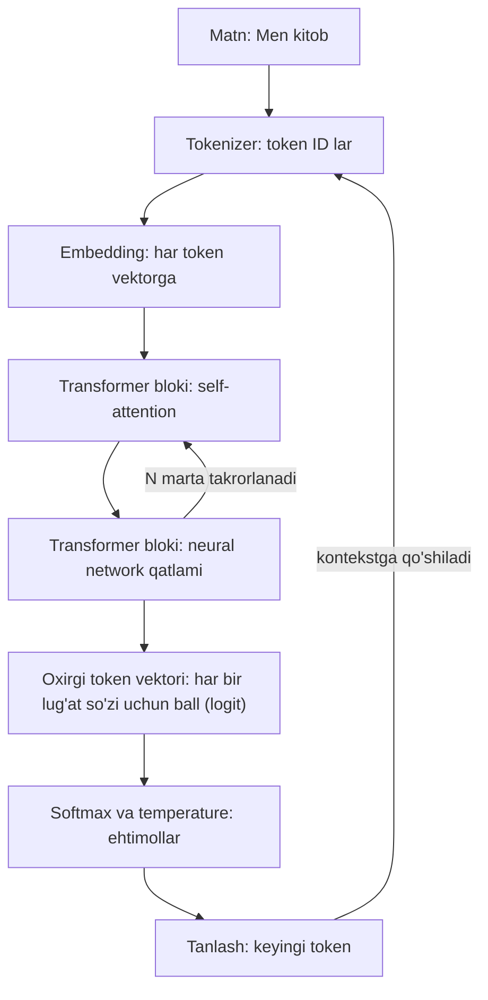
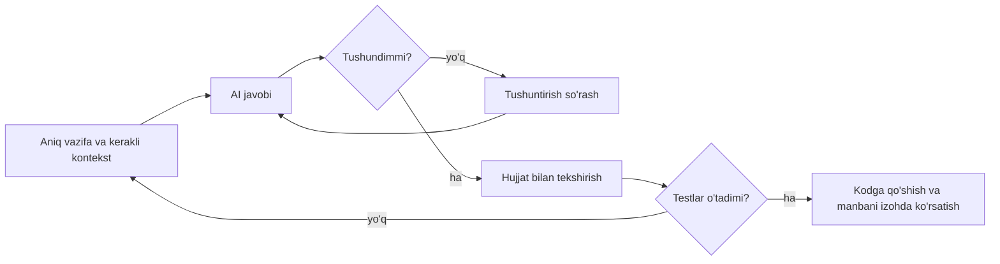

## Bu dars nima uchun kerak

Bugun dasturchi kodni yolg'iz yozmaydi: muharrir ichida yoki brauzerda unga savol berish, xatoni tushuntirtirish, test yozdirish mumkin bo'lgan AI yordamchilar bor. Ular ortida **large language model** (LLM, katta til modeli) turadi. Bu vosita foydali, lekin uning ichida nima bo'layotganini bilmagan dasturchi ikki xatodan biriga tushadi: yo unga ko'r-ko'rona ishonadi va ishonchli ohangda aytilgan noto'g'ri javobni kodiga qo'shadi, yoki uni "sehr" deb, umuman ishlatmaydi.

Bu dars LLM ni sehrdan mexanikaga aylantiradi. 53-darsda qidiruv va minimax bilan "aqlli" qaror qabul qilishni, 54-darsda machine learning va neural network ma'lumotdan qanday o'rganishini ko'rdik: model og'irliklari (weights) xatoni kamaytirish yo'nalishida asta-sekin o'zgartiriladi. LLM - xuddi shu g'oyaning juda katta miqyosdagi qo'llanishi, faqat vazifa bitta: matnning **keyingi bo'lagini bashorat qilish**. 2-darsdagi UTF-8, 12-darsdagi satrlar, 31-32-darslardagi Python dict va `Counter`, 16-darsdagi Big O ham shu yerda kerak bo'ladi.

Bu darsdan keyin siz:

- til modeli nima ekanini "keyingi tokenni bashorat qilish" sifatida ta'riflay olasiz va oddiy bigram modelni Python'da yoza olasiz;
- tokenizatsiya va BPE algoritmi qanday ishlashini, nega bir xil mazmun turli tillarda turli sondagi token olishini tushuntira olasiz;
- embedding va kosinus o'xshashlikni hisoblay olasiz;
- transformer va attention g'oyasini softmax orqali tushuntira olasiz;
- pretraining, fine-tuning va RLHF bosqichlarini farqlay olasiz;
- kontekst oynasi va temperature nimani boshqarishini bilasiz;
- gallyutsinatsiya nega muqarrar ekanini va undan qanday himoyalanishni tushuntira olasiz;
- AI yordamchi bilan xavfsiz va samarali ishlash qoidalarini, shuningdek CS50 ning AI siyosatini bilasiz.

## Til modeli: keyingi tokenni bashorat qilish

**Til modeli** (language model) - matn bo'lagidan keyin qaysi bo'lak kelishi ehtimolini beradigan model. "Men kitob ..." dan keyin "o'qiyman" kelishi ehtimoli katta, "mashina" kelishi ehtimoli kichik. Model uchun gap - ketma-ket bashoratlar zanjiri:

P(men, kitob, o'qiyman) = P(men) · P(kitob | men) · P(o'qiyman | men, kitob)

Bu ehtimollar nazariyasidagi zanjir qoidasi (chain rule). `P(B | A)` "A dan keyin B ning ehtimoli" deb o'qiladi. Muammo shundaki, oxirgi ko'paytuvchi butun oldingi matnga bog'liq va mumkin bo'lgan oldingi matnlar soni cheksiz. Eng oddiy yechim - faqat bitta oldingi so'zga qarash. Bunday model **bigram** model deyiladi (bi - ikki: "oldingi so'z, keyingi so'z" juftligi):

P(o'qiyman | men, kitob) ≈ P(o'qiyman | kitob)

Ehtimolni hisoblash oson: matnda "kitob" dan keyin necha marta "o'qiyman" kelganini "kitob" dan keyin kelgan barcha so'zlar soniga bo'lamiz. Bu - sanash, xolos. 32-darsdagi dict va `Counter` yetarli:

```python run
import random
from collections import Counter, defaultdict

text = """men kitob o'qiyman . sen kitob o'qiysan . men choy ichaman .
sen choy ichasan . men kitob yozaman . u kitob o'qiydi ."""

tokens = text.split()

# Har bir so'zdan keyin qaysi so'z necha marta kelganini sanaymiz
counts = defaultdict(Counter)
for prev, nxt in zip(tokens, tokens[1:]):
    counts[prev][nxt] += 1

def probs(word):
    c = counts[word]
    total = sum(c.values())
    return {w: n / total for w, n in c.items()}

for w in ["men", "kitob"]:
    print(w, "->", {k: round(v, 2) for k, v in probs(w).items()})

def generate(start, length, seed):
    rng = random.Random(seed)
    out = [start]
    for _ in range(length):
        p = probs(out[-1])
        if not p:
            break
        words = list(p)
        out.append(rng.choices(words, weights=[p[w] for w in words])[0])
    return " ".join(out)

for seed in [1, 2, 3]:
    print(f"seed={seed}:", generate("men", 8, seed))
```

Natija:

```text
men -> {'kitob': 0.67, 'choy': 0.33}
kitob -> {"o'qiyman": 0.25, "o'qiysan": 0.25, 'yozaman': 0.25, "o'qiydi": 0.25}
seed=1: men kitob o'qiydi . sen kitob o'qiysan . men
seed=2: men choy ichasan . sen choy ichasan . sen
seed=3: men kitob yozaman . men kitob o'qiyman . u
```

Hisob: matnda "men" 3 marta kelgan, ulardan keyin 2 marta "kitob" va 1 marta "choy": 2 / 3 = 0.67 va 1 / 3 = 0.33. "kitob" 4 marta, har safar boshqa so'z bilan, shuning uchun har biri 1 / 4 = 0.25.

**Generatsiya** (matn hosil qilish) - shu ehtimollar bo'yicha tasodifiy tanlab, tanlangan so'zni kontekstga qo'shib, yana bashorat qilish. `random.Random(seed)` tasodifiy sonlar generatorini aniq boshlang'ich qiymat (seed) bilan yaratadi: bir xil seed - bir xil natija (17-darsdagi LCG g'oyasi). Seed'ni o'zgartirib ko'ring.

Natijaga diqqat bilan qarang: `seed=2` da model "men choy ichasan" deb yozdi. Grammatik jihatdan bu xato ("men ... ichaman" bo'lishi kerak edi), lekin model uchun mantiqan to'g'ri: u faqat bitta oldingi so'zni ("choy") ko'radi va "choy" dan keyin "ichasan" haqiqatan uchragan. Model "men" ni allaqachon unutgan. Bu kichik misolda ikki katta saboq bor:

1. **Kontekst qanchalik uzun bo'lsa, matn shunchalik izchil.** Bigram 1 so'zni ko'radi. Zamonaviy LLM minglab tokenni ko'radi.
2. **Model "to'g'ri"ni emas, "ehtimolli"ni hosil qiladi.** Ishonchli ko'rinadigan, lekin noto'g'ri matn - xato emas, balki mexanizmning tabiiy natijasi. Gallyutsinatsiya bo'limida bunga qaytamiz.

Nega shunchaki sanash bilan katta model qurib bo'lmaydi? Lug'atda V ta so'z bo'lsa, bigram jadvali V² katakdan iborat. V = 50 000 bo'lsa, 50 000² = 2.5 · 10⁹ katak. Ikki oldingi so'zga qarasak (trigram), V³ = 1.25 · 10¹⁴ - bu son hech qanday matnda uchramaydigan kombinatsiyalarga to'la jadval. Bundan tashqari, sanash "mushuk ovqat yedi" ni ko'rgan bo'lsa ham "it ovqat yedi" haqida hech narsa bilmaydi: so'zlar orasidagi o'xshashlik yo'q. Neural network (54-dars) ikkala muammoni hal qiladi: jadval o'rniga so'zlarni sonlar vektori bilan ifodalaydi va o'xshash so'zlar o'xshash bashorat beradi.

## Token va tokenizatsiya

Model so'zlar bilan emas, **token**lar bilan ishlaydi. Token - matnning model lug'atidagi bo'lagi: butun so'z, so'z qismi, bitta belgi yoki bitta bayt bo'lishi mumkin. Matnni tokenlarga bo'lish **tokenizatsiya** deyiladi, buni qiladigan dastur - tokenizer.

Nega butun so'zlar emas? Chunki so'zlar cheksiz: "kitob", "kitoblar", "kitoblarimizdan" - o'zbek tilida bitta o'zakdan yuzlab shakl yasaladi. Hammasini lug'atga sig'dirib bo'lmaydi, yangi so'z esa "noma'lum" bo'lib qoladi. Nega alohida harflar emas? Chunki unda ketma-ketlik juda uzun bo'ladi va model har safar so'zni harflardan qayta yig'ishi kerak. Oraliq yechim - **so'z bo'laklari** (subword): tez-tez uchraydigan so'zlar bitta token, kam uchraydiganlari bir necha bo'lakka bo'linadi.

### BPE: eng ko'p uchraydigan juftlikni birlashtirish

**BPE** (byte pair encoding) dastlab ma'lumotlarni siqish algoritmi bo'lgan; Sennrich, Haddow va Birch uni so'z bo'laklarini topish uchun moslashtirgan (manbalarda). G'oya juda oddiy:

1. Har bir so'zni alohida belgilarga bo'l.
2. Korpusda (o'rganish matnida) eng ko'p uchraydigan qo'shni belgilar juftligini top.
3. Bu juftlikni hamma joyda bitta yangi belgiga birlashtir va uni lug'atga qo'sh.
4. Lug'at kerakli o'lchamga yetguncha 2-3 qadamni takrorla.

```python run
from collections import Counter

# So'z -> korpusda necha marta uchragani
corpus = {"kitob": 5, "kitoblar": 3, "kitobim": 2, "dars": 4, "darslar": 3}

# Boshida har bir so'z alohida belgilarga bo'linadi
words = {tuple(w): n for w, n in corpus.items()}

def pair_counts(words):
    pairs = Counter()
    for symbols, n in words.items():
        for a, b in zip(symbols, symbols[1:]):
            pairs[a, b] += n
    return pairs

def merge(words, pair):
    a, b = pair
    result = {}
    for symbols, n in words.items():
        out, i = [], 0
        while i < len(symbols):
            if i + 1 < len(symbols) and symbols[i] == a and symbols[i + 1] == b:
                out.append(a + b)
                i += 2
            else:
                out.append(symbols[i])
                i += 1
        result[tuple(out)] = n
    return result

for step in range(1, 9):
    pairs = pair_counts(words)
    best = max(pairs, key=pairs.get)
    words = merge(words, best)
    print(f"{step}: {best[0]} + {best[1]} ({pairs[best]} marta)")

for symbols in words:
    print(" | ".join(symbols))
```

Natija:

```text
1: a + r (13 marta)
2: k + i (10 marta)
3: ki + t (10 marta)
4: kit + o (10 marta)
5: kito + b (10 marta)
6: d + ar (7 marta)
7: dar + s (7 marta)
8: l + ar (6 marta)
kitob
kitob | lar
kitob | i | m
dars
dars | lar
```

Birinchi qadamni tekshiramiz: "ar" juftligi "dars" da 1 marta (4 so'z), "darslar" da 2 marta (3 so'z) va "kitoblar" da 1 marta (3 so'z): 4 + 6 + 3 = 13. Sakkiz birlashtirishdan keyin algoritm hech qanday grammatika bilmagan holda o'zbek tilining morfologiyasini "kashf qildi": `kitob` va `dars` o'zaklari, `lar` qo'shimchasi alohida token bo'ldi. Endi korpusda umuman uchramagan so'z, masalan `darsim`, ham ma'lum bo'laklardan (`dars`, `i`, `m`) yig'iladi. Haqiqiy tokenizerlarda o'n minglab birlashtirish bo'ladi va ular ko'pincha belgilar emas, UTF-8 baytlari ustida ishlaydi, shuning uchun istalgan matn (emoji, xitoy yozuvi, kod) kodlanadi.

### Turli tillar, turli sondagi token

Tokenizer qaysi matnlarda o'rgatilgan bo'lsa, o'sha tilda samarali bo'ladi. Ko'p tokenizerlar asosan ingliz tilidagi matnlarda o'rgatilgan, shuning uchun ingliz so'zlari ko'pincha butun token, boshqa tillardagi so'zlar esa ko'proq bo'laklarga bo'linadi.

Bu farqni o'lchagan tadqiqot (Petrov va hamkorlari, NeurIPS 2023, manbalarda) bir xil mazmundagi 2000 ta gapning 200 dan ortiq tildagi tarjimasini (FLORES-200 korpusi) turli tokenizerlar bilan tokenlarga bo'lgan. Ularning interaktiv jadvaliga ko'ra, o'zbek (lotin) matni ingliz matniga nisbatan: asosan ingliz tiliga mo'ljallangan tokenizerlarda taxminan 2-2.3 baravar (GPT-2 tokenizerida 2.30, cl100k_base da 2.17), ko'p tilli matnlarda o'rgatilgan tokenizerda (XLM-RoBERTa) 1.33 baravar, baytlar darajasidagi modelda 1.13 baravar ko'p token oldi. Ba'zi tillar uchun farq 15 baravargacha yetgan. Amaliy oqibatlari: token bo'yicha to'lanadigan xizmatlar o'zbek matni uchun qimmatroq, javob sekinroq va kontekst oynasiga kamroq mazmun sig'adi.

Baytlar darajasida farqning bir qismini o'zimiz ko'ra olamiz. 2-darsdan bilamizki, UTF-8 da lotin harflari 1 bayt, kirill harflari 2 bayt oladi. O'zbek lotin yozuvidagi tutuq belgisi uchun ko'pincha oddiy apostrof (1 bayt) o'rniga maxsus `ʻ` belgisi (U+02BB, 2 bayt) ishlatiladi:

```c run
#include <stdio.h>
#include <string.h>

// UTF-8 da kod nuqtalarni sanaydi: davom baytlari 10xxxxxx ko'rinishida
int count_code_points(const char *s)
{
    int n = 0;
    for (int i = 0; s[i] != '\0'; i++)
    {
        if (((unsigned char) s[i] & 0xC0) != 0x80)
        {
            n++;
        }
    }
    return n;
}

int main(void)
{
    const char *texts[] = {
        "I read books",
        "Men kitob o'qiyman",
        "Men kitob oʻqiyman",
        "Мен китоб ўқийман",
    };
    for (int i = 0; i < 4; i++)
    {
        printf("belgi: %2d  bayt: %2zu  %s\n", count_code_points(texts[i]), strlen(texts[i]), texts[i]);
    }
}
```

Natija:

```text
belgi: 12  bayt: 12  I read books
belgi: 18  bayt: 18  Men kitob o'qiyman
belgi: 18  bayt: 19  Men kitob oʻqiyman
belgi: 17  bayt: 32  Мен китоб ўқийман
```

`strlen` baytlarni sanaydi (12-dars), `count_code_points` esa davom baytlarini (yuqori ikki biti `10`) tashlab, belgilarni. Bir xil gap kirill yozuvida 17 belgi, lekin 32 bayt. Baytlar ustida ishlaydigan tokenizer uchun bu boshlang'ich material ikki baravar uzun. Bu tokenlar sonining o'zi emas (u tokenizerga bog'liq), faqat sabablardan biri.

## Embedding: so'zlar vektor sifatida

Tokenizer matnni token raqamlariga (ID) aylantiradi: masalan "kitob" - 2817-token. Lekin raqamning o'zi ma'nosiz: 2817 va 2818 o'xshash so'zlar degani emas. Shuning uchun model har bir tokenni **embedding**ga - uzun sonlar vektoriga aylantiradi. Vektorlar o'rganish jarayonida shunday sozlanadiki, o'xshash kontekstlarda uchraydigan so'zlar fazoda bir-biriga yaqin joylashadi.

Ikki vektor qanchalik "bir tomonga qaragan"ini **kosinus o'xshashlik** o'lchaydi:

cos(a, b) = (a · b) / (|a| · |b|)

bu yerda a · b = a₁b₁ + a₂b₂ + ... (skalyar ko'paytma), |a| = √(a₁² + a₂² + ...) (vektor uzunligi). Natija -1 dan 1 gacha: 1 - bir yo'nalish, 0 - bog'liqsiz, -1 - qarama-qarshi.

Haqiqiy embedding'larda yuzlab yoki minglab o'lchov bor va ularning hech biri alohida ma'noga ega emas. Tushunish uchun qo'lda 3 o'lchovli vektorlar yozamiz va o'lchovlarga taxminiy ma'no beramiz:

```python run
import math

# Qo'lda yozilgan 3 o'lchovli "embedding"lar (haqiqiy modelda o'lchov yuzlab yoki minglab)
# o'lchovlar taxminan: [hayvon, transport, kattalik]
vec = {
    "mushuk": [0.9, 0.0, 0.2],
    "it":     [0.8, 0.1, 0.4],
    "fil":    [0.7, 0.0, 0.9],
    "mashina": [0.0, 0.9, 0.6],
    "velosiped": [0.0, 0.8, 0.2],
}

def cosine(a, b):
    dot = sum(x * y for x, y in zip(a, b))
    na = math.sqrt(sum(x * x for x in a))
    nb = math.sqrt(sum(y * y for y in b))
    return dot / (na * nb)

for other in ["it", "fil", "velosiped", "mashina"]:
    print(f"mushuk ~ {other:9}: {cosine(vec['mushuk'], vec[other]):.3f}")
```

Natija:

```text
mushuk ~ it       : 0.964
mushuk ~ fil      : 0.771
mushuk ~ velosiped: 0.053
mushuk ~ mashina  : 0.120
```

Birinchi qatorni qo'lda tekshiramiz: a · b = 0.9 · 0.8 + 0 · 0.1 + 0.2 · 0.4 = 0.72 + 0.08 = 0.80; |mushuk| = √(0.81 + 0.04) = √0.85 ≈ 0.922; |it| = √(0.64 + 0.01 + 0.16) = √0.81 = 0.9; 0.80 / (0.922 · 0.9) ≈ 0.964. "mushuk" "it" ga eng yaqin, "fil" ga ham yaqin (ikkalasi hayvon), transportdan esa uzoq.

Embedding jadvali ham xotirada joy oladi. Faraz qilaylik, lug'atda 50 000 token va har vektorda 768 son, har son 4 baytli `float` (6-dars): 50 000 · 768 · 4 = 153 600 000 bayt, taxminan 146 MB - faqat bitta jadval uchun. Katta modellarning milliardlab parametri shunday matritsalardan yig'iladi.

Embedding'lar faqat LLM ichida emas, alohida ham ishlatiladi: hujjatlarni ma'no bo'yicha qidirishda har hujjat va so'rov vektorga aylantiriladi, keyin kosinus o'xshashligi eng katta hujjatlar qaytariladi.

## Transformer va attention

Embedding har bir tokenni alohida ifodalaydi, lekin so'zning ma'nosi kontekstga bog'liq. "Kitobni o'qidi" dagi "o'qidi" va "maktabda o'qidi" dagi "o'qidi" turli ma'noda. Model har bir token vektorini kontekstdagi boshqa tokenlar ma'lumoti bilan boyitishi kerak.

2017 yilda Vaswani va hamkorlari "Attention Is All You Need" maqolasida **transformer** arxitekturasini taklif qildilar. Undan oldingi modellar matnni so'zma-so'z, ketma-ket o'qirdi va uzun matnda boshidagi ma'lumot "yuvilib" ketardi. Transformer'ning asosiy qismi - **self-attention** (o'ziga e'tibor): har bir token kontekstdagi har bir boshqa tokenga "qanchalik muhimsan?" deb savol beradi va javoblar bo'yicha ularning ma'lumotini aralashtiradi. Barcha tokenlar uchun bu hisob parallel bajariladi, shuning uchun transformer zamonaviy hisoblash qurilmalarida tez o'rgatiladi.

G'oya darajasida har token uchta vektorga aylantiriladi (embedding'ni o'rganilgan matritsalarga ko'paytirib):

- **query** (q) - "men nimani qidiryapman";
- **key** (k) - "menda nima bor" (boshqalar qidiruviga moslik);
- **value** (v) - "agar meni tanlasang, mana bu ma'lumotni beraman".

i-token uchun hisob:

1. Har bir j-token bilan moslik bali: score(i, j) = (qᵢ · kⱼ) / √d, bu yerda d - vektor o'lchovi (√d ga bo'lish ballar juda katta bo'lib ketmasligi uchun).
2. Ballarni **softmax** bilan ehtimollarga aylantirish: wⱼ = e^score(i, j) / Σ e^score(i, k). Natija musbat va yig'indisi 1.
3. Yangi vektor: Σ wⱼ · vⱼ - value'larning og'irlikli o'rtachasi.

Matn hosil qiluvchi modellarda yana bitta qoida bor: token faqat o'zidan **oldingi** tokenlarga qaray oladi (causal mask), chunki generatsiya paytida keyingi tokenlar hali yo'q.

```python run
import math

def softmax(xs):
    m = max(xs)
    e = [math.exp(x - m) for x in xs]
    s = sum(e)
    return [v / s for v in e]

tokens = ["Ali", "kitobni", "o'qidi"]
# Har token uchun query, key, value vektorlari.
# Haqiqiy modelda ular embedding'ni o'rganilgan matritsalarga ko'paytirib olinadi.
Q = [[1.0, 0.0], [0.0, 1.0], [2.0, 1.0]]
K = [[1.0, 0.0], [0.0, 1.0], [0.0, 0.0]]
V = [[1.0, 0.0], [0.0, 1.0], [0.5, 0.5]]
d = len(Q[0])

for i, tok in enumerate(tokens):
    # causal mask: token faqat o'zi va o'zidan oldingilarga qaray oladi
    scores = [sum(q * k for q, k in zip(Q[i], K[j])) / math.sqrt(d) for j in range(i + 1)]
    weights = softmax(scores)
    out = [sum(weights[j] * V[j][c] for j in range(i + 1)) for c in range(d)]
    w = ", ".join(f"{t}={x:.2f}" for t, x in zip(tokens, weights))
    print(f"{tok:8} qaraydi: {w}  -> yangi vektor [{out[0]:.2f}, {out[1]:.2f}]")
```

Natija:

```text
Ali      qaraydi: Ali=1.00  -> yangi vektor [1.00, 0.00]
kitobni  qaraydi: Ali=0.33, kitobni=0.67  -> yangi vektor [0.33, 0.67]
o'qidi   qaraydi: Ali=0.58, kitobni=0.28, o'qidi=0.14  -> yangi vektor [0.65, 0.35]
```

"o'qidi" uchun hisob: q = [2, 1], ballar [2 / √2, 1 / √2, 0] = [1.414, 0.707, 0]; e^1.414 ≈ 4.11, e^0.707 ≈ 2.03, e^0 = 1, yig'indi 7.14; og'irliklar 4.11 / 7.14 ≈ 0.58, 2.03 / 7.14 ≈ 0.28, 1 / 7.14 ≈ 0.14. Fe'l "kim o'qidi?" degan savolga eng ko'p e'tibor berdi va uning yangi vektori "Ali" tomonga siljidi. Haqiqiy modelda Q, K, V qo'lda yozilmaydi: ular o'rganiladi va bitta qatlamda bir nechta mustaqil attention (multi-head) parallel ishlaydi, har biri o'z munosabatini (kim, nimani, qachon) kuzatadi.

`softmax` dagi `m = max(xs)` ni ayirish matematik natijani o'zgartirmaydi (surat va maxrajdagi e^(-m) qisqaradi), lekin `math.exp(1000)` kabi overflow'dan himoya qiladi (7-darsdagi float chegaralari).

Butun model taxminan shunday:



Diagrammaning oxirgi strelkasi muhim: model bir martada bitta token hosil qiladi, uni kontekstga qo'shadi va butun jarayonni qaytadan bajaradi. 500 tokenli javob - 500 ta ketma-ket bashorat.

### Attention narxi va kontekst oynasi

**Kontekst oynasi** (context window) - model bir vaqtda ko'ra oladigan tokenlarning eng ko'p soni: sizning savolingiz, oldingi suhbat, biriktirilgan fayllar va modelning o'z javobi hammasi shunga sig'ishi kerak. Oynadan tashqaridagi narsa model uchun mavjud emas: uzun suhbatning boshi "unutiladi", katta faylning bir qismi kesiladi.

Nega oyna cheksiz emas? Self-attention'da har token har bir oldingi tokenga ball beradi. n token uchun n · n ta ball (causal mask bilan taxminan yarmi: n(n + 1) / 2). Bu - O(n²) (16-dars): kontekst 2 baravar uzaysa, ish 4 baravar oshadi.

```c run
#include <stdio.h>

int main(void)
{
    // Self-attention: har token har bir tokenga (o'zidan oldingilarga) ball beradi.
    // To'liq jadval n x n; causal mask bilan taxminan yarmi: n(n+1)/2.
    long long sizes[] = {1000, 2000, 4000, 8000};
    for (int i = 0; i < 4; i++)
    {
        long long n = sizes[i];
        long long full = n * n;
        long long causal = n * (n + 1) / 2;
        // float ball 4 bayt: bitta qatlamdagi bitta "head" uchun jadval hajmi
        double mb = full * 4.0 / (1024 * 1024);
        printf("n=%5lld  n*n=%10lld  causal=%9lld  jadval=%7.1f MB\n", n, full, causal, mb);
    }
}
```

Natija:

```text
n= 1000  n*n=   1000000  causal=   500500  jadval=    3.8 MB
n= 2000  n*n=   4000000  causal=  2001000  jadval=   15.3 MB
n= 4000  n*n=  16000000  causal=  8002000  jadval=   61.0 MB
n= 8000  n*n=  64000000  causal= 32004000  jadval=  244.1 MB
```

`long long` ishlatilgan, chunki brauzerdagi wasm32 da `long` 32 bit (6-dars) va kattaroq n da ko'paytma sig'masligi mumkin. Har qatorda n ikki baravar, jadval to'rt baravar. Bu faqat bitta qatlamning bitta attention'i; model o'nlab qatlam va har qatlamda bir nechta attention'ga ega. Zamonaviy implementatsiyalar to'liq jadvalni xotirada saqlamaslik uchun uni bo'laklab hisoblaydi, lekin hisob hajmi baribir n² ga proporsional. Shuning uchun uzun kontekst qimmat va sekin, amaliy qoida esa: modelga faqat vazifaga kerakli kontekstni bering.

## Pretraining, fine-tuning va RLHF

LLM bir necha bosqichda yaratiladi:

1. **Pretraining** (oldindan o'rgatish). Model juda katta matn korpusida (kitoblar, veb-sahifalar, kod) bitta vazifaga o'rgatiladi: keyingi tokenni bashorat qilish. Har bashoratda xato o'lchanadi va og'irliklar 54-darsdagi kabi xatoni kamaytirish yo'nalishida biroz tuzatiladi. Belgilangan javoblar (label) kerak emas: matnning o'zi javob, chunki keyingi token har doim ma'lum. Bu bosqich eng qimmati. Natijada model til, faktlar va kod naqshlarini "yutgan", lekin u hali yordamchi emas: savolga javob o'rniga savolni davom ettirishi yoki yana savollar ro'yxatini yozishi mumkin.
2. **Fine-tuning** (moslashtirib o'rgatish). Tayyor model kichikroq, maxsus tayyorlangan ma'lumotda qo'shimcha o'rgatiladi: masalan, odamlar yozgan "savol - yaxshi javob" namunalarida. Endi model ko'rsatma (instruction) berilganda unga amal qilishni o'rganadi.
3. **RLHF** (reinforcement learning from human feedback, inson baholari asosida mustahkamlab o'rgatish). Model bitta savolga bir nechta javob yozadi, odamlar ularni yaxshidan yomonga tartiblaydi. Bu tartiblardan alohida **mukofot modeli** (reward model) o'rganiladi: u har javobga "odamlarga qanchalik yoqadi" bali beradi. Keyin asosiy model shu ballni oshirish yo'nalishida reinforcement learning bilan tuzatiladi. Ouyang va hamkorlarining 2022 yilgi maqolasi shu sxemani ko'rsatgan: inson baholari bilan moslashtirilgan kichikroq model, baholovchilar fikricha, 100 baravar katta, lekin moslashtirilmagan modeldan yaxshiroq javob bergan.

| Bosqich | Ma'lumot | Nimani o'rganadi | Nisbiy hajm |
|---|---|---|---|
| Pretraining | Juda katta xom matn | Til, faktlar, kod naqshlari; keyingi tokenni bashorat qilish | Eng katta |
| Fine-tuning | Odamlar yozgan namuna javoblar | Ko'rsatmaga amal qilish, javob formati | Ancha kichik |
| RLHF | Javoblarning inson tomonidan tartiblanishi | Foydali, aniq va xavfsiz javobni afzal ko'rish | Kichik |

Bundan bitta muhim xulosa: RLHF modelni "odamlarga yoqadigan" javoblarga undaydi. Odamlarga ishonchli va to'liq ko'rinadigan javob yoqadi. Agar baholovchi xatoni sezmasa, ishonchli ohangdagi noto'g'ri javob ham mukofotlanishi mumkin.

## Temperature va tanlash

Model har qadamda lug'atdagi har bir token uchun ball (**logit**) chiqaradi. Softmax ularni ehtimollarga aylantiradi. Shundan keyin tanlash usuli keladi va uni **temperature** (harorat, T) boshqaradi: softmax'dan oldin barcha logitlar T ga bo'linadi.

pᵢ = e^(zᵢ / T) / Σ e^(zⱼ / T)

```python run
import math

def softmax(scores, temperature=1.0):
    scaled = [s / temperature for s in scores]
    m = max(scaled)                      # katta sonlarda overflow bo'lmasligi uchun
    exps = [math.exp(s - m) for s in scaled]
    total = sum(exps)
    return [e / total for e in exps]

words = ["kitob", "choy", "dars", "mashina"]
logits = [2.0, 1.0, 0.5, -1.0]

for t in [0.2, 1.0, 2.0]:
    p = softmax(logits, t)
    row = "  ".join(f"{w}={x:.3f}" for w, x in zip(words, p))
    print(f"T={t}: {row}")
```

Natija:

```text
T=0.2: kitob=0.993  choy=0.007  dars=0.001  mashina=0.000
T=1.0: kitob=0.609  choy=0.224  dars=0.136  mashina=0.030
T=2.0: kitob=0.434  choy=0.263  dars=0.205  mashina=0.097
```

T = 1 uchun qo'lda: e² ≈ 7.389, e¹ ≈ 2.718, e^0.5 ≈ 1.649, e^(-1) ≈ 0.368; yig'indi ≈ 12.124; 7.389 / 12.124 ≈ 0.609. T = 0.2 da logitlar 5 baravar kattalashadi: 10, 5, 2.5, -5 - farqlar kuchayadi va eng katta logit deyarli hamma ehtimolni oladi. T = 2 da logitlar 1, 0.5, 0.25, -0.5 bo'ladi - farqlar siqiladi va taqsimot tekislanadi.

| Temperature | Xatti-harakat | Qachon foydali |
|---|---|---|
| 0 ga yaqin | Deyarli har doim eng ehtimolli token (greedy) | Aniq javob, kod, faktlar, takrorlanuvchan natija |
| Taxminan 1 | Model o'rgangan taqsimot bo'yicha | Oddiy suhbat |
| 1 dan katta | Kam ehtimolli tokenlar ham tez-tez tanlanadi | G'oyalar, variantlar; lekin xato va bema'nilik ham ko'payadi |

T = 0 ning o'zida formulada nolga bo'linish bor, shuning uchun amalda "T = 0" "eng katta logitni tanla" deb alohida ishlanadi. Yana bir keng tarqalgan usul - **top-k**: faqat eng ehtimolli k ta tokendan tanlash, qolganlari chiqarib tashlanadi. Pastdagi mashqda ikkalasini yozasiz. Muhim: past temperature javobni barqaror qiladi, lekin to'g'ri qilmaydi. Model ishonchli noto'g'ri javobni ham "eng ehtimolli" deb bilishi mumkin.

## Gallyutsinatsiya va nima uchun bo'ladi

**Gallyutsinatsiya** (hallucination) - model ishonchli ohangda, haqiqatga o'xshatib, lekin noto'g'ri ma'lumot hosil qilishi: mavjud bo'lmagan funksiya, kutubxona, maqola yoki noto'g'ri sana. Bu tasodifiy nosozlik emas, mexanizmdan kelib chiqadi:

1. **Maqsad - ehtimolli matn, haqiqat emas.** Bigram misolidagi "men choy ichasan" kabi: model kontekstga mos keladigan davomni tanlaydi. "Bu kutubxonada `parse_date` funksiyasi bor" degan gap ko'p kutubxonalar uchun to'g'ri bo'lgani sababli, u mavjud bo'lmagan kutubxona uchun ham ehtimolli.
2. **Model faktni qayerdan bilganini bilmaydi.** Kam uchragan fakt (masalan, kam ma'lum shaxsning tug'ilgan kuni) og'irliklarda aniq saqlanmagan bo'lishi mumkin. Model "bilmayman" o'rniga eng o'xshash javobni hosil qiladi.
3. **O'rgatish va baholash taxminni mukofotlaydi.** Kalai va hamkorlarining 2025 yilgi maqolasi (manbalarda) shuni ta'kidlaydi: ko'p testlar to'g'ri javobga ball beradi, "bilmayman" ga esa nol. Bunday sharoitda taxmin qilish foydaliroq, xuddi qiyin imtihonda talaba taxmin qilgani kabi. Mualliflar fikricha, noto'g'ri gapni haqiqatdan ajratib bo'lmaydigan hollarda gallyutsinatsiya statistik jihatdan muqarrar.
4. **Ma'lumot eskiradi.** Model pretraining ma'lumoti to'plangan sanagacha bo'lgan dunyoni biladi. Kutubxonaning yangi versiyasida o'zgargan API haqida u eski javobni beradi.
5. **Kontekstdan tashqarida qolgan narsa.** Kodingizning model ko'rmagan qismi haqida u taxmin qiladi.

Himoya usuli bitta: **tekshirish**. Hujjatda bormi? Kod kompilyatsiya bo'ladimi? Test o'tadimi? Manba haqiqatan mavjudmi va unda shu yozilganmi? Modelga ishonchli manbani (rasmiy hujjat bo'lagi, kodingiz) kontekstda berish gallyutsinatsiyani kamaytiradi, lekin yo'qotmaydi.

## AI yordamchi bilan dasturlash: yaxshi amaliyotlar

LLM ichida nima bo'lishini bilgach, undan foydalanish qoidalari o'z-o'zidan kelib chiqadi. Har bir qoida yuqoridagi mexanikaning oqibati:

- **Aniq vazifa bering.** "Kodimni tuzat" emas, "bu funksiya bo'sh ro'yxatda `IndexError` beradi, sababini tushuntir" - model so'rov matniga bashorat qiladi, noaniq so'rov noaniq javob beradi.
- **Kerakli kontekstni bering, ortiqchasini emas.** Xato xabari to'liq, tegishli funksiya, til va kutubxona versiyasi, kutilgan va haqiqiy natija. 10-darsdagi rubber duck debugging bilan bir xil: muammoni aniq yozishning o'zi ko'pincha javobni ochadi. Butun loyihani tashlash kontekst oynasini to'ldiradi va muhim qism "yo'qolib" ketadi.
- **Natijani tekshiring.** Kodni o'qing va tushuning: tushunmagan kodingizni topshirmang va ishga tushirmang. Model ko'rsatgan funksiya va flag'larni rasmiy hujjatda tekshiring.
- **Testlar bilan himoyalaning.** Avval chegaraviy holatlar uchun test yozing (bo'sh kirish, bitta element, manfiy son), keyin kodni o'zgartiring. Test - gallyutsinatsiyaga qarshi eng arzon tekshiruv. Shu kursdagi `python test` bloklari aynan shunday ishlaydi.
- **Kichik qadamlar bilan ishlang.** Bir yo'la 300 qator o'rniga bitta funksiya: kichik o'zgarishni tekshirish oson.
- **Maxfiy ma'lumotni bermang.** Parollar, API kalitlari, `.env` fayllari, shaxsiy ma'lumotlar, ish beruvchining yopiq kodi - bularni AI xizmatiga yuborish ularni boshqa tashkilot serverlariga yuborish demak. 50-51-darslardagi xavfsizlik qoidalari bu yerda ham amal qiladi: kalit kodda bo'lsa, uni xizmatga yuborishdan oldin olib tashlang yoki o'rniga `API_KEY` kabi belgini qo'ying.
- **Xavfsizlikni o'zingiz tekshiring.** Model SQL injection'ga ochiq (39-dars) yoki XSS'ga moyil (50-dars) kod yozishi mumkin, chunki bunday kod internetda ko'p uchraydi. Parametrlangan so'rov va escaping'ni o'zingiz nazorat qiling.
- **O'rganish uchun "yechim" emas, "tushuntirish" so'rang.** O'quvchi uchun eng foydali savol: "nega bu ishlamayapti?", "bu ikki usulning farqi nima?", "keyingi qadamga ishora ber".



### CS50 ning AI siyosati

CS50 o'zining AI vositasini yaratgan: **CS50 Duck** (ddb), cs50.ai va cs50.dev da ishlaydi. Bu 10-darsdagi rubber duck g'oyasining AI versiyasi: u tayyor yechim bermaydi, balki savollar va ishoralar bilan o'quvchining o'zini yechimga olib boradi. CS50 ma'ruza qaydlari ham shuni aytadi: kurs o'z vositalaridan tashqari generativ AI'dan foydalanishga ruxsat bermaydi.

Kursning rasmiy "Academic Honesty" sahifasi (manbalarda) "be reasonable" (oqilona bo'l) tamoyiliga asoslanadi:

| Oqilona (ruxsat) | Oqilona emas (taqiq) |
|---|---|
| CS50 ning o'z AI vositalaridan, jumladan cs50.ai va cs50.dev dagi CS50 Duck'dan foydalanish | CS50 dan tashqari, javob yoki kod qatorlarini taklif qiladigan yoki to'ldiradigan AI vositalaridan foydalanish |
| Kurs materialini boshqalar bilan muhokama qilib tushunish | Topshiriq bo'yicha tayyor yechimni qidirish yoki so'rash |
| Vebdan ma'lumotnoma va texnik muammolar yechimini qidirish, lekin topshiriqning to'g'ridan-to'g'ri yechimini emas | Topshiriq ishini boshqa odam bilan bo'lib, birlashtirish |
| Topshiriq yechimi bo'lmagan bir necha qator kodni manbasini ko'rsatib qo'shish | Kurs tashqarisidan olingan kod yoki usulning manbasini ko'rsatmaslik |

Qoidaning mantig'i bu darsdan aniq: LLM sizning o'rningizga yozgan kod sizning ko'nikmangizni oshirmaydi, xuddi boshqa odam yozgan kod kabi. Shu kursdagi topshiriqlarga ham shu yondashuv tavsiya qilinadi: AI'dan tushuntirish va ishora oling, kodni esa o'zingiz yozing va testlar bilan tekshiring.

## Ko'p uchraydigan xatolar

1. **LLM ni ma'lumotlar bazasi deb o'ylash.** Model faktlarni jadvaldan o'qimaydi, ehtimolli matn hosil qiladi. Sana, versiya, funksiya nomi kabi aniq ma'lumotni har doim manbada tekshiring.
2. **Ishonchli ohangni to'g'rilik belgisi deb qabul qilish.** RLHF modelni ishonchli va to'liq ko'rinadigan javobga undaydi. Ohang to'g'rilik haqida hech narsa demaydi.
3. **Temperature'ni 0 qilib, xato yo'qoladi deb kutish.** Past temperature faqat tasodifiylikni kamaytiradi. Eng ehtimolli javob noto'g'ri bo'lsa, u har safar bir xil noto'g'ri bo'ladi.
4. **Kontekst oynasini unutish.** Uzun suhbatda boshidagi talablar oynadan chiqib ketishi mumkin; muhim cheklovlarni qayta ayting yoki yangi suhbatni qisqa xulosa bilan boshlang.
5. **Maxfiy ma'lumotni yuborish.** API kaliti yoki parol bilan to'liq `.env` faylni "nega ishlamayapti" deb yuborish - kalitni oshkor qilish. Shunday bo'lsa, kalitni darhol bekor qiling va yangisini yarating.
6. **Tushunmagan kodni qabul qilish.** Kod ishlasa ham, chegaraviy holatda xato yoki xavfsizlik teshigi bo'lishi mumkin. Har qatorni tushuntira olmasangiz, uni qabul qilmang.
7. **Tokenlarni so'zlar bilan tenglashtirish.** Narx, tezlik va kontekst chegarasi tokenlarda o'lchanadi; o'zbek matni ingliz matniga nisbatan ko'proq token oladi.
8. **Kurs qoidalarini e'tiborsiz qoldirish.** CS50 topshiriqlarida tashqi AI kod yordamchilari taqiqlangan; ruxsat etilgan - CS50 Duck.

## Xulosa

- Til modeli keyingi tokenning ehtimolini beradi; generatsiya - tanlangan tokenni kontekstga qo'shib, bashoratni takrorlash.
- Bigram model sanash bilan quriladi, lekin faqat bitta oldingi so'zni ko'radi; jadval V² katakka o'sadi, shuning uchun katta modellar neural network va embedding'lardan foydalanadi.
- Tokenizatsiya matnni so'z bo'laklariga ajratadi; BPE eng ko'p uchraydigan juftliklarni birlashtiradi. O'zbek matni ko'p tokenizerlarda ingliz matniga nisbatan ko'proq token oladi.
- Embedding so'zni vektorga aylantiradi; o'xshashlik kosinus bilan o'lchanadi.
- Transformer'ning self-attention qismi har tokenga boshqa tokenlarga softmax og'irliklari bilan qarash imkonini beradi; narxi kontekst uzunligiga nisbatan O(n²).
- Pretraining keyingi tokenni bashorat qilishni, fine-tuning ko'rsatmaga amal qilishni, RLHF inson afzal ko'rgan javoblarni o'rgatadi.
- Temperature taqsimotni keskinlashtiradi yoki tekislaydi; gallyutsinatsiya mexanizmning tabiiy oqibati va unga qarshi yagona himoya - tekshirish.
- AI yordamchi bilan: aniq vazifa, kerakli kontekst, natijani tekshirish, testlar, maxfiy ma'lumotni bermaslik. CS50 da faqat CS50 Duck ruxsat etilgan.

## Amaliy topshiriq

Kichik "token tanlash" modulini yozing: model logitlarini ehtimollarga aylantiradigan va tanlash usullarini qo'llaydigan funksiyalar.

1. **`softmax_t(logits, t=1.0)`.** Logitlar ro'yxatini temperature bilan ehtimollarga aylantiring. Katta logitlarda (`[1000, 999]`) overflow bo'lmasligi kerak. `t <= 0` bo'lsa, `ValueError` ko'taring (nima uchun: formulada nimaga bo'linadi?).
2. **`top_k_filter(logits, k)`.** Eng katta k ta logitni qoldirib, qolganlarini `float("-inf")` ga almashtiring. Nima uchun `-inf` softmax'dan keyin aynan 0 ehtimol beradi?
3. **Qo'lda hisob.** `[3.0, 1.0, 0.0]` logitlari uchun T = 1 va T = 0.5 da ehtimollarni qo'lda (kalkulyator bilan) hisoblang va funksiyangiz natijasi bilan solishtiring.
4. **Bigram bilan bog'lash.** Darsdagi bigram modelni o'zgartiring: `generate` ehtimollarni to'g'ridan-to'g'ri ishlatish o'rniga ularning logarifmini logit sifatida olsin va `softmax_t` bilan T = 0.3 va T = 2 da 3 tadan gap hosil qilsin (seed 1, 2, 3). Natijalar qanday farq qiladi?
5. **AI bilan ishlash rejasi.** O'zingizning shu topshiriqdagi bitta xatoni (yoki o'ylab topilgan xatoni) AI yordamchiga qanday so'rov bilan berishingizni yozing: vazifa, kontekst, nima yubormaysiz va javobni qanday tekshirasiz.

```python run
import math

def softmax_t(logits, t=1.0):
    # Yechimingizni shu yerga yozing
    return [1 / len(logits)] * len(logits)

def top_k_filter(logits, k):
    # Yechimingizni shu yerga yozing
    return logits
```

```python test
def close(a, b, eps=1e-3):
    return all(abs(x - y) < eps for x, y in zip(a, b)) and len(a) == len(b)

check("yig'indi 1 ga teng", lambda: abs(sum(softmax_t([1.0, 2.0, 3.0])) - 1) < 1e-9)
check("T=1 da [2, 1, 0.5, -1] -> [0.609, 0.224, 0.136, 0.030]", lambda: close(softmax_t([2.0, 1.0, 0.5, -1.0]), [0.609, 0.224, 0.136, 0.030]))
check("kichik T: eng katta logit ehtimoli 0.99 dan katta", lambda: softmax_t([2.0, 1.0, 0.5], 0.05)[0] > 0.99)
check("katta T: ehtimolliklar tekisga yaqin", lambda: max(softmax_t([2.0, 1.0, 0.5], 1000)) - min(softmax_t([2.0, 1.0, 0.5], 1000)) < 0.01)
check("katta logitlarda overflow yo'q: [1000, 999]", lambda: close(softmax_t([1000.0, 999.0]), [0.731, 0.269]))
def _bad_t():
    try:
        softmax_t([1.0, 2.0], 0)
    except ValueError:
        return True
    return False
check("t <= 0 bo'lsa ValueError", _bad_t)
check("top_k_filter: k=2 da qolganlari -inf", lambda: top_k_filter([2.0, 1.0, 0.5, -1.0], 2) == [2.0, 1.0, float("-inf"), float("-inf")])
check("top_k + softmax: filtrlangan so'z ehtimoli 0", lambda: softmax_t(top_k_filter([0.5, 2.0, -1.0, 1.0], 2))[0] == 0.0)
```

Yaxshi javobda bo'lishi kerak bo'lgan narsalar:

- `softmax_t` barcha testlardan o'tadi, eng katta logitni ayirish usuli bilan yozilgan va bu natijani nega o'zgartirmasligi tushuntirilgan;
- `t <= 0` uchun `ValueError` va T = 0 amalda "eng katta logitni tanlash" sifatida alohida ishlanishi aytilgan;
- `top_k_filter` asl tartibni saqlaydi, e^(-inf) = 0 ekani ko'rsatilgan;
- 3-qadam: T = 1 da taxminan [0.844, 0.114, 0.042], T = 0.5 da [0.980, 0.018, 0.002] (logitlar 2 baravar kattalashadi: 6, 2, 0);
- 4-qadamda past T da gaplar bir-biriga o'xshab qolishi, yuqori T da xilma-xil va grammatik jihatdan xatoroq bo'lishi kuzatilgan;
- 5-qadamdagi so'rovda aniq xato xabari, kichik kod bo'lagi, maxfiy ma'lumot yo'qligi va javobni test bilan tekshirish rejasi bor.

Javobingizni pastdagi maydonga yozing va yuqoridagi mezonlar bilan solishtiring.

## Manbalar

- CS50x. [Artificial Intelligence notes](https://cs50.harvard.edu/x/notes/ai/) - "Prompt Engineering and Copilot" (kurs o'z vositalaridan tashqari generativ AI'ga ruxsat bermasligi) va "Large Language Models" bo'limlari.
- CS50x. [Academic Honesty](https://cs50.harvard.edu/x/2026/honesty/) - "Reasonable" va "Not Reasonable" ro'yxatlari: CS50 Duck (ddb) ruxsat, boshqa AI kod yordamchilari taqiq.
- [CS50.ai](https://cs50.ai/) - CS50 Duck, kursning AI yordamchisi.
- Jurafsky, Martin. [Speech and Language Processing](https://web.stanford.edu/~jurafsky/slp3/), 3-nashr qoralamasi (2026-yil avgust) - 2-bob "Words and Tokens" (BPE), 3-bob "N-gram Language Models", 5-bob "Embeddings" (kosinus), 7-bob "Transformers and Pretraining" (attention, temperature bilan tanlash), 8-bob "Post-training".
- Vaswani va boshq. [Attention Is All You Need](https://arxiv.org/abs/1706.03762), 2017 - transformer arxitekturasi, "Scaled Dot-Product Attention" bo'limi.
- Sennrich, Haddow, Birch. [Neural Machine Translation of Rare Words with Subword Units](https://arxiv.org/abs/1508.07909), 2016 - BPE ni so'z bo'laklari uchun qo'llash.
- Petrov va boshq. [Language Model Tokenizers Introduce Unfairness Between Languages](https://arxiv.org/abs/2305.15425), NeurIPS 2023 - tillar orasidagi tokenlar soni farqi; [interaktiv jadval](https://aleksandarpetrov.github.io/tokenization-fairness/) (FLORES-200, Northern Uzbek).
- Ouyang va boshq. [Training language models to follow instructions with human feedback](https://arxiv.org/abs/2203.02155), 2022 - fine-tuning va RLHF bosqichlari. Kalai va boshq. [Why Language Models Hallucinate](https://arxiv.org/abs/2509.04664), 2025 - gallyutsinatsiyaning statistik sabablari va baholashdagi taxminni mukofotlash.
