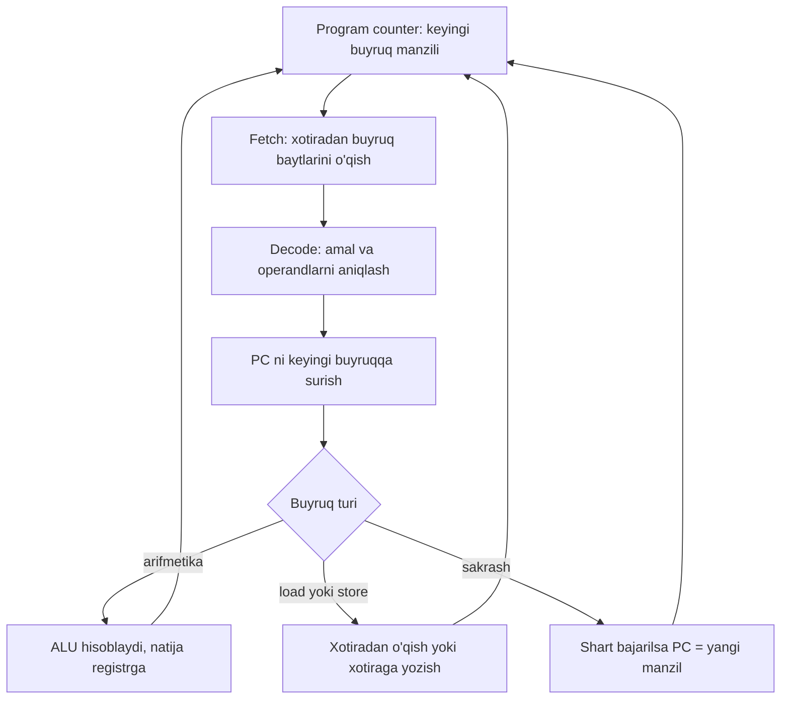

## Bu dars nima uchun kerak

Kurs davomida C kodini yozdik, `clang` bilan kompilyatsiya qildik va natijani ko'rdik. Lekin oradagi eng muhim qadam qorong'i qoldi: protsessor C ni bilmaydi. U faqat xotiradan baytlarni o'qiydi, ularni buyruq sifatida tushunadi va bajaradi. `total += i;` qatori qanday qilib bir nechta bayt mashina kodiga aylanadi, protsessor ularni qanday bajaradi va nega bir xil kod `-O0` va `-O2` bilan o'n baravar farqli tezlikda ishlashi mumkin?

9-darsda kompilyatsiyaning to'rt bosqichini (preprocessing, compiling, assembling, linking) ko'rdik va `square` funksiyasining assembly'siga birinchi marta qaradik. 7-darsda signed overflow undefined behavior ekanini va `-O2` da `x + 1 > x` har doim 1 bo'lib qolishini natija orqali ko'rdik. 18-darsda call stack va stack frame'ni, 21-24-darslarda manzil, stack va heap'ni o'rgandik. Bu dars shularning hammasini bir pastki qavatga tushiradi: endi biz kompilyator chiqargan buyruqlarni o'qiymiz va har bir kursdagi tushuncha mashina darajasida nimaga aylanishini ko'ramiz.

Bu darsdan keyin siz:

- CPU ning asosiy qismlari (registrlar, ALU, boshqaruv bloki) va xotira bilan aloqasini tushuntira olasiz;
- fetch-decode-execute siklini qadamma-qadam tasvirlay olasiz va uni C dagi o'yinchoq protsessor bilan modellashtira olasiz;
- x86-64 va ARM64 instruction set'larini, RISC va CISC yondashuvlarini taqqoslay olasiz;
- `clang -S` chiqargan oddiy assembly'ni o'qiy olasiz va System V chaqiruv qoidasida argumentlar qaysi registrlarda kelishini bilasiz;
- constant folding, inlining, loop unrolling va dead code elimination nima ekanini `-O0` va `-O2` assembly'si orqali ko'rsata olasiz;
- undefined behavior kompilyatorga qanday qilib kodni "soddalashtirish" huquqini berishini assembly bilan isbotlay olasiz;
- brauzerdagi C muhiti nega WebAssembly'ga kompilyatsiya qilishini va stack mashina nima ekanini tushuntira olasiz.

## CPU ichida: registrlar, ALU va xotira

Protsessorni (CPU, central processing unit) soddalashtirib uch qismga ajratish mumkin:

- **Registrlar** (register) - protsessor ichidagi juda kichik va juda tez xotira kataklari. x86-64 da 16 ta umumiy maqsadli 64-bitli registr bor (`rax`, `rbx`, `rcx`, `rdx`, `rsi`, `rdi`, `rbp`, `rsp`, `r8`-`r15`), ARM64 da esa 31 ta (`x0`-`x30`). Hisob-kitob asosan registrlar ustida bajariladi.
- **ALU** (arithmetic logic unit) - qo'shish, ayirish, bitli amallar (AND, OR, XOR, siljitish) va solishtirishni bajaradigan sxema. 2-darsdagi ikkilik qo'shish aynan shu yerda jismonan sodir bo'ladi.
- **Boshqaruv bloki** (control unit) - navbatdagi buyruqni xotiradan oladi, uni "tushunadi" va ALU, registrlar hamda xotiraga nima qilish kerakligini aytadi.

Maxsus registrlardan ikkitasi alohida e'tiborga loyiq. **Program counter** (x86-64 da `rip`, instruction pointer) keyingi bajariladigan buyruqning manzilini saqlaydi. **Stack pointer** (`rsp`) call stack'ning tepasini ko'rsatadi: 18-darsdagi frame'lar shu registr yordamida qo'shiladi va olib tashlanadi. Yana bir muhim narsa - **flag'lar registri**: solishtirish natijasi (teng, kichik, katta, overflow bo'ldi) shu yerda bitlar sifatida saqlanadi va keyingi shartli sakrash buyrug'i ularga qaraydi.

Registrlar soni nega shunchalik kam? Chunki ular eng tez, lekin eng qimmat xotira. Ierarxiya taxminan shunday: registrlar (bir necha o'n katak), cache (kilobayt va megabaytlar), operativ xotira RAM (gigabaytlar), disk. Har pastki qavat kattaroq, lekin sekinroq. 28-darsdagi cache locality aynan shu ierarxiyaning oqibati edi: ketma-ket xotira bilan ishlash tez, chunki ma'lumot cache'ga bloklab olib kelinadi.

Kompilyatorning asosiy vazifalaridan biri - **register allocation**: qaysi o'zgaruvchi qachon qaysi registrda turishini hal qilish. Registrlar yetmasa, qiymat vaqtincha stack'ka yoziladi (spill) va keyin qayta o'qiladi (reload). Pastda `-O0` va `-O2` farqining katta qismi shunda ekanini ko'ramiz.

## Fetch-decode-execute sikli

Protsessor ishining yuragi - bitta oddiy sikl, u soniyasiga milliardlab marta takrorlanadi:

1. **Fetch** (olib kelish): program counter ko'rsatgan manzildan buyruq baytlarini o'qish.
2. **Decode** (tushunish): baytlardan qaysi amal (qo'shish, sakrash, xotiradan o'qish) va qaysi operandlar (qaysi registr, qaysi son) ekanini aniqlash. Program counter keyingi buyruqqa suriladi.
3. **Execute** (bajarish): ALU hisoblaydi, xotiraga murojaat bo'lsa, o'qiladi yoki yoziladi, natija registrga qaytariladi. Sakrash buyrug'i bo'lsa, program counter yangi manzilga o'rnatiladi.



Bu - soddalashtirilgan model. Zamonaviy protsessorlar bir necha buyruqni bir vaqtda turli bosqichlarda ushlab turadi (pipeline), buyruqlarni tartibidan tashqari bajaradi va shartli sakrashning natijasini oldindan taxmin qiladi (branch prediction). Lekin tashqaridan qaraganda natija xuddi buyruqlar birma-bir, ketma-ket bajarilgandek bo'lishi kafolatlanadi. Dasturchi uchun shu model yetarli.

Sikl qanday ishlashini his qilish uchun uni C da yozamiz. Quyidagi "protsessor"da 4 ta registr va 6 ta buyruq bor. Dastur `struct` massivi sifatida berilgan (haqiqiy protsessorda u baytlar bo'lardi), `pc` program counter, `while` esa fetch-decode-execute sikli:

```c run
#include <stdio.h>

// O'yinchoq protsessor: 4 ta registr, 6 ta buyruq.
enum { LOAD, ADD, SUB, JNZ, PRINT, HALT };

typedef struct
{
    int op;  // buyruq kodi
    int a;   // 1-operand (registr raqami)
    int b;   // 2-operand (registr yoki son)
} instr;

int main(void)
{
    // r0 = 5; r1 = 0; r2 = 1
    // takror: r1 = r1 + r0; r0 = r0 - r2; agar r0 != 0 bo'lsa takror ga o't
    // natija: r1 = 5 + 4 + 3 + 2 + 1
    instr program[] = {
        {LOAD, 0, 5},   // 0
        {LOAD, 1, 0},   // 1
        {LOAD, 2, 1},   // 2
        {ADD, 1, 0},    // 3: r1 += r0
        {SUB, 0, 2},    // 4: r0 -= r2
        {JNZ, 0, 3},    // 5: r0 != 0 bo'lsa pc = 3
        {PRINT, 1, 0},  // 6
        {HALT, 0, 0},   // 7
    };

    int reg[4] = {0};
    int pc = 0;      // program counter: keyingi buyruq indeksi
    int steps = 0;

    while (1)
    {
        instr in = program[pc];   // fetch
        pc++;
        steps++;
        switch (in.op)            // decode
        {
            case LOAD:  reg[in.a] = in.b; break;           // execute
            case ADD:   reg[in.a] += reg[in.b]; break;
            case SUB:   reg[in.a] -= reg[in.b]; break;
            case JNZ:   if (reg[in.a] != 0) pc = in.b; break;
            case PRINT: printf("r%d = %d\n", in.a, reg[in.a]); break;
            case HALT:  printf("%d ta buyruq bajarildi\n", steps); return 0;
        }
    }
}
```

Natija:

```text
r1 = 15
20 ta buyruq bajarildi
```

Hisob: 3 ta `LOAD`, keyin sikl tanasi (`ADD`, `SUB`, `JNZ`) 5 marta, ya'ni 5 · 3 = 15 buyruq, oxirida `PRINT` va `HALT`: 3 + 15 + 2 = 20. E'tibor bering: C dagi `for` yoki `while` protsessor darajasida mavjud emas. Sikl - bu shunchaki "shart bajarilsa, orqaga sakra" (`JNZ`, jump if not zero) buyrug'i. `if` ham xuddi shunday: "shart bajarilmasa, oldinga sakra". Brauzerda `r0` ning boshlang'ich qiymatini 10 ga o'zgartirib ko'ring: natija 55, buyruqlar soni 3 + 10 · 3 + 2 = 35 bo'lishi kerak.

## Instruction set: x86-64 va ARM64

Protsessor tushunadigan buyruqlar to'plami va ularning baytlardagi ko'rinishi **instruction set architecture** (ISA) deb ataladi. ISA - dasturiy ta'minot va apparat orasidagi shartnoma: bir xil ISA'ga mo'ljallangan dastur shu ISA'ni bajaradigan istalgan protsessorda ishlaydi. Bugun ikki ISA keng tarqalgan: ish stoli kompyuterlari va serverlarning ko'pchiligida **x86-64**, telefonlar, planshetlar, ko'plab noutbuklar va tobora ko'proq serverlarda **ARM64** (AArch64).

Ular ikki xil falsafaga mansub:

| Xususiyat | CISC (x86-64) | RISC (ARM64) |
|---|---|---|
| To'liq nomi | Complex Instruction Set Computer | Reduced Instruction Set Computer |
| Buyruq uzunligi | O'zgaruvchan: 1 dan 15 baytgacha | Qat'iy: har buyruq 4 bayt |
| Xotiraga murojaat | Arifmetik buyruq operandi to'g'ridan-to'g'ri xotirada bo'lishi mumkin (`addl -8(%rbp), %eax`) | Load/store arxitektura: faqat `ldr`/`str` xotiraga tegadi, arifmetika faqat registrlarda |
| Umumiy registrlar | 16 ta | 31 ta |
| Decode | Murakkab: avval buyruq qayerda tugashini aniqlash kerak | Oddiy: har 4 bayt - bitta buyruq |
| Kod zichligi | Ko'pincha ixchamroq | Biroz kattaroq |

Bu farq "qaysi biri yaxshi" degan savolga olib kelmaydi: zamonaviy x86-64 protsessorlari ichida murakkab buyruqlarni sodda ichki amallarga bo'lib bajaradi, ARM64 esa vaqt o'tib ko'p murakkab buyruqlarga ega bo'ldi. Dasturchi uchun amaliy farq shu: bitta C kodi har ISA uchun alohida kompilyatsiya qilinadi va x86-64 uchun yig'ilgan executable ARM64 da to'g'ridan-to'g'ri ishlamaydi.

Buni ko'z bilan ko'ramiz. `add.c`:

```c
long add3(long a, long b, long c)
{
    return a + b + c;
}
```

x86-64 uchun object faylni `objdump -d` bilan ochsak, har buyruqning baytlari ko'rinadi:

```text
$ clang -c -O2 add.c -o add.o && objdump -d add.o
0000000000000000 <add3>:
   0:	48 8d 04 37          	lea    (%rdi,%rsi,1),%rax
   4:	48 01 d0             	add    %rdx,%rax
   7:	c3                   	ret
```

Xuddi shu fayl ARM64 uchun (lokal clang boshqa nishonga ham kompilyatsiya qila oladi, `--target` bilan):

```text
$ clang --target=aarch64-linux-gnu -c -O2 add.c -o add-arm.o && llvm-objdump -d add-arm.o
0000000000000000 <add3>:
       0: 8b000028     	add	x8, x1, x0
       4: 8b020100     	add	x0, x8, x2
       8: d65f03c0     	ret
```

x86-64 da uch buyruq 4 + 3 + 1 = 8 bayt (uzunliklar har xil), ARM64 da 3 · 4 = 12 bayt (hammasi 4 bayt). Chapdagi raqamlar - funksiya boshidan siljish (16 lik sanoqda, 2-dars). Bu baytlar - **machine code**, protsessor aynan shularni fetch qiladi. Assembly esa ularning odam o'qiy oladigan yozuvi: `c3` va `ret` bitta narsa.

## Assembly'ni o'qish: kichik lug'at

Linux'da clang sukut bo'yicha **AT&T sintaksisi**da yozadi (9-darsda ko'rgandek): manba chapda, nishon o'ngda, registrlar oldida `%`, sonlar oldida `$`. Buyruq oxiridagi harf operand o'lchamini bildiradi: `l` (long) 32 bit, `q` (quad) 64 bit. Shuning uchun `int` bilan ishlaganda `movl` va `%eax` (rax ning pastki 32 biti), `long` bilan `movq` va `%rax` ko'rinadi. 6-darsdagi tip o'lchamlari shu yerda harf sifatida qaytadi.

| Assembly | Ma'nosi | C dagi taxminiy ekvivalenti |
|---|---|---|
| `movl $5, %eax` | eax ga 5 ni yoz | `eax = 5;` |
| `movl -4(%rbp), %eax` | rbp - 4 manzildagi 4 baytni o'qi | `eax = *(int *)(rbp - 4);` |
| `addl %ecx, %eax` | qo'shish | `eax += ecx;` |
| `imull %ecx, %eax` | signed ko'paytirish | `eax *= ecx;` |
| `cmpl %ecx, %eax` | solishtirish, natija flag'larga | `eax - ecx` ni hisobla, lekin saqlama |
| `jg .L2` | oldingi solishtirish "katta" bo'lsa, `.L2` ga sakra | `if (eax > ecx) goto L2;` |
| `jmp .L1` | shartsiz sakrash | `goto L1;` |
| `callq f` | qaytish manzilini stack'ka qo'yib, f ga sakrash | `f();` |
| `retq` | stack'dagi qaytish manziliga qaytish | `return;` |
| `leaq (%rdi,%rsi), %rax` | manzil formulasini hisoblash (xotiraga tegmasdan) | `rax = rdi + rsi;` |

Oxirgi qator qiziq: `lea` (load effective address) aslida 11-darsdagi base + i · size manzil formulasini hisoblash uchun yaratilgan, lekin kompilyatorlar uni oddiy qo'shish uchun ham ishlatadi. Yuqoridagi `add3` da `a + b` aynan shunday hisoblangan.

Ichki tuzilmani ko'rish uchun shu darsdagi barcha assembly'lar quyidagi buyruq bilan olingan (clang 18, Linux x86-64): `clang -S -O0 -fno-asynchronous-unwind-tables fayl.c` yoki `-O2` bilan. `-fno-asynchronous-unwind-tables` `.cfi_` direktivalarini olib tashlaydi (9-dars). Matnda `.text`, `.globl`, `.p2align` kabi xizmat direktivalari qisqalik uchun tushirib qoldirilgan, buyruqlar esa aynan ko'chirilgan.

Muhim cheklov: brauzerdagi `c run` bloki assembly'ni ko'rsata olmaydi. U kodni kompilyatsiya qilib darhol ishga tushiradi va faqat dastur natijasini chiqaradi. Bundan tashqari, brauzer x86-64 emas, WebAssembly'ga kompilyatsiya qiladi (pastda). Shuning uchun assembly misollari oddiy (`run` siz) bloklarda, lokal natija sifatida berilgan. O'zingiz tajriba qilish uchun ikki yo'l bor: kompyuteringizda `clang -S` yoki brauzerda Compiler Explorer sayti (manbalarda): unda chap oynaga C kodi yoziladi, o'ngda tanlangan kompilyator va flag'lar uchun assembly darhol chiqadi.

## Chaqiruv qoidasi va stack frame

Funksiya `add3(10, 20, 30)` chaqirilganda argumentlar qayerga qo'yiladi? Chaqiruvchi va chaqiriluvchi bu haqda oldindan kelishgan bo'lishi kerak, aks holda alohida kompilyatsiya qilingan ikki fayl (9-darsdagi `main.o` va `square.o`) bir-birini tushunmaydi. Bu kelishuv **calling convention** (chaqiruv qoidasi) deb ataladi va platformaning ABI (application binary interface) hujjatida yoziladi. Linux, macOS va boshqa Unix tizimlarida x86-64 uchun **System V AMD64 ABI** amal qiladi:

| Nima | Qayerda |
|---|---|
| 1-6 butun son yoki pointer argument | `rdi`, `rsi`, `rdx`, `rcx`, `r8`, `r9` (shu tartibda) |
| 7-va undan keyingi argumentlar | stack'da |
| Butun son qaytish qiymati | `rax` (`int` uchun uning pastki qismi `eax`) |
| Kasr son argumentlari va natijasi | `xmm0`-`xmm7` |
| Chaqiruvdan keyin saqlanishi kafolatlangan | `rbx`, `rbp`, `r12`-`r15` |

ARM64 (AAPCS64) da g'oya bir xil, faqat argumentlar `x0`-`x7` da va natija `x0` da keladi. Yuqoridagi ARM64 `add3` da `add x0, x8, x2` aynan natijani `x0` ga yozadi.

Chaqiruvchi tomonini ko'ramiz:

```c
long add3(long a, long b, long c);

long caller(void)
{
    return add3(10, 20, 30) + 1;
}
```

```text
$ clang -S -O2 -fno-asynchronous-unwind-tables call.c
caller:                                 # @caller
# %bb.0:
	pushq	%rax
	movl	$10, %edi
	movl	$20, %esi
	movl	$30, %edx
	callq	add3@PLT
	incq	%rax
	popq	%rcx
	retq
```

10, 20, 30 qoidaga ko'ra `edi`, `esi`, `edx` ga qo'yiladi (32-bitli `movl` registrning yuqori yarmini ham nolga tenglaydi, shuning uchun bu 64-bitli `long` uchun ham to'g'ri). `callq` dan keyin natija `rax` da, `incq` unga 1 qo'shadi va u o'zgarmasdan `caller` ning natijasiga aylanadi. Boshidagi `pushq %rax` va oxiridagi `popq %rcx` qiymat saqlash uchun emas: ABI `call` buyrug'i oldidan stack 16 baytga tekislangan bo'lishini talab qiladi va bu 8 baytlik surish shuni ta'minlaydi (`@PLT` - 9-darsdagi dinamik linking izi).

Yettinchi argument stack'ka tushishini ham tekshirish mumkin: `long many(long a, long b, long c, long d, long e, long f, long g) { return a + g; }` uchun `-O2` kodi `movq %rdi, %rax` va `addq 8(%rsp), %rax`: `a` registrdan, `g` esa stack'dan, qaytish manzilidan 8 bayt yuqoridan o'qiladi.

### Stack frame assembly'da

Endi 18-darsdagi rekursiv faktorialni `-O0` bilan ko'ramiz:

```c
int factorial(int n)
{
    if (n <= 1)
    {
        return 1;
    }
    return n * factorial(n - 1);
}
```

```text
$ clang -S -O0 -fno-asynchronous-unwind-tables fact.c
factorial:                              # @factorial
# %bb.0:
	pushq	%rbp
	movq	%rsp, %rbp
	subq	$16, %rsp
	movl	%edi, -8(%rbp)
	cmpl	$1, -8(%rbp)
	jg	.LBB0_2
# %bb.1:
	movl	$1, -4(%rbp)
	jmp	.LBB0_3
.LBB0_2:
	movl	-8(%rbp), %eax
	movl	%eax, -12(%rbp)                 # 4-byte Spill
	movl	-8(%rbp), %edi
	subl	$1, %edi
	callq	factorial
	movl	%eax, %ecx
	movl	-12(%rbp), %eax                 # 4-byte Reload
	imull	%ecx, %eax
	movl	%eax, -4(%rbp)
.LBB0_3:
	movl	-4(%rbp), %eax
	addq	$16, %rsp
	popq	%rbp
	retq
```

18-darsdagi frame jadvali shu yerda jismonan ko'rinadi:

1. **Frame ochish.** `pushq %rbp` chaqiruvchining frame manzilini saqlaydi, `movq %rsp, %rbp` yangi frame'ning asosini belgilaydi, `subq $16, %rsp` lokal o'zgaruvchilar uchun 16 bayt ajratadi. Stack pastga qarab o'sadi (24-dars), shuning uchun joy ajratish - ayirish.
2. **Parametr nusxasi.** `movl %edi, -8(%rbp)` - `n` registrda keldi va frame'dagi o'z katagiga yozildi. Har chaqiruvning `n` i alohida, chunki har birida `rbp` boshqa.
3. **`if` = solishtirish va sakrash.** `cmpl $1, -8(%rbp)` va `jg .LBB0_2`: n > 1 bo'lsa, rekursiv tarmoqqa sakra.
4. **Spill va reload.** `n` ning nusxasi `-12(%rbp)` ga yoziladi ("4-byte Spill" izohini clang o'zi qo'ygan), chunki `callq factorial` registrlarni buzishi mumkin. Qaytgandan keyin u qayta o'qiladi ("Reload").
5. **Rekursiv chaqiruv.** `edi = n - 1`, `callq factorial`: qaytish manzili stack'ka tushadi va yangi frame ochiladi. Natija `eax` da keladi.
6. **Frame yopish.** `addq $16, %rsp`, `popq %rbp`, `retq` - ochishning teskarisi.

`factorial(5)` uchun stack'da bir vaqtning o'zida 5 ta shunday frame bo'ladi. Har biri: qaytish manzili 8 bayt + saqlangan `rbp` 8 bayt + 16 bayt lokal joy = 32 bayt, jami 5 · 32 = 160 bayt. 18-darsdagi stack overflow aynan shu baytlar 8 MB ga (Linux'dagi odatiy chegara) yetganda sodir bo'ladi.

`-O2` bilan esa kod tanib bo'lmas darajada o'zgaradi: unda `callq factorial` umuman yo'q. Optimizator rekursiyani siklga aylantirgan (oxirgi qismda `imull %edi, %eax` va orqaga sakrash `ja .LBB0_5`), ustiga `n >= 10` uchun 128-bitli `xmm` registrlarida (har birida 4 ta `int`) bir aylanishda 8 ta sonni ko'paytiradigan SIMD bo'lagini qo'shgan. 18-darsdagi tail recursion g'oyasi shu yerda amalda: bu funksiya tail-recursive emas (`n *` chaqiruvdan keyin bajariladi), lekin clang ko'paytirish assotsiativ ekanidan foydalanib, uni baribir siklga o'girdi. Demak `-O2` da `factorial` chuqur `n` larda ham stack'ni to'ldirmaydi, `-O0` da esa to'ldiradi. Xulosa: "rekursiya stack'ni yeydi" qoidasi optimizatsiya darajasiga bog'liq va unga tayanib bo'lmaydi.

## Kompilyator optimizatsiyalari

`-O0` da clang har bir C qatorini to'g'ridan-to'g'ri, alohida tarjima qiladi: har o'zgaruvchi xotirada, har murojaat - xotiradan o'qish. Bu debugger uchun qulay (10-dars): istalgan qatorda to'xtab, istalgan o'zgaruvchini ko'rish mumkin. `-O1`, `-O2`, `-O3` esa optimizatsiya bosqichlarini (pass) yoqadi: dastur IR ko'rinishida (9-dars) o'nlab marta qayta yoziladi va har safar natijasi o'zgarmagan, lekin tezroq versiya hosil qilinadi. Asosiy qoida - **"as-if" qoidasi**: kompilyator kuzatiladigan xatti-harakat (chiqish, fayllar, `volatile` murojaatlar) bir xil qolsa, kodni xohlagancha o'zgartirishi mumkin.

To'rtta asosiy optimizatsiyani bitta faylda ko'ramiz:

```c
static int square(int x)
{
    return x * x;
}

int seconds_in_day(void)
{
    return 24 * 60 * 60;
}

int area(void)
{
    return square(12);
}

int dead(int x)
{
    int unused = x * 1000;
    if (0)
    {
        x = x + 5;
    }
    return x;
}
```

`-O0` natijasi (`square` ning o'zi 9-darsdagidek, qisqalik uchun tushirib qoldirildi):

```text
seconds_in_day:                         # @seconds_in_day
# %bb.0:
	pushq	%rbp
	movq	%rsp, %rbp
	movl	$86400, %eax                    # imm = 0x15180
	popq	%rbp
	retq
area:                                   # @area
# %bb.0:
	pushq	%rbp
	movq	%rsp, %rbp
	movl	$12, %edi
	callq	square
	popq	%rbp
	retq
dead:                                   # @dead
# %bb.0:
	pushq	%rbp
	movq	%rsp, %rbp
	movl	%edi, -4(%rbp)
	imull	$1000, -4(%rbp), %eax           # imm = 0x3E8
	movl	%eax, -8(%rbp)
	movl	-4(%rbp), %eax
	popq	%rbp
	retq
```

`-O2` natijasi:

```text
seconds_in_day:                         # @seconds_in_day
# %bb.0:
	movl	$86400, %eax                    # imm = 0x15180
	retq
area:                                   # @area
# %bb.0:
	movl	$144, %eax
	retq
dead:                                   # @dead
# %bb.0:
	movl	%edi, %eax
	retq
```

Har birini alohida tahlil qilamiz.

**Constant folding** (konstantalarni yig'ish). `24 * 60 * 60` dasturda hisoblanmaydi: kompilyator 86400 ni o'zi hisoblab, tayyor sonni yozadi. Qiziq tomoni - bu `-O0` da ham bo'lgan, chunki C standarti bunday ifodalarni "integer constant expression" deb biladi va front-end ularni har doim hisoblaydi. `86400` sonining 16 lik ko'rinishi `0x15180` ni clang izohda yozgan.

**Inlining** (ichiga joylash). `-O0` da `area` haqiqatan `callq square` qiladi: frame ochish, sakrash, qaytish. `-O2` da `square` ning tanasi `area` ichiga ko'chirildi, keyin constant folding `12 * 12` ni 144 ga aylantirdi. Natijada butun `area` bitta `movl $144, %eax`. `square` funksiyasining o'zi `-O2` chiqishida umuman yo'q: u `static` (faqat shu faylda ko'rinadi) va boshqa hech kim uni chaqirmaydi. Inlining'ning qiymati shunda: u nafaqat chaqiruv narxini olib tashlaydi, balki boshqa optimizatsiyalarga yo'l ochadi.

**Dead code elimination** (o'lik kodni olib tashlash). `dead` da ikki xil o'lik kod bor: `if (0)` tanasi hech qachon bajarilmaydi (u `-O0` da ham yo'q), `unused` esa hisoblanadi-yu, hech qayerda ishlatilmaydi. `-O0` da `imull $1000` qatori bajariladi va natija stack'ka yoziladi; `-O2` da qolgani faqat `x` ni qaytarish: `movl %edi, %eax`. `-Wall` bilan clang `unused` haqida ogohlantirish ham beradi.

**Loop unrolling** (siklni yoyish). Sikl har aylanishda qo'shimcha ish qiladi: hisoblagichni oshirish, solishtirish, sakrash. Aylanishlar soni oldindan ma'lum va kichik bo'lsa, kompilyator siklni butunlay yoyib yuborishi mumkin:

```c
int sum4(const int *a)
{
    int s = 0;
    for (int i = 0; i < 4; i++)
    {
        s += a[i];
    }
    return s;
}
```

`-O0` da bu 4 marta aylanadigan sikl (`cmpl $4, -16(%rbp)`, `jge`, `jmp` bilan, 20 ga yaqin buyruq). `-O2` da, SIMD'ni o'chirib (`-fno-vectorize -fno-slp-vectorize`, faqat unrolling'ni alohida ko'rish uchun):

```text
$ clang -S -O2 -fno-vectorize -fno-slp-vectorize -fno-asynchronous-unwind-tables unroll.c
sum4:                                   # @sum4
# %bb.0:
	movl	4(%rdi), %eax
	addl	(%rdi), %eax
	addl	8(%rdi), %eax
	addl	12(%rdi), %eax
	retq
```

Sikl yo'q: to'rtta qo'shish, manzillar 0, 4, 8, 12 - 11-darsdagi base + i · 4 formulasi, kompilyator tomonidan oldindan hisoblangan. Oddiy `-O2` esa bundan ham uzoqqa boradi: to'rt sonni bitta 128-bitli `xmm0` registriga yuklab (`movdqu (%rdi), %xmm0`), SIMD (bitta buyruq - ko'p ma'lumot) qo'shishlari bilan yig'adi.

### Eng kuchli misol: sikl formulaga aylanadi

```c
int sum_to(int n)
{
    int total = 0;
    for (int i = 1; i <= n; i++)
    {
        total += i;
    }
    return total;
}
```

`-O0` da bu kutilgan sikl: `-12(%rbp)` dagi `i` ni o'qish, `cmpl -4(%rbp), %eax` bilan `n` ga solishtirish, `jg` bilan chiqish, `addl` va `jmp .LBB0_1` bilan orqaga qaytish. n = 1 000 000 bo'lsa, sikl tanasi million marta bajariladi. `-O2` da:

```text
sum_to:                                 # @sum_to
# %bb.0:
                                        # kill: def $edi killed $edi def $rdi
	testl	%edi, %edi
	jle	.LBB0_1
# %bb.2:
	leal	-1(%rdi), %eax
	leal	-2(%rdi), %ecx
	imulq	%rax, %rcx
	shrq	%rcx
	leal	(%rcx,%rdi,2), %eax
	decl	%eax
	retq
.LBB0_1:
	xorl	%eax, %eax
	retq
```

Sikl yo'q, orqaga sakrash yo'q. Kompilyator `total` ning qiymatini n orqali yopiq formula bilan ifodaladi. Qatorma-qator: `n <= 0` bo'lsa, 0 qaytar (`xorl %eax, %eax` - registrni nolga tenglashning qisqa usuli). Aks holda: `eax = n - 1`, `ecx = n - 2`, `rcx = (n - 1)(n - 2)` (64-bitli ko'paytirish), `shrq` - o'ngga 1 bit siljitish, ya'ni 2 ga bo'lish, keyin `+ 2n` va `- 1`. Algebrada tekshiramiz:

(n - 1)(n - 2) / 2 + 2n - 1 = (n² - 3n + 2) / 2 + (4n - 2) / 2 = (n² + n) / 2 = n(n + 1) / 2

Bu - 1 dan n gacha sonlar yig'indisining maktabdan tanish formulasi. Endi algoritm O(n) emas, O(1) (16-dars): n qanchalik katta bo'lmasin, 9 ta buyruq (`retq` bilan). Kompilyator nega bunday g'alati ko'rinishni tanladi? Chunki n(n + 1) ni to'g'ridan-to'g'ri hisoblash oraliq natijada 32 bitga sig'masligi mumkin; u esa 64-bitli `imulq` bilan hisoblab, keyin 32 bitga qaytadi.

Buning dastur tezligiga ta'sirini o'lchaymiz. Quyidagi blok brauzerda ishlaydi. Muhim: brauzerdagi C muhiti har doim `-O0` bilan, ustiga xotira va UB tekshiruvlari (sanitizer, 10-dars) bilan kompilyatsiya qiladi. Shuning uchun u bu yerda ko'rsatilgan optimizatsiyalarning hech birini qilmaydi va bir xil kod lokal `-O0` dan ham sekinroq ishlaydi:

```c run
#include <stdio.h>
#include <time.h>

// 1 dan n gacha yig'indi: oddiy sikl
long long sum_loop(int n)
{
    long long total = 0;
    for (int i = 1; i <= n; i++)
    {
        total += i;
    }
    return total;
}

int main(void)
{
    int n = 20000000;

    clock_t start = clock();
    long long s = sum_loop(n);
    clock_t end = clock();

    double ms = 1000.0 * (end - start) / CLOCKS_PER_SEC;
    printf("sikl:    %lld\n", s);
    printf("formula: %lld\n", (long long) n * (n + 1) / 2);
    printf("vaqt:    %.1f ms\n", ms);
}
```

Birinchi ikki qator har doim bir xil: `200000010000000`. Uchinchisi kompyuter va muhitga bog'liq. Xuddi shu faylni lokal kompyuterda (clang 18, x86-64) kompilyatsiya qilganda natija taxminan shunday bo'ldi:

| Flag | `vaqt` | Nima bo'ldi |
|---|---|---|
| `-O0` | 17-25 ms | 20 million aylanish, har birida xotiradan o'qish va yozish |
| `-O1` | 0.0 ms | Sikl formulaga aylandi |
| `-O2` | 0.0 ms | Sikl formulaga aylandi |

Hisob: 20 · 10⁶ aylanish 20 ms da - har aylanishga taxminan 1 nanosoniya, ya'ni bir necha protsessor takti. `-O2` da esa 20 million o'rniga 10 ga yaqin buyruq: farq millionlab baravar. `n` ni 10 baravar oshirib ko'ring: brauzerdagi vaqt taxminan 10 baravar oshadi (O(n)), optimizatsiya qilingan versiyada esa o'zgarmaydi. Shu sababli o'lchov (benchmark) har doim haqiqiy ishlatiladigan optimizatsiya darajasida qilinadi; `-O0` dagi o'lchovdan "bu kod sekin" degan xulosa chiqarmang.

Diqqat: lokal o'lchashda ham tuzoq bor. Agar `s` hech qayerda chop etilmaganida, `-O2` kompilyator butun `sum_loop` chaqiruvini o'lik kod sifatida olib tashlardi va siz "nol vaqt"ni o'lchardingiz. Benchmark'larda natija har doim ishlatilishi kerak.

| Optimizatsiya | Nima qiladi | Narxi yoki xavfi |
|---|---|---|
| Constant folding | Kompilyatsiya vaqtida ma'lum ifodani hisoblaydi | Deyarli yo'q |
| Inlining | Chaqiruvni funksiya tanasi bilan almashtiradi | Kod hajmi o'sadi; debugger'da funksiya "yo'qoladi" |
| Dead code elimination | Natijasi ishlatilmaydigan kodni o'chiradi | Benchmark'ni buzishi mumkin |
| Loop unrolling | Sikl tanasini bir necha marta takrorlab, sakrashlarni kamaytiradi | Kod hajmi o'sadi |
| Siklni formulaga almashtirish | Hisobni n ga bog'liq bo'lmagan ifodaga aylantiradi | Signed overflow yo'q degan farazga tayanadi |
| Register allocation | O'zgaruvchilarni xotira o'rniga registrda saqlaydi | Debugger o'zgaruvchini "optimized out" deb ko'rsatadi |

## Undefined behavior va optimizatsiya

Jadvalning oxiridan bitta oldingi qatoriga qarang: "signed overflow yo'q degan farazga tayanadi". 7-darsda `x + 1 > x` misolida natijaning o'zini ko'rdik: `-O0` da `bigger(INT_MAX)` 0, `-O2` da 1. Endi buni assembly darajasida isbotlaymiz va yonma-yon unsigned versiyasini qo'yamiz:

```c
int bigger(int x)
{
    return x + 1 > x;
}

int bigger_u(unsigned x)
{
    return x + 1 > x;
}
```

`-O0`:

```text
bigger:                                 # @bigger
# %bb.0:
	pushq	%rbp
	movq	%rsp, %rbp
	movl	%edi, -4(%rbp)
	movl	-4(%rbp), %eax
	addl	$1, %eax
	cmpl	-4(%rbp), %eax
	setg	%al
	andb	$1, %al
	movzbl	%al, %eax
	popq	%rbp
	retq
bigger_u:                               # @bigger_u
# %bb.0:
	pushq	%rbp
	movq	%rsp, %rbp
	movl	%edi, -4(%rbp)
	movl	-4(%rbp), %eax
	addl	$1, %eax
	cmpl	-4(%rbp), %eax
	seta	%al
	andb	$1, %al
	movzbl	%al, %eax
	popq	%rbp
	retq
```

`-O2`:

```text
bigger:                                 # @bigger
# %bb.0:
	movl	$1, %eax
	retq
bigger_u:                               # @bigger_u
# %bb.0:
	xorl	%eax, %eax
	cmpl	$-1, %edi
	setne	%al
	retq
```

`-O0` da ikkala funksiya deyarli bir xil: qo'shish (`addl $1`), solishtirish va natijani 0/1 ga aylantirish. Yagona farq: signed uchun `setg` ("greater", ishorali solishtirish), unsigned uchun `seta` ("above", ishorasiz). 7-darsdagi farq protsessorda ikki xil buyruq sifatida yashaydi. `addl` ning o'zi esa ikkala holatda bir xil: protsessor uchun signed va unsigned qo'shish bitta amal (two's complement'ning afzalligi, 6-dars), INT_MAX + 1 jimgina INT_MIN ga aylanadi.

`-O2` da farq tub: 

- `bigger` uchun kompilyator mulohaza qildi: "signed overflow - UB, demak to'g'ri dasturda `x + 1` har doim matematik x + 1, u har doim x dan katta". Qo'shish ham, solishtirish ham yo'q: `movl $1, %eax`. Funksiya argumentga umuman qaramaydi.
- `bigger_u` uchun bunday farazga huquq yo'q: unsigned arifmetika modul 2³² bo'yicha aniqlangan (7-dars), UINT_MAX + 1 = 0 va u UINT_MAX dan kichik. Kompilyator buni ham soddalashtirdi, lekin to'g'ri: "x + 1 > x faqat x != UINT_MAX bo'lganda rost", ya'ni `cmpl $-1, %edi` (32-bitli -1 ning bitlari UINT_MAX bilan bir xil) va `setne` ("not equal").

Bu misol undefined behavior'ning asl mohiyatini ko'rsatadi: UB bu "protsessor nimadir g'alati qiladi" emas. Protsessor `addl` ni har doim bir xil bajaradi. UB - bu kompilyator bilan kelishuv: siz UB qilmaslikka va'da berasiz, kompilyator esa shu va'daga tayanib, kodni qayta yozadi. Va'da buzilsa, natija hech qaysi C qatoriga mos kelmaydi. Yuqoridagi `sum_to` ham shunga tayanadi: `i <= n` sikli `n = INT_MAX` da cheksiz bo'lardi (`i` hech qachon INT_MAX dan oshmaydi, oshishga urinish UB), kompilyator esa bunday bo'lmaydi deb hisoblab, formulani qo'llaydi.

Brauzer muhiti bu yerda boshqa yo'l tutadi: u `-O0` va UBSan bilan ishlaydi, shuning uchun `bigger(INT_MAX)` chaqirilsa, dastur 7-darsdagi kabi `x + 1` qatorida "signed integer overflow" xabari bilan to'xtaydi. UB ni ushlashning yagona ishonchli yo'li - uni ish vaqtida tekshirish yoki umuman qilmaslik.

## WebAssembly: brauzerdagi C qayerga kompilyatsiya qilinadi

9-darsda brauzerdagi `c run` bloklari `--target=wasm32-wasip1` nishoniga kompilyatsiya qilinishini ko'rgan edik. **WebAssembly** (Wasm) - brauzerlar bajaradigan, aniq bir protsessorga bog'liq bo'lmagan virtual instruction set. Brauzer Wasm modulini yuklaydi, tekshiradi va o'zi ishlayotgan haqiqiy protsessor (x86-64 yoki ARM64) buyruqlariga tarjima qiladi. Shuning uchun bitta `a.wasm` fayli har qanday kompyuter va telefonda ishlaydi.

Wasm ikki jihatdan x86-64 va ARM64 dan farq qiladi:

1. **Stack mashina.** Registrlar o'rniga operandlar stack'iga qo'yiladi va buyruqlar ularni stack'dan oladi. Bu 27-darsdagi stack ADT va 31-darsdagi CPython virtual mashinasi bilan bir xil model.
2. **wasm32.** Xotira - bitta uzluksiz baytlar massivi (linear memory), manzil esa unga 32-bitli indeks. Shu sababli brauzerda `sizeof(int *)`, `sizeof(long)` va `sizeof(size_t)` 4 bayt (6-dars).

`add3` funksiyasini wasm32 uchun kompilyatsiya qilamiz:

```text
$ clang --target=wasm32 -S -O2 add.c
add3:                                   # @add3
	.functype	add3 (i32, i32, i32) -> (i32)
# %bb.0:
	local.get	1
	local.get	0
	i32.add 
	local.get	2
	i32.add 
                                        # fallthrough-return
	end_function
```

`.functype` qatoriga qarang: `long` parametrlar `i32` (32-bitli butun son) bo'lib qoldi, chunki wasm32 da `long` 4 bayt. x86-64 da xuddi shu funksiya `rdi`, `rsi`, `rdx` 64-bitli registrlari bilan ishlagan edi. Bajarilishini stack holati bilan kuzatamiz, `add3(10, 20, 30)` uchun:

| Buyruq | Stack (pastdan tepaga) |
|---|---|
| `local.get 1` | 20 |
| `local.get 0` | 20, 10 |
| `i32.add` | 30 |
| `local.get 2` | 30, 30 |
| `i32.add` | 60 |
| funksiya oxiri | 60 - natija |

`i32.add` stack tepasidan ikki qiymatni oladi va yig'indini qo'yadi. Registr nomlari yo'q, shuning uchun buyruqlar ixcham va istalgan protsessorga tarjima qilish oson: registrlarni taqsimlash ishini Wasm'ni bajaradigan dvigatel o'zi qiladi. Pastdagi mashqda xuddi shunday stack mashinani o'zingiz yozasiz.

Xotiradagi baytlar tartibini (21-darsdagi little-endian) brauzerda ham tekshirish mumkin. Yuqoridagi `seconds_in_day` dagi `movl $86400, %eax` buyrug'i mashina kodida (`clang -c -O2` va `objdump -d` bilan ko'rish mumkin) `b8 80 51 01 00` baytlari: `b8` - buyruq kodi, keyingi to'rt bayt 86400 = 0x00015180, lekin teskari tartibda. Wasm ham little-endian, shuning uchun brauzerda bir xil natija chiqadi:

```c run
#include <stdio.h>

int main(void)
{
    int value = 86400;
    unsigned char *bytes = (unsigned char *) &value;

    printf("%d = 0x%08x\n", value, value);
    printf("xotirada: ");
    for (int i = 0; i < (int) sizeof(value); i++)
    {
        printf("%02x ", bytes[i]);
    }
    printf("\n");
}
```

Natija:

```text
86400 = 0x00015180
xotirada: 80 51 01 00 
```

Mashina kodidagi son va xotiradagi son bir xil ko'rinishda: buyruqlar ham, ma'lumot ham shunchaki baytlar. Bu - zamonaviy kompyuterlarning asosiy g'oyasi (dastur ham xotirada saqlanadigan ma'lumot).

## Ko'p uchraydigan xatolar

1. **Assembly'ni "boshqa til" deb qo'rqish.** Assembly'dagi buyruqlarning ko'pchiligi oddiy: ko'chirish, qo'shish, solishtirish, sakrash. 10 ta buyruqni bilish `-O2` kodini o'qish uchun yetarli. Qolganini Compiler Explorer'da kursor bilan ustiga borib, izohini ko'rish mumkin.
2. **`-O0` da o'lchab, xulosa chiqarish.** `-O0` kodi har o'zgaruvchini xotiraga yozadi; tezlikni u bilan o'lchash noto'g'ri tasavvur beradi. Brauzerdagi `c run` ham `-O0` va sanitizer bilan ishlaydi: undagi vaqt faqat nisbiy taqqoslash uchun.
3. **Benchmark natijasini ishlatmaslik.** `-O2` natijasi ishlatilmaydigan hisobni dead code elimination bilan olib tashlaydi va siz bo'sh sikl vaqtini o'lchaysiz.
4. **UB ni "protsessor shunday qiladi" bilan oqlash.** `addl` haqiqatan aylanadi, lekin `-O2` da qo'shishning o'zi yo'qolishi mumkin (`bigger` misoli). C ning qoidalari protsessor qoidalari emas.
5. **Argument registrlarini adashtirish.** System V'da tartib `rdi`, `rsi`, `rdx`, `rcx`, `r8`, `r9`; natija `rax`. Windows x86-64 boshqa qoidadan foydalanadi (`rcx`, `rdx`, `r8`, `r9`), shuning uchun "x86-64 da argument doim `rdi` da" deyish noto'g'ri - bu platformaga bog'liq.
6. **AT&T va Intel sintaksisini aralashtirish.** AT&T da `movl %edi, %eax` "edi dan eax ga", Intel sintaksisida esa xuddi shu buyruq `mov eax, edi` (nishon birinchi). Compiler Explorer sukut bo'yicha Intel sintaksisini ko'rsatadi; `clang -S` esa AT&T'ni. `-masm=intel` flag'i bilan clang ham Intel sintaksisida chiqaradi.
7. **Bir ISA uchun yig'ilgan faylni boshqasida ishga tushirish.** x86-64 executable ARM64 da ishlamaydi (emulyator bo'lmasa). Portativ narsa - manba kodi yoki Wasm kabi virtual ISA.

## Xulosa

- CPU registrlar, ALU va boshqaruv blokidan iborat; u fetch-decode-execute siklini takrorlaydi va program counter keyingi buyruqni ko'rsatadi.
- C dagi `if`, `for`, `while` mashina darajasida solishtirish (`cmp`) va shartli sakrashga (`jg`, `jle`, `jne`) aylanadi.
- x86-64 (CISC) o'zgaruvchan uzunlikdagi buyruqlarga va xotira operandlariga ega; ARM64 (RISC) - qat'iy 4 baytli buyruqlar va load/store arxitektura.
- System V x86-64 chaqiruv qoidasi: argumentlar `rdi`, `rsi`, `rdx`, `rcx`, `r8`, `r9` da, natija `rax` da; stack frame `push rbp`, `mov rsp, rbp` bilan ochiladi.
- `-O2` constant folding, inlining, dead code elimination, loop unrolling qiladi va hatto siklni yopiq formulaga almashtiradi; bu kodni million baravar tezlashtirishi mumkin.
- Kompilyator UB yo'q deb faraz qiladi: `x + 1 > x` signed `int` uchun `return 1` ga aylanadi, unsigned uchun esa `x != UINT_MAX` ga.
- Brauzerdagi C muhiti WebAssembly'ga (wasm32, stack mashina) `-O0` va sanitizer'lar bilan kompilyatsiya qiladi; assembly ko'rish uchun lokal `clang -S` yoki Compiler Explorer kerak.

## Amaliy topshiriq

Topshiriq ikki qismdan iborat: stack mashina interpretatorini yozish va kompilyator chiqishini tahlil qilish.

1. **Stack mashina.** Quyidagi `run(program)` funksiyasini yozing. Dastur - qatorlar ro'yxati. Buyruqlar: `push N` (N ni stack'ka qo'yish, N manfiy ham bo'lishi mumkin), `add`, `sub`, `mul` (ikki qiymatni olib, natijani qo'yish; `sub` uchun natija "ostidagi - ustidagi"), `dup` (tepadagi qiymat nusxasini qo'yish). Funksiya oxirida stack tepasidagi qiymatni qaytaradi. Operand yetmasa yoki buyruq noma'lum bo'lsa, `ValueError` ko'taring. Wasm'dagi `i32.add` aynan shunday ishlaydi.
2. **Ifodadan dasturga.** `(7 - 2) * (3 + 4)` ifodasini stack mashina dasturiga o'giring va natija 35 ekanini tekshiring. Har buyruqdan keyingi stack holatini jadval sifatida yozing.
3. **Assembly tahlili.** Kompyuteringizda (yoki Compiler Explorer'da, x86-64 clang) quyidagi funksiyani `-O0` va `-O2` bilan kompilyatsiya qiling: `int count_even(const int *a, int n)` - massivdagi juft sonlar soni. Ikkala chiqishda ham: argumentlar qaysi registrda keldi, sikl qayerda (orqaga sakrash buyrug'i), `-O2` da qaysi optimizatsiyalar ko'rinadi?
4. **UB tajribasi.** `int always(int x) { return x * 2 / 2 == x; }` funksiyasining `-O2` assembly'sini oling. Nima chiqishini oldindan taxmin qiling va natija bilan solishtiring. `unsigned` versiyasi bilan nima farq bor? Brauzerda `always(INT_MAX)` ni chaqiring va UBSan xabarini yozing.
5. **Qo'lda bajarish.** Yuqoridagi `sum_to` ning `-O2` kodini n = 10 uchun qadamma-qadam bajaring: har buyruqdan keyin `eax`, `ecx` va `rcx` qiymatlarini jadvalga yozing va natija 1 + 2 + ... + 10 ga tengligini tekshiring. n = 0 va n = -5 da qaysi tarmoq ishlaydi?

```python run
def run(program):
    stack = []
    for line in program:
        parts = line.split()
        op = parts[0]
        # Yechimingizni shu yerga yozing
    return None
```

```python test
def raises(fn):
    try:
        fn()
    except ValueError:
        return True
    return False

check("push 7 -> 7", lambda: run(["push 7"]) == 7)
check("add: 2 + 3 = 5", lambda: run(["push 2", "push 3", "add"]) == 5)
check("mul: (2 + 3) * 4 = 20", lambda: run(["push 2", "push 3", "add", "push 4", "mul"]) == 20)
check("sub tartibi: push 10, push 4, sub -> 6 (ostki - ustki)", lambda: run(["push 10", "push 4", "sub"]) == 6)
check("dup: 5 * 5 = 25", lambda: run(["push 5", "dup", "mul"]) == 25)
check("manfiy son: push -3", lambda: run(["push -3", "push 2", "mul"]) == -6)
check("operand yetmasa ValueError", lambda: raises(lambda: run(["push 1", "add"])))
check("noma'lum buyruq ValueError", lambda: raises(lambda: run(["push 1", "jump"])))
```

Yaxshi javobda bo'lishi kerak bo'lgan narsalar:

- `run` barcha 8 testdan o'tadi; `sub` da avval ustki (b), keyin ostki (a) olinadi va `a - b` qo'yiladi;
- `(7 - 2) * (3 + 4)` uchun dastur: `push 7`, `push 2`, `sub`, `push 3`, `push 4`, `add`, `mul` va har qadamdagi stack holati;
- 3-qadamda `-O0` da `rdi` (massiv manzili) va `esi` (n) stack'ka saqlanishi, `-O2` da registrlarda qolishi, sikl sakrash buyrug'i va (bo'lsa) SIMD buyruqlari ko'rsatilgan;
- 4-qadamda `-O2` signed versiya uchun `movl $1, %eax` (yoki shunga teng) chiqishi, unsigned versiyada esa natija x ning yuqori bitiga bog'liq qolishi (`notl`, `shrl $31`: faqat x < 2³¹ da rost) va bu farq UB bilan tushuntirilgan;
- 5-qadam jadvali: `eax = 9`, `ecx = 8`, `rcx = 72`, `shrq` dan keyin 36, `leal` dan keyin 36 + 2 · 10 = 56, `decl` dan keyin 55; n <= 0 da `testl`/`jle` tarmog'i 0 qaytaradi.

Javobingizni pastdagi maydonga yozing va yuqoridagi mezonlar bilan solishtiring.

## Manbalar

- CS50x. [Lecture 2 notes](https://cs50.harvard.edu/x/notes/2/) - "Compiling" bo'limi: preprocessing, compiling, assembling, linking va assembly kodi namunasi.
- Bryant, O'Hallaron. [Computer Systems: A Programmer's Perspective](https://csapp.cs.cmu.edu/), 3-nashr - 3-bob "Machine-Level Representation of Programs" (x86-64 registrlari, chaqiruv qoidasi, stack frame) va 5-bob "Optimizing Program Performance".
- [System V Application Binary Interface, AMD64 Architecture Processor Supplement](https://gitlab.com/x86-psABIs/x86-64-ABI) - "Function Calling Sequence" bo'limi: argument registrlari, stack tekislash, saqlanadigan registrlar.
- [Compiler Explorer](https://godbolt.org/) - C kodini turli kompilyator va flag'lar bilan brauzerda assembly'ga aylantirish.
- LLVM. [LLVM's Analysis and Transform Passes](https://llvm.org/docs/Passes.html) - inline, dce, loop-unroll, indvars va boshqa optimizatsiya bosqichlari tavsifi.
- cppreference. [Undefined behavior](https://en.cppreference.com/w/c/language/behavior) - signed overflow va kompilyator optimizatsiyasi misollari.
- WebAssembly. [WebAssembly Core Specification](https://webassembly.github.io/spec/core/) - "Introduction" va "Instructions": stack mashina modeli, `i32.add`, `local.get`, linear memory.
