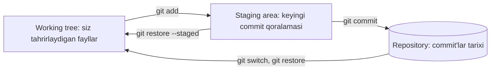
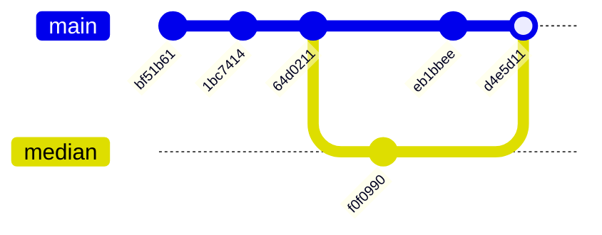
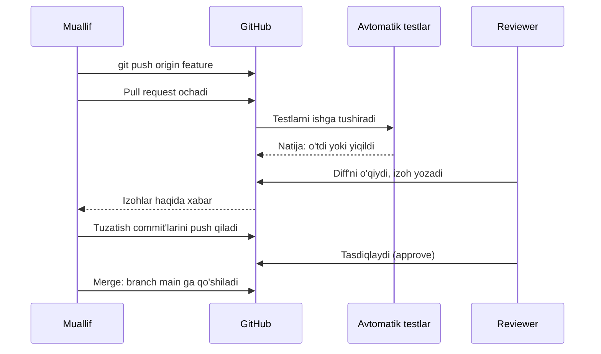

## Bu dars nima uchun kerak

Hozirgacha yozgan dasturlarimiz kichik edi: bitta fayl, bitta muallif, bir kunlik ish. Yakuniy loyihada (58-60-darslar) vaziyat boshqacha bo'ladi: o'nlab fayllar, haftalab ish, ehtimol bir-ikki sherik. Shunda uchta yangi muammo paydo bo'ladi.

Birinchisi - **tarix**. Kecha ishlagan kod bugun ishlamaydi, nima o'zgarganini esa hech kim eslamaydi. Papkada `app.py`, `app_eski.py`, `app_final.py`, `app_final2_TOGRI.py` paydo bo'ladi va qaysi biri haqiqiy ekanini aniqlash uchun ularni qo'lda solishtirish kerak. Ikkinchisi - **regressiya**: yangi funksiya qo'shganda eski, allaqachon ishlagan funksiya buziladi, va buni foydalanuvchi sizdan oldin sezadi. Uchinchisi - **jamoa**: ikki kishi bitta faylni bir vaqtda o'zgartirsa, kimningdir ishi yo'qoladi.

Dasturiy muhandislik (software engineering) - kodni "ishlaydigan" holatdan "uzoq yashaydigan va bir necha kishi o'zgartira oladigan" holatga olib chiqadigan amaliyotlar to'plami. Bu darsda uning uchta asosiy vositasini ko'ramiz: **git** (tarix va parallel ish), **avtomatik testlar** (regressiyadan himoya) va **code review** (ikkinchi juft ko'z).

Oldingi darslar bilan bog'liqlik: 10-darsda kod sifatining uchta o'qini (correctness, design, style) va debugging'ni ko'rgan edik - testlar correctness'ni avtomatik tekshiradi, review esa design va style'ni. 33-darsdagi exceptions bu yerda testlarda `assertRaises` bilan qaytadi. 52-darsdagi kriptografik hash git'ning yuragi ekanini ko'ramiz. Kursda alohida "Clean Code" kursi ham bor: unda testlar, test double'lar va code review chuqur o'rganiladi. Bu dars esa boshlovchi uchun amaliy kirish - birinchi repo, birinchi test, birinchi review.

Bu darsdan keyin siz:

- versiya nazorati qanday muammolarni hal qilishini va git nima uchun "taqsimlangan" ekanini tushuntira olasiz;
- commit nima uchun "farq" emas, butun loyihaning surati (snapshot) ekanini va hash orqali qanday nomlanishini ko'rsata olasiz;
- `init`, `status`, `add`, `commit`, `log`, `diff`, `branch`, `switch`, `merge`, `push`, `pull` buyruqlarining natijasini o'qiy olasiz;
- merge conflict'ni hal qilib, `.gitignore` va yaxshi commit xabarini yoza olasiz;
- Python'da `assert` va `unittest` bilan test yozib, chegaraviy holatlarni tanlay olasiz;
- testlar nimani kafolatlamasligini hisob bilan tushuntira olasiz;
- pull request'ni ko'rib chiqib, foydali review izohi yoza olasiz.

## Versiya nazorati nima uchun kerak

**Versiya nazorati** (version control) - fayllar to'plamidagi har bir o'zgarishni kim, qachon va nima uchun qilganini saqlab boradigan tizim. U beradigan imkoniyatlar:

1. **Tarix va qaytish.** Istalgan oldingi holatni ko'rish va kerak bo'lsa unga qaytish. "Kecha ishlagan edi" degan gap endi tekshiriladigan faktga aylanadi.
2. **Sabab.** Har o'zgarish bilan birga xabar saqlanadi: nima uchun shunday qilingan. Bir yildan keyin g'alati ko'ringan qatorning tarixini ochib, sababini o'qish mumkin.
3. **Parallel ish.** Bir nechta yo'nalish (branch) mustaqil rivojlanadi va keyin birlashtiriladi. Tajriba muvaffaqiyatsiz bo'lsa, asosiy kodga tegmasdan tashlab yuboriladi.
4. **Hamkorlik.** Ikki kishining o'zgarishlari avtomatik birlashtiriladi, to'qnashgan joylar esa ochiq ko'rsatiladi - jimgina yo'qolmaydi.

Git 2005-yilda Linux yadrosi jamoasi uchun yaratilgan: Pro Git kitobidagi tarixga ko'ra, o'sha yili jamoa oldin bepul foydalangan tijoriy tizimdan foydalanish huquqini yo'qotdi va Linus Torvalds boshchiligida o'z vositasini yozdi. Git **taqsimlangan** (distributed) tizim: har bir nusxa (clone) butun tarixni o'z ichiga oladi. Server bo'lmasa ham `log`, `diff`, `commit` lokal ishlaydi; server faqat nusxalarni almashish nuqtasi.

| Yondashuv | Tarix | Parallel ish | Internetsiz ishlash | Asosiy xavf |
|---|---|---|---|---|
| Papka nusxalari (`app_final2.py`) | Qo'lda, sababsiz | Fayllarni qo'lda birlashtirish | Ha | Qaysi nusxa haqiqiyligi noma'lum |
| Markazlashgan tizim (tarix bitta serverda) | Serverda | Server orqali | Faqat oddiy tahrir | Server ishlamasa, tarix yo'q |
| Taqsimlangan tizim (git) | Har nusxada to'liq | Branch va merge | Deyarli hamma amal | Noto'g'ri ishlatish (masalan, sirni commit qilish) |

## Git modeli: commit - bu snapshot

Ko'pchilik git'ni "fayllardagi farqlarni saqlaydigan" tizim deb o'ylaydi. Pro Git kitobi aynan shu farqni ta'kidlaydi: git ma'lumotni farqlar ro'yxati sifatida emas, **suratlar** (snapshot) ketma-ketligi sifatida ko'radi. Har bir commit - o'sha paytdagi butun loyiha holatining surati. O'zgarmagan fayl qayta saqlanmaydi: yangi surat eski faylga havola qiladi. `git diff` ko'rsatadigan farq esa saqlanmaydi, kerak bo'lganda ikki surat solishtirilib hisoblanadi.

### Uchta joy: working tree, staging area, repository

Git'da fayl uch joyda yashashi mumkin:

- **working tree** (ishchi papka) - siz tahrirlayotgan oddiy fayllar;
- **staging area** (index) - keyingi commit'ga kiradigan holatning qoralamasi;
- **repository** (`.git` papkasi) - saqlangan commit'lar va ularning obyektlari.



Staging area nima uchun kerak? Chunki bitta ish sessiyasida ko'pincha bir nechta mustaqil o'zgarish qilinadi: xato tuzatildi, yonida README yangilandi, debug uchun `print` qo'yildi. Staging area bularni alohida commit'larga ajratishga imkon beradi: avval tuzatishni `add` qilib commit qilasiz, keyin README'ni, `print` esa commit'ga umuman kirmaydi. `git add -p` hatto bitta fayl ichidagi o'zgarishlarni bo'laklab tanlashga imkon beradi.

### Obyektlar va hash

Repository ichida git uch xil asosiy obyekt saqlaydi:

- **blob** - bitta faylning mazmuni (nomisiz);
- **tree** - papka: nomlar ro'yxati va har biriga mos blob yoki ichki tree;
- **commit** - bitta tree (loyihaning surati), ota commit(lar), muallif, vaqt va xabar.

Har obyektning nomi - uning mazmunidan hisoblangan hash. Klassik git SHA-1 ishlatadi: 160 bit, ya'ni 40 ta o'n oltilik belgi. 52-darsda kriptografik hash'ning xossalarini ko'rgan edik: bir xil kirish doim bir xil hash beradi, bitta bayt o'zgarsa hash butunlay o'zgaradi, berilgan hash'ga mos ikkinchi kirishni topish amalda imkonsiz. Git'da bu xossalar ikki ishni bajaradi. Birinchidan, bir xil mazmunli fayl bir marta saqlanadi (nomi bir xil chiqadi). Ikkinchidan, tarixni sezdirmasdan o'zgartirib bo'lmaydi: commit ichida ota commit'ning hash'i bor, demak eski commit'dagi bitta bayt o'zgarsa, undan keyingi hamma commit'larning hash'i o'zgaradi.

SHA-1 ga qarshi amaliy collision hujumlari ma'lum bo'lgani uchun git loyihasi 2018-yilda vorisi sifatida SHA-256 ni tanlagan (git hujjatidagi hash-function-transition bo'limi). SHA-256 repolar bilan ishlash mumkin, lekin ko'pchilik repolar hali ham SHA-1 da; mexanika bir xil, faqat hash uzunroq (64 belgi).

Quyidagi misolni haqiqiy repoda bajardik (git 2.43, vaqtinchalik papkada). Uchinchi commit'ning ichini `git cat-file -p` bilan ochamiz:

```text
$ git cat-file -p HEAD
tree bd55e6fb16fe0525eb767287e53c21687b6889a9
parent 1bc741445100e1bef96e32c615b8e5f9989a43f0
author Aziz Karimov <aziz@example.com> 1793596320 +0500
committer Aziz Karimov <aziz@example.com> 1793596320 +0500

Return 0.0 for empty list in average
$ git cat-file -p HEAD^{tree}
100644 blob 6682acbbd7af133a0ee345c58bca17d4b36cdcf8	README.md
100644 blob a87d202f99676ed7c1b980c9d93c5260fe89a875	stats.py
```

Commit - oddiy matn: tree hash'i, ota hash'i, muallif (Unix vaqti va vaqt zonasi bilan) va xabar. Tree ham oddiy ro'yxat. Git obyekt nomini shunday hisoblaydi: `"<tip> <bayt soni>\0"` sarlavhasi + mazmun, va shuning SHA-1 hash'i. Buni Python'da tekshiramiz - natija yuqoridagi haqiqiy hash'lar bilan aynan bir xil chiqishi kerak:

```python run
import hashlib


def git_hash(kind, body):
    header = f"{kind} {len(body)}\0".encode()
    return hashlib.sha1(header + body).hexdigest()


stats = b"def average(xs):\n    if not xs:\n        return 0.0\n    return sum(xs) / len(xs)\n"
print("blob  ", git_hash("blob", stats), len(stats), "bayt")

commit = b"""tree bd55e6fb16fe0525eb767287e53c21687b6889a9
parent 1bc741445100e1bef96e32c615b8e5f9989a43f0
author Aziz Karimov <aziz@example.com> 1793596320 +0500
committer Aziz Karimov <aziz@example.com> 1793596320 +0500

Return 0.0 for empty list in average
"""
print("commit", git_hash("commit", commit))

# Xabardagi bitta harfni o'zgartiramiz
tampered = commit.replace(b"Return", b"return")
print("o'zg. ", git_hash("commit", tampered))
```

```text
blob   a87d202f99676ed7c1b980c9d93c5260fe89a875 80 bayt
commit 64d0211ed2c144dcd544356e228a8ea78b8ce5e3
o'zg.  768beaf6f6c9ccf1a9fe11554c417987def66a49
```

Birinchi ikki qator `git cat-file` va `git log` dagi haqiqiy hash'lar bilan mos keladi: git sehr emas, mazmundan hisoblangan SHA-1. Uchinchi qatordagi hash butunlay boshqacha, garchi faqat bitta harf (R -> r) o'zgargan bo'lsa ham.

Git odatda hash'ning boshidagi 7 belgini ko'rsatadi (`64d0211`). 7 ta o'n oltilik belgi 16^7 = 268 435 456 xil qiymat beradi; kichik va o'rta repoda bu bir ma'noli. Agar ikki obyekt bir xil 7 belgi bilan boshlansa, git avtomatik ravishda uzunroq prefiks ko'rsatadi.

### Tarix - yo'naltirilgan asiklik graf

Har commit o'z ota(lar)iga ishora qiladi, ota esa bolasini bilmaydi. Ikkita yo'nalishning birlashuvi (merge commit) ikkita otaga ega. Natijada tarix **DAG** (directed acyclic graph, yo'naltirilgan asiklik graf) bo'ladi: strelkalar faqat o'tmishga qaraydi va hech qachon aylana hosil qilmaydi (commit o'zining avlodiga ishora qila olmaydi, chunki avlodning hash'i hali ma'lum emas).

**Branch** esa graf ichidagi yorliq: bitta commit hash'ini saqlaydigan kichik fayl (`.git/refs/heads/main` ichida 40 belgi va yangi qator). Yangi commit qilinganda joriy branch yorlig'i yangi commit'ga suriladi. **HEAD** - "hozir qaysi branch'dasiz" ko'rsatkichi. Shuning uchun branch yaratish bir zumda bo'ladi: hech narsa nusxalanmaydi, faqat 41 baytli fayl yoziladi.

Quyida pastdagi sessiyada qurilgan haqiqiy tarix (hash'lar qisqartirilgan):



## Asosiy buyruqlar: bitta haqiqiy sessiya

Quyidagi chiqishlar lokal kompyuterda (git 2.43) olingan. Yangi git versiyalarida maslahat matnlari biroz farq qilishi mumkin. Birinchi marta git ishlatishdan oldin ism va email bir marta sozlanadi: `git config --global user.name "Ism"` va `git config --global user.email "email"` - ular har commit'ga yoziladi.

Repo yaratamiz va bitta fayl yozamiz:

```text
$ git init
$ git status
On branch main

No commits yet

Untracked files:
  (use "git add <file>..." to include in what will be committed)
	stats.py

nothing added to commit but untracked files present (use "git add" to track)
```

`git init` joriy papkada `.git` papkasini yaratadi. `status` - eng ko'p ishlatiladigan buyruq: u har uch joyning holatini aytadi. Fayl **untracked**: git uni ko'radi, lekin kuzatmaydi. Uni staging area'ga qo'shamiz va commit qilamiz:

```text
$ git add stats.py
$ git status
On branch main

No commits yet

Changes to be committed:
  (use "git rm --cached <file>..." to unstage)
	new file:   stats.py

$ git commit -m "Add average function"
[main (root-commit) bf51b61] Add average function
 1 file changed, 2 insertions(+)
 create mode 100644 stats.py
```

`root-commit` - otasi yo'q birinchi commit. Keyin README qo'shdik (ikkinchi commit) va `average` funksiyasini o'zgartirdik. Endi `diff`:

```text
$ git diff
diff --git a/stats.py b/stats.py
index 2bcc789..a87d202 100644
--- a/stats.py
+++ b/stats.py
@@ -1,2 +1,4 @@
 def average(xs):
+    if not xs:
+        return 0.0
     return sum(xs) / len(xs)
$ git status -s
 M stats.py
```

Diff'ni o'qish: `index 2bcc789..a87d202` - eski va yangi blob hash'lari (yangisini yuqorida Python'da hisobladik). `@@ -1,2 +1,4 @@` - eski fayldagi 1-qatordan 2 qator yangi fayldagi 1-qatordan 4 qatorga aylangan. `+` bilan boshlangan qatorlar qo'shilgan, `-` bilan - o'chirilgan, bo'shliq bilan - kontekst. `status -s` qisqa shakl: ` M` - working tree'da o'zgargan, lekin hali stage qilinmagan.

Muhim nozik joy: `git diff` (argumentsiz) working tree'ni **staging area** bilan solishtiradi, `git diff --staged` esa staging area'ni oxirgi commit bilan. `add` qilgandan keyin `git diff` bo'sh chiqadi - bu o'zgarish yo'qolgani emas, u endi `--staged` tomonda.

```text
$ git log --oneline
64d0211 Return 0.0 for empty list in average
1bc7414 Add README
bf51b61 Add average function
$ git log -1
commit 64d0211ed2c144dcd544356e228a8ea78b8ce5e3
Author: Aziz Karimov <aziz@example.com>
Date:   Mon Nov 2 10:12:00 2026 +0500

    Return 0.0 for empty list in average
```

| Buyruq | Nima qiladi | Qaysi joyga ta'sir qiladi |
|---|---|---|
| `git init` | Joriy papkada bo'sh repo yaratadi | `.git` papkasi |
| `git status` | Uch joyning holatini ko'rsatadi | Hech narsani o'zgartirmaydi |
| `git add <fayl>` | Fayl holatini staging area'ga yozadi | Staging area |
| `git commit -m "..."` | Staging area'dan yangi surat yaratadi | Repository, branch yorlig'i suriladi |
| `git diff` / `git diff --staged` | Working tree va stage / stage va commit farqi | Hech narsani o'zgartirmaydi |
| `git log` | Tarixni (ota bo'ylab orqaga) ko'rsatadi | Hech narsani o'zgartirmaydi |
| `git restore <fayl>` | Working tree'dagi o'zgarishni bekor qiladi | Working tree (ehtiyot bo'ling: qaytarib bo'lmaydi) |
| `git branch <nom>` | Joriy commit'da yangi yorliq yaratadi | `.git/refs/heads` |
| `git switch <nom>` | Boshqa branch'ga o'tadi, fayllarni almashtiradi | HEAD, working tree |
| `git merge <nom>` | Boshqa branch'ni joriysiga birlashtiradi | Repository, working tree |
| `git push` / `git pull` | Commit'larni serverga yuboradi / serverdan oladi va birlashtiradi | Masofaviy va lokal repo |

## Branch va merge

`median` funksiyasini alohida branch'da yozamiz, shu vaqtda `main` da README'ni yangilaymiz:

```text
$ git branch median
$ git branch
* main
  median
$ git switch median
Switched to branch 'median'
```

`median` da bitta commit qildik ("Add median function"), keyin `main` ga qaytib, README'ni o'zgartirdik ("Describe project in README"). Endi tarix ikkiga ajralgan. Birlashtiramiz:

```text
$ git switch main
Switched to branch 'main'
$ git merge median
Merge made by the 'ort' strategy.
 stats.py | 5 +++++
 1 file changed, 5 insertions(+)
$ git log --oneline --graph
*   d4e5d11 Merge branch 'median'
|\  
| * f0f0990 Add median function
* | eb1bbee Describe project in README
|/  
* 64d0211 Return 0.0 for empty list in average
* 1bc7414 Add README
* bf51b61 Add average function
```

Merge ikki xil bo'ladi:

- **Fast-forward**: agar `main` ajralgandan beri o'zgarmagan bo'lsa, yangi commit kerak emas - yorliq shunchaki `median` ning oxiriga suriladi. Tarix to'g'ri chiziq bo'lib qoladi.
- **Uch tomonlama merge** (three-way merge): ikkala tomonda ham yangi commit bor. Git umumiy ajdodni (`64d0211`) topadi, undan har ikki tomonga qadar o'zgarishlarni hisoblaydi va ularni birlashtiradi. Natija - ikki otali yangi commit (`d4e5d11`). `ort` - git'ning hozirgi standart merge algoritmi nomi.

Uch tomonlama merge'ning mantig'i oddiy: agar bir qatorni faqat bir tomon o'zgartirgan bo'lsa, o'sha o'zgarish olinadi. Bu yerda bir tomon `stats.py` ni, ikkinchisi `README.md` ni o'zgartirgan - to'qnashuv yo'q.

### Merge conflict va uni hal qilish

Agar ikkala tomon **bir xil qatorlarni** turlicha o'zgartirsa, git qaysi biri to'g'ri ekanini bilmaydi. Bu **merge conflict** - xato emas, git'ning odamga bergan savoli. Sinab ko'ramiz: `fix-empty` branch'ida bo'sh ro'yxat uchun `ValueError` ko'taramiz, `main` da esa o'sha qatorni `return None` ga o'zgartiramiz:

```text
$ git merge fix-empty
Auto-merging stats.py
CONFLICT (content): Merge conflict in stats.py
Automatic merge failed; fix conflicts and then commit the result.
$ git status
On branch main
You have unmerged paths.
  (fix conflicts and run "git commit")
  (use "git merge --abort" to abort the merge)

Unmerged paths:
  (use "git add <file>..." to mark resolution)
	both modified:   stats.py

no changes added to commit (use "git add" and/or "git commit -a")
$ cat stats.py
def average(xs):
    if not xs:
<<<<<<< HEAD
        return None
=======
        raise ValueError("bo'sh ro'yxat")
>>>>>>> fix-empty
    return sum(xs) / len(xs)
```

Belgilar: `<<<<<<< HEAD` dan `=======` gacha - joriy branch (`main`) varianti, `=======` dan `>>>>>>> fix-empty` gacha - birlashtirilayotgan branch varianti. Fayldagi qolgan qatorlar muammosiz birlashgan.

Hal qilish qadamlari:

1. Faylni ochib, to'g'ri natijani qo'lda yozing. Bu ikkala variantdan biri, ikkalasining aralashmasi yoki butunlay yangi kod bo'lishi mumkin. Bu yerda biz `ValueError` ni tanladik: 33-darsdan bilamizki, bo'sh ro'yxatning o'rtachasi ma'nosiz, `None` qaytarish esa xatoni keyinroqqa suradi.
2. Uchala belgi qatorini (`<<<<<<<`, `=======`, `>>>>>>>`) olib tashlang. Ular qolib ketsa, Python fayli `SyntaxError` beradi.
3. Testlarni ishga tushiring: merge to'g'ri chiqqanini faqat ular tasdiqlaydi.
4. `git add stats.py` - "bu fayl hal qilindi" degani, keyin `git commit` (xabar avtomatik tayyorlanadi).

Agar merge'ni boshlaganingizdan afsuslansangiz, `git merge --abort` hamma narsani merge'dan oldingi holatga qaytaradi. Conflict'larni kamaytirishning eng yaxshi usuli - kichik va tez-tez birlashtiriladigan branch'lar: bir haftalik branch'da conflict ehtimoli bir kunlikdagidan ancha yuqori.

## .gitignore: nima commit qilinmaydi

Repoga hamma narsa kirmasligi kerak:

- **generatsiya qilinadigan fayllar** - `__pycache__/`, `*.pyc`, C'da `*.o` va bajariladigan fayllar: ular manba koddan qayta olinadi va har kompyuterda boshqacha;
- **sirlar** - `.env` dagi parollar, API kalitlari, `SECRET_KEY`;
- **shaxsiy muhit** - `.venv/` (59-darsda), muharrir sozlamalari;
- **katta ma'lumot fayllari** - ma'lumotlar bazasi nusxalari, videolar.

`.gitignore` - har qatorida bitta naqsh (pattern) yozilgan matnli fayl:

```text
$ cat .gitignore
__pycache__/
*.pyc
.env
$ git status -s
?? .gitignore
$ git check-ignore -v .env
.gitignore:3:.env	.env
```

`__pycache__/` papkasi va `.env` fayli papkada bor, lekin `status` ularni endi ko'rsatmaydi - faqat yangi `.gitignore` ning o'zi `??` (untracked) sifatida chiqadi. `git check-ignore -v` qaysi qoida faylni yashirganini aytadi: `.gitignore` ning 3-qatori.

Ikki muhim tuzoq. Birinchisi: gitignore hujjatiga ko'ra, u faqat **kuzatilmayotgan** fayllarga ta'sir qiladi. Agar `.env` allaqachon commit qilingan bo'lsa, uni `.gitignore` ga yozish yetarli emas: `git rm --cached .env` bilan kuzatuvdan chiqarish kerak. Ikkinchisi: commit qilingan sir tarixda qoladi. Keyingi commit'da faylni o'chirsangiz ham, eski commit'da u bor va repoga kirgan har kim uni ko'radi. Yagona ishonchli yo'l - sizib chiqqan kalitni darhol yangisiga almashtirish (rotate).

## Yaxshi commit xabari

Commit xabari - kelajakdagi o'zingizga va hamkasbingizga xat. git-commit hujjati tavsiya qiladi: birinchi qator - o'zgarishning qisqa (50 belgidan oshmaydigan) xulosasi, keyin bo'sh qator, keyin batafsil izoh. Birinchi qator git'ning ko'p joyida sarlavha sifatida ishlatiladi (`log --oneline`, merge xabarlari).

Amaliy qoidalar:

- **Sarlavha buyruq shaklida**: "Add median function", "Fix off-by-one in loop". O'zbekcha repoda ham shunday: "Bo'sh ro'yxat uchun ValueError qo'sh". Bunday sarlavha "bu commit qo'llanilsa, u ... qiladi" gapini to'ldiradi.
- **Tanada "nima uchun"**: kod "nima"ni ko'rsatadi, xabar sababni aytsin: qaysi xato, qaysi talab, qaysi variant rad etildi va nega.
- **Bitta commit - bitta mantiqiy o'zgarish** (atomic commit). Xatoni tuzatish va fayllarni qayta formatlash alohida commit'larda bo'lsa, review oson, kerak bo'lsa bittasini qaytarish ham oson.

| Yomon | Nima uchun yomon | Yaxshiroq |
|---|---|---|
| `fix` | Nima tuzatildi, noma'lum | `Fix median for even-length lists` |
| `o'zgarishlar` | Hech narsa demaydi | `Validate phone number before insert` |
| `Fixed bug and refactored everything and updated README` | Uchta mustaqil ish bitta commit'da | Uchta alohida commit |
| `WIP` | Tugallanmagan ish tarixda qoladi | Tugatib commit qiling yoki branch'da qoldiring |

Clean Code kursida Conventional Commits kabi tuzilgan xabar formatlari ham ko'riladi; boshlash uchun yuqoridagi uch qoida yetarli.

## GitHub va pull request oqimi

Lokal repo - faqat sizniki. Hamkorlik uchun **remote** (masofaviy repo) kerak: hamma o'z commit'larini unga yuboradi va undan oladi. Eng keng tarqalgan xosting - GitHub; CS50 ham topshiriqlarni GitHub hisobi orqali qabul qiladi.

Remote bilan ishlashning uchta buyrug'i: `git clone <url>` - masofaviy reponing to'liq nusxasini (butun tarix bilan) olish; `git push` - lokal commit'larni yuborish; `git pull` - masofaviydagi yangi commit'larni olib, joriy branch'ga birlashtirish (`fetch` + `merge`). Quyidagi chiqishlarda GitHub o'rniga lokal "bare" repo (`../remote.git`, working tree'siz repo) ishlatilgan; GitHub bilan farq faqat manzilda:

```text
$ git push -u origin main
To ../remote.git
 * [new branch]      main -> main
branch 'main' set up to track 'origin/main'.
```

`origin` - remote'ning odatiy nomi, `-u` esa lokal `main` ni `origin/main` bilan bog'laydi: keyingi safar shunchaki `git push` yetarli. Keyin hamkasb o'z nusxasida README'ga qator qo'shib push qildi. Biz uni olamiz:

```text
$ git pull
From ../remote
   f933d51..b80872c  main       -> origin/main
Updating f933d51..b80872c
Fast-forward
 README.md | 1 +
 1 file changed, 1 insertion(+)
```

Bizda yangi commit bo'lmagani uchun pull fast-forward bilan tugadi. Ikkala tomonda yangi commit bo'lsa, pull merge qiladi (va conflict ham chiqishi mumkin). Agar siz push qilmoqchi bo'lsangiz, lekin serverda siz ko'rmagan commit bo'lsa, git push'ni rad etadi: avval `pull` qilib birlashtirish kerak. Bu - birovning ishini tasodifan o'chirib yuborishdan himoya.

### Pull request

Jamoada `main` ga to'g'ridan-to'g'ri push qilinmaydi. Buning o'rniga **pull request** (PR) oqimi ishlatiladi: siz o'z branch'ingizni serverga yuborasiz va "shu branch'ni `main` ga birlashtiring" degan so'rov ochasiz. PR sahifasida diff, izohlar va avtomatik tekshiruvlar natijasi bir joyda turadi.



**CI** (continuous integration, uzluksiz integratsiya) - har push'da testlarni avtomatik ishga tushiradigan server. U "mening kompyuterimda ishlaydi" muammosini kamaytiradi: testlar toza muhitda ishlaydi va natija PR'da hamma uchun ko'rinadi. PR oqimining afzalligi: `main` doim ishlaydigan holatda qoladi, har o'zgarish kamida ikki kishi ko'rgan va testlardan o'tgan bo'ladi.

Yakka loyihada ham (masalan, CS50 yakuniy loyihasi) bu oqimdan foyda bor: har funksiyani alohida branch'da yozib, o'zingizga PR ochish va diff'ni bir kun keyin o'qish - eng arzon review.

## Testlar: assert'dan unittest'gacha

10-darsda correctness'ni test holatlari bilan tekshirishni ko'rgan edik, lekin qo'lda: dasturni ishga tushirib, natijaga ko'z bilan qarash. **Avtomatik test** - natijani o'zi tekshiradigan kod. Uning asosiy qiymati birinchi yozilganda emas, keyin ko'rinadi: har o'zgarishdan keyin yuzlab tekshiruv bir soniyada qayta bajariladi va regressiyani darhol ushlaydi.

### assert

Python'dagi eng sodda tekshiruv - `assert` ifodasi. Til ma'lumotnomasiga ko'ra, `assert x` aslida `if __debug__: if not x: raise AssertionError` ga teng. `__debug__` odatda `True`, lekin Python `-O` (optimizatsiya) bayrog'i bilan ishga tushirilsa, `False` bo'ladi va barcha `assert` lar kodda **umuman bajarilmaydi**. Xulosa: `assert` - dasturchi uchun "bu hech qachon bo'lmasligi kerak" degan ichki tekshiruv va testlardagi tekshiruv vositasi; foydalanuvchi kiritgan ma'lumotni tekshirish uchun esa 33-darsdagi `raise ValueError(...)` ishlatiladi.

```python
def average(xs):
    return sum(xs) / len(xs)


assert average([2, 4]) == 3
assert average([5]) == 5
assert average([0.1, 0.2]) == 0.15   # AssertionError: 0.30000000000000004 / 2 != 0.15
```

Uchinchi qator 7-darsdagi floating-point muammosini eslatadi: haqiqiy sonlarni `==` bilan solishtirmang. `math.isclose` yoki `unittest` dagi `assertAlmostEqual` ishlating.

### unittest

Faqat `assert` bilan ishlashning kamchiligi: birinchi yiqilgan tekshiruv qolganlarini to'xtatadi va hisobot yo'q. **Unit test** - bitta kichik birlikni (odatda bitta funksiya yoki klass) boshqalardan ajratib tekshiradigan test; Python standart kutubxonasida buning uchun `unittest` moduli bor. Hujjatga ko'ra, test `unittest.TestCase` dan meros olgan klass ichida, nomi `test` bilan boshlanadigan metod sifatida yoziladi; tekshiruv uchun `assertEqual`, `assertTrue`, `assertRaises` kabi metodlar ishlatiladi - ular yiqilganda nima kutilgani va nima chiqqanini aniq aytadi.

Git sessiyasidagi `median` funksiyasini tekshiramiz. Unda ataylab qoldirilgan xato bor - testlar uni topishini ko'ring:

```python run
import unittest


def median(xs):
    s = sorted(xs)
    return s[len(s) // 2]


class MedianTest(unittest.TestCase):
    def test_odd_length(self):
        self.assertEqual(median([3, 1, 2]), 2)

    def test_single(self):
        self.assertEqual(median([7]), 7)

    def test_even_length(self):
        self.assertEqual(median([4, 1, 3, 2]), 2.5)

    def test_empty_raises(self):
        with self.assertRaises(ValueError):
            median([])


unittest.main(argv=[""], exit=False)
```

Natija (fayl yo'li va vaqt sizda boshqacha bo'ladi):

```text
EF..
======================================================================
ERROR: test_empty_raises (__main__.MedianTest.test_empty_raises)
----------------------------------------------------------------------
Traceback (most recent call last):
  ...
    return s[len(s) // 2]
           ~^^^^^^^^^^^^^
IndexError: list index out of range

======================================================================
FAIL: test_even_length (__main__.MedianTest.test_even_length)
----------------------------------------------------------------------
Traceback (most recent call last):
  ...
AssertionError: 3 != 2.5

----------------------------------------------------------------------
Ran 4 tests in 0.001s

FAILED (failures=1, errors=1)
```

Natijani o'qish:

- Birinchi qator - har test uchun bitta belgi: `.` o'tdi, `F` (failure) - tekshiruv yiqildi, `E` (error) - test ichida kutilmagan exception chiqdi. Testlar nom bo'yicha alifbo tartibida bajariladi, shuning uchun `test_empty_raises` birinchi.
- **FAIL** va **ERROR** farqi muhim. FAIL: kod ishladi, lekin noto'g'ri javob berdi (2.5 o'rniga 3). ERROR: kod javob berish o'rniga yiqildi (`IndexError`, biz esa `ValueError` kutgandik).
- `argv=[""]` - modulga buyruq qatori argumentlari bermaslik uchun, `exit=False` esa testlardan keyin interpretatorni to'xtatmaslik uchun (brauzer va Jupyter kabi muhitlarda kerak). Oddiy faylda shunchaki `unittest.main()` yoziladi va `python -m unittest` bilan ishga tushiriladi.

Ikkita xato topildi: juft uzunlikda o'rtadagi ikki elementning o'rtachasi olinishi kerak, bo'sh ro'yxatda esa tushunarli `ValueError`. Ularni o'zingiz pastdagi mashqda tuzatasiz.

### pytest uslubi

Amaliyotda ko'p Python loyihalari `pytest` kutubxonasini ishlatadi (u standart kutubxonada yo'q, `pip install pytest` bilan o'rnatiladi). Unda klass shart emas va oddiy `assert` yoziladi - pytest yiqilgan `assert` ni tahlil qilib, chap va o'ng qiymatlarni o'zi ko'rsatadi:

```python
# test_stats.py
import pytest
from stats import median


def test_even_length():
    assert median([4, 1, 3, 2]) == 2.5


def test_empty_raises():
    with pytest.raises(ValueError):
        median([])
```

Terminalda `pytest` buyrug'i `test_*.py` fayllarini o'zi topadi. Flask ilovasini esa 47-49-darslardagi `app.test_client()` bilan xuddi shunday test qilish mumkin: `assert client.get("/").status_code == 200`.

### Chegaraviy holatlar

Test yozishning eng qiyin qismi - **qaysi** kirishlarni tanlash. Xatolar oddiy holatlarda emas, chegaralarda yashaydi (10-darsdagi off-by-one'ni eslang). Har funksiya uchun quyidagi kategoriyalardan o'tib chiqing:

| Kategoriya | `median` uchun misol | Nimani ushlaydi |
|---|---|---|
| Oddiy holat | `[3, 1, 2]` -> 2 | Asosiy mantiq umuman ishlaydimi |
| Bo'sh kirish | `[]` -> `ValueError` | `IndexError`, nolga bo'lish |
| Bitta element | `[7]` -> 7 | Sikl yoki indeks chegarasi |
| Juft va toq uzunlik | `[4, 1, 3, 2]` -> 2.5 | Ikki tarmoqli mantiq |
| Tartib | Saralangan, teskari, aralash | Saralashni unutish |
| Takrorlar | `[2, 2, 2]` -> 2 | Noyob qiymat deb taxmin qilish |
| Manfiy va haqiqiy sonlar | `[-1.5, 0, 2]` -> 0 | Tip va ishora bilan bog'liq xatolar |
| Kirishning o'zgarmasligi | Chaqiruvdan keyin ro'yxat avvalgidek | `xs.sort()` kabi yon ta'sir |

### Test piramidasi

Testlar ko'lami bo'yicha uch qavatga bo'linadi. Martin Fowler saytidagi "The Practical Test Pyramid" maqolasiga ko'ra, bu g'oyani Mike Cohn "Succeeding with Agile" kitobida taklif qilgan:

- **unit testlar** (pastda, eng ko'p) - bitta funksiya, millisekundlarda ishlaydi;
- **integratsion testlar** (o'rtada) - bir nechta qism birgalikda: Flask route + SQLite baza;
- **end-to-end testlar** (tepada, eng kam) - butun ilova foydalanuvchi ko'zi bilan: brauzer ochiladi, forma to'ldiriladi.

Nima uchun piramida? Hisoblab ko'ramiz. Faraz qilaylik (taxminiy raqamlar), unit test 2 ms, end-to-end test 5 soniya davom etadi. 300 ta unit test: 300 · 0,002 = 0,6 soniya. Xuddi shu 300 holatni end-to-end tekshirsak: 300 · 5 = 1500 soniya = 25 daqiqa. Har commit'dan keyin 0,6 soniya kutish mumkin, 25 daqiqa esa yo'q - testlar ishga tushirilmay qo'yiladi. Bundan tashqari, end-to-end test yiqilsa, xato ilovaning istalgan joyida bo'lishi mumkin; unit test esa aniq funksiyani ko'rsatadi. Lekin unit testlar qismlar bir-biriga to'g'ri ulanganini tekshirmaydi, shuning uchun yuqori qavatlar ham kerak - faqat kamroq.

### TDD qisqacha

**TDD** (test-driven development) - kodni testdan boshlab yozish usuli. Fowler saytidagi ta'rifga ko'ra, uni 1990-yillar oxirida Kent Beck rivojlantirgan va u uch qadamdan iborat sikl: navbatdagi kichik funksionallik uchun test yozish (u yiqiladi - "qizil"), test o'tadigan darajada kod yozish ("yashil"), keyin yangi va eski kodni tartibga keltirish (refactor). Foydasi: test kodni yozishdan oldin "funksiya aslida nima qilishi kerak" degan savolga javob berishga majbur qiladi, va har qadamdan keyin ishlaydigan holat bo'ladi. Pastdagi mashq aynan shu tartibda: testlar tayyor (qizil), siz ularni yashil qilasiz.

### Testlar nimani kafolatlamaydi

Edsger Dijkstra 1970-yilgi "Notes on Structured Programming" ishida bu fikrni aniq aytgan: testlash xato **borligini** ko'rsata oladi, lekin xato **yo'qligini** hech qachon isbotlay olmaydi. Hisob bilan ko'ramiz. Ikkita 32-bitli `int` qabul qiladigan funksiyaning barcha kirishlari: 2^32 · 2^32 = 2^64 ≈ 1,8 · 10^19. Soniyasiga milliard (10^9) test bajarsak: 1,8 · 10^19 / 10^9 = 1,8 · 10^10 soniya, bir yil ≈ 3,16 · 10^7 soniya bo'lgani uchun bu taxminan 585 yil. Shuning uchun testlar har doim tanlanma: ular faqat siz o'ylagan holatlarni tekshiradi.

Testlar kafolatlamaydigan narsalar:

- **o'ylanmagan holat** - testlar faqat yozilgan kirishlarni tekshiradi;
- **noto'g'ri talab** - agar siz masalani noto'g'ri tushungan bo'lsangiz, test ham xuddi shu noto'g'ri tushunchani tasdiqlaydi;
- **coverage** (kod qamrovi) 100% bo'lishi xatosizlik emas: `median` ning eski versiyasida har qator `[3, 1, 2]` testi bilan bajariladi (qamrov 100%), lekin juft uzunlikdagi xato qoladi;
- **xavfsizlik va tezlik** - funksional test SQL injection yoki sekin so'rovni o'zi topmaydi.

Shunga qaramay, testlar o'z ishini juda yaxshi bajaradi: bir marta topilgan xato uchun yozilgan test (**regressiya testi**) u xato hech qachon jimgina qaytmasligini ta'minlaydi.

### Testli mashq: median'ni tuzating

Quyidagi `median` da uchta muammo bor. Funksiyani shunday tuzating:

1. Toq uzunlikda o'rtadagi element, juft uzunlikda o'rtadagi ikki elementning o'rta arifmetigi qaytarilsin.
2. Bo'sh ro'yxatda `ValueError` ko'tarilsin (xabar ixtiyoriy).
3. Kirish ro'yxati o'zgarmasin: chaqiruvdan keyin u avvalgi tartibda qolsin.

```python run
def median(xs):
    """Sonlar ro'yxatining medianasi."""
    xs.sort()
    return xs[len(xs) // 2]


data = [4, 1, 3, 2]
print(median(data))
print(data)
```

```python test
def raises(exc, fn):
    try:
        fn()
    except exc:
        return True
    return False


def input_unchanged():
    data = [5, 3, 9, 1]
    median(data)
    return data == [5, 3, 9, 1]


check("toq uzunlik: [3, 1, 2] -> 2", lambda: median([3, 1, 2]) == 2)
check("bitta element: [7] -> 7", lambda: median([7]) == 7)
check("juft uzunlik: [4, 1, 3, 2] -> 2.5", lambda: median([4, 1, 3, 2]) == 2.5)
check("juft uzunlik, butun natija: [1, 3] -> 2", lambda: median([1, 3]) == 2)
check("takrorlar: [2, 2, 2, 2] -> 2", lambda: median([2, 2, 2, 2]) == 2)
check("manfiy va haqiqiy: [-1.5, 0, 2] -> 0", lambda: median([-1.5, 0, 2]) == 0)
check("bo'sh ro'yxat ValueError ko'taradi", lambda: raises(ValueError, lambda: median([])))
check("kirish ro'yxati o'zgarmaydi", input_unchanged)
check("tuple ham ishlaydi: (9, 1, 5) -> 5", lambda: median((9, 1, 5)) == 5)
```

Oxirgi test yashirin talabni ochadi: `xs.sort()` faqat ro'yxatda bor, `sorted(xs)` esa istalgan ketma-ketlikdan yangi ro'yxat yaratadi. Bitta tuzatish ikki muammoni hal qiladi.

## Code review

**Code review** - kod `main` ga qo'shilishidan oldin uni boshqa dasturchi o'qib chiqishi. Maqsad - aybdorni topish emas, kodni va jamoani yaxshilash: xato ertaroq topiladi, bilim tarqaladi (loyihaning har qismini kamida ikki kishi biladi), uslub izchil bo'ladi.

### Nimaga qaraladi

Taxminiy muhimlik tartibida:

1. **To'g'rilik.** Kod aytilgan ishni qiladimi? Chegaraviy holatlar (bo'sh, bitta, katta qiymat) o'ylanganmi? Xato holatlari qanday ishlanadi?
2. **Testlar.** Yangi xatti-harakat test bilan qoplanganmi? Tuzatilgan xato uchun regressiya testi bormi? Testlar haqiqatan nimanidir tekshiradimi (assert'siz test hech narsani tekshirmaydi)?
3. **Xavfsizlik.** Foydalanuvchi ma'lumoti SQL'ga parametr sifatida berilganmi (39-40-darslar), HTML'da escape qilinganmi (50-dars)? Kodda parol yoki kalit yo'qmi? Ruxsat tekshirilganmi?
4. **Design va o'qilishi.** 10-darsdagi o'qlar: nomlar ma'noli, funksiyalar qisqa, takror yo'q, murakkablik o'rinli. Bir yildan keyin boshqa odam buni tushunadimi?
5. **Style.** Formatlash va uslub qoidalari. Buni imkon qadar avtomatik vositalarga (formatter, linter) topshiring - odamning vaqti mantiqqa sarflansin.

PR hajmi ham muhim. 50 qatorlik diff'ni diqqat bilan o'qish mumkin; 2000 qatorlikni esa reviewer ko'pincha "yaxshi ko'rinadi" deb tasdiqlaydi. Katta ishni kichik, mustaqil PR'larga bo'ling.

### Misol: bitta funksiyani ko'rib chiqish

PR'da quyidagi Flask route keldi:

```python
@app.route("/search")
def search():
    q = request.args.get("q")
    rows = db.execute(f"SELECT * FROM books WHERE title LIKE '%{q}%'").fetchall()
    return render_template("results.html", rows=rows)
```

Yaxshi review izohlari:

- **[muhim]** "`q` f-string bilan SQL ichiga qo'yilgan - bu SQL injection (39-dars). `q = x' OR '1'='1` bilan barcha qatorlar qaytadi. Parametr ishlating: `db.execute("SELECT * FROM books WHERE title LIKE ?", (f"%{q}%",))`."
- **[savol]** "`q` berilmasa `None` bo'ladi va so'rov `'%None%'` ni qidiradi. Bo'sh qidiruvda nima ko'rsatilishi kerak - hamma kitoblar yoki bo'sh ro'yxat?"
- **[test]** "Bo'sh `q` va qo'shtirnoqli `q` uchun `test_client` testi qo'shsangiz, bu ikki holat keyin buzilmaydi."
- **[nit]** "`SELECT *` o'rniga kerakli ustunlar yaxshiroq, lekin bu PR'ni to'xtatmaydi."

### Qanday izoh yozish

| Yomon izoh | Muammo | Yaxshi izoh |
|---|---|---|
| "Bu noto'g'ri." | Nima va nega noto'g'ri - noma'lum | "`len(s) // 2` juft uzunlikda o'ngdagi o'rta elementni beradi, [1, 2, 3, 4] uchun 3. Ikkalasining o'rtachasi kerak." |
| "Nega bunday yozding?" | Ayblov kabi eshitiladi | "Bu yerda `dict` emas, `list` tanlanganining sababi bormi? Qidiruv O(n) bo'lib qoladi." |
| "Hammasini qayta yoz." | Aniq yo'l yo'q | Muammoni aniq ko'rsating va bitta variant taklif qiling |
| "Bo'shliq ortiqcha" (20 marta) | Mayda narsa asosiy gapni ko'mib yuboradi | Formatter'ni taklif qiling, izohni bir marta yozing |

Qoidalar: kodni baholang, odamni emas ("bu funksiya", "sen" emas); sababini yozing; muhim muammoni maslahatdan ajrating (`nit:` - "mayda, majburiy emas" degan keng tarqalgan belgi); savol bering, ehtimol muallif siz bilmagan narsani biladi; yaxshi yechimni ham ayting - bu ham foydali signal.

Muallif tomonidan: PR tavsifida nima, nima uchun va qanday tekshirilganini yozing; o'z diff'ingizni PR ochishdan oldin bir marta o'qing; izohlarni shaxsiy qabul qilmang - har izohga javob bering yoki tuzating.

## Ko'p uchraydigan xatolar

1. **`git add .` bilan hamma narsani ko'r-ko'rona qo'shish.** `.env`, `__pycache__` va katta fayllar repoga tushadi. Avval `.gitignore`, har commit'dan oldin `git status` va `git diff --staged`.
2. **Sirni commit qilib, keyingi commit'da o'chirish.** Sir tarixda qoladi. Kalitni almashtiring; `.env` ni loyiha boshidan `.gitignore` ga yozing.
3. **Conflict belgilarini faylda qoldirish.** `<<<<<<<` qatorlari bilan commit qilingan kod ishlamaydi. Merge'dan keyin testlarni ishga tushiring va `git diff --staged` ni ko'ring.
4. **Bir haftalik ulkan commit yoki branch.** Review imkonsiz, conflict ko'p, xatoni qaysi o'zgarish keltirgani noma'lum. Kichik, tez-tez commit va merge.
5. **Testsiz "tuzatish".** Xato tuzatildi, lekin u uchun test yozilmadi - keyingi refactor'da u qaytadi. Avval xatoni ko'rsatadigan test, keyin tuzatish.
6. **Kiritish tekshiruvi uchun `assert` ishlatish.** `-O` bilan ishga tushirilganda hamma `assert` o'chadi. Foydalanuvchi ma'lumoti uchun `if ...: raise ValueError(...)`.
7. **Faqat oddiy holatni test qilish.** `median([3, 1, 2])` o'tdi - demak ishlaydi, degan xulosa. Chegaraviy holatlar jadvalidan o'ting.
8. **Review'da faqat formatlashga qarash.** Bo'shliq va qavslar haqida 20 izoh, SQL injection esa e'tiborsiz. Avval to'g'rilik va xavfsizlik, style'ni vositalarga topshiring.

## Xulosa

- Git - taqsimlangan versiya nazorati: har nusxada butun tarix, commit - butun loyihaning surati, obyektlar mazmunidan hisoblangan hash bilan nomlanadi.
- Fayl uch joyda yashaydi: working tree, staging area va repository. `add` stage'ga, `commit` repository'ga yozadi; `status` va `diff` ularni solishtiradi.
- Tarix - DAG; branch - commit'ga ishora qiluvchi yorliq. Merge fast-forward yoki uch tomonlama bo'ladi; bir xil qatorlar to'qnashsa, conflict'ni odam hal qiladi va testlar bilan tasdiqlaydi.
- `.gitignore` generatsiya qilinadigan fayllar va sirlarni repodan tashqarida saqlaydi; commit qilingan sir tarixda qoladi va almashtirilishi kerak.
- Yaxshi commit: bitta mantiqiy o'zgarish, 50 belgigacha buyruq shaklidagi sarlavha, tanada sabab.
- Unit test bitta birlikni tez tekshiradi; test piramidasi: ko'p unit, kamroq integratsion, oz end-to-end. Chegaraviy holatlar xatolarning asosiy manbai.
- Testlar xato borligini ko'rsatadi, yo'qligini isbotlamaydi; ular yozilgan holatlarnigina tekshiradi.
- Code review'da avval to'g'rilik, testlar va xavfsizlik, keyin design; izoh aniq, sababli va kodga qaratilgan bo'ladi.

## Amaliy topshiriq

Kichik Python kutubxonasini git va testlar bilan noldan quring.

1. Bo'sh papkada `git init` qiling. `.gitignore` yarating (`__pycache__/`, `*.pyc`, `.env`, `.venv/`) va uni birinchi commit sifatida saqlang.
2. `textstats.py` faylida uchta funksiya yozing: `word_count(text)` (so'zlar soni), `top_words(text, n)` (eng ko'p uchragan `n` ta so'z, kichik harfga keltirilgan, teng chastotada alifbo tartibida) va `average_word_length(text)` (bo'sh matnda `ValueError`). Har funksiyani alohida commit qiling.
3. `test_textstats.py` da `unittest` bilan har funksiya uchun kamida 4 ta test yozing: oddiy holat, bo'sh matn, tinish belgilari va katta-kichik harf, teng chastotalar. Kamida bitta test birinchi versiyangizda xato topgan bo'lsin - tuzatishni va regressiya testini bitta commit'da saqlang.
4. `stopwords` branch'ida `top_words` ga to'xtash so'zlarini (masalan, "va", "bu") tashlab yuborish parametrini qo'shing. Shu vaqtda `main` da `top_words` ning docstring'ini o'zgartiring. Branch'ni merge qiling; conflict chiqsa, hal qiling va qanday hal qilganingizni yozing.
5. `git log --oneline --graph` natijasini oling. Kamida bitta commit xabarini tanasi bilan (nima uchun) yozing.
6. O'z PR'ingizga reviewer sifatida qarang: diff'ni o'qib, kamida 3 ta izoh yozing (bittasi `[muhim]`, bittasi `[savol]`, bittasi `[nit]`) va ularga muallif sifatida javob bering.

Yaxshi javobda bo'lishi kerak bo'lgan narsalar:

- `.gitignore` birinchi commit'da va `__pycache__` hech qaysi commit'da yo'q (`git log --stat` bilan tekshirilgan);
- commit'lar atomar, sarlavhalar 50 belgigacha, buyruq shaklida;
- testlar `python -m unittest` bilan o'tadi va natija ko'rsatilgan; FAIL va ERROR farqi tushuntirilgan;
- teng chastota, bo'sh matn va katta-kichik harf holatlari testlangan; regressiya testi qaysi xatoni ushlaganini aytadi;
- merge natijasi `--graph` da ko'rinadi, conflict hal qilish qadamlari (belgilar olib tashlandi, testlar qayta ishga tushirildi, `git add`) yozilgan;
- review izohlari aniq qatorga ishora qiladi, sababni aytadi va muhimlik darajasi belgilangan.

Javobingizni pastdagi maydonga yozing va yuqoridagi mezonlar bilan solishtiring.

## Manbalar

- [Pro Git: What is Git?](https://git-scm.com/book/en/v2/Getting-Started-What-is-Git%3F) - snapshot modeli, SHA-1 bilan nomlash, uch holat (1.3-bo'lim); tarix uchun [A Short History of Git](https://git-scm.com/book/en/v2/Getting-Started-A-Short-History-of-Git) (1.2-bo'lim).
- [Pro Git: Git Objects](https://git-scm.com/book/en/v2/Git-Internals-Git-Objects) - blob, tree, commit obyektlari va hash qanday hisoblanishi (10.2-bo'lim).
- [Pro Git: Basic Branching and Merging](https://git-scm.com/book/en/v2/Git-Branching-Basic-Branching-and-Merging) - fast-forward, uch tomonlama merge va conflict hal qilish (3.2-bo'lim).
- [git-commit](https://git-scm.com/docs/git-commit) - DISCUSSION bo'limi: commit xabari sarlavhasi va tanasi; [gitignore](https://git-scm.com/docs/gitignore) - naqshlar va kuzatilayotgan fayllarga ta'sir qilmasligi; [hash-function-transition](https://git-scm.com/docs/hash-function-transition) - SHA-256 ga o'tish.
- [Python: unittest](https://docs.python.org/3/library/unittest.html) - TestCase, assert metodlari, `unittest.main`; [The assert statement](https://docs.python.org/3/reference/simple_stmts.html#the-assert-statement) - `__debug__` va `-O`.
- [Martin Fowler: The Practical Test Pyramid](https://martinfowler.com/articles/practical-test-pyramid.html) - test piramidasi va uning qavatlari; [Test Driven Development](https://martinfowler.com/bliki/TestDrivenDevelopment.html) - qizil, yashil, refactor sikli.
- [GitHub Docs: About pull requests](https://docs.github.com/en/pull-requests/collaborating-with-pull-requests/proposing-changes-to-your-work-with-pull-requests/about-pull-requests) - pull request oqimi.
- [E. W. Dijkstra, EWD249: Notes on Structured Programming](https://www.cs.utexas.edu/~EWD/ewd02xx/EWD249.PDF) - testlash xato yo'qligini isbotlay olmasligi haqidagi mulohaza.
