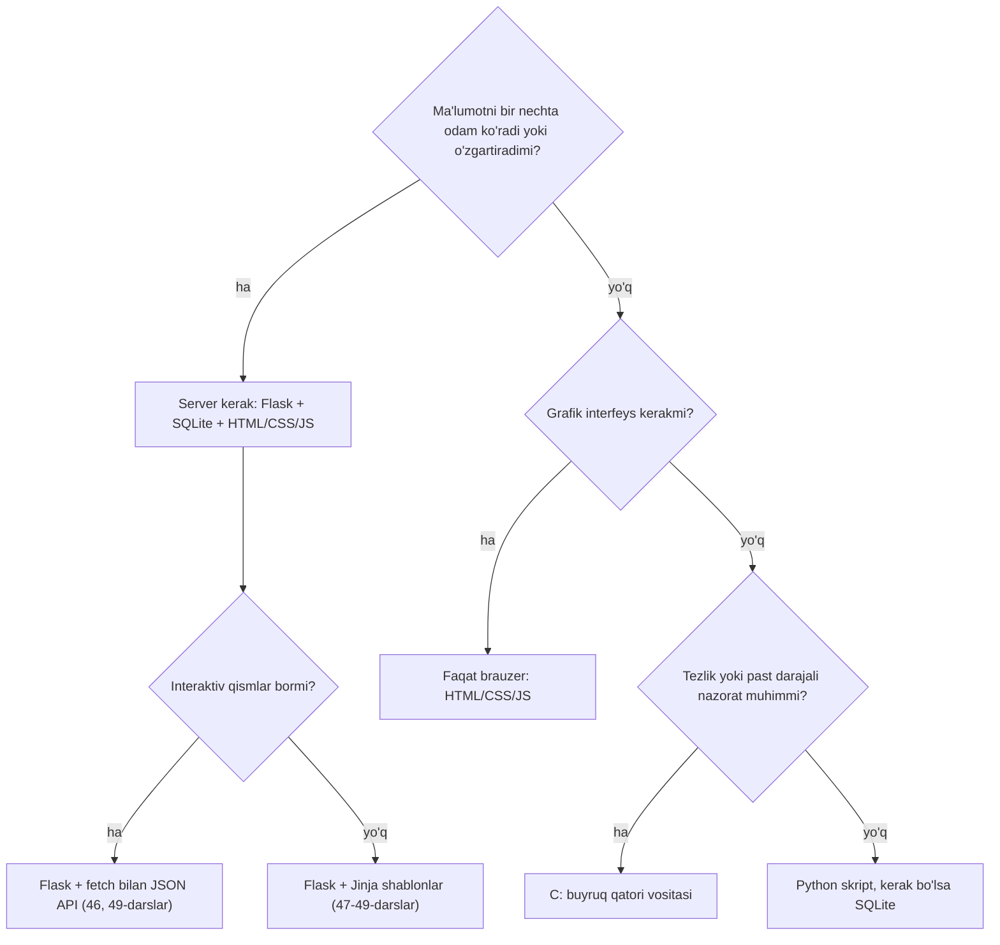
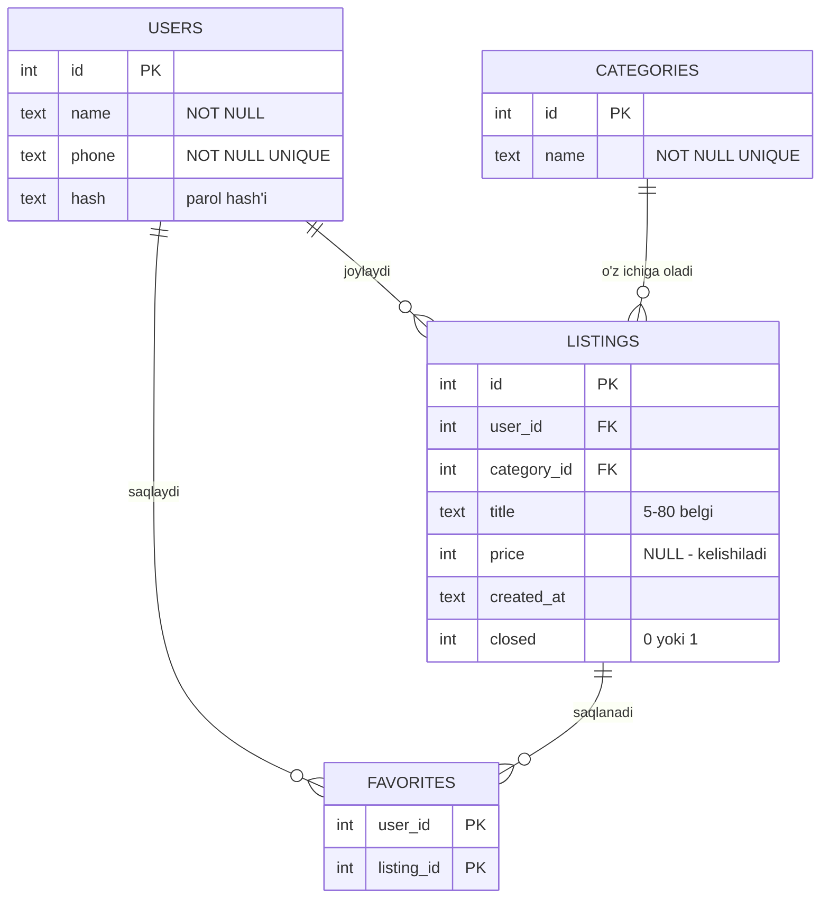
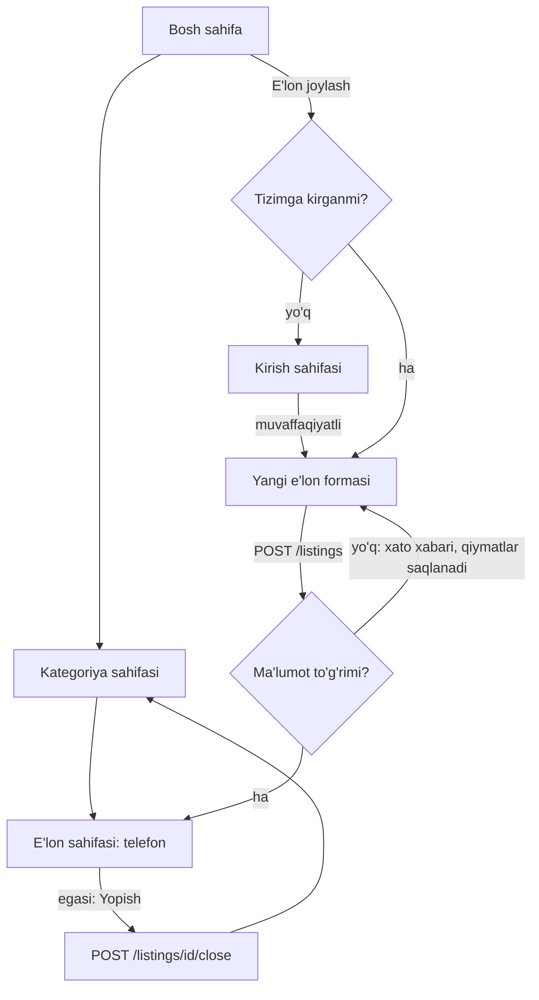

## Bu dars nima uchun kerak

Kurs davomida har bir topshiriqning sharti tayyor edi: nima kiritiladi, nima chiqishi kerak, qaysi funksiyani yozish kerak. Yakuniy loyihada shartni siz yozasiz. Bu eng qiyin qism: ko'p loyihalar kod yetishmagani uchun emas, noto'g'ri tanlangan g'oya, chegarasiz hajm yoki "keyin o'ylab ko'raman" deb qoldirilgan ma'lumotlar modeli tufayli to'xtab qoladi. Ikki hafta HTML bezash bilan o'tadi, keyin baza sxemasi hamma narsani qayta yozishni talab qilishi ma'lum bo'ladi.

Bu darsda kod emas, **reja** yozamiz. Loyihalash (design) - kod yozishdan oldin javob beriladigan savollar: kim uchun, qaysi muammo, minimal qanday versiya foydali, qaysi ma'lumot saqlanadi, qaysi sahifalar bor, ish qancha vaqt oladi va nima noto'g'ri ketishi mumkin. Bir soatlik loyihalash bir necha kunlik qayta yozishni tejaydi.

Oldingi darslar bilan bog'liqlik: 36-38-darslardagi jadvallar, primary va foreign key, normalizatsiya va ER diagramma bu yerda o'z loyihangiz sxemasiga aylanadi. 43-49-darslardagi HTML, JavaScript va Flask (route, forma, session, CRUD) sahifalar rejasi uchun asos. 50-51-darslardagi xavfsizlik - nofunksional talablar manbai. 57-darsdagi git va testlar - reja ijrosining vositalari. Keyingi 59-darsda shu rejani vertikal bo'laklar bilan kodga aylantirib, deploy qilamiz va README yozamiz; 60-darsda esa loyihani review qilamiz.

Bu darsdan keyin siz:

- CS50 yakuniy loyihasi qanday topshiriladi va nimalar talab qilinishini bilasiz;
- g'oyalarni mezonlar bo'yicha solishtirib, birini asosli tanlay olasiz;
- loyiha hajmini MVP va "yaxshi, yaxshiroq, eng yaxshi" natijalarga ajrata olasiz;
- foydalanuvchi hikoyalari, qabul mezonlari, funksional va nofunksional talablarni yoza olasiz;
- loyiha turiga qarab kursdagi texnologiyalardan mosini tanlay olasiz;
- talablardan ma'lumotlar modelini chiqarib, ER diagramma va SQLite prototipi bilan tekshira olasiz;
- sahifalar, URL'lar va foydalanuvchi oqimini chizib, ishni vazifalarga bo'lib, vaqtni baholay olasiz;
- xavflarni oldindan sanab, ularga reja tuza olasiz.

## CS50 yakuniy loyihasi: nima talab qilinadi

Rasmiy talablar CS50x sahifasidagi "Final Project" bo'limida; ular har yili yangilanishi mumkin, shuning uchun topshirishdan oldin o'sha sahifani o'qing. Bu yerda 2026-yil sahifasidagi asosiy nuqtalarni o'z so'zimiz bilan qisqa bayon qilamiz:

- **Erkinlik.** Loyiha kursda o'rganilganlarga tayansa, mavzu va til(lar) ixtiyoriy. CS50 Codespace'dan tashqarida ishlash ham mumkin. Maqsad - sizni qiziqtiradigan, haqiqiy muammoni yechadigan, kurs tugagandan keyin ham yashaydigan dastur.
- **Hajm.** Bir kishilik loyiha har qanday problem set'dan ko'proq vaqt va kuch talab qilishi kerak. Bir-ikki sherik bilan ishlash mumkin, lekin unda hajm mos ravishda ikki yoki uch barobar katta bo'lishi va har a'zoning hissasi teng bo'lishi kutiladi.
- **Video.** 3 daqiqadan oshmaydigan taqdimot videosi. Boshida loyiha nomi, ismingiz, GitHub va edX foydalanuvchi nomlari, shahar va mamlakat, yozib olingan sana ko'rsatiladi; keyin loyiha ishlayotgan holda namoyish qilinadi. Video ochiq yoki "unlisted" havola bilan joylanadi.
- **README.md.** Aynan shu nomdagi fayl: loyiha nomi, video havolasi va batafsil tavsif. Sahifa taxminan 750 so'z atrofidagi README yetarli bo'lishini aytadi; unda har fayl nima qilishi va qaysi dizayn qarorlarini nega tanlaganingiz tushuntiriladi. README'ga 750 so'z yig'ilmasa, bu loyiha yetarlicha murakkab emasligining belgisi bo'lishi mumkin.
- **Topshirish.** Kod va README `submit50` buyrug'i bilan yuboriladi, keyin gradebook sahifasini ochib, kurs tugaganini tasdiqlash kerak.
- **AI vositalari.** Faqat yakuniy loyihada CS50'dan tashqari AI yordamchilardan foydalanish mumkin, lekin ishning mohiyati sizniki bo'lishi va har foydalanish kod izohlarida ko'rsatilishi shart (55-darsdagi AI bilan ishlash qoidalari shu yerda amalda).
- **Halollik.** Topshirilgan ishlar tekshiriladi; akademik halollik qoidalarini buzish sertifikatdan mahrum qiladi.

| Topshiriladigan narsa | Nimani ko'rsatadi | Qachon tayyorlash kerak |
|---|---|---|
| Ishlaydigan kod | Loyiha haqiqatan ishlaydi | Butun loyiha davomida, kichik bo'laklar bilan |
| README.md | Nima, qanday tuzilgan, nima uchun shunday | Shu darsdagi reja uning qoralamasi; oxirida yakunlanadi (59-dars) |
| 3 daqiqalik video | Foydalanuvchi ko'zi bilan asosiy imkoniyatlar | Oxirgi hafta, MVP tayyor bo'lgach |
| AI foydalanish izohlari | Qaysi qism yordamchi bilan yozilgan | Har foydalanishda darhol, keyinga qoldirmasdan |

Sahifa yana bir foydali maslahat beradi: dasturiy ta'minotda deyarli hamma narsa kutilganidan uzoq davom etadi, shuning uchun loyiha uchun bir nechta natija darajasini - yaxshi, yaxshiroq va eng yaxshi - oldindan belgilab, oraliq marralar (milestone) qo'yish kerak. Bu g'oyani pastda hajmni baholashda ishlatamiz.

## G'oya tanlash

### O'z muammongizdan boshlang

Eng yaxshi g'oyalar "qanday loyiha qilsam ekan" degan savoldan emas, "nima meni har kuni bezovta qiladi" degan savoldan chiqadi. Sababi amaliy:

- **Foydalanuvchini bilasiz.** U - siz, oilangiz yoki tanishlaringiz. Talablarni o'ylab topish shart emas, ularni kuzatasiz.
- **Tekshirish oson.** Ilova haqiqatan foydalimi - bir hafta o'zingiz ishlatib ko'rasiz.
- **Motivatsiya.** Uchinchi haftada, kod ishlamay qolganda, o'zingizga kerakli narsani tugatish osonroq.

G'oya manbalari: qog'ozda yoki chat guruhida yuritiladigan har qanday ro'yxat (mahalladagi e'lonlar, o'quv to'garagidagi navbatchilik, oilaviy xarajatlar), takrorlanadigan qo'lda hisob (har oy bir xil jadvalni to'ldirish), yoki kursda o'zingizga yoqqan mavzuni kengaytirish (14-darsdagi shifrlarni fayl shifrlovchi CLI vositasiga aylantirish).

### Mezonlar bilan solishtirish

Bir nechta g'oya bo'lsa, ularni sezgi bilan emas, mezonlar bilan solishtiring. Har mezonga vazn (muhimligi, yig'indisi 1) va har g'oyaga har mezon bo'yicha 1-5 ball beriladi; yakuniy ball - vaznli yig'indi:

ball = Σ vazn(i) · baho(i)

Masalan, "O'quv kartochkalari" uchun: 0,30 · 4 + 0,20 · 5 + 0,25 · 5 + 0,25 · 5 = 1,20 + 1,00 + 1,25 + 1,25 = 4,70.

```python run
# Mezon va uning vazni. Vaznlar yig'indisi 1.
criteria = {
    "muammo haqiqiy": 0.30,
    "o'zim ishlataman": 0.20,
    "kurs bilimi yetadi": 0.25,
    "hajm 6-8 haftaga sig'adi": 0.25,
}

# Har g'oya har mezon bo'yicha 1-5 ball (criteria tartibida).
ideas = {
    "Mahalla e'lonlari": [5, 4, 4, 4],
    "O'quv kartochkalari": [4, 5, 5, 5],
    "Kutubxona hisobi": [4, 2, 5, 4],
    "Ijtimoiy tarmoq": [3, 3, 2, 1],
}

weights = list(criteria.values())
results = []
for name, scores in ideas.items():
    total = sum(w * s for w, s in zip(weights, scores))
    results.append((total, name))

for total, name in sorted(results, reverse=True):
    print(f"{name:22} {total:.2f}")
```

```text
O'quv kartochkalari    4.70
Mahalla e'lonlari      4.30
Kutubxona hisobi       3.85
Ijtimoiy tarmoq        2.25
```

Raqamlarning o'zi muhim emas - ballar sub'ektiv. Muhimi, jadval sizni har g'oya haqida bir xil savollarni berishga majbur qiladi. "Ijtimoiy tarmoq" qiziqarli eshitiladi, lekin "6-8 haftaga sig'adimi" degan savolga halol javob 1 ball: xabarlar, do'stlar, lenta, bildirishnomalar, moderatsiya - har biri alohida loyiha. Vaznlarni o'zgartirib ko'ring: agar "o'zim ishlataman" mezoni sizga muhimroq bo'lsa, tartib qanday o'zgaradi?

### Hajmni baholash: MVP

**MVP** (minimum viable product, minimal yashovchan mahsulot) - asosiy muammoni yechadigan va foydalanuvchi haqiqatan ishlata oladigan eng kichik versiya. MVP "yarim tayyor ilova" emas: unda kam funksiya bor, lekin ularning har biri boshidan oxirigacha ishlaydi.

MVP'ni topish usuli: barcha g'oyalaringizni ro'yxatga yozing va har biri uchun so'rang: "Busiz ilova asosiy vazifasini bajara oladimi?" Javob "ha" bo'lsa, u MVP'ga kirmaydi. Mahalla e'lonlari uchun: e'lon joylash va ko'rish - MVP; e'lonni qidirish - ehtimol MVP; rasm yuklash, sevimlilar, xabarlar, reyting - keyinroq.

CS50 sahifasidagi maslahatni shu yerda ishlatamiz - uch daraja:

- **Yaxshi natija** (albatta qilinadi) = MVP. Muddatning birinchi yarmida tayyor bo'lishi kerak.
- **Yaxshiroq natija** - foydalanuvchi tajribasini sezilarli yaxshilaydigan 2-3 imkoniyat.
- **Eng yaxshi natija** - vaqt qolsa qilinadigan "orzu" ro'yxati.

Vaqt tugaganda sizda doim ishlaydigan va ko'rsatsa bo'ladigan versiya bo'ladi. Teskari yondashuvda (hamma imkoniyatni parallel boshlash) muddat oxirida o'nta yarim tayyor funksiya va birorta ham ishlaydigan oqim bo'lmasligi mumkin.

## Talablarni yozish

**Talab** - tizim nima qilishi yoki qanday bo'lishi kerakligi haqidagi tekshirsa bo'ladigan gap. "Ilova qulay bo'lsin" - talab emas, istak: uni tekshirib bo'lmaydi. "E'lon joylash formasi 3 ta maydondan iborat va bitta sahifada" - talab.

### Foydalanuvchi hikoyalari

**User story** (foydalanuvchi hikoyasi) - talabni foydalanuvchi nuqtai nazaridan qisqa yozish usuli. Keng tarqalgan shablon (Mountain Goat Software sahifasida ham keltirilgan): "**[kim] sifatida men [nima qilishni] xohlayman, toki [nima uchun]**". Uchinchi qism eng muhimi: u talabning sababini saqlaydi va keyin "bu imkoniyat kerakmi" degan savolga javob beradi.

Mahalla e'lonlari uchun misollar:

1. Mahalla aholisi sifatida men kategoriya bo'yicha ochiq e'lonlarni ko'rishni xohlayman, toki kerakli narsani tez topay.
2. Sotuvchi sifatida men sarlavha, narx va kategoriya bilan e'lon joylashni xohlayman, toki qo'shnilarim uni ko'rsin.
3. Sotuvchi sifatida men e'lonimni "yopildi" deb belgilashni xohlayman, toki menga ortiqcha qo'ng'iroq qilinmasin.
4. Aholi sifatida men e'longa telefon orqali bog'lanishni xohlayman, toki saytda ro'yxatdan o'tmasdan kelisha olay.

Hikoya o'zi yetarli emas: "e'lon joylash" nimani anglatadi? Shuning uchun har hikoyaga **qabul mezonlari** (acceptance criteria) yoziladi - hikoya bajarildi deyish uchun tekshiriladigan aniq shartlar. 2-hikoya uchun:

- sarlavha bo'shliqlarsiz 5-80 belgi, aks holda forma xato bilan qaytadi va kiritilgan qiymatlar saqlanadi;
- narx bo'sh (kelishiladi) yoki 0 dan katta yoki teng butun son;
- kategoriya ro'yxatdagi uchtadan biri;
- muvaffaqiyatli joylangan e'lon kategoriya sahifasida birinchi bo'lib chiqadi;
- faqat tizimga kirgan foydalanuvchi e'lon joylay oladi.

Qabul mezonlari to'g'ridan-to'g'ri testlarga aylanadi (57-dars): har band - bitta yoki bir nechta `check`. Pastdagi mashqda aynan shuni qilamiz.

### Funksional va nofunksional talablar

**Funksional talab** - tizim **nima qilishi**: e'lon joylash, qidirish, yopish. Odatda hikoyalardan chiqadi. **Nofunksional talab** - tizim buni **qanday** qilishi: tezlik, xavfsizlik, qulaylik, ishonchlilik, qo'llab-quvvatlanadigan qurilmalar. Ular ko'pincha yozilmay qoladi va loyiha oxirida "nega telefonda ochilmaydi" ko'rinishida chiqadi.

| Tur | Mahalla e'lonlari uchun misol | Qanday tekshiriladi | Bog'liq dars |
|---|---|---|---|
| Funksional | Kategoriya bo'yicha ochiq e'lonlar, yangisi birinchi | `test_client` bilan sahifa so'rovi va tartib tekshiruvi | 49 |
| Funksional | Faqat egasi e'lonni yopa oladi | Boshqa foydalanuvchi bilan POST, 403 kutiladi | 48, 50 |
| Nofunksional: xavfsizlik | Parollar faqat hash ko'rinishida, barcha so'rovlar parametrlangan | Bazani ko'rish, kodda f-string SQL yo'qligi | 39, 50 |
| Nofunksional: qulaylik | 360 piksel kenglikdagi telefonda gorizontal scroll yo'q | Brauzer devtools'da tor ekran | 44 |
| Nofunksional: tezlik | 1000 e'lonli bazada ro'yxat sahifasi 200 ms dan tez | `EXPLAIN QUERY PLAN`, indeks, vaqtni o'lchash | 39 |
| Nofunksional: ishonchlilik | Noto'g'ri forma dastur xatosiga (500) olib kelmaydi | Bo'sh va noto'g'ri qiymatlar bilan testlar | 33, 59 |

Nofunksional talablarda ham raqam bo'lsin: "tez" emas, "200 ms dan tez"; "telefonda ishlasin" emas, "360 piksel kenglikda". Raqam bo'lmasa, talab bajarildimi yoki yo'qmi, hech kim ayta olmaydi.

### Ustuvorlik: MoSCoW

Talablar ko'p bo'lganda, ularni **MoSCoW** usuli bilan to'rt guruhga bo'lish qulay: **Must** (shart, MVP), **Should** (muhim, lekin busiz ham ishlaydi), **Could** (vaqt qolsa), **Won't** (bu safar qilinmaydi). Oxirgi guruh ayniqsa foydali: "qilmaymiz" deb ochiq yozilgan narsa keyin jimgina rejaga qo'shilib ketmaydi. Bu jarayon - loyiha davomida yangi istaklar rejaga sezdirmasdan qo'shilib, hajmni cheksiz o'stirishi - **scope creep** deyiladi va yakka loyihalarning eng keng tarqalgan kasalligi.

## Texnologiya tanlash

Yakuniy loyiha uchun eng yaxshi texnologiya - odatda siz yaxshi biladigani. Yangi freymvorkni o'rganish ham mumkin (CS50 sahifasi ham shuni so'raydi: qaysi yangi ko'nikmalar kerak bo'ladi?), lekin unda o'rganish vaqtini rejaga alohida qo'shing. Kursda o'rganilgan vositalar va ular qachon mos keladi:

| Texnologiya | Qachon mos | Qachon mos emas | Misol loyiha |
|---|---|---|---|
| C | Tezlik, xotira ustidan nazorat, fayl formatlari bilan ishlash, buyruq qatori vositalari | Ko'p sahifali web interfeys, tez o'zgaradigan talablar | BMP rasmlarga filtr qo'yuvchi CLI vosita (26-dars) |
| Python (skript) | Ma'lumotni qayta ishlash, avtomatlashtirish, fayl va CSV, bir foydalanuvchi | Ko'p foydalanuvchili interfeys kerak bo'lsa | Oylik xarajatlar CSV'sidan hisobot (34-dars) |
| SQL (SQLite) | Bog'langan, uzoq saqlanadigan, so'raladigan ma'lumot | Bir martalik hisob, oddiy kalit-qiymat sozlama | Deyarli har qanday ko'p jadvalli loyiha |
| Flask + HTML/CSS + SQLite | Bir nechta foydalanuvchi, login, forma, umumiy ma'lumot | Internetsiz, bitta qurilmada ishlashi kerak bo'lsa | Mahalla e'lonlari, kutubxona hisobi |
| HTML/CSS/JS (faqat brauzer) | Bitta foydalanuvchi, serversiz, interaktiv sahifa | Ma'lumot qurilmalar yoki odamlar orasida bo'lishilishi kerak bo'lsa | Taymer, kalkulyator, o'yin |

Tanlashni bir nechta savolga keltirsa bo'ladi:



Mahalla e'lonlari uchun javob: ma'lumotni ko'p odam ko'radi va qo'shadi, demak Flask + SQLite; sahifalar asosan ro'yxat va forma, shuning uchun Jinja shablonlari yetarli, JavaScript faqat kichik qulayliklar uchun.

## Ma'lumotlar modeli

Talablar tayyor bo'lgach, ulardan jadvallar chiqariladi. Oddiy usul: hikoyalar va qabul mezonlaridagi **otlarni** belgilang - ular jadvalga nomzod (foydalanuvchi, e'lon, kategoriya), **sifatlar va raqamlar** - ustunlar (sarlavha, narx, yopilganmi), **fe'llar** esa ko'pincha bog'lanishlarni bildiradi (foydalanuvchi e'lon *joylaydi*, e'lon kategoriyaga *tegishli*). Keyin 38-darsdagi savollar beriladi: har bog'lanish one-to-many'mi yoki many-to-many'mi, qaysi ustun majburiy (`NOT NULL`), qaysi qiymat takrorlanmasligi kerak (`UNIQUE`), ota qator o'chirilganda bola qatorlar bilan nima bo'ladi (`ON DELETE`).

Mahalla e'lonlari uchun (sevimlilar - "Should" darajasidagi imkoniyat, lekin many-to-many bog'lanishni ko'rsatish uchun qo'shildi):



Qarorlar va ularning sabablari:

- **Narx `INTEGER` va so'mda**, `NULL` - "kelishiladi". 7-darsdagi floating-point muammosi sababli pul `REAL` da saqlanmaydi; so'mda tiyin ishlatilmagani uchun butun son yetarli.
- **E'lon o'chirilmaydi, `closed` bilan yopiladi** - sotuvchi xato yopsa, qayta ochish mumkin, statistika ham yo'qolmaydi.
- **Kategoriyalar alohida jadvalda**, matn ustunida emas: "Sotaman" va "sotaman" kabi yozuv farqlari bo'lmaydi, nom bir joyda o'zgartiriladi (normalizatsiya, 38-dars).
- **`favorites` ning kaliti `(user_id, listing_id)` juftligi** - bir e'lonni ikki marta saqlab bo'lmaydi.
- **Foydalanuvchi o'chirilsa, uning e'lonlari ham o'chadi** (`ON DELETE CASCADE`) - egasiz e'lon ma'nosiz.

Sxemani qog'ozda emas, ishlaydigan prototipda tekshiring: jadvallarni yaratib, bir nechta qator qo'shib, eng muhim talab uchun so'rov yozib ko'ring. Agar so'rov qiyin yoki imkonsiz bo'lsa, sxema noto'g'ri. Cheklovlarni ham ataylab buzib ko'ring - baza noto'g'ri ma'lumotni rad etishi kerak:

```python run
import sqlite3

db = sqlite3.connect(":memory:")
db.execute("PRAGMA foreign_keys = ON")
db.executescript("""
CREATE TABLE users (
    id INTEGER PRIMARY KEY,
    name TEXT NOT NULL,
    phone TEXT NOT NULL UNIQUE,
    hash TEXT NOT NULL
);
CREATE TABLE categories (
    id INTEGER PRIMARY KEY,
    name TEXT NOT NULL UNIQUE
);
CREATE TABLE listings (
    id INTEGER PRIMARY KEY,
    user_id INTEGER NOT NULL REFERENCES users(id) ON DELETE CASCADE,
    category_id INTEGER NOT NULL REFERENCES categories(id),
    title TEXT NOT NULL CHECK (length(title) BETWEEN 5 AND 80),
    body TEXT NOT NULL DEFAULT '',
    price INTEGER CHECK (price IS NULL OR price >= 0),
    created_at TEXT NOT NULL DEFAULT CURRENT_TIMESTAMP,
    closed INTEGER NOT NULL DEFAULT 0 CHECK (closed IN (0, 1))
);
CREATE TABLE favorites (
    user_id INTEGER NOT NULL REFERENCES users(id) ON DELETE CASCADE,
    listing_id INTEGER NOT NULL REFERENCES listings(id) ON DELETE CASCADE,
    PRIMARY KEY (user_id, listing_id)
);
CREATE INDEX listings_by_category ON listings(category_id, closed);
""")

db.executemany("INSERT INTO users (name, phone, hash) VALUES (?, ?, ?)", [
    ("Malika", "+998901112233", "x"),
    ("Sardor", "+998935556677", "x"),
])
db.executemany("INSERT INTO categories (name) VALUES (?)", [("Sotaman",), ("Yo'qolgan",), ("Xizmat",)])
db.executemany(
    "INSERT INTO listings (user_id, category_id, title, price) VALUES (?, ?, ?, ?)",
    [(1, 1, "Bolalar velosipedi", 350000), (2, 3, "Matematikadan repetitor", 100000), (2, 2, "Kalitlar topildi", None)],
)
db.execute("INSERT INTO favorites VALUES (1, 2)")

# 1-hikoya: kategoriya bo'yicha ochiq e'lonlar, yangisi birinchi
rows = db.execute("""
    SELECT c.name, l.title, COALESCE(l.price, '-'), u.name
    FROM listings AS l
    JOIN categories AS c ON c.id = l.category_id
    JOIN users AS u ON u.id = l.user_id
    WHERE l.closed = 0
    ORDER BY c.name, l.id DESC
""").fetchall()
for row in rows:
    print(row)

# Qabul mezonlari baza darajasida ham ishlayaptimi?
bad = [
    ("qisqa sarlavha", "INSERT INTO listings (user_id, category_id, title) VALUES (1, 1, 'Velo')"),
    ("manfiy narx", "INSERT INTO listings (user_id, category_id, title, price) VALUES (1, 1, 'Eski divan', -5)"),
    ("yo'q kategoriya", "INSERT INTO listings (user_id, category_id, title) VALUES (1, 99, 'Eski divan')"),
    ("takror telefon", "INSERT INTO users (name, phone, hash) VALUES ('Ali', '+998901112233', 'x')"),
]
for name, sql in bad:
    try:
        db.execute(sql)
        print(name, "-> QABUL QILINDI (xato!)")
    except sqlite3.IntegrityError as e:
        print(name, "->", e)

db.execute("DELETE FROM users WHERE id = 2")
print("Sardor o'chirildi, e'lonlar:", db.execute("SELECT COUNT(*) FROM listings").fetchone()[0])
```

```text
('Sotaman', 'Bolalar velosipedi', 350000, 'Malika')
('Xizmat', 'Matematikadan repetitor', 100000, 'Sardor')
("Yo'qolgan", 'Kalitlar topildi', '-', 'Sardor')
qisqa sarlavha -> CHECK constraint failed: length(title) BETWEEN 5 AND 80
manfiy narx -> CHECK constraint failed: price IS NULL OR price >= 0
yo'q kategoriya -> FOREIGN KEY constraint failed
takror telefon -> UNIQUE constraint failed: users.phone
Sardor o'chirildi, e'lonlar: 1
```

(Xato xabarlari SQLite versiyasiga qarab biroz farq qilishi mumkin.) Prototip uchta narsani tasdiqladi: asosiy so'rov ikkita `JOIN` bilan yoziladi; noto'g'ri ma'lumot bazaga tushmaydi; `CASCADE` Sardorning ikkala e'lonini o'chirdi. Bazadagi `CHECK` - oxirgi himoya chizig'i: foydalanuvchiga tushunarli xabar berish uchun tekshiruv ilova kodida ham bo'lishi kerak (pastdagi mashq). `PRAGMA foreign_keys = ON` ni unutmang - SQLite'da u sukut bo'yicha o'chiq (38-dars).

Hajmni ham taxminlang. Faraz qilaylik, mahallada 2000 xonadon va har biri yiliga 5 ta e'lon joylaydi: 2000 · 5 = 10 000 qator yiliga. Bir qator taxminan 300 bayt bo'lsa (sarlavha, tavsif, raqamlar), 10 000 · 300 = 3 000 000 bayt ≈ 3 MB yiliga. Bu SQLite uchun juda kichik hajm - demak boshqa ma'lumotlar bazasi kerak emas, va bu qaror README'da asoslab yoziladi.

## Sahifalar va foydalanuvchi oqimi

Keyingi qadam - har hikoya qaysi sahifada va qaysi URL orqali bajarilishini aniqlash. 49-darsdagi qoida: URL resursni, HTTP metodi amalni bildiradi; holatni o'zgartiradigan amal faqat `POST`.

| Sahifa yoki amal | Metod va URL | Hikoya | Kirish talab qilinadimi |
|---|---|---|---|
| Bosh sahifa: kategoriyalar va oxirgi e'lonlar | `GET /` | 1 | Yo'q |
| Kategoriya e'lonlari | `GET /categories/<id>` | 1 | Yo'q |
| Bitta e'lon va telefon | `GET /listings/<id>` | 4 | Yo'q |
| Yangi e'lon formasi | `GET /listings/new` | 2 | Ha |
| E'lonni saqlash | `POST /listings` | 2 | Ha |
| E'lonni yopish | `POST /listings/<id>/close` | 3 | Ha, faqat egasi |
| Ro'yxatdan o'tish, kirish, chiqish | `GET/POST /register`, `/login`, `POST /logout` | 2, 3 uchun kerak | - |

Jadvaldan keyin asosiy oqimni chizing: foydalanuvchi qayerdan kiradi, qaysi tugmani bosadi, xato bo'lsa qayerga qaytadi. Bunday chizma xato oqimlarini ham ko'rsatadi, ular esa ko'pincha unutiladi:



Har sahifa uchun **wireframe** chizish foydali - qaysi element qayerda turishini ko'rsatadigan oddiy chizma, ranglar va bezaksiz. Qog'ozda to'rtburchaklar yetarli: sarlavha, forma maydonlari, tugmalar, ro'yxat. Wireframe ikki savolga erta javob beradi: sahifada qaysi ma'lumot ko'rsatiladi (demak qaysi so'rov kerak) va foydalanuvchi keyingi qadamni qayerdan topadi. HTML va CSS (43-44-darslar) wireframe tasdiqlangandan keyin yoziladi.

## Vazifalarni bo'lish va vaqtni baholash

Endi reja ishga aylantiriladi. Har hikoyani 1-4 soatlik vazifalarga bo'ling: 4 soatdan katta vazifa baholash uchun juda noaniq, uni yana bo'ling. 59-darsda ko'riladigan usul bo'yicha vazifalar qatlam bo'yicha emas (avval hamma jadval, keyin hamma shablon), **funksiya** bo'yicha guruhlanadi: bitta hikoya bazadan sahifagacha to'liq.

| Vazifa | Hikoya | Baho (soat) |
|---|---|---|
| Loyiha tuzilmasi, git repo, sxema va boshlang'ich ma'lumot | - | 3 |
| Ro'yxatdan o'tish, kirish, chiqish (parol hash'i bilan) | 2, 3 | 5 |
| Bosh sahifa va kategoriya sahifasi | 1 | 4 |
| E'lon sahifasi | 4 | 2 |
| E'lon formasi, validatsiya va testlar | 2 | 5 |
| E'lonni yopish va egasini tekshirish | 3 | 3 |
| Tor ekran uchun CSS | - | 4 |
| Xatolar sahifalari va chegaraviy holatlar testlari | - | 3 |
| Deploy (59-dars) | - | 4 |
| README va video | - | 5 |
| **Jami** | | **38** |

Baholar deyarli doim optimistik: CS50 sahifasi ham ogohlantirganidek, dasturlashda hamma narsa kutilganidan uzoq davom etadi. Kutilmagan xatolar, o'rganish va qayta ishlash uchun zaxira qo'shing; boshlovchi uchun 1,5 koeffitsient o'rinli taxmin:

38 · 1,5 = 57 soat.

Haftasiga 8 soat ajrata olsangiz: 57 / 8 ≈ 7,1, ya'ni taxminan 8 hafta (yuqoriga yaxlitlanadi). Agar muddat 6 hafta bo'lsa, ikki yo'l bor: haftalik vaqtni oshirish (57 / 6 ≈ 9,5 soat) yoki hajmni qisqartirish - masalan, "Tor ekran uchun CSS" ni oddiyroq qilish yoki ro'yxatdan o'tishni "Should" ga surish (e'lon egasini telefon va maxfiy kod bilan aniqlash). Bu qaror hozir, reja bosqichida qilinadi, oxirgi haftada emas.

Rejaga oraliq marralar qo'ying va har birining oxirida ilova ishlaydigan holatda bo'lsin:

- **1-2-hafta:** sxema, login, e'lonlar ro'yxati (faqat o'qish) - bu allaqachon namoyish qilsa bo'ladigan narsa;
- **3-4-hafta:** e'lon joylash va yopish - MVP tayyor ("yaxshi natija");
- **5-6-hafta:** qidiruv, sevimlilar, CSS ("yaxshiroq");
- **7-8-hafta:** deploy, README, video, zaxira vaqt.

Sherik bilan ishlasangiz, vazifalarni hikoyalar bo'yicha bo'ling (biri e'lonlar, biri foydalanuvchilar), fayl bo'yicha emas - aks holda ikkalangiz bir faylni o'zgartirib, 57-darsdagi merge conflict'larni har kuni hal qilasiz.

## Xavflar va cheklovlar

Xavf - loyihani to'xtatishi yoki kechiktirishi mumkin bo'lgan noaniqlik. Ularni oldindan yozish ikki foyda beradi: eng xavfli qismni birinchi qilasiz va har biriga zaxira reja tayyor bo'ladi.

| Xavf | Ehtimol | Ta'sir | Kamaytirish |
|---|---|---|---|
| Hajm muddatga sig'maydi | Yuqori | Yuqori | MoSCoW, MVP birinchi, haftalik tekshiruv: reja bilan farq 20% dan oshsa, "Could" ni kesish |
| Yangi texnologiyani o'rganish uzoq davom etadi | O'rta | Yuqori | Birinchi haftada eng noma'lum qismning kichik prototipi |
| Sxema xato chiqadi | O'rta | O'rta | Shu darsdagi SQLite prototipi, asosiy so'rovlar oldindan yozilgan |
| Kod yo'qoladi yoki buziladi | Past | Yuqori | git, har kuni push (57-dars) |
| Hosting yoki deploy muammosi | O'rta | O'rta | Deploy'ni oxirgi kunga qoldirmaslik, 59-darsdagi variantlar |
| Shaxsiy ma'lumot sizib chiqishi | Past | Yuqori | Faqat kerakli ma'lumotni saqlash, parol hash'i, telefonni faqat e'lon sahifasida ko'rsatish (50-51-darslar) |

Cheklovlarni ham yozing - bu xavf emas, balki o'zgarmas shartlar: muddat, haftalik vaqt, bepul hosting imkoniyatlari, internetsiz ishlash kerakmi, qaysi qurilmalarda ishlatiladi. README'dagi "Cheklovlar" bo'limi (59-dars) aynan shu ro'yxatdan boshlanadi.

## Uchta namunaviy loyiha

Quyidagi g'oyalar - qisqa reja namunasi; ularni nusxalash emas, o'z loyihangiz uchun shablon sifatida ishlating.

### 1. Mahalla e'lonlari

Butun dars davomida ko'rgan misol. **Muammo:** mahalladagi e'lonlar chat guruhlarida tezda yo'qolib ketadi, eski e'lonni topib bo'lmaydi. **MVP:** 1-4-hikoyalar. **Texnologiya:** Flask + SQLite + Jinja, oz JavaScript. **Jadvallar:** `users`, `categories`, `listings`, `favorites`. **Sahifalar:** yuqoridagi jadval. **Asosiy xavf:** shaxsiy ma'lumot (telefonlar) va spam; MVP'da e'lon joylash faqat ro'yxatdan o'tganlarga, "Could" darajasida - kuniga e'lonlar soni cheklovi.

### 2. O'quv kartochkalari

**Muammo:** yangi so'zlar yoki atamalarni yodlashda hamma kartochka bir xil tez-tez takrorlanadi, qiyinlari esa unutiladi. **Hikoyalar:** o'quvchi sifatida men to'plam (deck) yaratib, unga savol-javob kartochkalarini qo'shishni xohlayman; men bugun takrorlanishi kerak bo'lgan kartochkalarni ko'rishni xohlayman, toki vaqtimni bilganlarimga sarflamay; javobdan keyin "bildim / bilmadim" deb belgilashni xohlayman. **Algoritm:** Leitner tizimi - kartochkalar qutilarga bo'linadi, to'g'ri javob kartochkani keyingi (kamroq takrorlanadigan) qutiga suradi, xato - birinchi qutiga qaytaradi. Masalan, 1-quti har kuni, 2-quti har 2 kunda, 3-quti har 4 kunda takrorlanadi: keyingi sana = bugun + 2^(quti - 1) kun. **Texnologiya:** bitta foydalanuvchi bo'lsa - faqat brauzer (HTML/CSS/JS); bir nechta foydalanuvchi va qurilma bo'lsa - Flask + SQLite. **Jadvallar:** `decks`, `cards (deck_id, front, back, box, due_date)`, ixtiyoriy `reviews` (statistika uchun). **Asosiy xavf:** sanalar bilan ishlash (vaqt zonasi, "bugun" qachon boshlanadi); sanani bitta joyda, bitta funksiyada hisoblang va uni chegaraviy holatlar bilan testlang.

### 3. Kutubxona hisobi

**Muammo:** maktab yoki to'garak kutubxonasida kim qaysi kitobni olgani daftarda yuritiladi, muddati o'tganlarni topish qiyin. 38-darsdagi `authors`, `books`, `readers`, `loans` sxemasi bu loyihaning tayyor ma'lumotlar modeli - uni boshlang'ich nuqta sifatida oling va o'z talablaringizga moslang. **Hikoyalar:** kutubxonachi sifatida men kitob berilganini va qaytarilganini belgilashni xohlayman; muddati o'tgan kitoblar ro'yxatini ko'rishni xohlayman, toki o'quvchilarga eslatay; o'quvchi sifatida men kitob bandmi yoki yo'qligini ko'rishni xohlayman. **Texnologiya:** Flask + SQLite; ikki rol (kutubxonachi va o'quvchi) - session'da rol saqlanadi va har route'da tekshiriladi. **Asosiy so'rov:** `loans` dan `returned_on IS NULL AND due_on < date('now')` shartli qatorlar. **Asosiy xavf:** ruxsatlar - o'quvchi kitob berishni belgilay olmasligi kerak; buni kodda bir joyda tekshiradigan funksiya va unga test yozing.

## Mashq: talablardan validatsiya funksiyasi

Qabul mezonlarini kodga aylantiramiz. Mahalla e'lonlari formasidan kelgan ma'lumotni tekshiradigan ikki funksiya yozing (forma qiymatlari doim satr bo'lib keladi, 48-dars):

1. `normalize_phone(raw)` - telefon raqamini `+998XXXXXXXXX` ko'rinishiga keltiradi. Bo'shliq, defis va qavslar olib tashlanadi. Qabul qilinadigan shakllar: `+998` va 9 raqam; `998` va 9 raqam (plyussiz); faqat 9 raqam (mamlakat kodi qo'shiladi). Boshqa har qanday kirishda `None` qaytaradi.
2. `validate_listing(form)` - `form` lug'atida `title`, `price`, `category`, `phone` kalitlari (biri yo'q bo'lishi mumkin - bo'sh satr deb hisoblang). `(data, errors)` juftligini qaytaradi:
   - `title`: chetdagi bo'shliqlar olib tashlangan, uzunligi 5-80 belgi;
   - `price`: bo'sh satr - `None` (kelishiladi); aks holda faqat raqamlardan iborat, 0 dan 1 000 000 000 gacha butun son (`int` ga aylantiriladi);
   - `category`: `CATEGORIES` dagi qiymatlardan biri;
   - `phone`: `normalize_phone` dan o'tishi kerak;
   - `errors` - xato bo'lgan maydon nomidan xabarga lug'at; xato bo'lmasa bo'sh. `data` - tozalangan qiymatlar (xato bo'lmagan maydonlar uchun).

```python run
CATEGORIES = {"Sotaman", "Yo'qolgan", "Xizmat"}


def normalize_phone(raw):
    """'+998 90 111-22-33' -> '+998901112233', noto'g'ri bo'lsa None."""
    # Yechimingizni shu yerga yozing
    return raw


def validate_listing(form):
    """Forma ma'lumotini tekshiradi: (data, errors) qaytaradi."""
    data = {}
    errors = {}
    # Yechimingizni shu yerga yozing
    return data, errors


print(normalize_phone("+998 (90) 111-22-33"))
print(validate_listing({"title": "  Velosiped ", "price": "-5", "category": "Sotaman", "phone": "901112233"}))
```

```python test
good = {"title": "  Bolalar velosipedi ", "price": "350000", "category": "Sotaman", "phone": "+998 90 111-22-33"}


def fields(form):
    return set(validate_listing(form)[1])


check("telefon: bo'shliq, qavs va defis olib tashlanadi", lambda: normalize_phone("+998 (90) 111-22-33") == "+998901112233")
check("telefon: 998 bilan plyussiz", lambda: normalize_phone("998901112233") == "+998901112233")
check("telefon: faqat 9 raqam", lambda: normalize_phone("90 111 22 33") == "+998901112233")
check("telefon: raqam kam - None", lambda: normalize_phone("+99890111223") is None)
check("telefon: harf bor - None", lambda: normalize_phone("+99890111223a") is None)
check("telefon: boshqa mamlakat kodi - None", lambda: normalize_phone("+7 901 112 23 34") is None)
check("to'g'ri forma: xato yo'q", lambda: validate_listing(good)[1] == {})
check("to'g'ri forma: tozalangan data", lambda: validate_listing(good)[0] == {"title": "Bolalar velosipedi", "price": 350000, "category": "Sotaman", "phone": "+998901112233"})
check("sarlavha bo'shliqsiz 4 belgi - xato", lambda: fields(dict(good, title="  Velo  ")) == {"title"})
check("sarlavha 80 belgi - qabul", lambda: fields(dict(good, title="a" * 80)) == set())
check("sarlavha 81 belgi - xato", lambda: fields(dict(good, title="a" * 81)) == {"title"})
check("bo'sh narx - None (kelishiladi)", lambda: validate_listing(dict(good, price=""))[0].get("price", 0) is None)
check("narx 0 - qabul", lambda: validate_listing(dict(good, price="0"))[0].get("price") == 0)
check("manfiy narx - xato", lambda: fields(dict(good, price="-5")) == {"price"})
check("kasr narx - xato", lambda: fields(dict(good, price="12.5")) == {"price"})
check("juda katta narx - xato", lambda: fields(dict(good, price="1000000001")) == {"price"})
check("noma'lum kategoriya - xato", lambda: fields(dict(good, category="Sotiladi")) == {"category"})
check("noto'g'ri telefon - xato", lambda: fields(dict(good, phone="12345")) == {"phone"})
check("kalit yo'q bo'lsa ham ishlaydi", lambda: fields({"price": ""}) == {"title", "category", "phone"})
check("bir nechta xato birga qaytadi", lambda: fields({"title": "", "price": "abc", "category": "", "phone": ""}) == {"title", "price", "category", "phone"})
```

E'tibor bering: har test bitta qabul mezonining aniq chegarasini tekshiradi - 80 belgi qabul, 81 rad; 0 qabul, manfiy rad. Chegaraning ikkala tomonini tekshirish (57-dars) off-by-one xatolarini ushlaydi. Bundan tashqari, barcha xatolar birga qaytariladi: foydalanuvchi formani bir marta to'g'rilaydi, to'rt marta emas.

## Ko'p uchraydigan xatolar

1. **Juda katta g'oya.** "Mahalliy ijtimoiy tarmoq" yoki "hamma narsa uchun ilova". Mezonlar jadvalidagi "hajm sig'adimi" savoliga halol javob bering va MVP'ni bir jumlada ayta oladigan g'oya tanlang.
2. **Talablarsiz kod yozishni boshlash.** Ikki haftadan keyin "aslida nima qilyapman" degan savol tug'iladi. Kamida hikoyalar, qabul mezonlari va jadvallar yozilgan bo'lsin.
3. **Tekshirib bo'lmaydigan talablar.** "Tez", "qulay", "xavfsiz". Har nofunksional talabga raqam yoki aniq tekshiruv usuli qo'shing.
4. **Hamma imkoniyatni parallel boshlash.** Muddat oxirida o'nta yarim tayyor funksiya. MVP birinchi, har oraliq marra oxirida ilova ishlaydi.
5. **Sxemani qog'ozda qoldirish.** Asosiy so'rov yozilmaguncha sxema tekshirilmagan. SQLite prototipi 15 daqiqa oladi va qayta yozishdan qutqaradi.
6. **Vaqtni zaxirasiz baholash.** 38 soatlik ish 38 soatda tugamaydi. Koeffitsient qo'shing va haftalik vaqt bilan solishtiring.
7. **Xavfli qismni oxirga qoldirish.** Yangi kutubxona, deploy, fayl yuklash - birinchi haftalarda kichik prototip bilan sinab ko'ring.
8. **"Won't" ro'yxatini yozmaslik.** Yozilmagan "keyin" har hafta rejaga qaytib, scope creep'ga aylanadi.

## Xulosa

- CS50 yakuniy loyihasi: erkin mavzu va til, problem set'dan katta hajm, 3 daqiqalik video, kamida bir necha yuz so'zli README.md, `submit50`; CS50'dan tashqari AI yordamchilar faqat shu loyihada mumkin va kod izohlarida ko'rsatiladi. Rasmiy sahifani har doim o'zingiz tekshiring.
- G'oya o'z muammongizdan chiqsin; bir nechta g'oyani vaznli mezonlar bilan solishtiring.
- MVP - asosiy muammoni boshidan oxirigacha yechadigan eng kichik versiya; "yaxshi, yaxshiroq, eng yaxshi" darajalari muddat tugaganda ham ishlaydigan natija beradi.
- Talablar: user story (kim, nima, nima uchun) + tekshiriladigan qabul mezonlari; funksional (nima) va raqamli nofunksional (qanday) talablar; MoSCoW bilan ustuvorlik va "Won't" ro'yxati.
- Texnologiya loyiha turidan kelib chiqadi: ko'p foydalanuvchi - Flask + SQLite, bitta foydalanuvchi va interfeys - brauzer, tezlik va past daraja - C, avtomatlashtirish - Python.
- Ma'lumotlar modeli hikoyalardagi otlar va fe'llardan chiqadi, ER diagramma bilan chiziladi va SQLite prototipida asosiy so'rov hamda cheklovlar bilan tekshiriladi.
- Sahifalar URL va metod jadvali hamda oqim chizmasi bilan rejalashtiriladi; vazifalar 1-4 soatga bo'linadi, baho zaxira koeffitsienti bilan haftalik vaqtga solishtiriladi.
- Xavflar oldindan yoziladi, eng noaniq qism birinchi sinab ko'riladi.

## Amaliy topshiriq

O'z yakuniy loyihangiz uchun loyihalash hujjatini (README qoralamasi) yozing.

1. Kamida uchta g'oya yozing va ularni o'zingiz tanlagan 4-5 mezon bo'yicha vaznli jadvalda solishtiring (yuqoridagi `python run` blokini o'z raqamlaringiz bilan ishlating). Tanlovni 3-4 gap bilan asoslang.
2. Tanlangan g'oya uchun kamida 6 ta user story yozing va ularni MoSCoW bo'yicha guruhlang (kamida bittasi "Won't"). Ikkita "Must" hikoyaga 3-5 tadan qabul mezoni yozing. Kamida 4 ta nofunksional talabni raqam yoki aniq tekshiruv usuli bilan yozing.
3. Texnologiyani tanlang va nima uchun boshqa variant emasligini yozing. Ma'lumotlar modelini mermaid `erDiagram` bilan chizing, `CREATE TABLE` buyruqlarini yozing va `sqlite3` prototipida eng muhim hikoya uchun so'rovni hamda kamida ikkita cheklovni (`CHECK`, `UNIQUE` yoki foreign key) ishlating.
4. Sahifalar va URL'lar jadvalini (metod, hikoya, kirish talab qilinadimi) tuzing va asosiy foydalanuvchi oqimini xato yo'llari bilan birga chizing.
5. Ishni 1-4 soatlik vazifalarga bo'ling, jami vaqtni zaxira koeffitsienti bilan hisoblang, haftalik vaqtingizga bo'lib, oraliq marralarni yozing. Agar muddatga sig'masa, nimani kesasiz?
6. Kamida 4 ta xavfni (ehtimol, ta'sir, kamaytirish) va cheklovlarni yozing. Eng noaniq qism uchun birinchi haftada qanday kichik prototip qilishingizni ayting.

Yaxshi javobda bo'lishi kerak bo'lgan narsalar:

- MVP bir jumlada ifodalangan va u "Must" hikoyalariga to'liq mos keladi;
- hikoyalarda "nima uchun" qismi bor, qabul mezonlari tekshiriladigan (chegaralar raqam bilan);
- nofunksional talablarda o'lchov birligi bor (ms, piksel, belgi soni) yoki aniq tekshiruv usuli;
- sxema normalizatsiyalangan, foreign key'lar, `NOT NULL`/`UNIQUE` va `ON DELETE` tanlovi asoslangan; prototip so'rovi va cheklov xatosi natijasi bilan ko'rsatilgan;
- har holatni o'zgartiradigan amal `POST`, himoyalangan sahifalar belgilangan;
- vaqt hisobi formulasi ochiq (jami · koeffitsient / haftalik soat) va sig'masa nima kesilishi aytilgan;
- xavflar ro'yxatida hajm va texnologiya xavfi bor, eng xavfli qism birinchi haftaga qo'yilgan.

Javobingizni pastdagi maydonga yozing va yuqoridagi mezonlar bilan solishtiring.

## Manbalar

- [CS50x 2026: Final Project](https://cs50.harvard.edu/x/2026/project/) - yakuniy loyiha talablari: g'oyalar, boshlash savollari, video, README.md, `submit50`, AI vositalari qoidasi.
- [CS50x 2026](https://cs50.harvard.edu/x/2026/) - kurs sahifasi va haftalar ro'yxati.
- [Mountain Goat Software: User Stories](https://www.mountaingoatsoftware.com/agile/user-stories) - user story shabloni va hikoya suhbat uchun eslatma ekanligi.
- [Martin Fowler: Yagni](https://martinfowler.com/bliki/Yagni.html) - hozir kerak bo'lmagan imkoniyatni qurmaslik, hajmni cheklash.
- [Mermaid: Entity Relationship Diagrams](https://mermaid.js.org/syntax/entityRelationshipDiagram.html) - `erDiagram` sintaksisi, kardinallik belgilari.
- [SQLite: Foreign Key Support](https://sqlite.org/foreignkeys.html) - `PRAGMA foreign_keys`, `ON DELETE CASCADE`.
- [Flask Tutorial](https://flask.palletsprojects.com/en/stable/tutorial/) - kichik Flask ilovasining tuzilmasi: sxema, autentifikatsiya, CRUD sahifalari.
