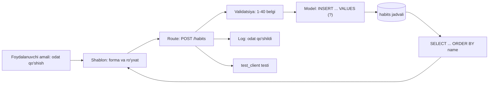
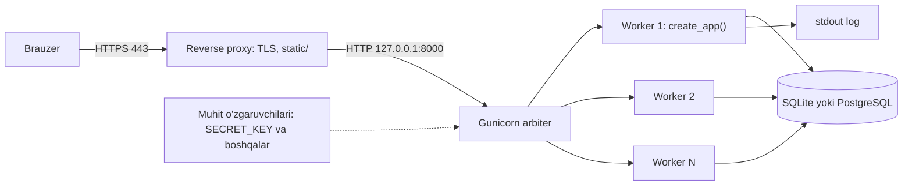
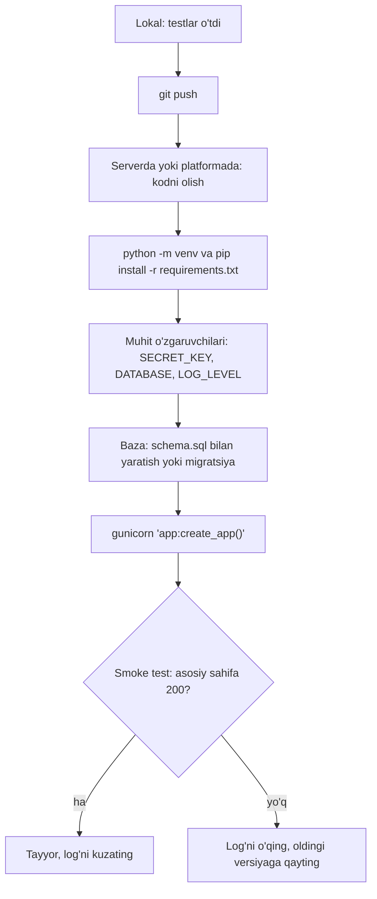

## Bu dars nima uchun kerak

58-darsda yakuniy loyiha uchun g'oya tanladik, talablarni yozdik va loyihani qog'ozda loyihaladik: jadvallar, sahifalar, URL'lar. Endi uni kodga aylantirish va internetga chiqarish kerak. Bu bosqichda ko'p loyihalar to'xtab qoladi, va sababi odatda bilim yetishmasligi emas, tartib yetishmasligi bo'ladi: avval hamma jadval yoziladi, keyin hamma shablon, keyin hamma route, va bir oydan keyin ham birorta funksiya boshidan oxirigacha ishlamaydi. Loyiha "o'z kompyuterimda ishlaydi" holatida qoladi: maxfiy kalit kodning ichida, kutubxona versiyalari hech qayerda yozilmagan, xato bo'lsa faqat terminalda bir lahza ko'rinadi.

Bu dars shu bo'shliqni yopadi. Biz loyihani **vertikal bo'laklar** bilan quramiz: har safar bitta funksiyani bazadan sahifagacha to'liq tugatamiz. Keyin loyihani boshqa kompyuterda ham ishlaydigan qilamiz: sozlamalar muhit o'zgaruvchilarida, bog'liqliklar `requirements.txt` da, xatolar log'da. Oxirida production nima ekanini, Flask ilova serverda qanday ishga tushishini va deploy variantlarini ko'ramiz.

Oldingi darslar bilan bog'liqlik: 47-50-darslardagi Flask (route, shablon, session, CRUD, xavfsizlik), 36-40-darslardagi SQL va `sqlite3`, 43-46-darslardagi HTML, CSS va JavaScript, 33-darsdagi exceptions. 57-darsdagi git, testlar va code review bu darsda tayyor vosita sifatida ishlatiladi.

Bu darsdan keyin siz:

- loyihani vertikal bo'laklarga ajratib, birinchi bo'lakni bazadan sahifagacha qura olasiz;
- Flask loyiha tuzilmasini (`app.py`, `templates/`, `static/`, `schema.sql`, `requirements.txt`, `instance/`) tushuntira olasiz va application factory yoza olasiz;
- `SECRET_KEY` va boshqa sozlamalarni koddan ajratib, muhit o'zgaruvchilaridan o'qiy olasiz;
- `venv` bilan izolyatsiya qilingan muhit yaratib, bog'liqliklarni `pip freeze` bilan qayd eta olasiz;
- `logging` moduli bilan darajali log yoza olasiz va 500 xatoni foydalanuvchidan yashirib, log'da saqlay olasiz;
- `debug=False`, WSGI server va SQLite cheklovlari nima uchun muhimligini hisob bilan tushuntira olasiz;
- PaaS, VPS va statik hosting orasidan loyihangizga mosini tanlab, deploy oldidan tekshiruv ro'yxatidan o'tkaza olasiz;
- boshqa odam loyihangizni 10 daqiqada ishga tushira oladigan README yoza olasiz.

## Vertikal bo'lak: bitta funksiyani bazadan sahifagacha

### Gorizontal va vertikal qurish

Web ilova qatlamlardan iborat (49-darsdagi MVC): baza va sxema, model funksiyalari, route'lar, shablonlar, CSS va JavaScript. Loyihani qurishning ikki yo'li bor.

**Gorizontal** usulda qatlamlar birin-ketin quriladi: avval butun sxema (10 ta jadval), keyin barcha model funksiyalari, keyin barcha route'lar. Qog'ozda tartibli ko'rinadi, lekin amalda uchta muammo beradi. Birinchidan, birinchi ishlaydigan sahifa loyihaning oxirida paydo bo'ladi, shuning uchun xatolar ham oxirida, hammasi birdaniga chiqadi. Ikkinchidan, sxemadagi xato (masalan, kerakli ustun yo'q) faqat shablon yozilganda ma'lum bo'ladi va pastki qatlamlarning hammasini qayta yozishga majbur qiladi. Uchinchidan, vaqt tugasa, qo'lingizda "deyarli tayyor", lekin hech narsa qilmaydigan kod qoladi.

**Vertikal bo'lak** (vertical slice) - bitta foydalanuvchi amalini barcha qatlamlar orqali to'liq amalga oshirish: jadvaldagi bitta ustundan tortib formadagi tugmagacha. Masalan, odat kuzatuvchi ilovada birinchi bo'lak "odat qo'shish va ro'yxatda ko'rish": `habits` jadvali (faqat `id` va `name`), `INSERT` va `SELECT`, `GET /` va `POST /habits` route'lari, bitta shablon. Bu bo'lak tayyor bo'lgach, keyingisi: "odatni bajarildi deb belgilash". Har bo'lak oxirida ilova ishlaydi, test qilinadi va git'ga commit qilinadi (57-dars).



| Mezon | Gorizontal qurish | Vertikal bo'laklar |
|---|---|---|
| Birinchi ishlaydigan sahifa | loyiha oxirida | birinchi bo'lakdan keyin (1-2 kun) |
| Sxema xatosi qachon chiqadi | shablon yozilganda, kech | shu bo'lak ichida, darhol |
| Vaqt tugasa | ko'p yarim tayyor qatlam | kamroq, lekin to'liq ishlaydigan funksiyalar |
| Test va commit | katta, kam | kichik, tez-tez |
| Taqdimotda ko'rsatish | qiyin | har bosqichda mumkin |

### Bo'laklar tartibi

58-darsda yozgan talablaringiz ro'yxatini oling va har talabni bitta bo'lakka aylantiring. Tartib uchun oddiy qoida: **avval loyihaning asosiy qiymatini beradigan eng kichik bo'lak**, keyin uni boyitadiganlar, oxirida "bo'lsa yaxshi" narsalar. Ro'yxatdan o'tish va kirish (login) odatda birinchi bo'lak emas: agar loyihaning mohiyati odatlarni kuzatish bo'lsa, avval odatlar ishlasin, foydalanuvchilar keyin qo'shiladi (bu holda `habits` jadvaliga `user_id` ustuni keyinroq qo'shiladi).

Hisob: aytaylik, sizda 8 ta talab bor va har bo'lak o'rtacha 1,5 kun oladi. Gorizontal usulda 8 × 1,5 = 12 kundan keyin birinchi marta hammasini birga ko'rasiz. Vertikal usulda 1,5 kundan keyin birinchi funksiya ishlaydi, 6 kundan keyin to'rttasi ishlaydi. Agar 9-kuni kasal bo'lib qolsangiz yoki muddat qisqarsa, vertikal usulda 6 ta ishlaydigan funksiya bor, gorizontal usulda esa nol.

### Bitta bo'lak ichidagi qadamlar

Har bo'lak uchun bir xil kichik sikl:

1. Sxemaga faqat shu bo'lakka kerakli ustunlarni qo'shing (`schema.sql`).
2. Model funksiyasini parametrlangan so'rov bilan yozing (40-dars).
3. Route'ni yozing: kirishni tekshirish, model chaqirish, javob yoki redirect (48-darsdagi Post/Redirect/Get).
4. Shablonni yozing, foydalanuvchi matni faqat `{{ }}` orqali (50-dars).
5. `test_client` bilan kamida uchta test: muvaffaqiyatli holat, noto'g'ri kirish, chegaraviy holat.
6. Qo'lda brauzerda tekshiring, keyin commit.

## Flask loyiha tuzilmasi

### Papkalar va fayllar

47-darsda eng kichik tuzilmani ko'rdik. Yakuniy loyiha uchun bir oz kengroq, lekin hali oddiy tuzilma yetarli:

```text
habits/
  app.py              # create_app(), route'lar
  db.py               # get_db(), close_db(), init_db() - 49-darsdagi naqsh
  schema.sql          # CREATE TABLE ... (bazani noldan yaratish)
  requirements.txt    # pip freeze natijasi: aniq versiyalar
  README.md           # loyiha nima, qanday ishga tushadi
  .env.example        # qaysi muhit o'zgaruvchilari kerakligi (qiymatlarsiz)
  .gitignore          # .venv/, instance/, .env, __pycache__/
  templates/
    layout.html       # umumiy karkas (shablon merosi)
    index.html
  static/
    styles.css
    app.js
  instance/           # git'ga kirmaydi: haqiqiy baza fayli shu yerda
    habits.sqlite
  tests/
    test_habits.py
```

Har bir faylning vazifasi:

- **`app.py`** - ilovani yig'adigan joy. Kichik loyihada route'lar ham shu yerda; 15-20 route'dan oshsa, ularni Flask blueprint'lariga bo'lish mumkin, lekin yakuniy loyiha uchun bu shart emas.
- **`schema.sql`** - bazaning yagona haqiqat manbai. Yangi ishtirokchi (yoki serverdagi yangi nusxa) bazani shu fayldan yaratadi: `sqlite3 instance/habits.sqlite < schema.sql`. Sxemani faqat DB Browser kabi dasturda qo'lda o'zgartirish xavfli: o'zgarish hech qayerda yozilmay qoladi.
- **`requirements.txt`** - qaysi paketlar va qaysi versiyalar kerakligi (pastda batafsil).
- **`instance/`** - Flask kelishuvi: ilovaga tegishli, lekin git'ga kirmaydigan fayllar (baza, mahalliy sozlamalar). Flask'da `app.instance_path` shu papkani ko'rsatadi.
- **`.env.example`** - kerakli o'zgaruvchilar ro'yxati, haqiqiy qiymatlarsiz. `.env` ning o'zi git'ga kirmaydi.

### Application factory

49-darsda `app = Flask(__name__)` modul darajasida yaratildi. Yakuniy loyihada ilovani **funksiya ichida** yaratish qulayroq: `create_app(config)`. Flask hujjati bu naqshni application factory deb ataydi. Foydasi: testda alohida sozlama (xotiradagi baza, `TESTING=True`) bilan, productionda boshqa sozlama bilan ilova yasash mumkin, global holat esa yo'q. Gunicorn ham factory'ni to'g'ridan-to'g'ri chaqira oladi: `gunicorn 'app:create_app()'`.

Quyidagi blok - birinchi vertikal bo'lak to'liq holda: sxema, ulanish, validatsiya, ikki route, xato sahifalari, log va testlar. Haqiqiy loyihada `PAGE` - `templates/index.html` fayli, `SCHEMA` - `schema.sql`, baza esa fayl. Brauzerda fayl yo'qligi sababli 49-darsdagi nomlangan xotira bazasi (`mode=memory&cache=shared`) ishlatiladi.

```python run
import logging
import sqlite3
import sys

from flask import Flask, abort, g, redirect, render_template_string, request

SCHEMA = """
CREATE TABLE IF NOT EXISTS habits (
    id    INTEGER PRIMARY KEY,
    name  TEXT NOT NULL UNIQUE CHECK (length(name) BETWEEN 1 AND 40),
    done  INTEGER NOT NULL DEFAULT 0
);
"""

PAGE = """<h1>Odatlar</h1>
<p class="error">{{ error }}</p>
<ul><li>{{ h["name"] }}: {{ h["done"] }} marta</li></ul>
<form method="post" action="/habits"><input name="name"><button>Qo'shish</button></form>"""


def create_app(config):
    app = Flask(__name__)
    app.config.update(config)

    def get_db():
        if "db" not in g:
            g.db = sqlite3.connect(app.config["DATABASE"], uri=True)
            g.db.row_factory = sqlite3.Row
        return g.db

    @app.teardown_appcontext
    def close_db(exc):
        db = g.pop("db", None)
        if db is not None:
            db.close()

    @app.get("/")
    def index(error=None, status=200):
        rows = get_db().execute("SELECT name, done FROM habits ORDER BY name").fetchall()
        return render_template_string(PAGE, habits=rows, error=error), status

    @app.post("/habits")
    def add_habit():
        name = request.form.get("name", "").strip()
        if not 1 <= len(name) <= 40:
            return index(error="Nom 1-40 belgi bo'lsin", status=400)
        try:
            with get_db() as db:
                db.execute("INSERT INTO habits (name) VALUES (?)", (name,))
        except sqlite3.IntegrityError:
            return index(error="Bu odat allaqachon bor", status=409)
        app.logger.info("odat qo'shildi: %s", name)
        return redirect("/", code=303)

    @app.post("/habits/<name>/done")
    def mark_done(name):
        with get_db() as db:
            cur = db.execute("UPDATE habits SET done = done + 1 WHERE name = ?", (name,))
        if cur.rowcount == 0:
            abort(404)
        return redirect("/", code=303)

    @app.errorhandler(404)
    def not_found(e):
        return "Sahifa topilmadi", 404

    return app


logging.basicConfig(stream=sys.stdout, level=logging.INFO,
                    format="%(levelname)s %(name)s: %(message)s", force=True)

URI = "file:habits?mode=memory&cache=shared"
keeper = sqlite3.connect(URI, uri=True)   # xotiradagi baza shu ulanish bilan yashaydi
keeper.executescript(SCHEMA)

app = create_app({"DATABASE": URI, "SECRET_KEY": "test-uchun", "TESTING": True})
client = app.test_client()

r = client.post("/habits", data={"name": "Kitob o'qish"})
print("1)", r.status_code, r.headers["Location"])
r = client.post("/habits", data={"name": "Kitob o'qish"})
print("2)", r.status_code, "Bu odat allaqachon bor" in r.get_data(as_text=True))
r = client.post("/habits", data={"name": "   "})
print("3)", r.status_code)
client.post("/habits/Kitob o'qish/done")
client.post("/habits/Kitob o'qish/done")
r = client.post("/habits/Yugurish/done")
print("4)", r.status_code, r.get_data(as_text=True))
html = client.get("/").get_data(as_text=True)
print("5)", "<li>Kitob o&#39;qish: 2 marta</li>" in html)
```

Natija:

```text
INFO __main__: odat qo'shildi: Kitob o'qish
1) 303 /
2) 409 True
3) 400
4) 404 Sahifa topilmadi
5) True
```

Har qatorni o'qing. (1) Muvaffaqiyatli qo'shish 303 redirect beradi (Post/Redirect/Get) va log'ga bitta INFO yozuvi tushadi. (2) Takroriy nomni `UNIQUE` cheklovi ushlaydi va route uni 409 Conflict'ga aylantiradi: tekshiruv bazada, chunki "avval SELECT, keyin INSERT" ikki so'rov orasida race condition'ga ochiq (39-dars). (3) Faqat bo'shliqlardan iborat nom `strip()` dan keyin bo'sh bo'ladi va 400 oladi. (4) Mavjud bo'lmagan odat 404 beradi: `rowcount == 0` - "hech bir qator yangilanmadi" degani. (5) Apostrof Jinja tomonidan `&#39;` ga escape qilingan (50-dars), ya'ni chiqarish xavfsiz.

E'tibor bering: validatsiya ikki joyda. `CHECK (length(name) BETWEEN 1 AND 40)` - bazadagi oxirgi to'siq, route'dagi `if` esa foydalanuvchiga tushunarli xabar beradi. Faqat bittasiga tayanmang: brauzerdagi `maxlength` atributini esa umuman himoya deb hisoblamang, uni har kim chetlab o'tadi.

## Konfiguratsiya: muhit o'zgaruvchilari va maxfiy kalitlar

### Nima uchun sozlama koddan ajratiladi

Kod - hamma joyda bir xil bo'ladigan narsa. **Konfiguratsiya** - bir nusxadan boshqasiga o'zgaradigan narsa: baza manzili, maxfiy kalit, debug rejimi, port, tashqi xizmat tokeni. Lokal kompyuteringizda, do'stingiz kompyuterida va serverda kod bir xil, sozlama esa har xil.

Twelve-Factor App metodologiyasi buni qat'iy qoida qiladi: sozlama koddan to'liq ajratilsin va **muhit o'zgaruvchilarida** saqlansin. U oddiy sinovni taklif qiladi: kodingizni hozir ochiq (open source) qilsangiz, birorta maxfiy ma'lumot oshkor bo'ladimi? Agar `app.py` da `SECRET_KEY = "mening-kalitim"` yozilgan bo'lsa, javob "ha".

Maxfiy kalit kodda bo'lsa, nima bo'ladi? 48-darsda ko'rdikki, Flask session - `SECRET_KEY` bilan imzolangan cookie. Kalitni bilgan odam istalgan foydalanuvchi, jumladan administrator session'ini soxtalashtiradi. Git tarixi esa unutmaydi: kalitni keyingi commit'da o'chirsangiz ham, u eski commit'larda qoladi va repo ochiq bo'lsa, uni topish uchun maxsus skanerlar bor. Kalit bir marta git'ga tushsa, yagona to'g'ri chora - uni **almashtirish** (yangi kalit yaratish), faqat o'chirish yetarli emas.

### Muhit o'zgaruvchisi nima

**Muhit o'zgaruvchisi** (environment variable) - operatsion tizim har bir jarayonga (process) beradigan `NOM=qiymat` juftliklari to'plami. Jarayon uni ishga tushirgan shell'dan meros oladi. Terminalda:

```bash
export SECRET_KEY="$(python3 -c 'import secrets; print(secrets.token_hex())')"
export APP_DEBUG=1
flask --app app run
```

Python'da ular `os.environ` - lug'atga o'xshash obyekt orqali o'qiladi. Ikki usul bor va farqi muhim:

- `os.environ["SECRET_KEY"]` - o'zgaruvchi bo'lmasa `KeyError`. Majburiy sozlama uchun to'g'ri: ilova ishga tushishda darhol yiqiladi, yarim soatdan keyin emas.
- `os.environ.get("PORT", "8000")` - bo'lmasa standart qiymat. Ixtiyoriy sozlama uchun.

Muhit o'zgaruvchilari doim **satr**: `"0"`, `"false"`, `""` ham `bool()` da `True` (45-darsdagi JavaScript truthy qoidasiga o'xshab, Python'da ham bo'sh bo'lmagan satr rost). Shuning uchun `DEBUG = bool(os.environ.get("APP_DEBUG"))` xato: `APP_DEBUG=0` debug'ni yoqib yuboradi. Satrni aniq qiymatlar to'plami bilan solishtirish kerak.

`secrets.token_hex()` sukut bo'yicha 32 tasodifiy bayt oladi va 64 ta hex belgi qaytaradi (har bayt 2 hex belgi). Bu 32 × 8 = 256 bit entropiya: taxmin qilish uchun o'rtacha 2^255 urinish kerak. Flask'ning rasmiy deploy qo'llanmasi ham kalitni aynan shu buyruq bilan yaratishni tavsiya qiladi.

### Flask'da: `from_prefixed_env`

Flask har bir o'zgaruvchini qo'lda o'qimaslik uchun `app.config.from_prefixed_env()` metodini beradi: `FLASK_` bilan boshlanadigan barcha muhit o'zgaruvchilarini prefikssiz kalit bilan `app.config` ga yuklaydi. Qiymatni avval `json.loads()` bilan o'qishga urinadi, shuning uchun `"50"` son bo'lib keladi, `true` va `false` (faqat kichik harf bilan) bool bo'ladi, JSON bo'lmagan satr esa satrligicha qoladi. Tuzoq: faqat raqamlardan iborat kalit ham son bo'lib qoladi, shuning uchun `secrets.token_hex()` kabi harfli kalit ishlating.

```python run
import os

from flask import Flask

# Odatda bularni shell yoki hosting paneli o'rnatadi; bu yerda namoyish uchun
os.environ["FLASK_SECRET_KEY"] = "a3f9c2e1b7d04c8e9f1a2b3c4d5e6f70"
os.environ["FLASK_MAX_ITEMS"] = "50"

app = Flask(__name__)
app.config.from_prefixed_env()
print("SECRET_KEY:", app.config["SECRET_KEY"][:6] + "...")
print("MAX_ITEMS:", app.config["MAX_ITEMS"], type(app.config["MAX_ITEMS"]).__name__)
print("DEBUG:", app.debug, "| TESTING:", app.testing)
print("APP_DEBUG ='0' bool() bilan:", bool("0"))
```

Natija:

```text
SECRET_KEY: a3f9c2...
MAX_ITEMS: 50 int
DEBUG: False | TESTING: False
APP_DEBUG ='0' bool() bilan: True
```

Kalitni log'ga yoki ekranga to'liq chiqarmang: yuqorida faqat boshidagi 6 belgi ko'rsatildi. Log fayllar ko'pincha kalitlardan ancha kengroq doirada o'qiladi.

### `.env` fayli

Lokal ishlab chiqishda har safar `export` yozish noqulay. Shuning uchun o'zgaruvchilar `.env` faylida saqlanadi va `python-dotenv` paketi ularni yuklaydi (Flask CLI bu paket o'rnatilgan bo'lsa, `.env` va `.flaskenv` ni o'zi o'qiydi). Ikki qoida: `.env` doim `.gitignore` da, repoga esa qiymatlarsiz `.env.example` qo'yiladi:

```text
# .env.example - nusxa oling: cp .env.example .env, keyin qiymatlarni to'ldiring
SECRET_KEY=
APP_ENV=development
APP_DEBUG=1
DATABASE=instance/habits.sqlite
LOG_LEVEL=DEBUG
```

Serverda `.env` o'rniga odatda hosting panelidagi "Environment variables" bo'limi yoki systemd xizmat faylidagi `Environment=` qatorlari ishlatiladi.

## Virtual muhit va bog'liqliklar

### Muammo: global paketlar

`pip install flask` sukut bo'yicha paketni Python'ning umumiy joyiga o'rnatadi. Ikki loyiha bir paketning turli versiyalarini talab qilsa, ular to'qnashadi. Bundan ham yomoni: loyiha qaysi paketlarga bog'liqligi hech qayerda yozilmaydi, ular sizning kompyuteringizda "shunchaki bor". Serverda esa yo'q.

**Virtual muhit** (virtual environment) - loyiha uchun alohida papka, unda Python interpretatoriga havola va loyihaning o'z `site-packages` papkasi bor. Faollashtirilgan muhitda `pip install` paketlarni faqat shu papkaga o'rnatadi. Standart kutubxonadagi `venv` moduli buni qiladi:

```bash
python3 -m venv .venv            # .venv papkasini yaratish
source .venv/bin/activate        # Linux/macOS (Windows: .venv\Scripts\activate)
pip install flask gunicorn       # endi faqat .venv ichiga
pip freeze > requirements.txt    # aniq versiyalarni qayd etish
deactivate                       # muhitdan chiqish
```

Python hujjatiga ko'ra, virtual muhit bir martalik va ko'chirilmaydigan narsa deb qaraladi: uni git'ga qo'shmang, boshqa joyga ko'chirmang, kerak bo'lsa o'chirib, `requirements.txt` dan qayta yarating. Shuning uchun `.venv/` - `.gitignore` da.

### `pip freeze` va versiyalarni qotirish

`pip freeze` muhitdagi barcha o'rnatilgan paketlarni `nom==versiya` ko'rinishida chiqaradi. Muhim nuqta: unda faqat siz o'rnatgan Flask emas, balki uning bog'liqliklari ham bor (Werkzeug, Jinja2, itsdangerous, click, blinker, MarkupSafe). Masalan:

```text
blinker==1.9.0
click==8.2.1
Flask==3.1.1
gunicorn==23.0.0
itsdangerous==2.2.0
Jinja2==3.1.6
MarkupSafe==3.0.2
packaging==25.0
Werkzeug==3.1.3
```

Bu ro'yxat namuna; sizdagi versiyalar o'rnatgan kuningizga bog'liq. Boshqa kompyuterda `pip install -r requirements.txt` aynan shu versiyalarni o'rnatadi. Versiyasiz `Flask` yozilsa, bir yildan keyin serverga yangi asosiy versiya tushishi va kod buzilishi mumkin.

| Yozuv | Ma'nosi | Qachon |
|---|---|---|
| `Flask` | istalgan (eng yangi) versiya | faqat tez sinov |
| `Flask>=3.1` | 3.1 yoki undan yangi | kutubxona yozganda (boshqalarga erkinlik) |
| `Flask==3.1.1` | aynan shu versiya | ilova va deploy: takrorlanuvchi o'rnatish |

Ilova uchun aniq versiyalar to'g'ri tanlov. Lekin "qotirib, unutish" ham xavfli: eski versiyalarda xavfsizlik xatolari topiladi. Vaqti-vaqti bilan versiyalarni yangilab, testlarni ishga tushirib, yangi `requirements.txt` ni commit qiling.

## Xatolar bilan ishlash va log yozish

### `print` emas, `logging`

Lokal ishlab chiqishda `print` (10-darsdagi printf debugging) yetarli. Productionda esa uchta narsa kerak: xabarning **muhimlik darajasi**, **vaqti va manbasi**, va xabarlarni darajasiga qarab o'chirib-yoqish imkoni, kodni o'zgartirmasdan. Python'ning standart `logging` moduli shularni beradi.

Har bir xabar darajaga ega. Darajalar son, va logger faqat o'zining darajasidan past bo'lmagan xabarlarni o'tkazadi:

| Daraja | Son | Qachon ishlatiladi | Misol |
|---|---|---|---|
| `DEBUG` | 10 | faqat ishlab chiqishda kerak bo'ladigan tafsilot | "SQL: SELECT ... parametrlar (3,)" |
| `INFO` | 20 | kutilgan, normal hodisa | "odat qo'shildi", "ilova ishga tushdi" |
| `WARNING` | 30 | g'alati, lekin ilova ishlayapti | "disk 85% to'lgan", "eski API chaqirildi" |
| `ERROR` | 40 | amal bajarilmadi | "so'rov 500 bilan tugadi" |
| `CRITICAL` | 50 | ilova umuman ishlay olmaydi | "bazaga ulanib bo'lmadi" |

Root logger'ning sukutdagi darajasi `WARNING`: hech narsa sozlanmasa, `info()` va `debug()` chiqmaydi. Bu ko'p yangi boshlovchini chalg'itadi.

```python run
import logging
import sys

logging.basicConfig(
    stream=sys.stdout,
    level=logging.INFO,
    format="%(levelname)-8s %(name)s: %(message)s",
    force=True,
)
log = logging.getLogger("habits")

log.debug("bu ko'rinmaydi: DEBUG (10) < INFO (20)")
log.info("ilova ishga tushdi, port=%d", 8000)
log.warning("disk 85% to'lgan")

def parse_count(text):
    try:
        return int(text)
    except ValueError:
        log.exception("son emas: %r", text)
        return 0

print("natija:", parse_count("12a"))
log.setLevel(logging.WARNING)
log.info("endi INFO ham ko'rinmaydi")
log.error("lekin ERROR (40) ko'rinadi")
print(logging.getLevelName(logging.WARNING), logging.WARNING, logging.ERROR, logging.CRITICAL)
```

Natija (traceback'dagi fayl yo'li muhitga qarab farq qiladi):

```text
INFO     habits: ilova ishga tushdi, port=8000
WARNING  habits: disk 85% to'lgan
ERROR    habits: son emas: '12a'
Traceback (most recent call last):
  File "...", line 18, in parse_count
    return int(text)
ValueError: invalid literal for int() with base 10: '12a'
natija: 0
ERROR    habits: lekin ERROR (40) ko'rinadi
WARNING 30 40 50
```

Uch nuqta:

- `log.info("port=%d", 8000)` - argumentlar alohida beriladi, f-string bilan emas. Xabar faqat haqiqatan chiqariladigan bo'lsa formatlanadi, bu o'chirilgan DEBUG xabarlarida vaqtni tejaydi.
- `log.exception(...)` faqat `except` ichida chaqiriladi: u ERROR darajasida yozadi va joriy traceback'ni (33-dars) qo'shadi. Xatoni "yutib yuborib" (`except: pass`) hech narsa yozmaslik - eng yomon variant.
- Darajani o'zgartirish uchun kodni emas, sozlamani o'zgartirish kifoya: `LOG_LEVEL` muhit o'zgaruvchisi shu uchun.

### Flask'da 500 xato

Productionda (`debug` va `TESTING` o'chiq) route ichida tutilmagan exception bo'lsa, Flask foydalanuvchiga 500 javob qaytaradi va xatoni traceback bilan `app.logger` ga ERROR sifatida yozadi. `@app.errorhandler(500)` bilan o'z sahifangizni ko'rsatishingiz mumkin: foydalanuvchi traceback'ni ko'rmaydi (u kod tuzilishini oshkor qiladi), dasturchi esa log'da hammasini ko'radi.

```python run
import logging
import sys

from flask import Flask

logging.basicConfig(stream=sys.stdout, level=logging.INFO,
                    format="%(levelname)s %(name)s: %(message)s", force=True)

app = Flask(__name__)          # DEBUG=False, TESTING=False: production xatti-harakati

@app.get("/boom")
def boom():
    return {"natija": 1 / 0}

@app.errorhandler(500)
def server_error(e):
    return "Ichki xato. Biz allaqachon bilamiz.", 500

r = app.test_client().get("/boom")
print("javob:", r.status_code, r.get_data(as_text=True))
```

Natija (qisqartirilgan; traceback qatorlari va yo'llar muhitga bog'liq):

```text
ERROR __main__: Exception on /boom [GET]
Traceback (most recent call last):
  ...
    return {"natija": 1 / 0}
ZeroDivisionError: division by zero
javob: 500 Ichki xato. Biz allaqachon bilamiz.
```

`TESTING=True` bo'lsa, Flask exception'ni yutmaydi va testga uzatadi: test qizil bo'ladi va siz xatoni darhol ko'rasiz. Bu to'g'ri xatti-harakat, shuning uchun testlarda `TESTING=True`, productionda `False`.

Log qayerga yoziladi? Gunicorn ostida stdout va stderr'ga yozilgan log hosting paneli yoki `journalctl` (systemd) orqali o'qiladi. Twelve-Factor ham shuni tavsiya qiladi: ilova log'ni faylga emas, oqimga (stdout) yozadi, uni yig'ish va saqlash - muhitning ishi.

## Production'ga tayyorlash

### Development va production farqi

**Production** - ilovaning haqiqiy foydalanuvchilarga xizmat qiladigan nusxasi. Unga talablar boshqacha: xavfsizlik, barqarorlik, bir vaqtda ko'p so'rov, qayta ishga tushganda ma'lumot yo'qolmasligi.

| Jihat | Development (o'z kompyuteringiz) | Production (server) |
|---|---|---|
| Server | `flask run` (Werkzeug development server) | WSGI server: Gunicorn, Waitress va h.k. |
| Debug | `--debug`: reloader va interaktiv debugger | o'chiq; xato faqat log'da |
| `SECRET_KEY` | istalgan, `.env` dan | uzun tasodifiy, faqat muhit o'zgaruvchisida |
| Baza | `instance/habits.sqlite` | SQLite fayl yoki PostgreSQL, zaxira nusxa bilan |
| Log | terminal, DEBUG | stdout, INFO yoki WARNING |
| HTTPS | yo'q (`http://127.0.0.1:5000`) | majburiy; `SESSION_COOKIE_SECURE=True` |

47-darsda ko'rdikki, Flask development serveri va debugger productionda taqiqlanadi: debugger brauzerdan serverda ixtiyoriy Python kodini bajarishga imkon beradi. Development serveri esa xavfsizlik, barqarorlik va samaradorlik uchun mo'ljallanmagan.

### WSGI server: Gunicorn

47-darsda WSGI shartnomasini ko'rdik: server `app(environ, start_response)` ni chaqiradi. Production WSGI server bu chaqiruvni ko'p jarayonda bajaradi. **Gunicorn** - UNIX tizimlari uchun sof Python'da yozilgan WSGI HTTP server. U pre-fork modelida ishlaydi: bitta boshqaruvchi jarayon (Gunicorn hujjatida arbiter) bir nechta **worker** jarayonlarni ishga tushiradi. Har worker ilovaning alohida nusxasi va sukutdagi sinxron (sync) turida bir vaqtda bitta so'rovni bajaradi. Arbiter worker'larni kuzatadi va yiqilganini qayta ishga tushiradi.

```bash
pip install gunicorn
gunicorn -w 4 --bind 0.0.0.0:8000 'app:create_app()'
```

`-w 4` - 4 ta worker (berilmasa, atigi bitta). `'app:create_app()'` - "`app` modulidan `create_app()` ni chaqirib, natijani ilova sifatida ol". `--bind` berilmasa, Gunicorn faqat `127.0.0.1:8000` ni tinglaydi, ya'ni tashqaridan kirib bo'lmaydi; odatda bu to'g'ri, chunki oldida reverse proxy turadi. Gunicorn Windows'da faqat WSL ichida ishlaydi; Flask hujjatidagi serverlar ro'yxatida Windows'da to'g'ridan-to'g'ri ishlaydigan Waitress ham bor.

Gunicorn hujjati worker soni uchun boshlang'ich formula beradi: `(2 × CPU yadrolari) + 1`, keyin yuklama ostida sozlanadi. U yana ogohlantiradi: worker - mijoz emas, og'ir trafikka ham odatda 4-12 worker yetadi, ortiqchasi resursni isrof qiladi. 2 yadroli serverda: 2 × 2 + 1 = 5 worker.

Hisob: sahifa o'rtacha 50 ms (0,05 s) da tayyorlanadi. Bitta sinxron worker sekundiga 1 / 0,05 = 20 so'rov bajaradi. 5 worker - 5 × 20 = 100 so'rov/s. Sutkada bu nazariy jihatdan 100 × 86 400 = 8 640 000 so'rov. Yakuniy loyiha uchun bu juda katta zaxira: kuniga 10 000 so'rov ham o'rtacha sekundiga 10 000 / 86 400 ≈ 0,12 so'rov. Haqiqiy cheklov odatda CPU emas, balki bazadagi sekin so'rovlar (39-darsdagi indekslar) va tashqi xizmatlarni kutish bo'ladi: so'rov 50 ms emas, 500 ms bo'lsa, xuddi shu 5 worker atigi 10 so'rov/s beradi.

### Reverse proxy va HTTPS

Gunicorn hujjati uni proxy server ortida ishlatishni qat'iy tavsiya qiladi va nginx'ni taklif qiladi: sinxron worker'lar bilan proxy sekin mijozlarni buferlashi kerak, aks holda server denial-of-service hujumiga zaif bo'ladi. Bunday server **reverse proxy** deyiladi. Reverse proxy - internetdan kelgan so'rovlarni qabul qilib, ichkaridagi ilova serveriga uzatadigan server. U HTTPS (TLS) ni o'zi bajaradi, statik fayllarni (`static/`) Python'ga tegmasdan beradi va sekin mijozlarni o'zi kutadi: aks holda sekin internetli bitta mijoz sinxron worker'ni band qilib turadi. PaaS'larda bu qatlam platformaning o'zida bo'ladi va siz uni ko'rmaysiz.



Proxy ortida Flask so'rov `127.0.0.1` dan, `http` orqali kelgan deb o'ylaydi. Haqiqiy mijoz IP'si va sxemasi `X-Forwarded-For`, `X-Forwarded-Proto` header'larida keladi. Werkzeug'ning `ProxyFix` middleware'i ularni o'qiydi, lekin uni faqat haqiqatan proxy ortida yoqing: aks holda istalgan mijoz header'ni soxtalashtirib, IP'sini o'zgartira oladi.

### SQLite qachon yetadi, qachon PostgreSQL kerak

SQLite (36-dars) server emas, kutubxona: baza - bitta fayl, ilova uni to'g'ridan-to'g'ri o'qiydi. SQLite'ning o'z hujjati ("Appropriate Uses For SQLite") kam va o'rta trafikli saytlar uchun uni yaxshi tanlov deb ataydi: kuniga 100 ming murojaatgacha bo'lgan sayt bemalol ishlaydi, bu ham ehtiyotkor baho, yuqori chegara emas. Asosiy cheklovni ham ochiq aytadi: bir vaqtda istalgancha o'quvchi bo'lishi mumkin, lekin **yozuvchi faqat bitta**. Yozish qisqa (millisekundlar) bo'lsa, navbat sezilmaydi.

Hisob: har yozish 2 ms davom etsa, nazariy maksimum 1 / 0,002 = 500 yozish/s. Kuniga 10 000 so'rovdan 20% yozish bo'lsa, 2 000 yozish, o'rtacha 2 000 / 86 400 ≈ 0,02 yozish/s. Zaxira 20 000 barobardan ortiq. Yakuniy loyiha uchun SQLite deyarli doim yetadi.

PostgreSQL kabi server bazaga qachon o'tish kerak:

- ilova **bir nechta serverda** ishlaydi: SQLite fayli bitta mashinada, uni tarmoq orqali ulashish (NFS) SQLite hujjati bo'yicha tavsiya etilmaydi;
- yozish ko'p va parallel (masalan, chat, real vaqtli hisoblagichlar), bitta yozuvchi qulfi navbat hosil qiladi;
- hosting fayl tizimi **vaqtinchalik** (ephemeral): ko'p PaaS'larda konteyner qayta ishga tushganda diskdagi o'zgarishlar yo'qoladi, demak `instance/habits.sqlite` ham. Bunday platformada yo doimiy disk (persistent disk) ulanadi, yo boshqariladigan PostgreSQL ishlatiladi;
- foydalanuvchi va rollar, tarmoq orqali ulanish, onlayn zaxira nusxa kabi server imkoniyatlari kerak.

Bitta serverda SQLite bilan qolsangiz ham, WAL rejimini yoqish (`PRAGMA journal_mode=WAL;`) o'qish va yozishni bir-birini to'smaydigan qiladi va zaxira nusxani unutmang: SQLite'ning `.backup` buyrug'i ishlab turgan bazadan to'g'ri nusxa oladi, faylni oddiy `cp` qilish esa yozish paytida buzuq nusxa berishi mumkin.

## Deploy variantlari: PaaS, VPS, statik hosting

**Deploy** - kodni production muhitga chiqarish: serverga yetkazish, bog'liqliklarni o'rnatish, sozlamalarni berish va ishga tushirish. Uchta asosiy yo'l bor; aniq provayderlar, narxlar va bepul tariflar tez-tez o'zgaradi, shuning uchun tanlashdan oldin provayderning joriy narxlar sahifasini o'qing.

**PaaS** (Platform as a Service) - siz kodni (odatda git repo'ni) berasiz, platforma qolganini qiladi: build, ishga tushirish, HTTPS, log, qayta ishga tushirish. Siz ishga tushirish buyrug'ini (`gunicorn 'app:create_app()'`) va muhit o'zgaruvchilarini kiritasiz. Ko'p PaaS'larda boshqariladigan PostgreSQL qo'shimcha xizmat sifatida bor. Kamchiligi: fayl tizimi ko'pincha vaqtinchalik, bepul tariflarda ilova uzoq so'rovsiz turganda "uxlab qolishi" va birinchi so'rov sekin bo'lishi mumkin.

**VPS** (Virtual Private Server) - sizga ajratilgan virtual Linux mashina. Hammasi qo'lingizda va hammasi zimmangizda: paketlar, xavfsizlik yangilanishlari, firewall, nginx, TLS sertifikati (masalan, Let's Encrypt), Gunicorn'ni systemd xizmati qilish, zaxira nusxa. Diskda SQLite fayli barqaror turadi. Eng ko'p narsa o'rgatadigan, lekin eng ko'p mas'uliyat talab qiladigan yo'l.

**Statik hosting** - faqat tayyor fayllarni (HTML, CSS, JS, rasm) CDN orqali beradi; server kodi yo'q. Agar loyihangiz faqat front-end bo'lsa (masalan, 45-46-darslardagi kabi brauzerda ishlaydigan o'yin yoki ochiq API'dan `fetch` qiladigan sahifa), bu eng sodda va arzon yo'l. Flask ilova statik hostingda ishlamaydi, chunki Python bajariladigan server yo'q.

| Mezon | PaaS | VPS | Statik hosting |
|---|---|---|---|
| Nima beriladi | git repo yoki konteyner | Linux mashina (root) | tayyor fayllar papkasi |
| Flask + baza | ha | ha | yo'q (faqat front-end) |
| HTTPS | avtomatik | o'zingiz sozlaysiz | avtomatik |
| SQLite fayli | ko'pincha vaqtinchalik disk, ehtiyot bo'ling | barqaror | qo'llanmaydi |
| Sizning ishingiz | buyruq va o'zgaruvchilar | hammasi: OS, nginx, systemd, zaxira | build va yuklash |
| Kimga mos | ko'p yakuniy loyihalar | serverni o'rganmoqchi bo'lganlar | sof HTML/CSS/JS loyihalar |

Deploy jarayoni qaysi variantda bo'lmasin, bir xil qadamlardan iborat:



## Deploydan oldingi tekshiruv ro'yxati

Bu ro'yxatni har deploy oldidan qo'lda o'ting. Har band oldingi darslardagi aniq bir xavf yoki xatoga javob:

1. **Testlar o'tadi** (57-dars): `pytest` yoki o'zingizning `test_client` testlaringiz yashil.
2. **Debug o'chiq**: `flask run --debug` emas, Gunicorn; `app.debug` - `False` (47-dars).
3. **Sirlar kodda emas**: `git grep -i secret` va `git log -p` da haqiqiy kalit yo'q; `SECRET_KEY` muhitdan, kamida 32 bayt tasodifiy (48-dars).
4. **`requirements.txt` yangilangan**: toza virtual muhitda `pip install -r requirements.txt` va ilova ishga tushadi.
5. **Baza noldan yaratiladi**: `schema.sql` bilan bo'sh bazada ilova ishlaydi; mavjud ma'lumotning zaxira nusxasi olingan.
6. **Xavfsizlik** (50-dars): parollar sekin hash bilan, barcha POST'larda CSRF himoyasi, `|safe` yo'q yoki asoslangan, SQL faqat parametrlangan (40-dars).
7. **Cookie'lar**: `SESSION_COOKIE_SECURE=True`, `SESSION_COOKIE_HTTPONLY=True`, `SESSION_COOKIE_SAMESITE="Lax"` (48-dars).
8. **Xato sahifalari**: 404 va 500 uchun o'z sahifangiz, traceback foydalanuvchiga ko'rinmaydi, lekin log'ga tushadi.
9. **Log darajasi**: productionda `INFO` yoki `WARNING`, log'da parol, kalit va session cookie yo'q.
10. **Smoke test**: deploydan keyin asosiy sahifa, login va bitta yozish amali qo'lda tekshirildi.
11. **Orqaga qaytish rejasi**: oldingi ishlagan versiyaning git commit'i ma'lum, unga qanday qaytish aniq.

## README yozish

README - loyihangizning birinchi sahifasi: repo ochilganda hamma birinchi uni ko'radi. Uning vazifasi - begona odam (o'qituvchi, ish beruvchi, yarim yildan keyingi o'zingiz) loyiha nima ekanini tushunishi va uni o'z kompyuterida ishga tushira olishi. Yaxshi README savollarga shu tartibda javob beradi: bu nima, nima uchun, qanday ishga tushadi, qanday ishlaydi (ichi), qanday dizayn qarorlari qabul qilindi.

```markdown
# Odatlar - kunlik odat kuzatuvchi

Har kuni bajarmoqchi bo'lgan odatlaringizni qo'shasiz va ularni belgilab borasiz.
Ilova ketma-ket kunlar (streak) sonini hisoblaydi.

## Ishga tushirish

    python3 -m venv .venv && source .venv/bin/activate
    pip install -r requirements.txt
    cp .env.example .env        # SECRET_KEY ni to'ldiring
    sqlite3 instance/habits.sqlite < schema.sql
    flask --app app run --debug

## Tuzilma

- `app.py` - create_app() va route'lar
- `db.py` - ulanish (get_db, close_db)
- `schema.sql` - jadvallar: users, habits, checks
- `templates/` - Jinja shablonlari, `static/` - CSS va JS
- `tests/` - test_client testlari: `pytest`

## Dizayn qarorlari

- Belgilashlar alohida `checks (habit_id, day)` jadvalida, `UNIQUE (habit_id, day)` bilan:
  bir kunda ikki marta belgilab bo'lmaydi va streak SQL bilan hisoblanadi.
- SQLite tanlandi: bitta server, kuniga bir necha ming so'rov; PostgreSQL'ga o'tish
  sharti - bir nechta server yoki parallel yozishlar ko'payishi.
- Parollar werkzeug.security bilan (scrypt), barcha POST'larda CSRF token.

## Cheklovlar va keyingi qadamlar

- Vaqt zonasi server vaqti bo'yicha; foydalanuvchi zonasini saqlash rejada.
```

"Dizayn qarorlari" bo'limi eng qimmat qism: u siz nimani bilib tanlaganingizni ko'rsatadi. "Nima uchun bu jadval alohida?", "nima uchun SQLite?" kabi savollarga javob - 60-darsdagi review va taqdimotning ham asosi. Agar loyihaga AI yordamchi (55-dars) yoki birovning kodi yordam bergan bo'lsa, buni ochiq ko'rsating: bu halollik masalasi. CS50 ham yakuniy loyihada AI vositalardan foydalanishga ruxsat beradi, lekin ishning mohiyati sizniki bo'lishi va foydalanish kod izohlarida ko'rsatilishi shart. CS50 README'ga ham aniq talab qo'yadi: bir necha paragraf, har fayl nima qilishi va dizayn qarorlari; rasmiy sahifa taxminan 750 so'zni yetarli hajm deb ko'rsatadi.

## Mashq: konfiguratsiyani muhitdan o'qish

`load_config(env)` funksiyasini yozing. U muhit o'zgaruvchilari lug'atini (`env`, berilmasa `os.environ`) oladi va tekshirilgan sozlamalar lug'atini qaytaradi. Qoidalar:

- `SECRET_KEY` - majburiy. Yo'q, bo'sh yoki faqat bo'shliqdan iborat bo'lsa, yoki 32 belgidan qisqa bo'lsa - `RuntimeError`.
- `DEBUG` - `APP_DEBUG` dan: `"1"`, `"true"`, `"yes"`, `"on"` (katta-kichik harf farqsiz) bo'lsa `True`, qolgan hamma holatda (jumladan `"0"`, `"false"`, yo'q) `False`.
- `APP_ENV` - sukut bo'yicha `"production"`. Agar `APP_ENV` `"production"` bo'lsa va `DEBUG` yoqilgan bo'lsa - `RuntimeError` (debug productionga tushmasin).
- `DATABASE` - sukut `"instance/app.sqlite"`.
- `PORT` - butun son, sukut `8000`; son emas yoki 1-65535 oralig'idan tashqarida bo'lsa - `RuntimeError`.
- `LOG_LEVEL` - sukut `"INFO"`, katta harfga keltiriladi, faqat `DEBUG`, `INFO`, `WARNING`, `ERROR`, `CRITICAL` dan biri; aks holda `RuntimeError`.

Natija kalitlari: `SECRET_KEY`, `DEBUG`, `APP_ENV`, `DATABASE`, `PORT`, `LOG_LEVEL`. Funksiya berilgan `env` ni o'zgartirmasin va berilgan bo'lsa, `os.environ` ni o'qimasin.

```python run
import os

LEVELS = {"DEBUG", "INFO", "WARNING", "ERROR", "CRITICAL"}


def load_config(env=None):
    env = os.environ if env is None else env
    # 1) SECRET_KEY: majburiy, kamida 32 belgi, aks holda RuntimeError
    # 2) DEBUG: APP_DEBUG "1"/"true"/"yes"/"on" bo'lsa True
    # 3) APP_ENV (sukut "production"): production + DEBUG = RuntimeError
    # 4) DATABASE, PORT (1-65535), LOG_LEVEL (LEVELS dan biri)
    return {}


cfg = load_config({"SECRET_KEY": "k" * 64, "APP_ENV": "development", "APP_DEBUG": "1"})
print(cfg)
```

```python test
_KEY = "f" * 64


def _raises(env):
    try:
        load_config(env)
    except RuntimeError:
        return True
    return False


check("SECRET_KEY bor - qaytgan lug'atda SECRET_KEY", lambda: load_config({"SECRET_KEY": _KEY})["SECRET_KEY"] == _KEY)
check("sukutdagi qiymatlar: DEBUG False, APP_ENV production, PORT 8000, LOG_LEVEL INFO, DATABASE instance/app.sqlite",
      lambda: load_config({"SECRET_KEY": _KEY}) == {"SECRET_KEY": _KEY, "DEBUG": False, "APP_ENV": "production",
                                                    "DATABASE": "instance/app.sqlite", "PORT": 8000, "LOG_LEVEL": "INFO"})
check("SECRET_KEY yo'q, bo'sh yoki bo'shliqlar - RuntimeError",
      lambda: _raises({}) and _raises({"SECRET_KEY": ""}) and _raises({"SECRET_KEY": " " * 40}))
check("SECRET_KEY 32 belgidan qisqa - RuntimeError", lambda: _raises({"SECRET_KEY": "qisqa-kalit"}))
check("APP_DEBUG: 1/TRUE/yes/On - True, 0/false/no/bo'sh - False", lambda: all(
    load_config({"SECRET_KEY": _KEY, "APP_ENV": "development", "APP_DEBUG": v})["DEBUG"] is True
    for v in ["1", "TRUE", "yes", "On"]) and not any(
    load_config({"SECRET_KEY": _KEY, "APP_ENV": "development", "APP_DEBUG": v})["DEBUG"]
    for v in ["0", "false", "no", ""]))
check("production va DEBUG birga - RuntimeError (APP_ENV berilmasa ham production)",
      lambda: _raises({"SECRET_KEY": _KEY, "APP_DEBUG": "1"})
      and _raises({"SECRET_KEY": _KEY, "APP_ENV": "production", "APP_DEBUG": "true"}))
check("PORT satrdan int ga o'tadi", lambda: load_config({"SECRET_KEY": _KEY, "PORT": "5000"})["PORT"] == 5000)
check("PORT noto'g'ri (abc, 0, 70000) - RuntimeError",
      lambda: all(_raises({"SECRET_KEY": _KEY, "PORT": p}) for p in ["abc", "0", "70000"]))
check("LOG_LEVEL katta harfga keltiriladi, noma'lum daraja - RuntimeError",
      lambda: load_config({"SECRET_KEY": _KEY, "LOG_LEVEL": "warning"})["LOG_LEVEL"] == "WARNING"
      and _raises({"SECRET_KEY": _KEY, "LOG_LEVEL": "VERBOSE"}))


def _isolated():
    os.environ["SECRET_KEY"] = "x" * 40
    env = {"SECRET_KEY": _KEY, "DATABASE": "/srv/habits.sqlite"}
    before = dict(env)
    cfg = load_config(env)
    return cfg["SECRET_KEY"] == _KEY and cfg["DATABASE"] == "/srv/habits.sqlite" and env == before


check("berilgan env ishlatiladi, os.environ emas; env o'zgarmaydi", _isolated)
```

Bu funksiyaning g'oyasi - "tez yiqilish" (fail fast): noto'g'ri sozlama bilan ilova umuman ishga tushmasin, 3 kundan keyin birinchi login'da emas. Haqiqiy `app.py` da `create_app()` boshida `app.config.update(load_config())` chaqiriladi.

## Ko'p uchraydigan xatolar

1. **Hammasini gorizontal qurish.** Avval barcha jadval, keyin barcha shablon: birinchi ishlaydigan sahifa oxirida chiqadi va vaqt tugasa, hech narsa ishlamaydi. Bo'lakma-bo'lak, har biri bazadan sahifagacha to'liq.
2. **`SECRET_KEY` ni kodga yozish yoki `.env` ni commit qilish.** Kalit git tarixida qoladi. Muhit o'zgaruvchisi, `.env` - `.gitignore` da; sizib chiqqan kalit almashtiriladi.
3. **`bool(os.environ.get("DEBUG"))`.** `"0"` va `"false"` ham rost bo'ladi. Satrni aniq qiymatlar bilan solishtiring.
4. **Serverda `flask run --debug` yoki `app.run(debug=True)`.** Interaktiv debugger orqali serverda kod bajarish mumkin. Productionda WSGI server va debug o'chiq.
5. **`requirements.txt` siz yoki versiyasiz deploy.** "Mening kompyuterimda ishlaydi", serverda esa boshqa versiya. Toza `venv` da `pip freeze` qiling va shu muhitda sinab ko'ring.
6. **`.venv` papkasini git'ga qo'shish.** U ko'chirilmaydi va boshqa OS'da ishlamaydi. `.gitignore` ga qo'shing, `requirements.txt` dan qayta yarating.
7. **Xatoni yutib yuborish yoki faqat `print` qilish.** `except: pass` dan keyin muammo izsiz yo'qoladi. `log.exception(...)` bilan traceback'ni saqlang, foydalanuvchiga esa umumiy xato sahifasini ko'rsating.
8. **Vaqtinchalik diskdagi SQLite.** Ko'p PaaS'larda qayta ishga tushganda fayl o'chadi va barcha ma'lumot yo'qoladi. Doimiy disk, boshqariladigan PostgreSQL yoki VPS.

## Xulosa

- Loyihani vertikal bo'laklar bilan quring: har bo'lak bitta foydalanuvchi amalini sxemadan shablon va testgacha to'liq tugatadi, oxirida ilova ishlaydi va commit qilinadi.
- Flask loyiha: `app.py` (application factory `create_app`), `templates/`, `static/`, `schema.sql`, `requirements.txt`, git'ga kirmaydigan `instance/` va `.env`.
- Konfiguratsiya koddan ajratiladi va muhit o'zgaruvchilarida yashaydi; majburiy sozlama yo'q bo'lsa, ilova ishga tushishda darhol yiqilsin. `SECRET_KEY` - `secrets.token_hex()` (256 bit).
- `venv` loyiha bog'liqliklarini izolyatsiya qiladi, `pip freeze > requirements.txt` ularni aniq versiyalar bilan qayd etadi; `.venv` git'ga kirmaydi.
- `logging`: DEBUG 10, INFO 20, WARNING 30, ERROR 40, CRITICAL 50; root sukut darajasi WARNING. `log.exception` traceback'ni saqlaydi. Flask productionda tutilmagan exception'ni 500 ga aylantirib, log'ga yozadi.
- Production: debug o'chiq, Gunicorn kabi WSGI server (boshlang'ich taxmin `2 × yadro + 1` worker), oldida HTTPS beradigan reverse proxy.
- SQLite bitta serverli kam va o'rta trafikli ilova uchun yetadi (bir yozuvchi cheklovi); bir nechta server, ko'p parallel yozish yoki vaqtinchalik disk - PostgreSQL'ga o'tish belgisi.
- Deploy variantlari: PaaS (eng oddiy), VPS (to'liq nazorat va mas'uliyat), statik hosting (faqat front-end). Narx va bepul tariflarni provayderning joriy sahifasidan tekshiring.

## Amaliy topshiriq

58-darsda loyihalagan yakuniy loyihangizni (yoki 49-darsdagi kutubxona ilovasini) production'ga tayyor holga keltiring.

1. **Bo'laklar rejasi.** Talablaringizni 5-8 ta vertikal bo'lakka ajrating va tartiblang. Har bo'lak uchun: qaysi jadval va ustunlar, qaysi route'lar, qaysi shablon, qaysi 3 ta test. Birinchi bo'lakni to'liq yozing va commit qiling.
2. **Tuzilma va factory.** Loyihani yuqoridagi tuzilmaga keltiring: `create_app(config=None)`, `schema.sql`, `instance/`, `.gitignore`, `.env.example`. Testlar `create_app({"TESTING": True, "DATABASE": ...})` bilan alohida bazada ishlasin.
3. **Konfiguratsiya.** Mashqdagi `load_config` ni loyihangizga qo'shing. `SECRET_KEY` siz ilova ishga tushmasligini va `APP_ENV=production APP_DEBUG=1` kombinatsiyasi rad etilishini ko'rsating.
4. **Log va xatolar.** `LOG_LEVEL` bo'yicha `logging` ni sozlang; muhim amallar (ro'yxatdan o'tish, yaratish, o'chirish) INFO, kutilmagan xatolar `log.exception` bilan. 404 va 500 uchun o'z sahifalaringizni yozing va 500 holatda log'da traceback borligini test bilan isbotlang.
5. **Deploy.** Toza `venv` da `pip install -r requirements.txt` va `gunicorn 'app:create_app()'` bilan lokal ishga tushiring. Keyin PaaS yoki VPS'dan birini tanlab, deploy qiling (yoki imkoningiz bo'lmasa, qadamlarni batafsil yozing). Tanlovingizni SQLite fayli qayerda saqlanishi nuqtai nazaridan asoslang.
6. **README.** Yuqoridagi namunadagi bo'limlar bilan README yozing: kamida 3 ta dizayn qarori va har birining sababi.

Yaxshi javobda bo'lishi kerak bo'lgan narsalar:

- bo'laklar ro'yxati va birinchi bo'lakning to'liq kodi, kamida 3 ta testi bilan;
- kodda va git tarixida haqiqiy maxfiy kalit yo'qligi, `.env.example` va `.gitignore`;
- `requirements.txt` aniq versiyalar bilan va toza muhitda o'rnatish natijasi;
- log darajalari to'g'ri tanlangan, 500 xatoning log'dagi yozuvi va foydalanuvchi ko'radigan sahifa;
- deploy varianti tanlovi va SQLite/PostgreSQL qarorining hisob bilan asoslanishi (kunlik so'rov, yozish ulushi);
- deploy oldidan tekshiruv ro'yxatining har bandiga javob;
- begona odam 10 daqiqada ishga tushira oladigan README.

Javobingizni pastdagi maydonga yozing va yuqoridagi mezonlar bilan solishtiring.

## Manbalar

- Flask. [Deploying to Production](https://flask.palletsprojects.com/en/stable/deploying/) - development server nima uchun productionda ishlatilmaydi, WSGI serverlar ro'yxati; [Gunicorn](https://flask.palletsprojects.com/en/stable/deploying/gunicorn/) - `gunicorn -w 4 'hello:create_app()'`, sukutdagi `127.0.0.1:8000` va bitta worker, Windows (faqat WSL) haqida eslatma.
- Flask. [Tutorial: Deploy to Production](https://flask.palletsprojects.com/en/stable/tutorial/deploy/) - `SECRET_KEY` ni `secrets.token_hex()` bilan yaratish, instance papkasi; [Configuration Handling](https://flask.palletsprojects.com/en/stable/config/) - `from_prefixed_env`, "Configuring from Environment Variables"; [Application Factories](https://flask.palletsprojects.com/en/stable/patterns/appfactories/).
- Gunicorn. [Design](https://gunicorn.org/design/) - arbiter va worker modeli, worker turlari, "How Many Workers?" (`2 × yadro + 1`, odatda 4-12); [Deploy](https://gunicorn.org/deploy/) - proxy ortida ishlatish, sekin mijozlarni buferlash, nginx sozlamasi.
- Python. [Logging HOWTO](https://docs.python.org/3/howto/logging.html) - "When to use logging" (darajalar jadvali), sukutdagi WARNING darajasi, "Logging variable data"; [venv](https://docs.python.org/3/library/venv.html) - muhit yaratish va faollashtirish, nima uchun muhit ko'chirilmaydi.
- pip. [pip freeze](https://pip.pypa.io/en/stable/cli/pip_freeze/) - chiqish formati va `requirements.txt` bilan ishlatish.
- SQLite. [Appropriate Uses For SQLite](https://sqlite.org/whentouse.html) - "Websites", bitta yozuvchi cheklovi, "Situations Where A Client/Server RDBMS May Work Better"; [Write-Ahead Logging](https://sqlite.org/wal.html).
- [The Twelve-Factor App](https://12factor.net/) - "III. Config" (sozlama muhit o'zgaruvchilarida), "XI. Logs" (log - hodisalar oqimi, stdout).
- CS50x 2026. [Final Project](https://cs50.harvard.edu/x/2026/project/) - yakuniy loyiha talablari, README (hajmi va mazmuni), AI vositalardan foydalanishni ko'rsatish; [Lecture 9 notes](https://cs50.harvard.edu/x/notes/9/) - Flask.
