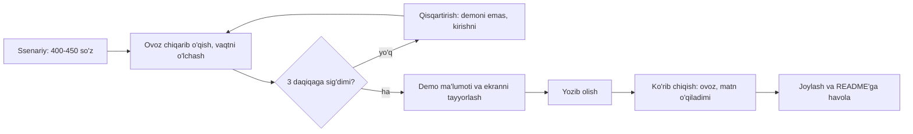
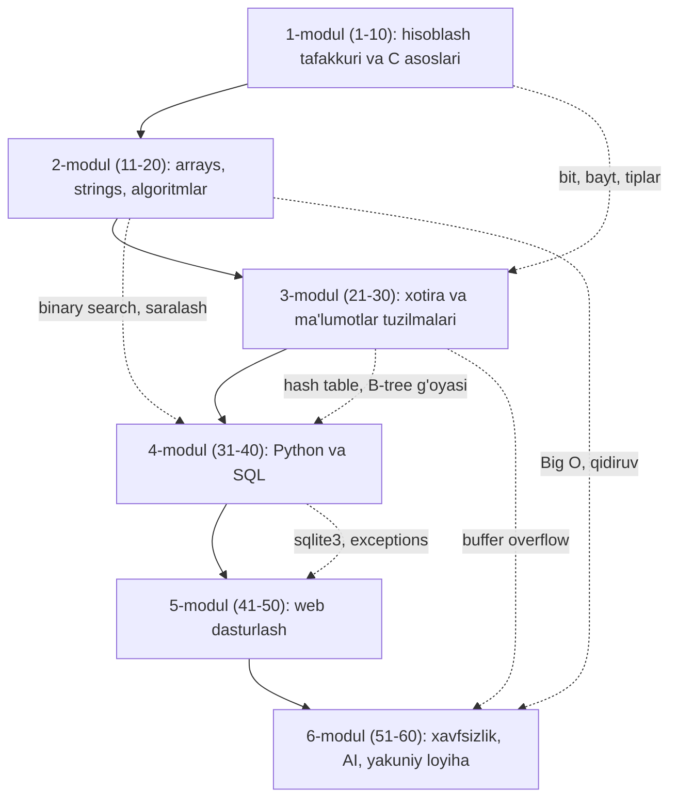

## Bu dars nima uchun kerak

59-darsda yakuniy loyihani vertikal bo'laklar bilan qurdik, sozlamalarni koddan ajratdik va deployga tayyorladik. Ishlaydigan loyiha - hali tugagan loyiha emas. Uni boshqa odam ko'zi bilan o'qib chiqish, kamchiliklarini o'zingiz topish va qilgan ishingizni qisqa va aniq ko'rsatib berish kerak. Bu dars uchta ishni qiladi.

Birinchisi - **o'z-o'zini review**: loyihangizni kurs davomida o'rgangan mezonlar bo'yicha tizimli tekshirish. 10-darsda kod sifatining uch o'qini (to'g'rilik, dizayn, stil) ko'rdik, 50-darsda web xavfsizlikni, 57-darsda testlar va code review'ni. Endi ularni bitta ro'yxatga yig'ib, o'z kodingizga qo'llaymiz.

Ikkinchisi - **taqdimot**: bir necha daqiqalik videoda loyiha nima, kimga kerak va ichida qanday ishlashini ko'rsatish. Bu ko'nikma kursdan keyin ham kerak: ish suhbatida, jamoada demo kunida, portfolio sahifasida.

Uchinchisi - **xulosa va keyingi yo'l**: 60 dars davomida nima o'rganganimizni bitta xaritaga joylash, ulardan o'tadigan beshta asosiy g'oyani ajratish va bundan keyin qayerga borish mumkinligini ko'rsatish.

Bu darsdan keyin siz:

- loyihangizni to'g'rilik, dizayn, stil, xavfsizlik va testlar bo'yicha ro'yxat asosida review qila olasiz va topilgan muammolarni ustuvorlik bo'yicha tartiblay olasiz;
- 3 daqiqalik video taqdimotni vaqt byudjeti bilan rejalashtira olasiz;
- kursning 6 moduli bir-biriga qanday tayanishini va har birining asosiy g'oyasini tushuntira olasiz;
- abstraksiya, algoritm narxi, xotira, ma'lumot modeli va xavfsizlik g'oyalarini yangi muammoga qo'llay olasiz;
- binary search va hash table'ni bitta kichik tizimda birlashtira olasiz;
- keyingi o'rganish yo'nalishini tanlab, o'rganishni davom ettirish uchun ishlaydigan odatlarni qura olasiz.

## O'z-o'zini review qilish

### Nega o'z kodingizni review qilish qiyin

57-darsda code review'ni boshqa odam kodini o'qish sifatida ko'rdik. **Self-review** (o'z-o'zini review) - o'sha jarayonni o'z kodingizga qo'llash. Muammo shundaki, muallif kodni yozgan niyati bilan o'qiydi: miya "bu yerda nima bo'lishi kerak" ni ko'radi, "bu yerda aslida nima yozilgan" ni emas. Xuddi o'z matningizdagi imlo xatolarini ko'rmaslik kabi.

Buni yengish uchun uchta usul ishlaydi:

1. **Masofa.** Kodni yozib bo'lgach, kamida bir kecha kutib, keyin o'qing. Yangi ko'z bilan niyat emas, matn ko'rinadi.
2. **Ro'yxat.** "Qandaydir yaxshilash kerak" emas, aniq savollar ro'yxati bo'yicha yuring. Ro'yxat xotiraga tayanmaydi va har safar bir xil ishlaydi.
3. **Boshqa format.** Kodni muharrirda emas, git diff ko'rinishida (`git diff main`) yoki chop etilgan holda o'qing; ovoz chiqarib tushuntiring (10-darsdagi rubber duck debugging aynan shu).

### Review ro'yxati

Quyidagi jadval kurs bo'yicha tarqalgan mezonlarni bitta joyga yig'adi. Har qator uchun "ha", "yo'q" yoki "qisman" deb javob bering va "yo'q" larni yozib boring.

| O'q | Savol | Qanday tekshiriladi | Dars |
|---|---|---|---|
| To'g'rilik | Talablardagi har bir amal ishlaydimi? | 58-darsdagi talablar ro'yxati bo'yicha qo'lda va test bilan | 10, 58 |
| To'g'rilik | Chegaraviy holatlar: bo'sh kirish, juda uzun matn, takror, mavjud bo'lmagan id? | har biriga `test_client` testi | 10, 49 |
| To'g'rilik | Xato holatlarida to'g'ri status kod (400, 403, 404, 409)? | testda `status_code` ni tekshirish | 42 |
| Dizayn | Bitta funksiya bitta ish qiladimi, takror kod yo'qmi? | 30 qatordan uzun funksiyalarni ko'rib chiqish | 10, 49 |
| Dizayn | SQL model qatlamida, HTML shablonda, route faqat bog'laydimi? | `app.py` da `SELECT` va HTML satrlarini qidirish | 49 |
| Dizayn | Jadvallar normallashtirilgan, kalitlar va cheklovlar bormi? | `schema.sql` ni o'qish: PRIMARY KEY, FOREIGN KEY, UNIQUE, CHECK | 38 |
| Dizayn | Ko'p qidiriladigan ustunlarda indeks bormi, N+1 so'rov yo'qmi? | `EXPLAIN QUERY PLAN`, sahifa uchun so'rovlar soni | 39, 49 |
| Stil | Nomlar ma'noli, formatlash bir xilmi? | formatter (masalan, `black`) va linter | 10 |
| Stil | Izohlar "nima" emas, "nima uchun" ni tushuntiradimi? | izohlarni alohida o'qish | 10 |
| Xavfsizlik | Barcha SQL parametrlanganmi? | f-string va `+` bilan yasalgan so'rovlarni qidirish | 39, 40 |
| Xavfsizlik | Parollar sekin hash bilan, `|safe` yo'q, POST'larda CSRF token bormi? | `generate_password_hash`, `|safe`, `csrf_token` ni qidirish | 50 |
| Xavfsizlik | Foydalanuvchi faqat o'z ma'lumotini o'zgartira oladimi? | boshqa foydalanuvchi id'si bilan so'rov - 403 | 50 |
| Xavfsizlik | Sirlar kodda va git tarixida yo'qmi, debug o'chiqmi? | `git log -p` da kalit qidirish | 48, 59 |
| Testlar | Har bir route uchun kamida bitta muvaffaqiyatli va bitta xato testi bormi? | testlar ro'yxati va route'lar ro'yxatini solishtirish | 57 |
| Testlar | Testlar bir-biridan mustaqil, har biri toza baza bilan ishlaydimi? | testlarni teskari tartibda ishga tushirish | 57 |

To'g'rilik birinchi o'rinda turadi: chiroyli, lekin noto'g'ri ishlaydigan kod foydasiz. Xavfsizlik undan keyin, chunki uning xatosi foydalanuvchiga zarar keltiradi. Dizayn va stil - kodni o'zgartirish narxi; ular muhim, lekin muddat yaqin bo'lsa, oxirgi navbatda.

### Topilganlarni tartiblash

Review oxirida ro'yxatda, aytaylik, 14 ta muammo bor. Hammasini tuzatishga vaqt yetmasligi mumkin. Har biriga ikki baho bering: **ta'sir** (1 - kosmetik, 3 - ma'lumot yo'qolishi yoki xavfsizlik teshigi) va **narx** (1 - 10 daqiqa, 3 - bir kun). Ta'sir yuqori va narx past bo'lganlardan boshlang. Masalan, f-string bilan yasalgan bitta SQL so'rov - ta'sir 3, narx 1: birinchi navbatda. Butun loyihani blueprint'larga bo'lish - ta'sir 1, narx 3: ehtimol, hech qachon.

Tuzatib bo'lmaganlarini yashirmang: README'ning "Cheklovlar" bo'limiga yozing (59-dars). O'z kamchiligini bilgan muallif - yaxshi muhandis belgisi; ularni ko'rmagan muallif esa xavfli.

## Video taqdimot tuzilmasi

### Vaqt byudjeti

CS50 yakuniy loyihasi videosi 3 daqiqadan oshmasligi kerak va boshida loyiha va muallif haqidagi ma'lumotlar ko'rsatiladi (aniq ro'yxat rasmiy Final Project sahifasida, uni o'sha yerdan o'qing). Qisqa videoning asosiy qiyinchiligi - hamma narsani ko'rsatish istagi. 3 daqiqa = 180 soniya. Ravon nutq tezligi taxminan daqiqasiga 130-150 so'z, ya'ni 3 daqiqada 390-450 so'z: bu bir sahifadan sal kamroq matn. Ko'p narsa sig'maydi, shuning uchun byudjet oldindan taqsimlanadi:

| Qism | Vaqt | Ulush | Nima aytiladi va ko'rsatiladi |
|---|---|---|---|
| Kirish | 0:00-0:15 | 8% | loyiha nomi va talab qilingan ma'lumotlar, bir gapda: bu nima |
| Muammo | 0:15-0:40 | 14% | kimning qanday muammosini yechadi, nima uchun mavjud yechimlar yetmaydi |
| Demo | 0:40-2:00 | 44% | bitta foydalanuvchi ssenariysi boshidan oxirigacha, jonli |
| Ichki tuzilma | 2:00-2:40 | 22% | arxitektura diagrammasi, 1-2 ta qiziq dizayn qarori |
| Xulosa | 2:40-3:00 | 11% | nima o'rgandingiz, keyingi qadam |

Demo eng katta ulushni oladi, chunki "ko'rsat, aytma" qoidasi ishlaydi: tugmani bosib natijani ko'rsatish "foydalanuvchi odat qo'sha oladi" degan gapdan kuchliroq. Demoni bitta ssenariy atrofida quring (masalan, "yangi foydalanuvchi ro'yxatdan o'tadi, odat qo'shadi, uch kun belgilaydi va streak'ni ko'radi"), funksiyalar ro'yxatini birin-ketin ko'rsatmang.

### Tayyorgarlik

- **Ssenariy yozing** va ovoz chiqarib o'qib, vaqtini o'lchang. 450 so'zdan oshsa, qisqartiring.
- **Demo ma'lumotini oldindan tayyorlang**: bo'sh sahifa emas, real ko'rinadigan bir necha yozuv. Lekin parol va shaxsiy ma'lumot ko'rinmasin.
- **Ekranni tayyorlang**: brauzer masshtabini kattalashtiring (125-150%), keraksiz tablarni yoping, bildirishnomalarni o'chiring.
- **Ichki tuzilmani bitta diagramma bilan** ko'rsating (59-darsdagi kabi): kod ekranini aylantirib o'tish tomoshabin uchun hech narsa bermaydi.
- **Xato bo'lsa**, qayta yozing: video jonli efir emas. Lekin juda silliqlashga ham vaqt sarflamang, mazmun muhimroq.



## Kurs xaritasi: 60 dars

### Modullar va ularning bog'liqligi

Kurs 6 moduldan iborat edi va har biri oldingisiga tayanadi. Pastdagi diagramma ularning asosiy g'oyalarini va qaysi g'oya qayerga o'tganini ko'rsatadi:



Tutash chiziqlar - modullar ketma-ketligi, uzuq chiziqlar - oldingi modul g'oyasi keyinroq qayerda qayta paydo bo'lgani. Masalan, 30-darsdagi hash table 32-darsda Python `dict` ning ichki tuzilishi bo'lib qaytdi, 15-darsdagi binary search esa 39-darsdagi indekslar (B-tree) ortidagi g'oya bo'ldi.

| Modul | Darslar | Asosiy savol | Eng muhim natija |
|---|---|---|---|
| 1. Hisoblash tafakkuri va C | 1-10 | Kompyuter ma'lumotni qanday ko'rsatadi va dastur qanday bajariladi? | binary, tiplar va ularning chegarasi, kompilyatsiya, debugging |
| 2. Arrays va algoritmlar | 11-20 | Muammoni qancha qadamda yechish mumkin? | Big O, binary search, merge sort, rekursiya |
| 3. Xotira va tuzilmalar | 21-30 | Ma'lumot xotirada qanday joylashadi va qanday bog'lanadi? | pointer, heap, linked list, daraxt, hash table |
| 4. Python va SQL | 31-40 | Yuqori darajali til va baza nimani yashiradi? | dinamik tiplar, `dict` narxi, relational model, JOIN, indeks |
| 5. Web | 41-50 | Ma'lumot tarmoq orqali foydalanuvchiga qanday yetadi? | HTTP, HTML/CSS/JS, Flask, CRUD, XSS va CSRF |
| 6. Xavfsizlik, AI, loyiha | 51-60 | Tizimni qanday himoya qilish, qanday "aqlli" qilish va qanday yetkazish? | tahdid modeli, kriptografiya, qidiruv va ML, git va testlar, deploy |

## O'rganilgan asosiy g'oyalar

Til va texnologiyalar o'zgaradi: C, Python, Flask o'rniga boshqa vositalar keladi. Quyidagi beshta g'oya esa ularning barchasida qayta uchraydi. Ularni bilgan odam yangi texnologiyani tezroq o'rganadi, chunki u "bu yerda abstraksiya qayerda, narx qancha, xotira qayerda" deb so'raydi.

### 1. Abstraksiya

**Abstraction** (4-dars) - murakkab narsani oddiy interfeys ortiga yashirish. Kurs bo'ylab biz qatlamlarni pastdan yuqoriga bosib o'tdik: tranzistor va bit (2-dars), C dagi `int` va `char` (6-dars), `struct` (20-dars), linked list va hash table (28, 30-darslar), Python `dict` (32-dars), SQL jadvali (36-dars), HTTP so'rov (42-dars), Flask route (47-dars). Har qatlam pastdagisini yashiradi: `SELECT` yozganda B-tree haqida o'ylamaysiz, `dict[key]` yozganda hash funksiya haqida.

Lekin abstraksiyani tushunish shuni anglatadi: kerak bo'lganda bir qavat pastga tusha olish. Sekin so'rovni tuzatish uchun indeks nima ekanini (39-dars), `dict` kalitlari nega o'zgarmas bo'lishi kerakligini (32-dars), Python'da `x = 2**100` nega xato bermasligini (C'dagi overflow bilan solishtiring, 7-dars) bilish kerak. Yaxshi muhandis abstraksiyadan foydalanadi, lekin uning ichi ko'rinmaydigan qora quti bo'lib qolmaydi.

### 2. Algoritm narxi

Bir xil natijani turli narxda olish mumkin. 15-darsda linear search eng yomon holatda n qadam, binary search esa ⌊log₂ n⌋ + 1 qadam olishini ko'rdik. n = 1 000 000 da bu 1 000 000 va 20 qadam: farq 50 000 barobar. 16-darsda bu farqni Big O bilan ifodaladik, 17-19-darslarda saralash uchun O(n²) va O(n log n) ni solishtirdik: n = 1 000 000 da n² = 10¹², n log₂ n ≈ 2 × 10⁷. Sekundiga 10⁹ amal bajaradigan kompyuterda bu taxminan 17 daqiqa va 0,02 sekund.

Narx faqat vaqt emas: xotira ham narx (space complexity), va ko'pincha biri ikkinchisiga almashtiriladi. Hash table qo'shimcha xotira hisobiga o'rtacha O(1) qidiruv beradi (30-dars), indeks diskda joy egallaydi va yozishni sekinlashtiradi, lekin o'qishni tezlashtiradi (39-dars). Har bir dizayn qarori - shu narxlar orasidagi tanlov.

### 3. Xotira

Ma'lumot xotirada qayerdadir yotadi va bu "qayerda" muhim. 11-darsda massiv elementlari ketma-ket joylashgani uchun indeks bo'yicha murojaat O(1) ekanini, 21-24-darslarda pointer, stack va heap'ni, `malloc` va `free` ni, buffer overflow va use-after-free xatolarini ko'rdik. Python bularning hammasini yashiradi (35-darsdagi reference counting), lekin muammo yo'qolmaydi, faqat boshqa ko'rinishga o'tadi: mutable aliasing, bir obyektga ikki havola (32-dars).

Xotira g'oyasi xavfsizlikka ham olib keladi: C'dagi buffer overflow (24-dars) - tarixdagi eng ko'p ishlatilgan zaifliklardan biri, va xotira jihatidan xavfsiz tillarga o'tishning asosiy sababi.

### 4. Ma'lumot modeli

Muammoni yechishning katta qismi - ma'lumotni to'g'ri shaklga keltirish. 2-3-darslarda matn, rasm va ovoz bitlarga aylandi; 20-darsda `struct` bir nechta qiymatni bitta yozuvga birlashtirdi; 36-38-darslarda jadvallar, kalitlar va normalizatsiya keldi; 46-darsda JSON tarmoq orqali ma'lumot almashish tiliga aylandi. Yakuniy loyihada ham eng muhim qaror `schema.sql` da: jadval noto'g'ri bo'lsa, kodning qolgani shu xatoni yamash bilan band bo'ladi. Fred Brooks "The Mythical Man-Month" (1975) kitobining 9-bobida shuni yozgan: flowchart'laringizni ko'rsatib, jadvallaringizni yashirsangiz, men tushunmay qolaveraman; jadvallaringizni ko'rsatsangiz, flowchart'lar odatda kerak bo'lmaydi - ular o'zi ravshan bo'ladi.

### 5. Xavfsizlik

Xavfsizlik oxirida qo'shiladigan qatlam emas, har qatlamdagi xususiyat. Kurs bo'ylab biz bir xil xatoni turli kiyimda ko'rdik: **ma'lumot kodga aylanadi**. C'da massiv chegarasidan chiqqan kirish qaytish manzilini buzadi (24-dars), SQL'da foydalanuvchi matni so'rovning bir qismi bo'ladi (39-dars), HTML'da u skriptga aylanadi (50-dars). Yechim ham bir xil: kirishni ishonchsiz deb hisoblang va ma'lumot bilan kodni chegara orqali ajrating (parametrlangan so'rov, escaping, chegarani tekshirish). 51-52-darslarda bunga tahdid modeli va kriptografiya qo'shildi: kimdan, nimani himoya qilyapmiz va qaysi vosita (hash, shifrlash, imzo) qaysi xavfga javob beradi.

### Hammasi bitta dasturda

Quyidagi kichik dastur kursning to'rt modulidan foydalanadi: regular expression bilan matnni so'zlarga ajratadi (34-dars), `Counter` (hash table, 30 va 32-darslar) bilan sanaydi, xuddi shu hisobni SQL `GROUP BY` bilan qiladi (37-dars) va ikki natijani solishtiradi, keyin saralangan lug'atda linear va binary search qadamlarini sanaydi (15-16-darslar).

```python run
import re
import sqlite3
from collections import Counter

TEXT = """Algoritm - bu muammoni yechish uchun aniq qadamlar ketma-ketligi.
Yaxshi algoritm to'g'ri ishlaydi, tez ishlaydi va xotirani tejaydi.
Muammoni bo'laklarga ajratish - abstraksiya. Abstraksiya murakkablikni yashiradi.
Xotira cheklangan, vaqt ham cheklangan: algoritm narxini o'lchang."""

# 34-dars: regular expression bilan so'zlarga ajratish
words = re.findall(r"[a-z']+", TEXT.lower())

# 30, 32-darslar: hash table (dict) - har so'z O(1) o'rtacha vaqtda sanaladi
freq = Counter(words)

# 37-dars: xuddi shu hisob SQL bilan
db = sqlite3.connect(":memory:")
db.execute("CREATE TABLE words (w TEXT)")
db.executemany("INSERT INTO words VALUES (?)", [(w,) for w in words])
top_sql = db.execute(
    "SELECT w, COUNT(*) AS n FROM words GROUP BY w ORDER BY n DESC, w LIMIT 3"
).fetchall()
top_py = sorted(freq.items(), key=lambda p: (-p[1], p[0]))[:3]
print("so'zlar:", len(words), "| noyob:", len(freq))
print("SQL:   ", top_sql)
print("Python:", top_py)
print("bir xilmi:", top_sql == top_py)

# 15, 16-darslar: saralangan ro'yxatda qidiruv, qadamlarni sanab
vocab = sorted(freq)

def linear(a, x):
    steps = 0
    for i, v in enumerate(a):
        steps += 1
        if v == x:
            return i, steps
    return -1, steps

def binary(a, x):
    lo, hi, steps = 0, len(a), 0
    while lo < hi:
        mid = (lo + hi) // 2
        steps += 1
        if a[mid] < x:
            lo = mid + 1
        else:
            hi = mid
    return (lo if lo < len(a) and a[lo] == x else -1), steps

for w in ["abstraksiya", "xotirani", "python"]:
    print(f"{w:12} linear={linear(vocab, w)} binary={binary(vocab, w)}")
```

Natija:

```text
so'zlar: 33 | noyob: 27
SQL:    [('algoritm', 3), ('abstraksiya', 2), ('cheklangan', 2)]
Python: [('algoritm', 3), ('abstraksiya', 2), ('cheklangan', 2)]
bir xilmi: True
abstraksiya  linear=(0, 1) binary=(0, 5)
xotirani     linear=(23, 24) binary=(23, 5)
python       linear=(-1, 27) binary=(-1, 5)
```

Ikki narsaga qarang. Birinchidan, deklarativ SQL va imperativ Python bir xil javob berdi: bu bir masalaga ikki abstraksiya darajasi. Ikkinchidan, 27 so'zli lug'atda binary search ko'pi bilan 5 qadam (⌈log₂ 27⌉ = 5; bu uchala so'zda aynan 5 chiqdi, ba'zi so'zlarda 4 bo'ladi), linear search esa so'z qayerda turganiga qarab 1 dan 27 gacha. "abstraksiya" ro'yxat boshida bo'lgani uchun linear search bu safar yutdi: Big O bilan aytilgan baho odatda eng yomon holat uchun, har bir alohida holat uchun emas (16-dars). Mavjud bo'lmagan "python" esa linear search uchun eng yomon holat: 27 qadamning hammasi.

Xuddi shu binary search C'da ham bir xil ishlaydi. Pastdagi dastur 1 dan 1 000 000 gacha sonlar massivida qadamlarni sanaydi:

```c run
#include <stdio.h>
#include <stdlib.h>

int binary_steps(const int *a, int n, int x, int *found)
{
    int lo = 0, hi = n, steps = 0;
    while (lo < hi)
    {
        int mid = lo + (hi - lo) / 2;
        steps++;
        if (a[mid] < x)
        {
            lo = mid + 1;
        }
        else
        {
            hi = mid;
        }
    }
    *found = (lo < n && a[lo] == x);
    return steps;
}

int main(void)
{
    int n = 1000000;
    int *a = malloc(n * sizeof(int));
    if (a == NULL)
    {
        return 1;
    }
    for (int i = 0; i < n; i++)
    {
        a[i] = i + 1;
    }

    int targets[] = {1, 500000, 1000000, 0};
    for (int i = 0; i < 4; i++)
    {
        int found;
        int steps = binary_steps(a, n, targets[i], &found);
        printf("x = %7d: %s, %d qadam\n", targets[i], found ? "topildi" : "yo'q", steps);
    }
    free(a);
    return 0;
}
```

Natija:

```text
x =       1: topildi, 20 qadam
x =  500000: topildi, 20 qadam
x = 1000000: topildi, 20 qadam
x =       0: yo'q, 20 qadam
```

Bu yozuv (yarim ochiq oraliq `[lo, hi)`, 15-dars) har qanday x uchun ⌊log₂ n⌋ yoki ⌈log₂ n⌉ qadam qiladi, ya'ni ko'pi bilan ⌈log₂ n⌉: 2^19 = 524 288 < 1 000 000 ≤ 2^20 = 1 048 576, demak ko'pi bilan 20 (yuqoridagi to'rt holatda aynan 20, boshqa x larda 19 ham bo'ladi). `mid = lo + (hi - lo) / 2` - 15-darsdagi overflow'dan himoyalangan o'rta, `malloc` va `free` - 23-dars, `found` ni pointer orqali qaytarish - 25-dars. Bitta 30 qatorli dasturda uch modulning g'oyasi bor.

## Mashq: binary search va hash table birga

Kichik "natijalar indeksi" quring. Talabalar natijalari bo'yicha ikki xil so'rov kerak: ism bo'yicha aniq qidiruv va ball oralig'idagi talabalar soni. Birinchisi uchun hash table (30-dars), ikkinchisi uchun saralangan massivda binary search (15-dars) mos keladi. Vazifa:

- `HashTable` ni separate chaining bilan yakunlang: `put(key, value)` - kalit bor bo'lsa qiymatni yangilaydi, yo'q bo'lsa qo'shadi va `size` ni oshiradi; load factor (`size / len(buckets)`) 0,75 dan oshsa, bucket'lar sonini ikki barobarga oshirib, barcha juftlarni qayta joylaydi; `get(key, default=None)`. Python `dict` ishlatmang: maqsad - uni o'zingiz qurish.
- `lower_bound(a, x)` - saralangan `a` da `x` dan kichik bo'lmagan birinchi element indeksi (bo'lmasa `len(a)`), binary search bilan.
- `count_in_range(a, lo, hi)` - `lo <= v <= hi` bo'lgan elementlar soni, ikki `lower_bound` bilan.

Testlar to'g'rilikni va usulni tekshiradi: 100 000 elementli massivda `count_in_range` massivdan 40 martadan ko'p o'qisa, bu binary search emas.

```python run
def hash_str(s):
    """FNV-1a (30-dars), 32 bit. Tayyor, o'zgartirmang."""
    h = 2166136261
    for b in s.encode():
        h = ((h ^ b) * 16777619) % 2**32
    return h


class HashTable:
    def __init__(self, n_buckets=8):
        self.buckets = [[] for _ in range(n_buckets)]
        self.size = 0

    def _bucket(self, key):
        return self.buckets[hash_str(key) % len(self.buckets)]

    def put(self, key, value):
        # 1) kalit bucket'da bo'lsa - qiymatni yangilang
        # 2) bo'lmasa - [key, value] qo'shing, size += 1
        # 3) size / len(buckets) > 0.75 bo'lsa - bucket'larni 2 barobar ko'paytirib, qayta joylang
        pass

    def get(self, key, default=None):
        return default


def lower_bound(a, x):
    # a saralangan; x dan kichik bo'lmagan birinchi element indeksi
    return 0


def count_in_range(a, lo, hi):
    # lo <= v <= hi bo'lgan elementlar soni (butun sonlar uchun)
    return 0


t = HashTable()
for name, score in [("Ali", 71), ("Vali", 88), ("Gulnora", 95)]:
    t.put(name, score)
print(t.get("Vali"), t.get("Hasan", "yo'q"))
print(count_in_range([10, 20, 20, 30, 40], 20, 30))
```

```python test
import random as _random


class _Counted(list):
    reads = 0

    def __getitem__(self, i):
        _Counted.reads += 1
        return super().__getitem__(i)


def _table(n):
    t = HashTable()
    for i in range(n):
        t.put(f"talaba{i}", i)
    return t


check("put va get: qo'shilgan kalit topiladi, yo'q kalit uchun default",
      lambda: (lambda t: t.get("talaba7") == 7 and t.get("yo'q", -1) == -1)(_table(20)))
check("mavjud kalitga put - qiymat yangilanadi, size o'zgarmaydi",
      lambda: (lambda t: (t.put("talaba3", 300), t.get("talaba3") == 300 and t.size == 20)[1])(_table(20)))
check("1000 ta kalitdan keyin size 1000 va hammasi bucket'larda",
      lambda: (lambda t: t.size == 1000 and sum(len(b) for b in t.buckets) == 1000
               and all(t.get(f"talaba{i}") == i for i in range(1000)))(_table(1000)))
check("resize: load factor 0,75 dan oshmaydi (1000 kalit - kamida 1334 bucket)",
      lambda: (lambda t: t.size == 1000 and t.size / len(t.buckets) <= 0.75)(_table(1000)))
check("lower_bound: chegaralar va takrorlar",
      lambda: lower_bound([], 5) == 0 and lower_bound([1, 3, 3, 3, 7], 3) == 1
      and lower_bound([1, 3, 7], 4) == 2 and lower_bound([1, 3, 7], 100) == 3 and lower_bound([1, 3, 7], -5) == 0)
check("count_in_range: oddiy holat, takrorlar, bo'sh oraliq",
      lambda: count_in_range([10, 20, 20, 30, 40], 20, 30) == 3 and count_in_range([10, 20, 30], 21, 29) == 0
      and count_in_range([], 0, 100) == 0 and count_in_range([5, 5, 5], 5, 5) == 3)


def _big():
    rng = _random.Random(50)
    data = sorted(rng.randrange(0, 1000) for _ in range(100000))
    expected = sum(1 for v in data if 100 <= v <= 199)
    a = _Counted(data)
    _Counted.reads = 0
    got = count_in_range(a, 100, 199)
    return got == expected and _Counted.reads <= 40


check("100 000 element: to'g'ri javob va 40 tadan kam o'qish (binary search)", _big)
```

Nega aynan 40? Bitta `lower_bound` 100 000 elementda ⌈log₂ 100 001⌉ = 17 marta o'qiydi, ikkitasi - 34. Chiziqli o'tish esa 100 000 marta o'qiydi. Hash table bilan oraliq so'rovini bajarib bo'lmasligiga e'tibor bering: hash funksiya tartibni buzadi, 150 va 151 ballar butunlay boshqa bucket'larga tushadi. Shuning uchun haqiqiy bazalar ham aniq qidiruv uchun hash indeks, oraliq uchun B-tree indeks ishlatadi (39-dars): bu mashq ularning kichik modeli.

## Keyingi yo'llar

### Shu saytdagi boshqa kurslar

Bu sayt bir nechta kursdan iborat va ular CS50'dan keyin tabiiy davom bo'ladi:

- **[System Design](/system-design)** - 100 dars: talablar va trade-off'lardan storage ichki tuzilishi, masshtablash, distributed systems, messaging, ishonchlilik va real tizimlar case study'larigacha. Bu kursdagi 39-dars (indekslar va tranzaksiyalar), 41-42-darslar (tarmoq va HTTP) va 59-dars (production) uning boshlanish nuqtasi. Kurs backend tajribasini kutadi, shuning uchun avval yakuniy loyihani tugatib, bir-ikki o'z loyihangizni qilib olish foydali.
- **[Clean Code](/clean-code)** - 100 dars: nomlash, funksiyalar, xatolar, testlar, refaktoring va arxitektura chegaralari, TypeScript va Node.js misollarida. 10-darsdagi "dizayn" va "stil" o'qlarining chuqur davomi. Kod yozishni boshlagan har kimga foydali, ayniqsa jamoada ishlay boshlaganda.
- **[Go](/go)** - 100 dars: Go tili spetsifikatsiya darajasidan production servislargacha: slice, map va interface ichi, concurrency va xotira modeli, scheduler va garbage collector, profiling, tarmoq servislari. C'dagi pointer va xotira (21-25-darslar) bilan Python'ning qulayligi orasidagi til; backend va tizim dasturlash uchun yaxshi davom.

Taklif qilinadigan tartib: avval Clean Code (har qanday yo'nalishda kerak), keyin yo'nalishingizga qarab Go yoki to'g'ridan-to'g'ri System Design.

### Boshqa yo'nalishlar

CS50 hamma yo'nalish uchun umumiy poydevor. Undan keyin tanlov qiziqishingizga bog'liq:

| Yo'nalish | Nima qilinadi | Kursdan qaysi poydevor | Keyingi qadam |
|---|---|---|---|
| Web (backend, full-stack) | server, API, baza, deploy | 36-50, 59 | Clean Code, System Design, bitta framework chuqur |
| Mobil | iOS yoki Android ilovalar | 43-46 (UI, event'lar), 46 (API bilan ishlash) | platforma tili (Swift yoki Kotlin) yoki cross-platform framework (CS50'da React Native kursi bor) |
| Data science | ma'lumot tahlili, statistika, ML | 31-40 (Python, SQL), 54 | statistika, pandas, vizualizatsiya, chiziqli algebra |
| Tizim dasturlash | OS, kompilyator, tarmoq, ma'lumotlar bazasi dvigateli | 5-9, 21-26, 56 | C chuqur, operatsion tizimlar, Go yoki Rust |
| AI muhandisligi | model bilan ishlaydigan ilovalar | 53-55, 46 | ML asoslari, LLM API'lari, baholash (evaluation) |
| Kiberxavfsizlik | himoya, audit, zaifliklarni topish | 24, 39, 50-52 | tarmoq xavfsizligi, CTF musobaqalari |

**Tizim dasturlash** (systems programming) alohida eslatishga arziydi: bu boshqa dasturlar ustida ishlaydigan dasturlarni yozish - operatsion tizimlar, kompilyatorlar, ma'lumotlar bazalari, brauzer dvigatellari. U kursning 1 va 3-modullaridagi bilimni eng ko'p talab qiladi: xotira, pointer, kompilyatsiya, assembly.

### CS50'ning boshqa kurslari

Harvard CS50 oilasida CS50x dan keyingi ixtisoslashgan kurslar bor (joriy ro'yxat rasmiy sahifada): Python bilan dasturlash (CS50P), Python va JavaScript bilan web dasturlash (CS50W), Python bilan sun'iy intellekt (CS50AI), SQL bilan ma'lumotlar bazalari (CS50SQL), kiberxavfsizlik, R bilan dasturlash, React Native bilan mobil ilovalar, shuningdek biznes va huquqshunoslar uchun kurslar. Ularning har biri bu kursdagi bitta modulni alohida kursga kengaytiradi. Masalan, 53-55-darslar sizga yoqqan bo'lsa, CS50AI; 47-50-darslar yoqqan bo'lsa, CS50W; 36-40-darslar yoqqan bo'lsa, CS50SQL.

## O'rganishni davom ettirish odatlari

Kurs tugashi bilan eng xavfli davr boshlanadi: tashqi tuzilma (dars, test, muddat) yo'qoladi va bilim tez unutiladi. Quyidagi odatlar tadqiqotlarda samarasi ko'rsatilgan o'rganish usullariga asoslanadi. 2013-yilgi katta sharhda (Dunlosky va hammualliflar) o'nta keng tarqalgan usul baholangan: o'zini test bilan tekshirish va oraliqli takrorlash eng yuqori foydali, talabalar eng ko'p tayanadigan qayta o'qish va matnni marker bilan belgilash esa past foydali deb topilgan.

1. **Faol eslash** (active recall). Konspektni qayta o'qish o'rniga, yopiq kitob bilan o'zingizni tekshiring: "hash table'da load factor nimaga ta'sir qiladi?" deb yozib, javobni xotiradan tiklang, keyin solishtiring. Har dars oxiridagi testlar aynan shu uchun. O'qish tanish tuyg'usini beradi, eslash esa haqiqiy bilimni tekshiradi.
2. **Oraliqli takrorlash** (spaced repetition). Bir mavzuni bir kunda besh marta emas, ortib boruvchi oraliqlarda takrorlang: 1 kun, 3 kun, 1 hafta, 1 oy. Har takrorlash unutish boshlangan paytga to'g'ri kelsa, xotira mustahkamroq bo'ladi. Kartochka dasturlari buni avtomatlashtiradi.
3. **Ongli mashq** (deliberate practice). Yoqqan va oson narsani emas, hali chiqmaydigan narsani mashq qiling: rekursiya qiyin bo'lsa, 10 ta rekursiv masala. Har mashqdan keyin nima noto'g'ri bo'lganini yozing.
4. **Loyiha qiling.** Har 1-2 oyda bitta kichik, lekin tugallangan loyiha: README, test va deploy bilan (59-dars). Tugallanmagan 10 ta loyihadan tugallangan bitta loyiha qimmatroq.
5. **Kod o'qing.** Ochiq manbali loyihalardagi yaxshi kodni o'qing: standart kutubxonaning bir moduli, Flask'ning bir fayli. Yozishdan oldin o'qish - yozuvchilarning ham odati.
6. **Tushuntiring.** Biror mavzuni boshqa odamga yoki yozma ravishda tushuntirib bering. Tushuntira olmagan joyingiz - tushunmagan joyingiz (10-darsdagi rubber duck g'oyasi o'rganishga ham ishlaydi).
7. **Bir vaqtda bitta yo'nalish.** Uchta kursni parallel boshlab, birortasini tugatmaslik oson. Bittasini tanlang, haftalik vaqt ajrating (masalan, 5 kun × 1 soat) va tugating.

Hisob: haftada 5 soat, bitta 60 daqiqalik dars va mashqi uchun o'rtacha 2 soat bo'lsa, haftasiga 2,5 dars. 100 darslik kurs 100 / 2,5 = 40 hafta, ya'ni taxminan 9-10 oy. Bu bilan bir yilda bitta chuqur kursni tugatish mumkin. Haftada 2 soat bo'lsa, 100 hafta - deyarli 2 yil: shuning uchun vaqtni oldindan rejalashtirish muhim.

## Ko'p uchraydigan xatolar

1. **Review'ni yozib bo'lgan zahoti qilish.** Niyat ko'rinadi, matn emas. Kamida bir kecha kuting va ro'yxat bo'yicha yuring.
2. **Faqat stilni review qilish.** Bo'shliq va nomlarni tuzatib, f-string bilan yasalgan SQL'ni o'tkazib yuborish. Tartib: to'g'rilik, xavfsizlik, dizayn, stil.
3. **Kamchiliklarni yashirish.** Tuzatilmagan muammo README'da "Cheklovlar" bo'limida bo'lishi kerak. Yashirilgan muammo topilganda ishonchni yo'qotadi.
4. **Videoda funksiyalar ro'yxatini o'qish.** "Bu tugma buni qiladi, bu tugma buni" - zerikarli va vaqtni yeydi. Bitta foydalanuvchi ssenariysi boshidan oxirigacha.
5. **Videoda kodni aylantirib o'tish.** Tomoshabin 2 soniyada 50 qator kodni o'qiy olmaydi. Bitta diagramma va bitta qiziq qaror.
6. **Til va framework'ni g'oya deb o'ylash.** "Flask'ni bilaman" emas, "HTTP so'rov-javob modelini va MVC'ni bilaman" - shunda ertaga boshqa framework bir hafta oladi, bir oy emas.
7. **Kursdan keyin o'qishni to'xtatish yoki bir vaqtda hammasini boshlash.** Ikkalasi ham natijasiz. Bitta yo'nalish, muntazam vaqt, faol eslash va loyihalar.

## Xulosa

- Self-review - ro'yxat bo'yicha, masofa bilan va boshqa formatda (diff, ovoz chiqarib) o'qish. Tartib: to'g'rilik, xavfsizlik, dizayn, stil; testlar har birini qo'llab-quvvatlaydi.
- Topilgan muammolarni ta'sir va narx bo'yicha tartiblang; tuzatilmaganlarini README'da ochiq yozing.
- Qisqa video uchun vaqt byudjeti: 3 daqiqa ≈ 400-450 so'z; eng katta ulush - jonli demo (taxminan 45%), bitta ssenariy atrofida. Rasmiy talablarni CS50 Final Project sahifasidan oling.
- Kurs 6 moduldan iborat: C va ma'lumot ko'rinishi, algoritmlar, xotira va tuzilmalar, Python va SQL, web, xavfsizlik, AI va loyiha. Har modul oldingisiga tayanadi.
- Besh asosiy g'oya: abstraksiya (va kerak bo'lganda ichiga tusha olish), algoritm narxi (vaqt va xotira), xotira (ma'lumot qayerda yotadi), ma'lumot modeli (sxema - eng muhim qaror), xavfsizlik (ma'lumot kodga aylanmasin).
- Aniq qidiruvga hash table, oraliq va tartibga saralangan tuzilma va binary search mos: bazalardagi hash va B-tree indekslari ham shu tanlov.
- Keyingi yo'l: shu saytdagi Clean Code, Go va System Design kurslari, yoki mobil, data science, tizim dasturlash, AI, xavfsizlik yo'nalishlari; CS50'ning ixtisoslashgan kurslari.
- O'rganishni davom ettirish: faol eslash, oraliqli takrorlash, ongli mashq, tugallangan loyihalar, kod o'qish, tushuntirish va bir vaqtda bitta yo'nalish.

## Amaliy topshiriq

Yakuniy loyihangizni review qiling, taqdimotini tayyorlang va keyingi 3 oylik o'rganish rejasini tuzing.

1. **Self-review.** Loyiha yozilib bo'lgach kamida bir kun kutib, yuqoridagi jadvalning har bir qatoriga "ha", "yo'q" yoki "qisman" deb javob bering. Har "yo'q" uchun aniq fayl va qatorni ko'rsating.
2. **Tartiblash va tuzatish.** Topilgan muammolarga ta'sir (1-3) va narx (1-3) bering. Eng yuqori ustuvorlikdagi kamida 3 tasini tuzating va har biri uchun test qo'shing (tuzatishdan oldin qizil, keyin yashil). Qolganlarini README'ning "Cheklovlar" bo'limiga yozing.
3. **Video ssenariysi.** Yuqoridagi vaqt byudjeti bo'yicha 400-450 so'zlik ssenariy yozing: kirish, muammo, bitta ssenariyli demo, bitta diagramma bilan ichki tuzilma, xulosa. Ovoz chiqarib o'qib, vaqtini o'lchang va yozing.
4. **Kurs xaritasi.** Loyihangizda kursning qaysi darslaridagi g'oyalar ishlatilganini kamida 8 ta dars raqami bilan sanab chiqing (masalan: "39-dars - `habits(name)` ustunidagi UNIQUE indeks"). Beshta asosiy g'oyaning har biri loyihangizda qayerda uchrashini bitta gap bilan yozing.
5. **O'rganish rejasi.** Keyingi yo'nalishni tanlang (shu saytdagi kurs yoki boshqa yo'nalish) va 12 haftalik reja tuzing: haftalik soat, qaysi darslar yoki mavzular, takrorlash jadvali (oraliqli takrorlash) va reja oxirida tugallanadigan bitta loyiha.

Yaxshi javobda bo'lishi kerak bo'lgan narsalar:

- review jadvali to'liq to'ldirilgan, "yo'q" lar fayl va qator bilan;
- kamida 3 ta tuzatish va ularning testlari, ustuvorlik asoslangan;
- vaqti o'lchangan, 3 daqiqaga sig'adigan ssenariy, demo bitta ssenariy atrofida;
- loyihadagi kamida 8 ta dars havolasi va beshta asosiy g'oyaning har biri uchun aniq misol;
- haftalik soat va dars soni bilan hisoblangan, real o'rganish rejasi va yakuniy loyihasi.

Javobingizni pastdagi maydonga yozing va yuqoridagi mezonlar bilan solishtiring.

## Manbalar

- CS50x 2026. [Final Project](https://cs50.harvard.edu/x/2026/project/) - yakuniy loyiha talablari: 3 daqiqagacha video va uning kirish qismi, README, topshirish tartibi; [Lecture 0 notes](https://cs50.harvard.edu/x/notes/0/) - abstraksiya va algoritmlar.
- CS50. [CS50 kurslari](https://cs50.harvard.edu/) - CS50 oilasidagi kurslar ro'yxati va qayerdan boshlash bo'yicha tavsiya (AI, web, Python, SQL, kiberxavfsizlik, R, React Native va boshqalar).
- Google Engineering Practices. [How to do a code review](https://google.github.io/eng-practices/review/reviewer/) - "What to look for in a code review": dizayn, funksionallik, murakkablik, testlar, nomlash, izohlar, stil.
- OWASP. [Top 10:2025](https://top10.owasp.org/2025/) - xavfsizlik review'i uchun asosiy xavflar ro'yxati.
- Flask. [Testing Flask Applications](https://flask.palletsprojects.com/en/stable/testing/) - `test_client`, fixture'lar, har test uchun alohida ilova va baza.
- Dunlosky va boshq. (2013). [Improving Students' Learning With Effective Learning Techniques](https://pubmed.ncbi.nlm.nih.gov/26173288/) - 10 o'rganish usuli tahlili: practice testing (faol eslash) va distributed practice (oraliqli takrorlash) yuqori foydali, qayta o'qish va belgilash (highlighting) past foydali deb baholangan.
- Python. [bisect](https://docs.python.org/3/library/bisect.html) - `bisect_left` (lower_bound) va saralangan ro'yxatda oraliq qidiruv.
